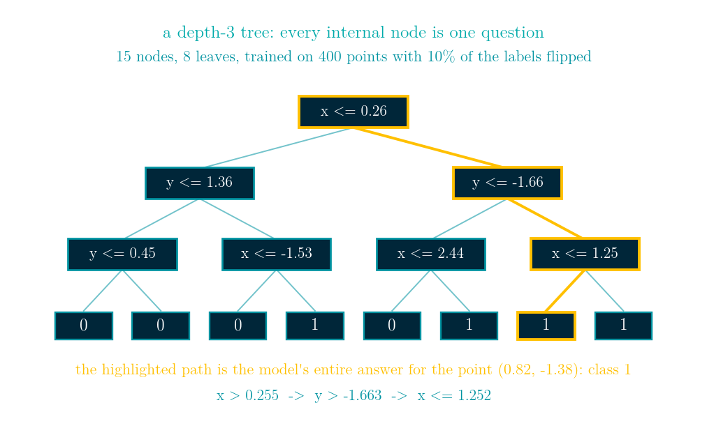
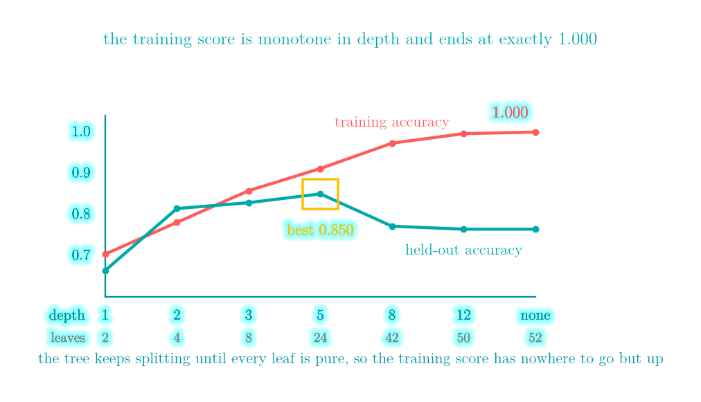
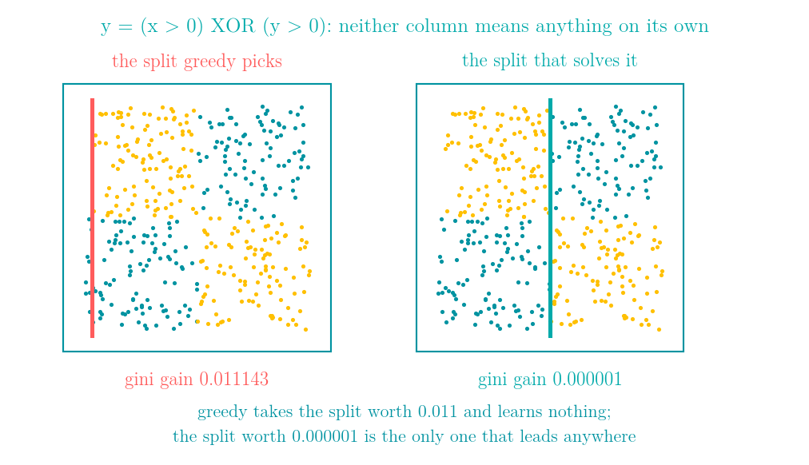
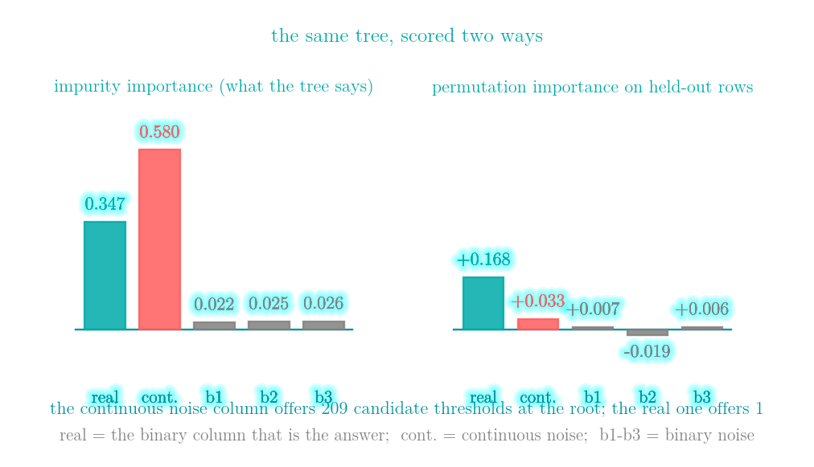
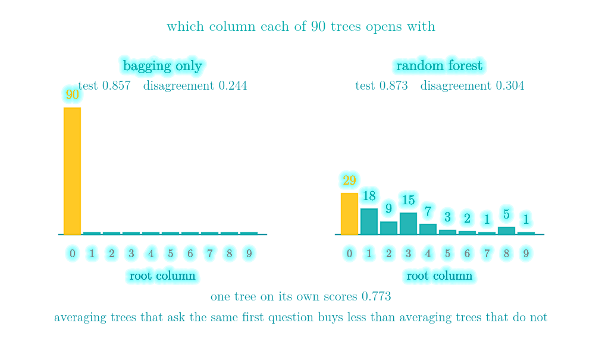
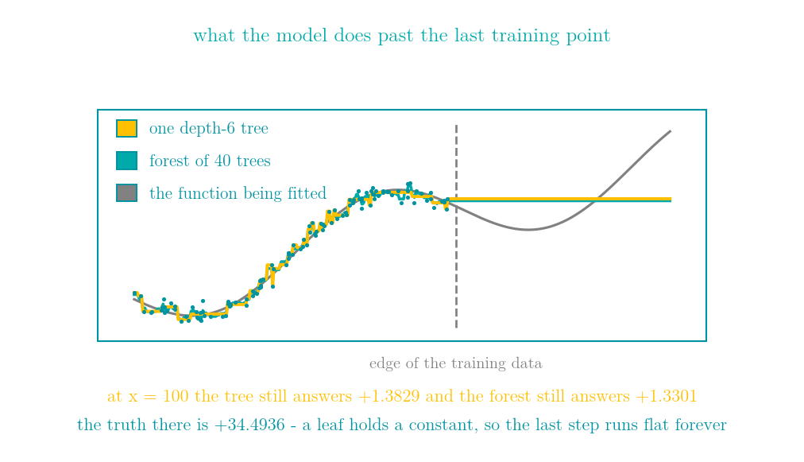
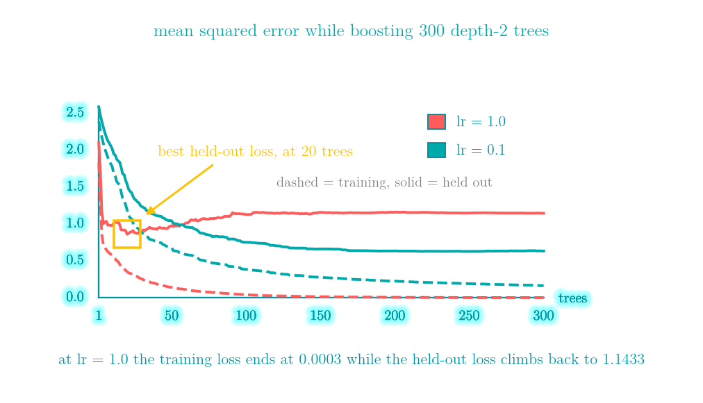

# Decision trees, random forests and gradient boosting: how the most widely used model on tabular data works

More details in:
https://medium.com/100-days-of-python

Interactive walkthrough: [demo.html](demo.html) - a single self-contained page
(no build step, works offline, 中文 / English toggle) that grows a tree one cut at a
time until the last two cuts exist only to memorise a single row, shows the XOR split
that is worth nothing at the root and everything one level down, puts impurity
importance next to permutation importance on the same tree, counts which column each of
90 forest trees opens with, runs a regression tree off the edge of its training data,
stacks six single-split trees onto a residual, and walks LeetCode 112 and LeetCode 257
including the one character that breaks each of them.



I grew a decision tree on 300 rows where one binary column *is* the answer and one continuous column is pure noise, then asked it which columns mattered. It said the noise column, by a factor of 1.67. It also scored 1.000 on its own training data. Both of those numbers are what the model says about itself, and both of them are wrong in a direction you can predict before you run anything.

A decision tree is the only model in this series with no coefficients and no distance function. It asks questions — *is column 7 below 0.31?* — and keeps asking until it is willing to commit. That makes it the one model a person can actually read, and the easiest one to fool.

The same block gets used three ways:

```
one tree          : ask questions until every leaf is pure   -> it memorises
many independent  : average trees that memorise different noise  (random forest)
many dependent    : each small tree fixes what the last ones missed  (boosting)
```

The forest exists to kill variance, boosting exists to kill bias, and swapping their tree depths swaps their failure modes.

## One prediction is one root-to-leaf path

The loop is short enough to read in full:

```python
def grow(X, y, depth):
    node = Node(majority(y), gini(y))
    if gini(y) == 0 or depth == max_depth:
        return node                      # a leaf holds a constant
    gain, j, t = best_split(X, y)        # every (column, threshold)
    node.feat, node.thr = j, t
    m = X[:, j] <= t
    node.left  = grow(X[m],  y[m],  depth + 1)
    node.right = grow(X[~m], y[~m], depth + 1)
    return node
```

Gini and entropy both ask "how mixed is this node" and both hit 0 when it is pure. On eight rows split 0/8, 1/7, 2/6, 3/5, 4/4 the gini values are 0.000, 0.219, 0.375, 0.469, 0.500 and the entropies are 0.000, 0.544, 0.811, 0.954, 1.000. Which one you pick barely matters. The stopping rule is what matters, and that is the next section.

Because the question is always "is this column below this number", every cut is parallel to an axis and every leaf is a box. A prediction walks one root-to-leaf path and reads the constant at the end — and the whole model is just the set of those paths, which makes it the one thing in this series you can export as a list of rules and argue with.

## Finding the split twice

The obvious implementation rebuilds both children for every candidate threshold: O(n) work, O(n) candidates, d columns, so **O(n² d) per node**. Sorting the column once and sweeping the cut left to right makes every statistic the criterion needs a running total, so each candidate costs O(1) and the node costs **O(n log n · d)**. For gini and entropy the running totals are class counts; for variance they are `sum(y)` and `sum(y²)`, because `var = E[y²] − E[y]²`.

Both versions are in the module and the assertions check that they agree exactly on 60 random problems under gini, entropy and variance alike. Only the fast one is usable at the sizes further down; the rebuilt version would have made the rest of this article impractical to run.

## Silent failure #1: a tree grown to purity scores 1.000 on its own data

400 points in two diagonal bands, 10% of the labels flipped, 260 train and 140 held out:

| max_depth | leaves | train | test |
|---|---|---|---|
| 1 | 2 | 0.704 | 0.664 |
| 2 | 4 | 0.781 | 0.814 |
| 3 | 8 | 0.858 | 0.829 |
| 5 | 24 | 0.912 | **0.850** |
| 8 | 42 | 0.973 | 0.771 |
| 12 | 50 | 0.996 | 0.764 |
| none | 52 | **1.000** | 0.764 |



The training column is monotone in depth and ends at exactly 1.000, and that number carries no information at all. This is Day 47's k = 1 nearest neighbour wearing a different hat: a fully grown tree is a lookup table for its own training set.

You can watch it happen on 24 hand-placed points. Calling everything the majority class scores 0.7083. The first cut drops gini by 0.17014 and takes accuracy to 0.7917; the second drops it by 0.34028 and reaches 0.9583; the third drops it by 0.03125 and moves accuracy *not at all*; the fourth finally locks one odd row into a box of its own and reports 1.0000. The last two cuts are not learning anything.

How general is "it gets to 1.000"? Nearly but not quite, and the two exceptions are worth naming. The exotic one is exact symmetry: on a perfect 8×8 XOR lattice the best split available has a gain of exactly 0.0, so the tree stops at **1 leaf** and trains to **0.5000**. The common one is contradictory duplicates — two identical rows carrying different labels leave an impure node with no legal split at all. Outside those two cases some split has a positive gain, and the tree walks all the way up.

## Silent failure #2: greedy cannot look one step ahead

`y = (x0 > 0) XOR (x1 > 0)`, 400 points, no label noise whatsoever. A depth-2 tree represents this exactly: cut x0 at 0, then x1 at 0 in both children, four pure leaves, accuracy 1.0000.



- gain of the correct split on x0 at 0: **0.00000124**
- gain of the correct split on x1 at 0: **0.00061250**
- gain of the split greedy actually picks: **0.01114311**, at `x0 <= -0.9414`

Neither column carries any information on its own, so the correct cut is worth nothing *at the root*. All of the payoff is in the second cut, and greedy only ever looks at the first. So the root goes to a sliver at the edge of the range that happens to be slightly unbalanced, and everything after it is patching: greedy depth 2 scores 0.5675 where the correct depth-2 tree scores 1.0000, and it takes depth 6 and 10 leaves to crawl back to 1.0000.

Representable and unreachable at the same time. This is not a sloppy implementation — finding the optimal tree is NP-hard, so greedy top-down induction is what essentially every tree learner in production does. (Exact solvers do exist — MIP formulations, DL8.5, MurTree, GOSDT — but they are a different tool for a different size of problem, not what CART or XGBoost run.)

What *does* escape it? Not boosting on its own. A sum of single-split trees is an additive model, and XOR is the textbook example of something no additive model can express: 200 rounds of depth-1 boosting on this data reaches **0.6900**. That is above 0.5 only because a finite sample is never perfectly balanced, so the marginals carry a little accidental signal — not because the sum of stumps captures any part of the XOR. Depth 2 is the first size that can hold the interaction inside one tree, and 200 rounds of it reach **1.0000**, as does depth 3. The fix is not a cleverer search; it is a building block big enough to contain the thing you are looking for.

## Silent failure #3: feature importance rewards opportunity, not use

300 rows. Column 0 is binary and *is* the answer, with 20% of labels flipped. Column 1 is continuous pure noise. Columns 2–4 are binary noise. Grow the tree to purity and ask it what mattered:

| column | impurity importance | permutation importance (held out) |
|---|---|---|
| real (binary) | 0.347 | **+0.168** |
| noise (continuous) | **0.580** | +0.033 |
| noise b1 | 0.022 | +0.007 |
| noise b2 | 0.025 | −0.019 |
| noise b3 | 0.026 | +0.006 |



Impurity importance puts the pure-noise column **first**, at 1.67× the real signal. The mechanism is in one line: at the root, the continuous column offers **209** candidate thresholds and the binary column offers **1**. Two hundred times the chances to look good on noise. Impurity importance sums how much impurity each column's splits removed; it has no way to ask whether removing it meant anything.

Permutation importance asks exactly that — shuffle a column, measure how far the score falls — and it reverses the ranking. It has to be measured on rows the model never saw. Run it on the training set and it will cheerfully reward the column the tree memorised with, because on the training set that column really does carry the predictions. (This tree scores 1.000 on its training rows and 0.656 on held-out ones.)

## Silent failure #4: one row changes the whole tree

Take 200 points, fit a depth-4 tree, then refit 200 times with one row removed each time. The **root split** changed in 60 of 200 runs — 30%. Predictions moved on 1.8% of rows on average and 7.5% at worst.

Nothing about the data changed meaningfully: 199 of 200 rows are identical every time. A model this sensitive to its sample is a model with high variance, and high variance is exactly what averaging is good at removing. That is the entire argument for the next section.

## The forest: bagging first, and then making the trees ask different questions

900 rows, 10 columns: one that dominates the answer, four that help a little, five pure noise. 600 train, 300 held out, averaged over three forest seeds.

| model | train | test | disagreement | out-of-bag |
|---|---|---|---|---|
| single unpruned tree | 1.000 | 0.773 | - | - |
| bagging only, all 10 features | 0.999 | 0.857 | 0.244 | 0.826 |
| random forest, sqrt = 3 features | 0.999 | **0.873** | **0.304** | 0.834 |

The root column chosen, over 90 trees:

```
bagging only  : [90,  0,  0,  0, 0, 0, 0, 0, 0, 0]
random forest : [29, 18,  9, 15, 7, 3, 2, 1, 5, 1]
```



The two knobs do different jobs. Bagging makes the trees see different rows; `max_features` makes them ask different questions. Bagging is where most of the win is: +0.083. Feature subsampling adds +0.017 on top, which is smaller than it is usually sold as, and I would rather say so than round it up. What it clearly does change is the disagreement between trees, 0.244 to 0.304 — and that is the quantity averaging feeds on. Averaging predictors that agree buys nothing, and the root histogram shows exactly why: without subsampling, every single tree opens with the same question.

Out-of-bag scoring is genuinely free. Each bootstrap sample draws n rows with replacement, so it misses about `(1 − 1/n)^n → 1/e = 36.8%` of them; every row is therefore unseen by roughly a third of the trees and can be scored with exactly those. No validation split required.

## Silent failure #5: a tree cannot predict a number it has never seen

120 points of `y = sin(x) + 0.35x` on x in [−3, 3], fitted with a depth-6 tree and a 40-tree forest. Then asked about x outside that range:

| x | tree | forest | truth |
|---|---|---|---|
| 2.9 | +1.3829 | +1.3301 | +1.2542 |
| 3.5 | +1.3829 | +1.3301 | +0.8742 |
| 5.0 | +1.3829 | +1.3301 | +0.7911 |
| 10.0 | +1.3829 | +1.3301 | +2.9560 |
| 100.0 | **+1.3829** | **+1.3301** | **+34.4936** |



Every answer past the edge is the same number, forever. A leaf holds a constant, so the model is a step function and the rightmost step has no right edge. Averaging flat things is flat, so the forest does not fix it — it just picks a slightly different constant.

There is a second, quieter version of the same fact: the data reaches 1.7795 and the tree never predicts above 1.5463. Any model whose output is a non-negative weighted average of training targets is trapped inside their range. The usual fix is not a better tree. It is to model the trend separately — fit a line, take the residual — and let the tree have what is left.

## Boosting: gradient descent where the parameter is a function

Day 45 took steps in parameter space, `w ← w − lr · dL/dw`. Here the model is a sum of trees and the thing being improved is the function `F` itself:

```python
F = np.full(len(y), y.mean())        # the best constant under squared loss
for _ in range(n_trees):
    resid = y - F                    # = -dL/dF for L = 0.5 (y - F)^2
    tree = DecisionTree(max_depth=2).fit(X, resid)
    F += lr * tree.predict(X)
```

"Fit the next tree to what is left over" is not a separate idea. It is what the gradient of squared loss happens to look like. Change the loss and the target of the next tree changes with it — that is the entire content of the word *gradient*, and it is why the same loop trains a classifier by fitting trees to something that is not a residual at all.

On 600 rows and 6 columns (3 informative), 420 train and 180 held out, predicting the training mean for everything gives a test MSE of 2.6937. Three hundred depth-2 trees — at most four leaves each, models that can barely do anything — get to 0.6312.

## Silent failure #6: the training loss never tells you to stop

| lr | depth | train MSE at the end | best test MSE | at tree | test MSE at the end |
|---|---|---|---|---|---|
| 1.0 | 2 | **0.0003** | 0.8597 | 20 | **1.1433** |
| 0.3 | 2 | 0.0277 | 0.6510 | 95 | 0.7006 |
| 0.1 | 2 | 0.1603 | **0.6250** | 250 | 0.6312 |
| 0.03 | 2 | 0.4367 | 0.8102 | 300 | 0.8102 |
| 0.1 | 6 | 0.0000 | 0.6272 | 142 | 0.6296 |
| 0.1 | 10 | 0.0000 | 0.7130 | 132 | 0.7130 |



Read the first row across. Training MSE finishes at 0.0003 — visually zero, a perfect fit. Held-out MSE bottomed out at 0.8597 after only 20 trees and then climbed 33% to 1.1433. The training curve is monotone decreasing for every row in this table — the module checks that row by row and prints the result as an extra column — and it is structurally incapable of telling you when to stop. That is why early stopping needs held-out data, and why every boosting library has a parameter for it. None of them require one; they will all happily run to the end.

Shrinkage is the trade: `lr = 1.0` reaches its best after 20 trees and that best is 0.8597; `lr = 0.1` needs 250 trees and gets 0.6250. Smaller steps, more of them, a better place to stop — the learning-rate story from Day 45 with a tree in place of a gradient vector.

Depth is the other half of the same trade. At `lr = 0.1`, depth 2 gets 0.6250, depth 6 gets 0.6272, and depth 10 gets 0.7130 while driving the training MSE to zero on the way. A boosting loop wants weak learners; give it strong ones and the first few trees have already memorised the residuals, leaving the rest of the loop nothing honest to fit.

## The two uses pull in opposite directions

| model | test MSE |
|---|---|
| one deep tree (max_depth=None) | 1.1002 |
| one stump (max_depth=2) | 2.0962 |
| forest of 40 deep trees | 0.7165 |
| forest of 40 stumps (max_depth=2) | 1.7940 |
| boosting, 300 stumps, lr 0.1 | **0.6312** |

The forest of deep trees works and the forest of stumps does not: averaging removes variance, and a stump has almost none to remove — it is simply wrong, and averaging forty copies of wrong gives wrong. Boosting on stumps is the best row in the table, because the dependence is the point: tree 2 is fitted to what tree 1 got wrong. (The two stump rows are not literally the same trees — the forest's stumps see 3 random columns each, the boosted ones see all 6 — but the depth, which is what the row is about, is identical.)

Deep and independent kills variance. Shallow and dependent kills bias. Swapping the depths swaps the failure.

## LeetCode 112 - Path Sum

**The task.** Given the root of a binary tree and an integer `targetSum`, return `true` if the tree has a root-to-leaf path such that the values along the path add up to `targetSum`. A leaf is a node with no children.

**Input / output.** `root` is a binary tree node (or `None` for an empty tree) and `targetSum` is an integer. You return a boolean.

**Example.** For `[5,4,8,11,null,13,4,7,2,null,null,null,1]` and `targetSum = 22`, the answer is `true`: the path 5 → 4 → 11 → 2 sums to 22. There is no path summing to 100, so that would be `false`.

**Constraints.** Up to 5,000 nodes, values between −1,000 and 1,000, and — the constraint that makes the problem interesting — **values may be negative**. That is what rules out the pruning you would reach for first: you cannot stop descending when the running sum passes the target, because a negative child can bring it back. The empty tree must return `false` for any target, including 0.

The whole problem is the definition of a leaf. A leaf is a node with **no children**, which is not the same as "the recursion ran off the tree".

```python
class Solution:
    def hasPathSum(self, root, targetSum: int) -> bool:
        if root is None:
            return False
        if root.left is None and root.right is None:
            return targetSum == root.val
        rest = targetSum - root.val
        return self.hasPathSum(root.left, rest) or self.hasPathSum(root.right, rest)
```

Write the base case as `if root is None: return targetSum == 0` instead and a node with one child gets counted as a leaf. On `[1, 2]` with target 1 that version walks into the right child that does not exist, finds the target already used up, and returns `True` — reporting a root-to-leaf path that is not there. Over 3,000 random small trees the two spellings disagree 121 times, 4.0%: common enough to be caught, rare enough to pass a handful of examples.

A decision tree never hits this bug, because every internal node it builds gets exactly two children. LeetCode's trees are not so disciplined, which is precisely why the definition matters there.

[leetcode.com/problems/path-sum](https://leetcode.com/problems/path-sum/)

## LeetCode 257 - Binary Tree Paths

**The task.** Given the root of a binary tree, return every root-to-leaf path as a string with the values joined by `->`. The paths may come back in any order.

**Input / output.** `root` is a binary tree node; you return a list of strings such as `"1->2->5"`.

**Example.** For `[1,2,3,null,5]` the answer is `["1->2->5", "1->3"]`. Node 2 has only a right child, so it is not a leaf and does not end a path; node 5 and node 3 are the leaves.

**Constraints.** Between 1 and 100 nodes, so the tree always exists and the output is small. The size bound is what makes this a clarity problem rather than a performance one: there is no clever algorithm to find, only an accumulator to get right.

```python
class Solution:
    def binaryTreePaths(self, root) -> list[str]:
        out: list[str] = []

        def walk(node, acc):
            if node is None:
                return
            acc = acc + [str(node.val)]          # a new list, not a mutated one
            if node.left is None and node.right is None:
                out.append('->'.join(acc))
                return
            walk(node.left, acc)
            walk(node.right, acc)

        walk(root, [])
        return out
```

The walk is three lines and it is never where things go wrong. The accumulator is. Share one list across the recursion with no copy and no undo, append it at each leaf, and `[1,2,3,null,5]` comes back as `['1->2->5->3', '1->2->5->3']` — both paths wrong, and both the *same* wrong value, because what got stored at the first leaf was the list that kept growing afterwards. This is Day 39's `res.append(path)` bug moved from a backtracking search into a tree. Either copy on the way in, as above, or append and pop around the recursive calls.

That same walk over a fitted tree is what turns the model into something readable: the depth-3 tree from the first figure becomes 8 rules of the form *if x ≤ 0.26 and y > 1.36 and x > −1.53 then class 1 (35 rows)*. No other model in this series hands you that.

[leetcode.com/problems/binary-tree-paths](https://leetcode.com/problems/binary-tree-paths/)

## Complexity

| Operation | Time | Space |
|---|---|---|
| One split, swept, n rows, d columns, k classes | O(d · n log n + d · n · k) | O(n · k) |
| One split, rebuilt per candidate | O(d · n²) | O(n) |
| Growing a tree to depth D | O(D · d · n log n) | O(nodes) |
| Predicting one row | O(depth) | O(1) |
| Random forest, T trees | T times one tree, trivially parallel | O(T · nodes) |
| Out-of-bag score | O(T · n · depth) | O(n · k) |
| Boosting, T trees | T times one tree, strictly sequential | O(T · nodes) |
| Permutation importance, r repeats | O(r · d · n · depth) | O(n · d) |

## References

- Breiman, Friedman, Olshen and Stone, *Classification and Regression Trees*, Wadsworth 1984 (CART, and the gini criterion used here)
- Breiman, [*Random Forests*](https://link.springer.com/article/10.1023/A:1010933404324), Machine Learning 2001
- Friedman, [*Greedy Function Approximation: A Gradient Boosting Machine*](https://www.jstor.org/stable/2699986), Annals of Statistics 2001 - where "fit the next tree to the negative gradient" comes from
- Hyafil and Rivest, *Constructing optimal binary decision trees is NP-complete*, Information Processing Letters 1976
- Strobl, Boulesteix, Zeileis and Hothorn, [*Bias in random forest variable importance measures*](https://bmcbioinformatics.biomedcentral.com/articles/10.1186/1471-2105-8-25), BMC Bioinformatics 2007 - the cardinality bias measured above
- [scikit-learn: permutation importance vs impurity importance](https://scikit-learn.org/stable/modules/permutation_importance.html)
- [Chen and Guestrin, *XGBoost*](https://arxiv.org/abs/1603.02754), KDD 2016
