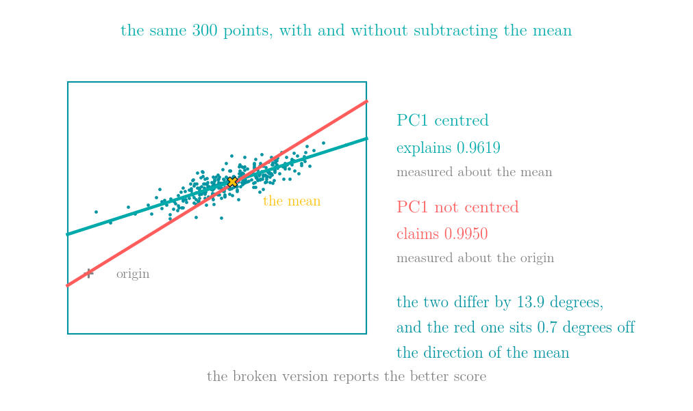
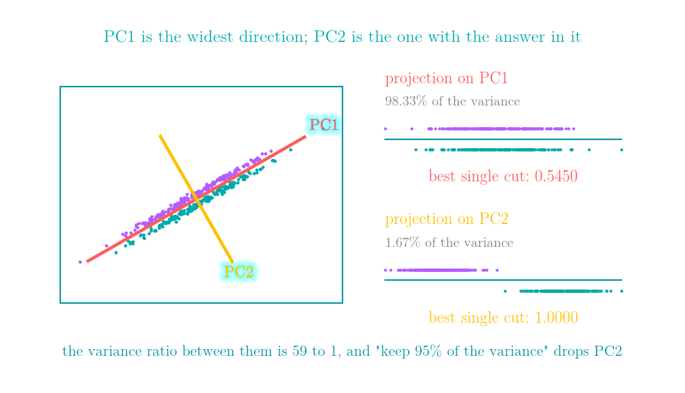
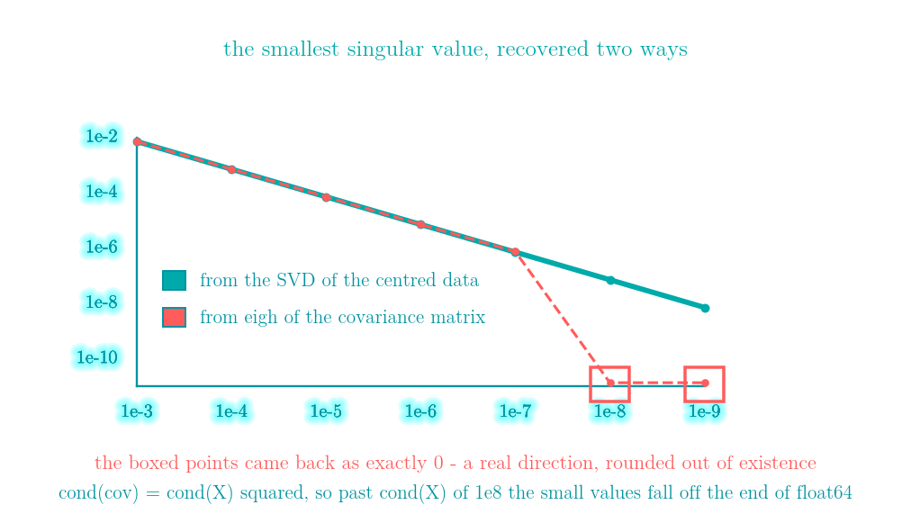
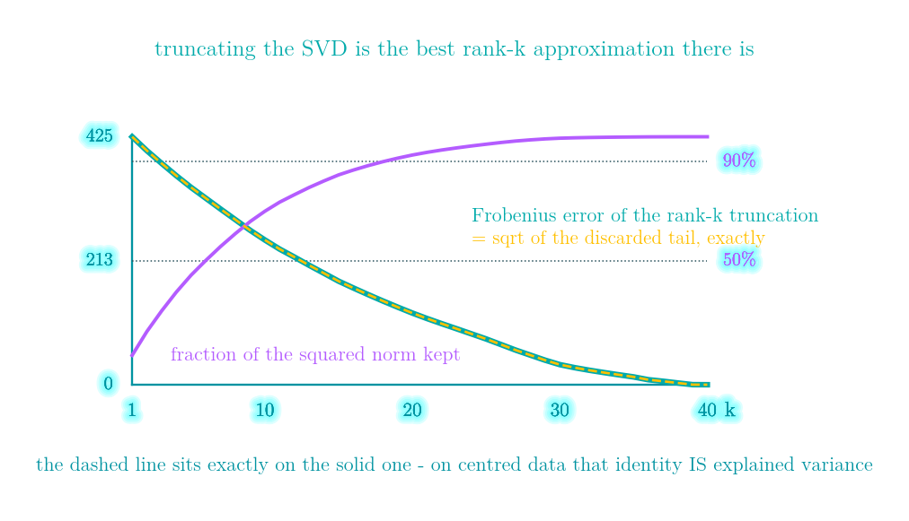
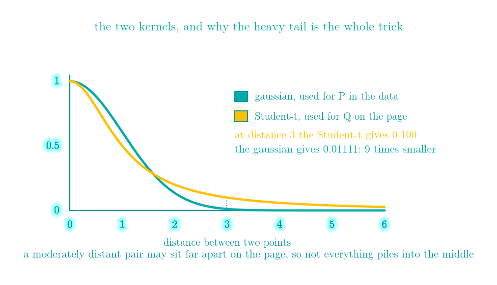
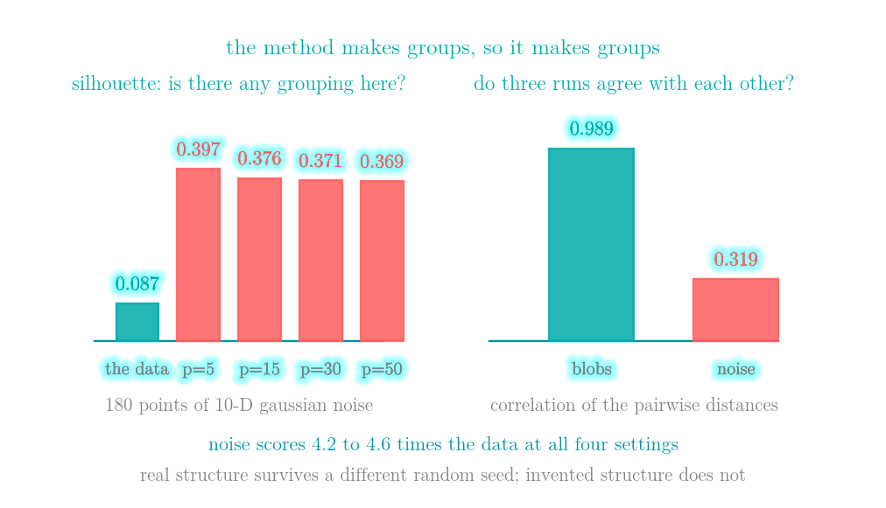
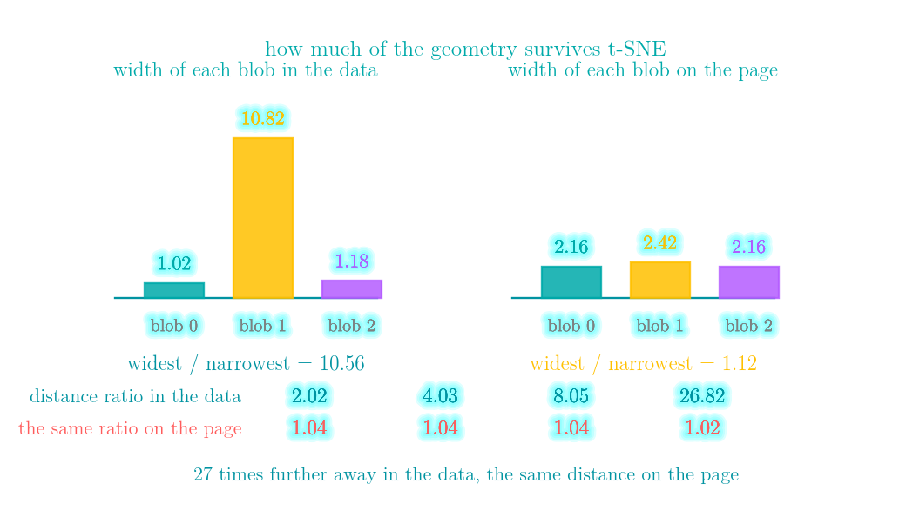

# PCA, SVD and t-SNE: turning hundreds of columns into two you can plot

More details in:
https://medium.com/100-days-of-python

Interactive walkthrough: [demo.html](demo.html) - a single self-contained page
(no build step, works offline, 中文 / English toggle) that swings the first principal
component away from the data and onto the mean when the centring line is removed, puts
a component holding 98% of the variance next to the one holding the answer, watches the
covariance route round a real singular value down to exactly zero, rebuilds a matrix
from its first k singular values, runs t-SNE on sixty points one snapshot at a time,
measures the three things its picture does not say, and walks LeetCode 719 and
LeetCode 2352 one step at a time.



I ran t-SNE on 180 points of ten-dimensional gaussian noise. It drew three groups — three that a k-means cut of the map separates cleanly. I changed the random seed and it drew three different ones. A silhouette score, which is near zero when a grouping is arbitrary, gave the raw data 0.0872 and gave each of four pictures of it between 0.3689 and 0.3972 — between 4.2 and 4.6 times as much structure as the data contains.

That is the shape of this whole day. Dimensionality reduction takes d columns and hands back two, and the d − 2 that went away leave no trace. What comes out is a picture, and a picture is extremely easy to over-read.

```
PCA   answers: which directions carry the most variance?
t-SNE answers: which points are each other's neighbours?
```

Neither of those is *which directions matter* or *how far apart are these groups*, and those are the two things people read off the plot. Everything below measures the gap between what was optimised and what was read.

## PCA is the SVD of the centred data

```python
Xc = X - X.mean(axis=0)
U, s, Vt = np.linalg.svd(Xc, full_matrices=False)
components = Vt                       # rows are the directions
explained_variance = s ** 2 / (n - 1)
```

The textbook route builds the covariance matrix `XᵀX / (n − 1)` and eigendecomposes it. The two agree here to 4.4e-15, and later they stop agreeing at all. Two things to note before that.

`np.linalg.eigh` returns eigenvalues in **ascending** order, so the covariance route needs an explicit reversal. Forget it and you get a perfectly ordinary looking answer pointing at the least important direction.

And an eigenvector with a simple eigenvalue is defined only up to its sign: `v` and `−v` span the same line, and both are correct. (When two eigenvalues are equal it is worse than a mirror — any rotation inside their plane is equally valid.) Two libraries, two versions of one library, or the same code on a different machine can hand you a flipped plot and nothing warns you. Code that compares components has to compare them up to sign, `|u · v|`; anything a human will look at needs a pinned convention instead, such as forcing the largest-magnitude entry of each component positive before plotting.

## Silent failure #1: forgetting to subtract the mean

The first line above is the one that matters. Without it, "variance" is measured about the origin instead of about the data, so the first component points at **where the data is** rather than at how it is shaped.

On 300 points centred at `[7.85, 4.98]` with a spread of 2.2:

| | PC1 | explained variance ratio |
|---|---|---|
| centred | `[-0.9521, -0.3059]` | `[0.9619, 0.0381]` |
| not centred | `[-0.8508, -0.5254]` | `[0.9950, 0.0050]` |

The uncentred PC1 sits **0.701 degrees** from the direction of the mean and **13.885 degrees** from the real PC1.

The dangerous part is the second column. The broken version reports **0.9950** of the variance in one component against the correct **0.9619**. It looks better, because the offset it is now measuring is larger than the spread it should have been measuring — the denominator was inflated along with the numerator.

The number anyone actually reports goes **up** when you make this mistake. Not every number is fooled, though, which is the useful part: rebuilding the 300 points from one component costs 0.093544 centred and 0.230609 uncentred, so reconstruction error is **2.5× worse** and does catch it. It is simply not the number that ends up on the slide.

## Silent failure #2: the units pick the axes

Day 47 and Day 48 both ran into this. PCA is where it is most visible, because the answer *is* a direction. Two independent noise columns — `prompt_tokens` in the hundreds, a cache hit rate in [0, 1]:

```
raw units    : PC1 [1.00000000 0.00003620]   explained variance ratio 0.99999992
standardised : PC1 [0.70710678 0.70710678]   explained variance ratio 0.56328964
```

In raw units PC1 is the token axis to within 0.0021 degrees, and PCA reports that one component explains **99.999992%** of the variance of two independent noise columns. That number is true, and it is a fact about the units rather than about the data. Standardising makes the columns equally loud, which is a different arbitrary choice, not a neutral one — but at least it is one you made.

## Silent failure #3: explained variance is not usefulness

400 points in two classes. The classes are separated along one direction; another direction carries far more variance and no information at all; the whole thing is rotated so that neither one is an axis.



| component | variance explained | best single cut |
|---|---|---|
| PC1 | 98.33% | 0.5450 |
| PC2 | 1.67% | **1.0000** |

PC1 holds 98.33% of the variance and separates the classes at 0.5450, which is a coin flip. PC2 holds 1.67% and separates them perfectly. The ratio of the two variances is 59.0 to 1, and the ordering is exactly backwards for the only question anyone was going to ask.

Note what PCA did and did not get wrong. It found the right *pair* of directions — the rotation is correct and the signal lies cleanly along one of its axes. It only sorted them by the wrong key. "Keep 95% of the variance" discards PC2 here, and PCA could not have done better: it is unsupervised and never sees the labels.

## Why the SVD and not the covariance matrix

Both routes are the same mathematics. Forming `XᵀX` squares the condition number, and `float64` has about 16 digits to spend.

With singular values proportional to 1, eps and eps/2 in a random orthogonal basis (the basis is scaled by √(n−1), which is why the smallest singular value at eps = 1e-4 below reads 7.04e-04 rather than 5e-05):

| eps | cond(X) | cond(cov) | smallest sv, from SVD | from eigh | relative error |
|---|---|---|---|---|---|
| 1e-04 | 2.0e+04 | 4.0e+08 | 7.0425e-04 | 7.0425e-04 | 4.582e-08 |
| 1e-06 | 2.0e+06 | 4.0e+12 | 7.0425e-06 | 7.0416e-06 | 1.197e-04 |
| 1e-08 | 2.0e+08 | 4.2e+16 | 7.0425e-08 | **0.0000e+00** | 1.000e+00 |
| 1e-09 | 2.0e+09 | 6.5e+17 | 7.0425e-09 | **0.0000e+00** | 1.000e+00 |



At eps = 1e-8 the covariance route returns **exactly zero** for a singular value that is really 7.04e-08. A direction with real variance in it has been rounded out of existence, with no warning at all.

The `cond(cov)` column is measured from the covariance matrix rather than squared by hand, which is why the last row reads 6.5e+17 instead of the predicted 4.0e+18: by then the matrix is too degenerate for its own condition number to survive. The measurement is a victim of what it measures.

There is a second symptom in the same place: `eigh` returns **-1.435e-16** for a covariance matrix, which is a negative variance. `np.sqrt` of it is `nan`, so code that takes standard deviations from eigenvalues has to clamp at zero — and clamping is exactly what hides the problem.

## Truncated SVD, and what "explained variance" means

Eckart–Young: truncating the SVD at k is the best rank-k approximation in Frobenius norm, and the error is exactly the square root of the sum of the discarded singular values squared.

| k | Frobenius error | sqrt(sum dropped²) | share of the squared norm |
|---|---|---|---|
| 1 | 425.474593 | 425.474593 | 0.1185 |
| 5 | 338.494196 | 338.494196 | 0.4421 |
| 10 | 248.372324 | 248.372324 | 0.6996 |
| 20 | 122.977998 | 122.977998 | 0.9264 |
| 40 | 0.000000 | 0.000000 | 1.0000 |



The last column is the share of the squared Frobenius norm kept, and on **centred** data that is exactly PCA's explained-variance ratio — the same ratio, one step before the statistics. This `A` is not centred, so the two differ a little: at k = 10 the raw share is 0.6996 and the centred one is 0.6991.

That identity is all "explained variance" ever means, which is also why the phrase is so easy to misuse. "Keep 95% of the variance" says the squared reconstruction error is down to 5%. It does not say that 95% of the thing you care about survived, and the previous section is what those two parting company looks like.

## t-SNE: keep the neighbours, let go of everything else

**P**: in the original space, turn distances into neighbour probabilities with a gaussian. Every row gets its **own** width, found by binary search so that the perplexity of that row hits the number you asked for. Perplexity is 2^entropy — "how many neighbours does this point effectively have". On 180 points at perplexity 30, sigma ranges from 0.7827 to 1.7242 across the rows. The search stops at a tolerance of 1e-5, so the perplexity it actually achieves runs 29.9997 to 30.0003 — near enough, but not exactly 30.

**Q**: on the 2-D page, use a Student-t with one degree of freedom instead.



At a distance of 3 the Student-t still gives 0.100 where the gaussian gives 0.01111 — nine times smaller. That heavy tail is the whole trick. In high dimensions almost every pair is moderately far apart, and without it they would all pile into the middle of the page.

Then minimise KL(P ‖ Q) by moving the points:

```python
num  = 1 / (1 + pairwise_sq_dists(Y))        # the Student-t kernel
np.fill_diagonal(num, 0.0)                   # a point is not its own neighbour
Q    = num / num.sum()
W    = (P - Q) * num
grad = 4 * (Y * W.sum(1)[:, None] - W @ Y)
```

600 iterations take KL from 1.6949 to 0.2499, and 0.6206 of each point's ten nearest neighbours are still its neighbours on the page. **That recall number is the only claim the picture is entitled to make.**

The embedding *is* the parameter vector. There is no function being fitted, which is why t-SNE has no `transform()` for new points — a new point means re-running everything, at n² pairs per iteration.

## Silent failure #4: t-SNE draws clusters in pure noise

180 points of ten-dimensional gaussian noise. There is nothing in it.

| perplexity | silhouette of the data | silhouette of the picture |
|---|---|---|
| 5 | 0.0872 | 0.3972 |
| 15 | 0.0872 | 0.3763 |
| 30 | 0.0872 | 0.3707 |
| 50 | 0.0872 | 0.3689 |

A silhouette near 0 means "this grouping is arbitrary". The data scores 0.0872; the four pictures of it score between 4.23 and 4.56 times that. This is Day 47's k-means on uniform noise, one layer further along: the method is built to produce groups, so it produces groups.

The test that catches it costs one more run:

```
three real blobs: correlation between three runs [0.9871, 0.9894, 0.99],   mean 0.9889
 pure 10-D noise: correlation between three runs [0.3244, 0.2875, 0.3439], mean 0.3186
```

Real structure survives a different random seed. Invented structure does not: the same noise gives three maps that barely agree with each other.



## Silent failure #5: sizes and distances on the page mean nothing



Three blobs, the middle one ten times wider than the others:

```
spreads in the data : [1.025, 10.818, 1.182]   widest / narrowest = 10.56
spreads in the map  : [2.159,  2.421, 2.155]   widest / narrowest =  1.12
```

A cluster ten times wider comes out the same size as the others, because every row chose its own sigma to reach the same perplexity. That per-row width is how t-SNE copes with regions of different density, and it is exactly why the output cannot report density.

And the between-cluster distances are simply gone:

| true distance ratio | ratio on the page |
|---|---|
| 2.02 | 1.04 |
| 4.03 | 1.04 |
| 8.05 | 1.04 |
| **26.82** | **1.02** |

One group is nearly 27 times further away than another and the map puts them at the same distance. There is no bug here: KL(P ‖ Q) is a sum over *pairs* of points, and it contains no term that names how wide a cluster is or how far apart two clusters are, so the optimisation was never trying to get either of them right.

## Silent failure #6: the loss gets better while the map gets worse

Same three blobs, one knob changed:

| perplexity | final KL | neighbours kept |
|---|---|---|
| 2 | 0.6008 | 0.5283 |
| 5 | 0.5849 | 0.5822 |
| 30 | 0.2499 | **0.6206** |
| 80 | **0.0010** | 0.5028 |
| 150 | 0.0025 | 0.3656 |

The lowest KL in the table is 0.0010, at perplexity 80. That looks like a perfect fit, and it keeps 0.5028 of the neighbours against 0.6206 at perplexity 30.

The trap is that **P is rebuilt from scratch for every perplexity**, so each row of this table is a different objective function. KL values are not comparable across perplexities, and the one number the optimiser prints is therefore useless for choosing the one knob that matters.

## LeetCode 719 - Find K-th Smallest Pair Distance

**The task.** Given an integer array `nums` and an integer `k`, return the k-th smallest distance among all pairs, where the distance of a pair `(a, b)` is `|a − b|`. Every unordered pair of positions counts once, including pairs of equal values.

**Input / output.** `nums` is a list of integers and `k` is an integer with `1 ≤ k ≤ n(n−1)/2`. You return a single integer.

**Example.** For `nums = [1, 3, 1]` and `k = 1`, the three pairs give distances 2, 0 and 2. Sorted they are 0, 2, 2, so the first smallest is `0`.

**Constraints.** `2 ≤ n ≤ 10⁴` and `0 ≤ nums[i] ≤ 10⁶`. That upper bound on n is the whole problem: it allows **49,995,000** pairs, so building them, let alone sorting them, is out of reach. The bound on the values is what makes the answer binary-searchable — it lives in `[0, 10⁶]`, a range you can halve.

The move is to binary-search the **answer** rather than the data. `count(m)`, the number of pairs at most `m` apart, is non-decreasing in `m`, so the smallest `m` with `count(m) ≥ k` is the k-th smallest distance. And because the array is sorted, `count` itself is a sliding window: `j` only ever moves right, so it is O(n) rather than O(n²).

```python
class Solution:
    def smallestDistancePair(self, nums: list[int], k: int) -> int:
        nums.sort()
        n = len(nums)

        def count(m: int) -> int:
            total = j = 0
            for i in range(n):
                while nums[i] - nums[j] > m:
                    j += 1
                total += i - j          # every index in [j, i) pairs with i
            return total

        lo, hi = 0, nums[-1] - nums[0]
        while lo < hi:
            mid = (lo + hi) // 2
            if count(mid) >= k:
                hi = mid
            else:
                lo = mid + 1
        return lo
```

`lo` must start at **0**, not 1. "A distance is at least 1" is true of every pair of different values and false the moment the array repeats one. Starting at 1 differs from the truth on 316 of 5,000 random cases — 6.3% — and the first failure is `nums = [0, 0, 0, 1, 4, 5, 6, 8], k = 2`, which returns 1 instead of 0. A handful of hand-written tests with distinct values will never see it.

[leetcode.com/problems/find-k-th-smallest-pair-distance](https://leetcode.com/problems/find-k-th-smallest-pair-distance/)

## LeetCode 2352 - Equal Row and Column Pairs

**The task.** Given an `n × n` integer matrix `grid`, return the number of pairs `(r, c)` such that row `r` and column `c` are equal — that is, they contain the same elements in the same order.

**Input / output.** `grid` is a square list of lists of integers. You return a single integer; the same row can match several columns and each match counts separately.

**Example.** For `grid = [[3,2,1],[1,7,6],[2,7,7]]` the answer is `1`: row 2 is `(2, 7, 7)` and column 1 is `(2, 7, 7)`. For `[[3,1,2,2],[1,4,4,5],[2,4,2,2],[2,4,2,2]]` the answer is `3`.

**Constraints.** `1 ≤ n ≤ 200` and `1 ≤ grid[i][j] ≤ 10⁵`. The size bound means the naive O(n³) triple loop passes comfortably, so this is a clarity problem rather than a performance one. The **value** bound is the one that bites: values up to 10⁵ are multi-digit, which is what breaks the shortcut below.

A row and a column are equal when they are the same *sequence*, so the key has to be the sequence. A tuple keeps the element boundaries; gluing the digits into one string throws them away.

```python
from collections import Counter

class Solution:
    def equalPairs(self, grid: list[list[int]]) -> int:
        rows = Counter(tuple(r) for r in grid)
        return sum(rows[col] for col in zip(*grid))
```

Use `''.join(map(str, row))` as the key instead and `(1, 2, 34)` and `(1, 23, 4)` both become `"1234"`. On `[[1, 2, 34], [23, 5, 6], [4, 7, 8]]` the correct answer is 0 and the joined-string version returns 1.

How big is that bug, and how likely is a test to find it? Of the 9,801 two-element sequences with values in 1..99, only **9,072** distinct joined keys exist. 729 keys are shared, each by exactly two sequences, so **1,458 of the 9,801 — 14.9%** — are not uniquely keyed. And two independently drawn three-element sequences with values up to 100,000 collided **0 times in 200,000 draws**. Fifteen percent of the input space, and essentially no chance of stumbling into it: the exact shape of a bug that reaches production.

[leetcode.com/problems/equal-row-and-column-pairs](https://leetcode.com/problems/equal-row-and-column-pairs/)

## Complexity

| Operation | Time | Space |
|---|---|---|
| PCA via the SVD, n rows, d columns | O(n · d · min(n, d)) | O(n · d) |
| PCA via the covariance matrix | O(n · d² + d³) | O(d²) |
| Randomized SVD, k components | O(n · d · k) | O((n + d) · k) |
| Projecting onto k components | O(n · d · k) | O(n · k) |
| Building P for t-SNE | O(n² · d) plus a binary search per row | O(n²) |
| One t-SNE iteration, exact | O(n²) | O(n²) |
| One t-SNE iteration, Barnes-Hut | O(n log n) | O(n) |
| LeetCode 719 | O(n log n + n log(max distance)) | O(1) beyond the sort |
| LeetCode 2352 | O(n²) | O(n²) |

## References

- Pearson, *On Lines and Planes of Closest Fit to Systems of Points in Space*, Philosophical Magazine 1901
- Eckart and Young, *The approximation of one matrix by another of lower rank*, Psychometrika 1936
- Golub and Van Loan, *Matrix Computations*, 4th edition - chapter 8 on why the SVD is preferred to the normal equations
- van der Maaten and Hinton, [*Visualizing Data using t-SNE*](https://www.jmlr.org/papers/v9/vandermaaten08a.html), JMLR 2008
- van der Maaten, [*Accelerating t-SNE using Tree-Based Algorithms*](https://www.jmlr.org/papers/v15/vandermaaten14a.html), JMLR 2014 - the Barnes-Hut version
- Wattenberg, Viégas and Johnson, [*How to Use t-SNE Effectively*](https://distill.pub/2016/misread-tsne/), Distill 2016 - the cluster-size and distance warnings, made interactive
- Halko, Martinsson and Tropp, [*Finding Structure with Randomness*](https://arxiv.org/abs/0909.4061), SIAM Review 2011 - randomized SVD
- [scikit-learn: decomposition](https://scikit-learn.org/stable/modules/decomposition.html) and [manifold learning](https://scikit-learn.org/stable/modules/manifold.html)
