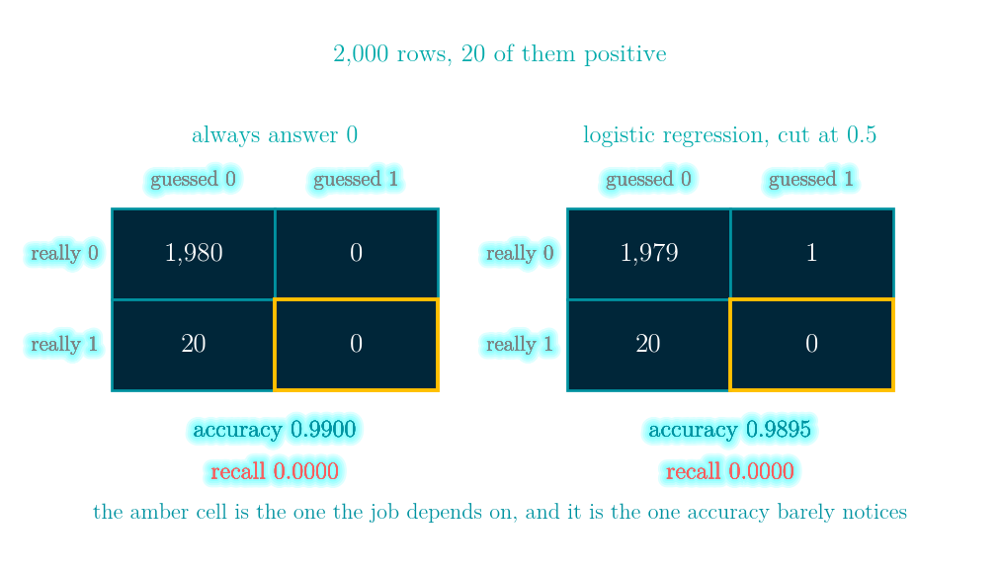
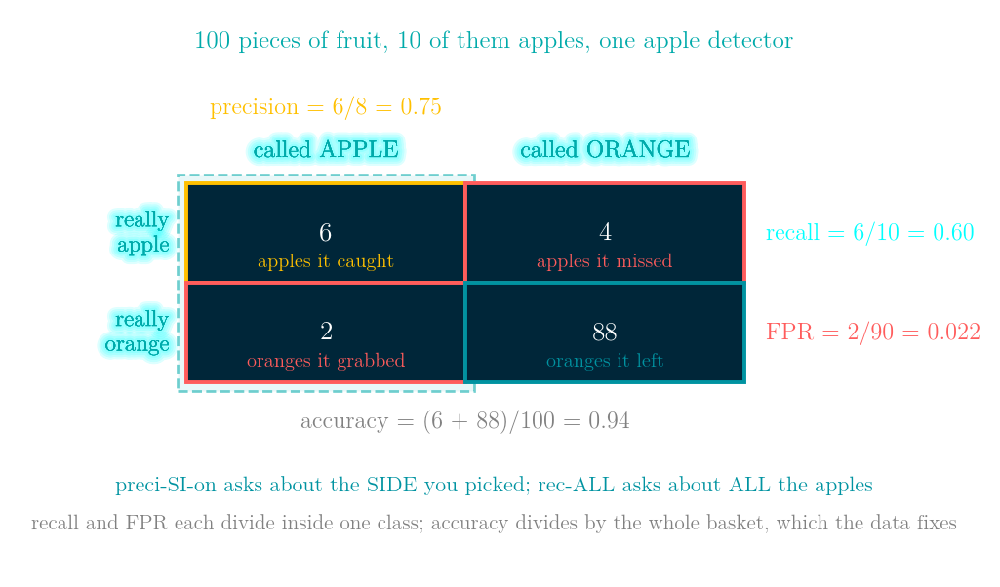
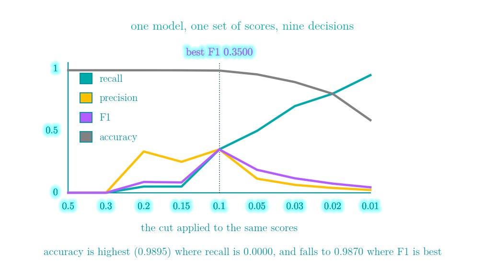
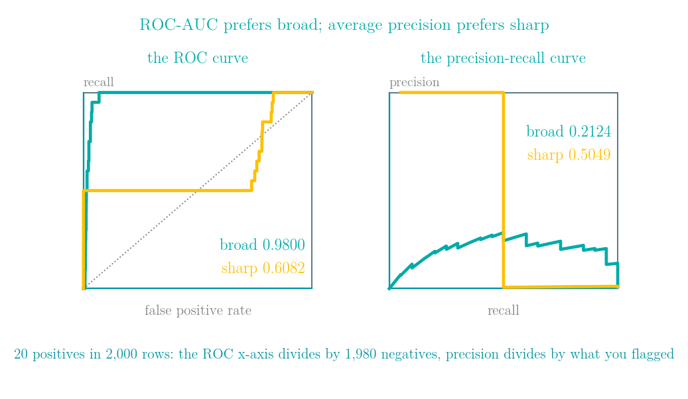
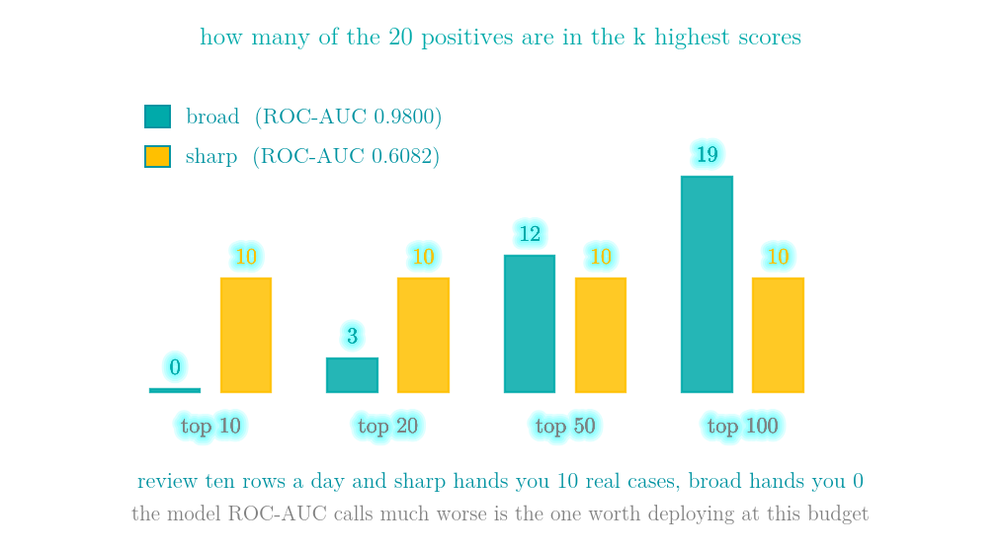
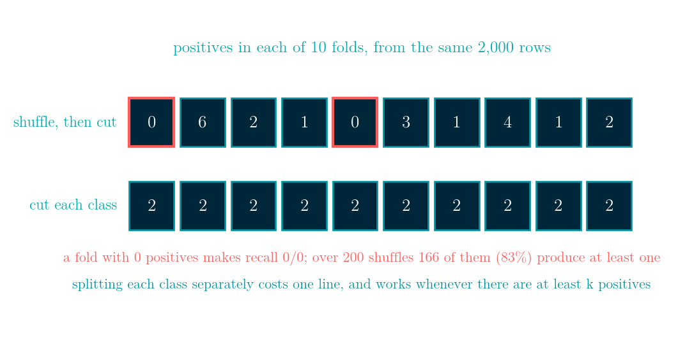
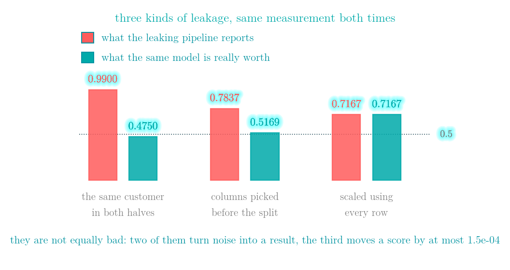
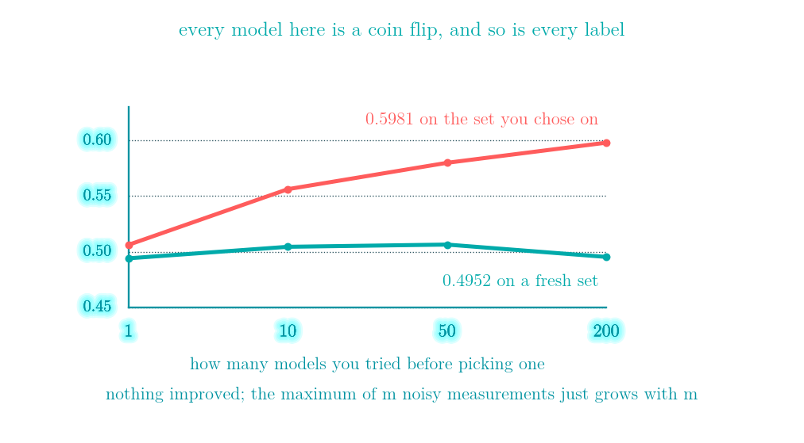

# Evaluation metrics and cross-validation: deciding whether to look at accuracy, F1 or AUC

More details in:
https://medium.com/100-days-of-python

Interactive walkthrough: [demo.html](demo.html) - a single self-contained page
(no build step, works offline, 中文 / English toggle) with eight tabs: it puts a trained
model's confusion matrix next to the one you get by answering the majority class and
lights up each metric in turn, lights up the four denominators on a basket of apples
and oranges, slides a threshold across one fixed set of scores and watches accuracy
fall as the model becomes useful, draws the ROC and precision-recall curves of two
models that rank each other in opposite orders and then counts what is in the top ten,
throws negatives away to show which metrics notice the class balance and which do not,
shuffles 2,000 rows into ten folds and finds two with no positives in them, measures
three kinds of leakage side by side, and walks LeetCode 493 and LeetCode 169 one step
at a time.



I trained a logistic regression on 2,000 rows where 20 are positive, scored it on the rows it had not seen, and asked for its accuracy: **0.9895**. Answering "negative" to all 2,000 rows scores **0.9900**. So the trained model is worse than a constant, and its recall and F1 are both 0.0000.

The same scores give a ROC-AUC of **0.9027**. Ranked by score, the 20 positives sit at places 2, 5, ... 452, 1407 out of 2,000: **7 of them are in the top 20**, and the median rank is **83** — the two middle positives sit at 77 and 89. That is what a ROC-AUC of 0.90 looks like from close up — mostly high, with a long tail. The model did learn. Both numbers are arithmetically correct, and the one that gets reported is the one that is wrong about the model.

Day 47 scored k-means, Day 48 scored decision trees and forests, and both days quoted an accuracy without asking what it was made of. This is the day that asks. Everything below is pure NumPy, and every measured number in it is printed by `evaluation.py` in that folder. It is about one question: when you have one number to put in the report, which number should it be?

## Four counts, and every metric is one ratio of them

A classifier that has already made its decisions produces exactly four numbers. Eight rows, truth `[1, 1, 1, 0, 0, 0, 0, 0]` and guess `[1, 1, 0, 1, 0, 0, 0, 0]`:

```
             guessed 0   guessed 1
really 0             4           1
really 1             1           2
```

`tn = 4`, `fp = 1`, `fn = 1`, `tp = 2`. Every metric on this page is one ratio of those four:

| metric | value | what it divides by |
|---|---|---|
| accuracy | 0.7500 | everything |
| precision | 0.6667 | what we flagged, `tp + fp` |
| recall | 0.6667 | what was really there, `tp + fn` |
| specificity | 0.8000 | the negatives, `tn + fp` |
| F1 | 0.6667 | harmonic mean of precision and recall |
| balanced accuracy | 0.7333 | mean of recall and specificity |
| MCC | 0.4667 | all four counts at once |

Choosing a metric is choosing which of the four counts you are willing to let grow. Accuracy adds `tp` and `tn` together, so when `tn` is 99% of the table, accuracy is mostly a report about `tn`.

## Accuracy, precision, recall — and an apple that makes the difference stick

Four ratios, four different denominators. A basket of **100 pieces of fruit, 10 of them apples**, and an apple detector that puts 8 pieces on the apple side — 6 apples and 2 oranges — leaving the other 92 alone, including the 4 apples it missed.

```
tp 6    fp 2    fn 4    tn 88
```



**Accuracy** is how much of *everything* it got right: `(tp + tn) / 100 = 0.9400`.

**Precision** is how much of the *apple side* really is apple: `tp / (tp + fp) = 6/8 = 0.7500`. The spelling is the mnemonic — preci-**si**-on asks about the **si**de you picked. Its denominator is **what the model said**.

**Recall** is how many of *all the apples* you got back: `tp / (tp + fn) = 6/10 = 0.6000`. Again the spelling — rec-**all** asks about **all** the apples. Its denominator is **what the truth said**. It has a second name, the **true positive rate**, which is the one to remember for the next section but one.

**False positive rate** is the mirror image on the other class: of *all the oranges*, how many did you grab? `fp / (fp + tn) = 2/90 = 0.0222`.

So why keep precision and recall when accuracy already exists? Look at what each denominator is made of. Recall counts apples only. FPR counts oranges only. Precision counts the pieces **you** put on the apple side, so the model decides how big it is. And accuracy counts the whole basket — which the dataset decides and the model cannot change. With 90 oranges in 100 pieces of fruit, most of accuracy is settled before the detector is switched on.

A detector that gives up and calls every piece of fruit an orange scores:

```
accuracy 0.9000   recall 0.0000   precision nan   (0 / 0 - it flagged nothing)
```

0.9000 against the real detector's 0.9400, while finding not a single apple. Precision cannot be inflated the same way — oranges reach its denominator only when the detector actually reaches for them, which is the mistake it is being charged for, and here it reaches for nothing, so precision answers `0 / 0`. Recall cannot be inflated by the majority class either: the 90 oranges never appear in it.

They also pull against each other, but not symmetrically. Raising the threshold moves rows out of the apple side, which can only turn true positives into false negatives — so **recall is monotone**: it can only fall as the cut goes up, and only rise as the cut comes down. **Precision is not.** The next section's table shows it wobbling: 0.3333 at a cut of 0.20, 0.2500 at 0.15, back up to 0.3500 at 0.10, because each new row either lands on an apple or does not. Over 300 random label-and-score sets, precision falls somewhere along the sweep in **all 300**. "Raise the threshold for better precision" is a tendency; only recall comes with a guarantee.

Which one to optimise is a question about costs, not about statistics:

| if this is true | optimise |
|---|---|
| a missed positive costs more than a wasted check | recall |
| a wasted check costs more than a missed positive | precision |
| the two costs are similar and the classes are balanced | accuracy |
| you need one number and the classes are not balanced | F1 |

Google's Machine Learning Crash Course has a [chapter on exactly these definitions](https://developers.google.com/machine-learning/crash-course/classification/accuracy-precision-recall) with the same shape of guidance table, and a [companion chapter on thresholds and the confusion matrix](https://developers.google.com/machine-learning/crash-course/classification/thresholding); both are worth twenty minutes.

## Silent failure #1: accuracy measures the size of the majority class

Back to the 2,000 rows. Predict the majority class everywhere:

- accuracy **0.9900**
- recall **0.0000**
- precision **nan** — it is `0 / 0`, because we flagged nothing
- MCC **nan** — a whole column of zeros makes its denominator 0

Precision and MCC refuse to answer, and the refusal is the useful part: they noticed there was nothing to score. Accuracy answered cheerfully.

Finding that constant is LeetCode 169, further down. On this table it is `0`, it covers 0.9900 of the rows, and that is the number any accuracy you report has to beat before it has said anything at all. Quote accuracy on imbalanced data and you are mostly quoting the class balance.

## The threshold is a number you chose, even if you never typed it

The model does not output a class. It outputs a score, and the score becomes a decision only when someone picks a cut. Here are nine cuts applied to the same scores, with nothing retrained in between:

| cut | flagged | accuracy | precision | recall | F1 |
|---|---|---|---|---|---|
| 0.50 | 1 | 0.9895 | 0.0000 | 0.0000 | 0.0000 |
| 0.30 | 1 | 0.9895 | 0.0000 | 0.0000 | 0.0000 |
| 0.20 | 3 | 0.9895 | 0.3333 | 0.0500 | 0.0870 |
| 0.15 | 4 | 0.9890 | 0.2500 | 0.0500 | 0.0833 |
| **0.10** | **20** | **0.9870** | **0.3500** | **0.3500** | **0.3500** |
| 0.05 | 88 | 0.9560 | 0.1136 | 0.5000 | 0.1852 |
| 0.03 | 220 | 0.8940 | 0.0636 | 0.7000 | 0.1167 |
| 0.02 | 413 | 0.7995 | 0.0387 | 0.8000 | 0.0739 |
| 0.01 | 845 | 0.5865 | 0.0225 | 0.9500 | 0.0439 |



The highest score the model gave any row was **0.6481**, so a cut at 0.5 was always going to flag almost nothing — and 0.5 is a library default, not a decision anyone made about this data.

Look at the accuracy column. It is **highest when the model catches nothing**, 0.9870 where F1 peaks, and 0.5865 where recall reaches 0.9500. Accuracy goes *down* as the model becomes useful, because being useful means spending true negatives to buy true positives.

The real decision is not which metric is best. It is how many rows a day someone can review. That number picks the cut, and the cut picks the metrics.

## Silent failure #2: the same F1, half the cases caught

F1 is one number carrying two independent quantities, so it has to throw one of them away. Two ways of flagging rows in a table of 2,000 with 100 positives:

| | flagged | caught | precision | recall | F1 | accuracy |
|---|---|---|---|---|---|---|
| wide net | 300 | 90 | 0.3000 | 0.9000 | **0.4500** | 0.8900 |
| narrow net | 100 | 45 | 0.4500 | 0.4500 | **0.4500** | 0.9450 |

Identical F1. The wide net catches 90 of the 100 and wastes 210 reviews; the narrow net catches 45 and wastes 55. If the 100 are frauds, those are not two versions of the same system — one of them lets 55 frauds through.

And the narrow net, the one that misses more than half of them, has the **higher accuracy**: 0.9450 against 0.8900. Report both numbers, or report the one your job depends on, but do not report their average and call it a summary.

## Silent failure #3: ROC-AUC and PR-AUC rank two models in opposite orders

Two models scoring the same 2,000 rows, 20 of which are positive:

- **broad** separates the whole population well, but parks 135 negatives above its weakest positive.
- **sharp** ranks half the positives above every negative, and buries the other half low — those ten outrank between **17% and 26%** of the negatives, **22%** on average. That is where its ROC-AUC of 0.6082 comes from: `(10 x 1.0000 + 10 x 0.2163) / 20 = 0.6082`.

| | ROC-AUC | average precision | top 10 | top 20 | top 50 | top 100 |
|---|---|---|---|---|---|---|
| broad | **0.9800** | 0.2124 | 0 | 3 | 12 | 19 |
| sharp | 0.6082 | **0.5049** | 10 | 10 | 10 | 10 |



ROC-AUC prefers broad by a wide margin. Average precision prefers sharp by a wide margin. Neither is miscomputed.

The disagreement is one denominator. To catch all 20 positives, broad has to come down to a score of 0.5897, and **135 negatives sit above that line**.

The ROC x-axis divides those 135 by all **1,980** negatives, so they move it by `135/1980 = 0.0682` — under seven percent of the way across, with the curve already at the top. The same 135 are `135/155 = 0.8710` of everything you flagged to get there: **87% of the review queue is wrong**, and precision says so while the ROC curve does not. One set of mistakes, two denominators, and only one of them is the size of your working day.



The last four columns settle it. If an analyst reviews ten rows a day, **sharp hands them 10 real cases and broad hands them 0**. If the budget is a hundred rows a day, broad gives 19 and sharp still gives 10. The budget decides which metric to read; reading the metric first picks the wrong model.

Rule of thumb: ROC-AUC when both classes matter and are comparable in size, average precision when the positives are rare and the cost is the review queue.

## Why the ROC axes are those two numbers and not any others

The ROC curve plots **false positive rate** across and **recall** up. Those two were not chosen for symmetry. Look at the denominators from the apple basket:

- recall = `tp / (tp + fn)` — counts only rows that really are **positive**
- FPR = `fp / (fp + tn)` — counts only rows that really are **negative**

Neither denominator mixes the classes, so **neither axis knows how many of each class there are**. Going up is the benefit — more of the real positives caught. Going right is the cost — more of the real negatives falsely flagged. Each threshold gives you one point; sweeping every threshold draws the curve; the diagonal is what guessing at random does, because random guessing catches the same fraction of both classes.

That independence is measurable. Keep all 20 positives of the broad model and throw negatives away at random, so the model and its ranking never change and only the rarity of the positives does. Each row is the mean over 50 draws:

| negatives kept | positive rate | ROC-AUC | average precision |
|---|---|---|---|
| 1,980 | 0.0100 | 0.9800 | 0.2124 |
| 495 | 0.0388 | 0.9807 | 0.5331 |
| 124 | 0.1389 | 0.9797 | 0.8142 |
| 40 | 0.3333 | 0.9811 | 0.9377 |

The positives go from 1% of the rows to 33%. Over that range the mean ROC-AUC moves by **0.00146** and the mean average precision moves by **0.72529** — **496 times further**. Precision has `fp` and `tp` in the same denominator, so it feels the balance; both ROC axes are normalised inside one class, so they do not.

"Nearly invariant" is the honest phrase, and the word *nearly* is doing work. Those rows are means over 50 draws; the 50 individual draws at 40 negatives run from **0.9400 to 1.0000**. With only 40 negatives left, which 40 you kept matters a lot. What does not drift is the average.

That near-invariance is simultaneously the reason to use ROC-AUC and the reason not to. It is what you want when your test set was sampled with a different class balance from production — the number transfers. It is exactly what you do not want when the rarity of the positives *is* the problem, because then the number stays high while the review queue fills with false positives. That is the whole of the previous section in one sentence.

## AUC is a pair count, which is why LeetCode 493 is on this page

ROC-AUC is not an area you have to integrate. It is exactly this: *pick one positive and one negative at random — how often does the positive score higher?*, counting a tie as half.

With 20 positives and 1,980 negatives that is **39,600 pairs**. Written out as a loop over every pair, and computed from the sorted ranks instead:

```
the definition, every pair:  0.9800000000
from the ranks, O(n log n):  0.9800000000
difference:                  0.00e+00
```

Sorting once and reading off the ranks gives the identical number without building the pairs. That matters at the size where it matters: at 10,000 rows the pair count is `100 x 9,900 = 990,000` with 1% positives, and `5,000 x 5,000 = 25,000,000` once the classes are balanced. LeetCode 493 allows 50,000 elements, which is `1,249,975,000` pairs.

Ties are not a detail. A model that gives every row the same score wins no pair and loses none, so its AUC is exactly **0.5000**. Score on a coarse grid — rounded probabilities, integer buckets, a tree with few leaves — and a large share of your pairs become ties that silently count half.

## Silent failure #4: plain k-fold hands you a fold with no positives

Cross-validation starts by cutting the rows into k blocks. The usual way shuffles the row numbers and splits them, and **it never looks at the labels**. The same 2,000 rows with 20 positives, cut into 10 folds:

```
shuffle then cut   positives per fold [0, 6, 2, 1, 0, 3, 1, 4, 1, 2]
cut each class     positives per fold [2, 2, 2, 2, 2, 2, 2, 2, 2, 2]
```



Two folds have nothing to score. Recall on them is `0 / 0`. `np.mean` turns the whole cross-validation score into `nan`; `np.nanmean` quietly drops the fold from the average. Neither raises.

This is not bad luck. Over 200 different shuffles, **166 of them (83%)** produce at least one fold with zero positives, and 258 of the 2,000 folds have no positives in them. Twenty positives over ten folds averages two per fold, and two is easily zero.

Stratifying means doing the same cut once per class. It costs one line. It can change the fold sizes a little, because each class is split separately: 103 rows with 9 positives into 5 folds gives sizes `[21, 21, 21, 21, 19]` instead of `[21, 21, 21, 20, 20]`, one row per class rather than one row overall.

## Silent failure #5: averaging the folds is not pooling the predictions

Five folds, the same out-of-fold scores, cut at 0.10. Two ways to turn five folds into one number:

```
per-fold precision  [1.0, 0.1667, 0.3333, 0.1429, 1.0]   mean 0.5286
pooled precision                                               0.3500
```

A gap of **+0.1786**, and it comes from two folds that flagged very few rows and got them all right. The five folds flagged `[2, 6, 3, 7, 2]` rows, and the two that flagged the fewest scored a precision of 1.0000. The mean treats a fold that flagged 2 rows as equal to one that flagged 7.

Precision, recall and F1 are ratios, and the mean of ratios is not the ratio of the totals. Pool the out-of-fold predictions and compute the metric once. Keep the per-fold numbers for the spread, not for the headline.

## Silent failure #6: three kinds of leakage, measured and ranked

Leakage is information about the held-out rows reaching the model. Here are three kinds, each measured twice with the same procedure.

**(a) The same customer on both sides of the split.** 150 customers, 4 rows each, and the label belongs to the customer. The classifier copies the label of the nearest training row — Day 47's k = 1 nearest neighbour, which has no parameters at all, so anything it scores above chance it found by recognising a row rather than by learning.

```
random 5-fold   accuracy 0.9900
group 5-fold    accuracy 0.4750
```

A 0.9900 that is really 0.4750. The model learned nothing; it recognised the three siblings of each test row sitting in the training set.

**(b) Choosing the columns before splitting.** 60 rows, 400 columns of gaussian noise, a coin-flip label. There is nothing in this table to find.

```
pick the 5 best columns on all 60 rows, then cross-validate:  0.7837
pick them inside each fold, from that fold's training rows:   0.5169
```

Both are means over 20 independently drawn noise tables. The honest number is 0.5169 against a true 0.5. The selection saw every label, including the ones it was about to be tested on, so it found the columns that happen to match the test rows too. A cross-validation that starts *after* the selection cannot undo it.

**(c) Standardising before splitting.** A different 60 rows this time — 8 columns with real signal in them, and logistic regression rather than a centroid. The only thing that changes between the two numbers is where the column means and standard deviations were fitted.

```
inside the fold  accuracy 0.7167
over all rows    accuracy 0.7167
largest difference between any two scores: 1.50e-04
```

Almost nothing, and saying so is the point: these three are not equally bad. A mean and a standard deviation are two summaries of a whole column, so the 11 to 13 rows a fifth holds out barely move them while the rows are interchangeable. It stops being harmless when the test rows are a later period or a different population — then the global mean is a fact about the future. The first two are the ones that turn noise into a result.



## Regularisation: how lambda gets chosen without spending the test set

120 training rows, 40 columns, only 4 of which affect the label. A larger L2 penalty makes the weights earn their size — it is the same `2 * lam * w` term added to the gradient that Day 45 and Day 46 built:

| lambda | train | 5-fold CV | test (4,000 rows) | sum of absolute weights |
|---|---|---|---|---|
| 0.000 | 0.9917 | 0.7500 | 0.7895 | 33.87 |
| 0.001 | 0.9750 | 0.7500 | 0.7917 | 24.29 |
| **0.003** | 0.9500 | 0.7500 | **0.7955** | 16.53 |
| 0.010 | 0.9250 | 0.7333 | 0.7937 | 10.02 |
| 0.030 | 0.9083 | 0.7333 | 0.7833 | 6.53 |
| 0.100 | 0.8833 | 0.7333 | 0.7715 | 3.83 |
| 0.300 | 0.8667 | 0.7333 | 0.7565 | 1.99 |

Unpenalised, the model scores 0.9917 on the rows it trained on and 0.7895 on fresh rows — a gap of **0.2022** that no amount of staring at the training score would reveal. That gap is what cross-validation exists to measure.

Cross-validation never sees those 4,000 test rows, and it scores 0.7500 at three different lambdas. It cannot separate them: 120 rows split five ways means the CV accuracy can only move in steps of `1/120 = 0.0083`. The resolution of your validation set limits which settings you are allowed to distinguish between.

Breaking that tie toward the strongest penalty picks lambda 0.003, which turns out to be the best of the seven on the test rows. Taking the first tied value instead gives lambda 0.0 and 0.7895. The rule is worth having because among settings you cannot tell apart, the one that fits least is the one least likely to be fitting the validation folds.

Either way, the knob was chosen without touching the test set. Which matters because of the next section.

## Silent failure #7: the set you chose on is no longer a test set

Score `m` models on one labelled set, keep the best, then score that same model on a second set drawn the same way. Every model below is a coin flip and so is every label, so the true accuracy of all of them is 0.5:

| models tried | best, on the set you chose on | the same model, fresh set |
|---|---|---|
| 1 | 0.5061 | 0.4940 |
| 10 | 0.5563 | 0.5044 |
| 50 | 0.5800 | 0.5064 |
| 200 | **0.5981** | 0.4952 |



Nothing was learned and nothing improved. The first column rises because you are reporting a **maximum over m noisy measurements**, and the maximum of noise grows with m.

Every hyper-parameter you sweep, every threshold you tune and every architecture you try on the same held-out set adds to m. The fix is the split you already have: choose on the validation folds, and look at the test set once, at the end, after you have stopped choosing.

## LeetCode 493 - Reverse Pairs

**The task.** Given an array of integers, count the pairs of positions `(i, j)` where `i` comes before `j` and the earlier number is more than twice the later one — `nums[i] > 2 * nums[j]`.

**Input / output.** A list of integers. Return a single integer, the number of such pairs.

**Example.** `nums = [1, 3, 2, 3, 1]` gives **2**. Walking the pairs: position 1 holds 3 and position 4 holds 1, and `3 > 2 * 1`, so that pair counts. Position 3 also holds 3, and it is also before position 4, so that is the second. Position 2 holds 2, and `2 > 2 * 1` is false, so it does not count. A second example, `nums = [2, 4, 3, 5, 1]`, gives **3**: the 4, the 3 and the 5 are each more than twice the final 1.

**Constraints.** `1 <= nums.length <= 5 * 10^4` and `-2^31 <= nums[i] <= 2^31 - 1`. The length is the constraint that chooses the algorithm: 50,000 elements means 1,249,975,000 pairs, so anything that looks at each pair is out. The value range is the second trap — in a language with 32-bit integers, `2 * nums[j]` can overflow, which is why the usual advice is to compare with `nums[i] / 2.0` or to widen the type. Python integers do not overflow, so this one is free here and is not free in an interview in C++ or Java.

**The move.** Sort the two halves, then count across them before merging. Once both halves are sorted, if the current left value exceeds `2 * right[j]`, then everything before `j` on the right also qualifies — one comparison settles a whole block. And because the left values are themselves increasing, `j` never goes backwards: it crosses the right half once per merge, not once per element.

**The trap.** Counting *during* the merge looks like free work, and it is wrong. The merge advances on `left[i] <= right[j]` while the pairs need `left[i] > 2 * right[j]` — two different orders, so the pointer stops in the wrong place. I implemented that version and compared it to brute force on 2,000 random arrays: it disagrees **1,051 times (52.5%)**, and it overcounts in **0** of them — every disagreement is a count that is too low. The first one is `[5, 0, -10, -8, -19, -17, -20, -13]`, where it says 23 and the answer is 28. Count in one pass, merge in the next.

```python
class Solution:
    def reversePairs(self, nums: list[int]) -> int:
        def sort_count(a):
            if len(a) < 2:
                return a, 0
            mid = len(a) // 2
            left, cl = sort_count(a[:mid])
            right, cr = sort_count(a[mid:])
            count = cl + cr
            j = 0
            for v in left:                 # both halves are sorted,
                while j < len(right) and v > 2 * right[j]:
                    j += 1                 # so j only moves forward
                count += j                 # a whole block at once
            merged, i, j2 = [], 0, 0
            while i < len(left) and j2 < len(right):
                if left[i] <= right[j2]:
                    merged.append(left[i]); i += 1
                else:
                    merged.append(right[j2]); j2 += 1
            merged.extend(left[i:]); merged.extend(right[j2:])
            return merged, count
        return sort_count(list(nums))[1]
```

[leetcode.com/problems/reverse-pairs](https://leetcode.com/problems/reverse-pairs/)

## LeetCode 169 - Majority Element

**The task.** Given an array, return the value that appears more than `n / 2` times.

**Input / output.** A list of integers. Return the single value that holds the majority.

**Example.** `nums = [2, 2, 1, 1, 1, 2, 2]` gives **2**. There are seven elements, so a majority needs at least four; 2 appears four times and 1 appears three, so 2 is the answer. The shorter `nums = [3, 2, 3]` gives **3** — two out of three.

**Constraints.** `1 <= n <= 5 * 10^4` and `-10^9 <= nums[i] <= 10^9`, and — the one that changes everything — **the majority element always exists**. That promise is what lets you skip verification. The follow-up asks for `O(n)` time and `O(1)` space, which rules out both sorting and a hash map of counts.

**The move.** Boyer-Moore voting: keep one candidate and one count. A value equal to the candidate adds to the count, anything else subtracts, and when the count hits zero the next value becomes the candidate. A value holding more than half the array cannot be cancelled away, however the other values are arranged, so whatever survives is the answer. One pass, one integer of memory.

**Where it connects.** This is the baseline from the top of the article. On the 2,000-row table it answers `0`, which is right 0.9900 of the time — and any accuracy you report has to beat that before it means anything.

**Without the promise.** Remove the guarantee and the algorithm still returns something. On `[1, 2, 3]` it returns **3**, which appears once in three rows. A second pass that counts the candidate turns that into "there is no majority". It returns a well-formed number either way and never raises — the same shape as every failure in this article.

```python
class Solution:
    def majorityElement(self, nums: list[int]) -> int:
        count, candidate = 0, None
        for v in nums:
            if count == 0:
                candidate = v
            count += 1 if v == candidate else -1
        return candidate
```

[leetcode.com/problems/majority-element](https://leetcode.com/problems/majority-element/)

## Complexity

| Operation | Time | Space |
|---|---|---|
| confusion matrix and every ratio from it | O(n) | O(1) |
| ROC or PR curve, and the area under it | O(n log n) | O(n) |
| ROC-AUC from the pair definition | O(P x N) | O(P x N) |
| ROC-AUC from the ranks | O(n log n) | O(n) |
| k-fold cross-validation | k x (cost of one fit) | O(n) |
| LeetCode 493, merge sort counting | O(n log n) | O(n) |
| LeetCode 169, Boyer-Moore | O(n) | O(1) |

## References

- Google Machine Learning Crash Course, [*Classification: Accuracy, recall, precision and related metrics*](https://developers.google.com/machine-learning/crash-course/classification/accuracy-precision-recall) and [*Thresholds and the confusion matrix*](https://developers.google.com/machine-learning/crash-course/classification/thresholding) and [*ROC and AUC*](https://developers.google.com/machine-learning/crash-course/classification/roc-and-auc) - the clearest short treatment of the definitions in this article
- Hanley and McNeil, *The meaning and use of the area under a receiver operating characteristic (ROC) curve*, Radiology 1982 - where AUC is shown to equal the Mann-Whitney U statistic, i.e. the pair count
- Davis and Goadrich, [*The Relationship Between Precision-Recall and ROC Curves*](https://www.biostat.wisc.edu/~page/rocpr.pdf), ICML 2006 - why the two curves can disagree, and why interpolating a PR curve linearly is wrong
- Saito and Rehmsmeier, [*The Precision-Recall Plot Is More Informative than the ROC Plot When Evaluating Binary Classifiers on Imbalanced Datasets*](https://journals.plos.org/plosone/article?id=10.1371/journal.pone.0118432), PLOS ONE 2015
- Chicco and Jurman, [*The advantages of the Matthews correlation coefficient (MCC) over F1 score and accuracy*](https://bmcgenomics.biomedcentral.com/articles/10.1186/s12864-019-6413-7), BMC Genomics 2020
- Varma and Simon, [*Bias in error estimation when using cross-validation for model selection*](https://bmcbioinformatics.biomedcentral.com/articles/10.1186/1471-2105-7-91), BMC Bioinformatics 2006 - the feature-selection leak, measured, and nested cross-validation as the fix
- Cawley and Talbot, [*On Over-fitting in Model Selection and Subsequent Selection Bias in Performance Evaluation*](https://jmlr.org/papers/v11/cawley10a.html), JMLR 2010 - choosing on a set and then reporting from it
- Kaufman, Rosset and Perlich, *Leakage in Data Mining: Formulation, Detection, and Avoidance*, KDD 2011
- [scikit-learn: metrics and scoring](https://scikit-learn.org/stable/modules/model_evaluation.html) and [cross-validation](https://scikit-learn.org/stable/modules/cross_validation.html)
