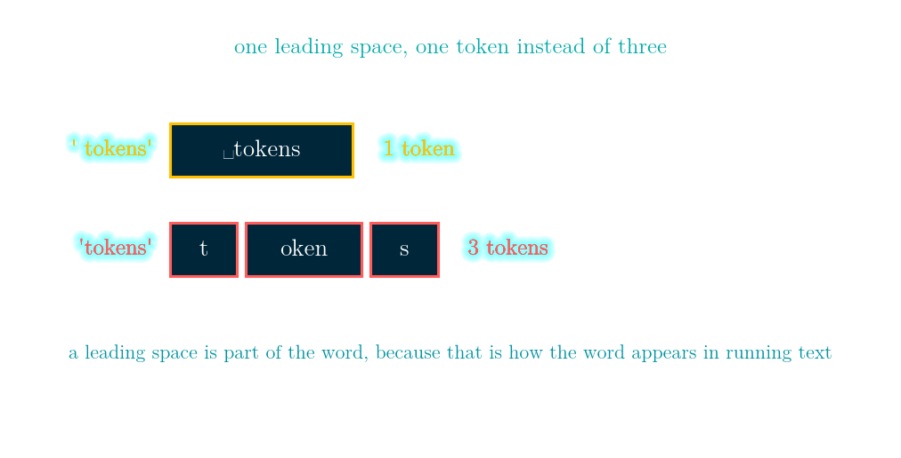
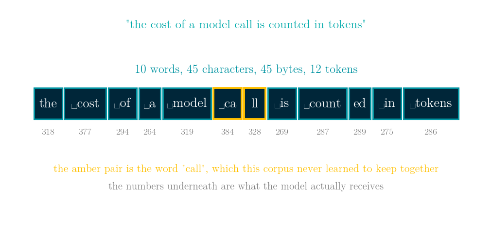
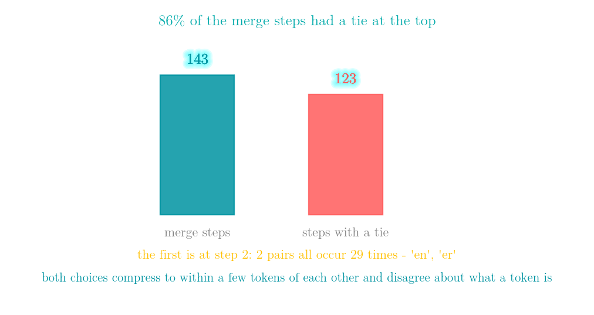
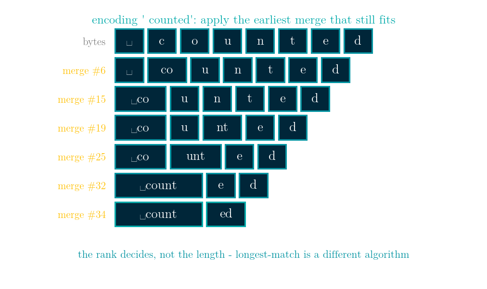
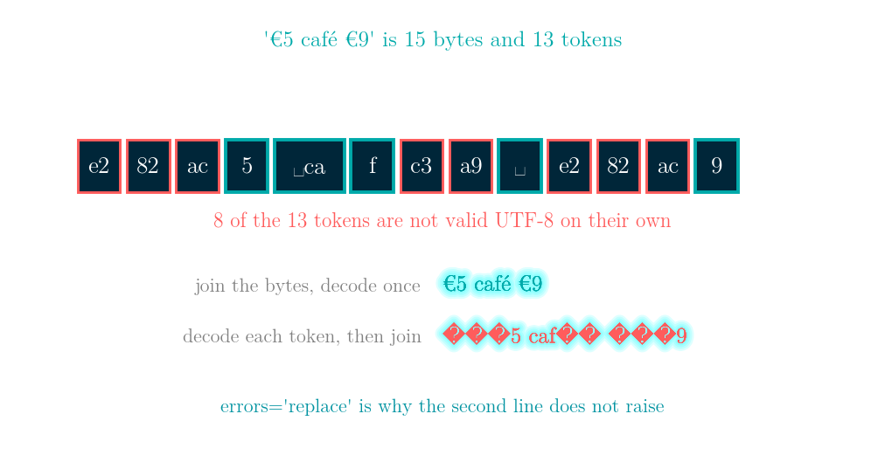
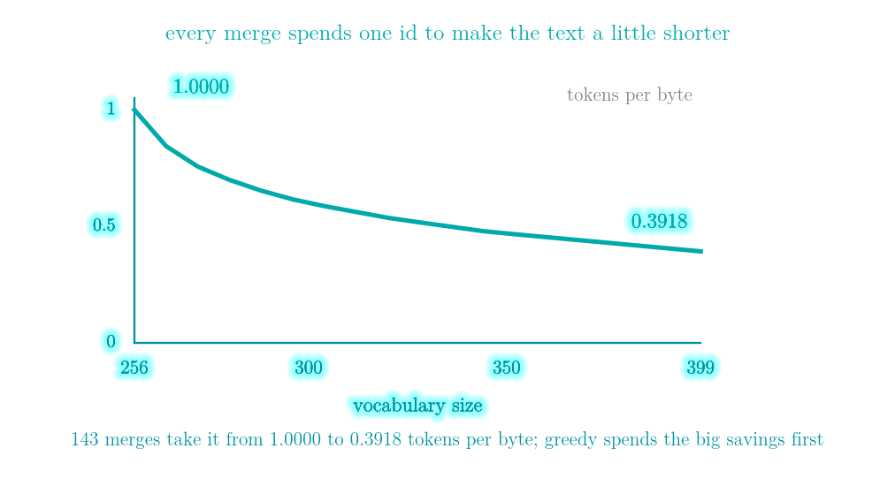

# Building a BPE tokenizer from scratch: turning a sentence into the integers a model actually sees

More details in:
https://medium.com/100-days-of-python

Interactive walkthrough: [demo.html](demo.html) - a single self-contained page
(no build step, works offline, 中文 / English toggle) with seven tabs: it prices the
same five letters with and without a leading space, breaks one sentence into the
twelve integers a model actually receives, runs the training loop one merge at a
time, counts how often the most frequent pair is tied, replays the merges that turn
eight bytes into two tokens, splits a Chinese character across a token boundary and
decodes it both the right way and the wrong way, and walks LeetCode 692 and
LeetCode 394 step by step.



The word `tokens` costs **three tokens**. The word ` tokens`, with a space in front of it, costs **one**.

Same five letters. The difference is a space, and the reason is that a tokenizer learned ` tokens` as a single symbol because that is how the word appears in running text, while bare `tokens` was never frequent enough to be worth an id.

A language model never sees your text. It sees a list of integers, and the thing that produced that list made a long series of choices you did not make: where words break, whether a leading space belongs to the next word, how a number is cut up, and how many of those integers your sentence costs. This is the one part of the pipeline that is not learned by gradient descent — it is learned by counting.

Everything below is pure Python with no dependencies — about a hundred lines of tokenizer, plus the tests — and `python bpe.py` prints every measured number in this article.

## One sentence has four different lengths

```
"the cost of a model call is counted in tokens"
10 words, 45 characters, 45 bytes, 12 tokens
the | cost| of| a| model| ca|ll| is| count|ed| in| tokens
```



None of those four numbers can be computed from another. Billing is the last one. The context window measures the last one. And the only thing that can produce the last one is the tokenizer itself.

Look at `call`. It comes apart into ` ca` and `ll`, because this corpus never made ` call` frequent enough to merge. Nothing is broken — but the model will never see the word *call*. It sees two fragments that mean other things in other places.

## Everything is bytes first

A byte-level tokenizer starts with all 256 possible bytes already in the vocabulary. That makes it total: every possible input is representable and there is no unknown-token problem. The cost moves somewhere else.

```
   'a'  1 byte(s)  [97]           -> 1 token
   'é'  2 byte(s)  [195, 169]     -> 2 tokens
   '模'  3 byte(s)  [230, 168, 161] -> 3 tokens
  '🙂'  4 byte(s)  [240, 159, 153, 130] -> 4 tokens
```

On this tokenizer, `'模型看到的從來不是你的文字'` is 13 characters, 39 bytes and **32 tokens**. The English `'what the model sees is never your text'` is 38 characters, 38 bytes and **17 tokens**. Roughly the same sentence; the Chinese one costs 1.9 times as many tokens, and per character it is 2.46 tokens against 0.45 — **5.5 times more**. That is UTF-8 and the training corpus, not the model.

## Training is three lines

Count every adjacent pair in the corpus. Merge the most frequent one into a new symbol. Repeat.

```
  #         pair   count   new token
  1    (32, 116)      41   ' t'
  2   (101, 110)      29   'en'
  3   (101, 114)      29   'er'
  4    (32, 105)      26   ' i'
  5   (256, 104)      21   ' th'
  6    (99, 111)      20   'co'
  7   (111, 107)      17   'ok'
  8   (262, 257)      16   'oken'
```

Round five merges `' t'` — itself the output of round one — with `h`. Round eight merges two already-merged symbols, `ok` and `en`, into `oken`. Merges stack on merges, and that is how tokens grow from bytes into whole words.

On this corpus it stops after **143 merges** at a vocabulary of 399, because no pair occurs twice any more: merging something that appears once grows the vocabulary and shortens nothing.

The merges are kept **in the order they were made**, and that order is the tokenizer. Encoding is nothing but replaying it.

## Silent failure #1: the most frequent pair is usually not unique

Look at rounds two and three above. `'en'` and `'er'` both occur 29 times. The algorithm says "merge the most frequent pair" and there are two of them.

Of the 143 merge steps on this corpus, **123 of them — 86% — had a tie at the top.**



Either choice is defensible. But after you take one, the counts around that pair change and the two tokenizers diverge from there. Re-running this training with other tie-breaks gives 141 to 143 merges and 500 to 504 tokens: they compress the corpus to within a few tokens of each other and they disagree about what a token is.

So the tie-break is not an implementation detail. It is part of the specification:

```python
best = max(counts.items(), key=lambda kv: (kv[1], -kv[0][0], -kv[0][1]))[0]
```

The first field is the count; the other two are the tie-break. Without them, `max` over a dictionary follows insertion order, and your vocabulary becomes a function of which Python you ran it on. Picking the k most frequent things with a written-down tie-break is LeetCode 692, below.

## Encoding replays the merges by rank, not by longest match

```
' counted' starts as 8 bytes
after merge #  6 ('c' + 'o'):   ' ' 'co' 'u' 'n' 't' 'e' 'd'
after merge # 15 (' ' + 'co'):  ' co' 'u' 'n' 't' 'e' 'd'
after merge # 19 ('n' + 't'):   ' co' 'u' 'nt' 'e' 'd'
after merge # 25 ('u' + 'nt'):  ' co' 'unt' 'e' 'd'
after merge # 32 (' co' + 'unt'): ' count' 'e' 'd'
after merge # 34 ('e' + 'd'):   ' count' 'ed'
```



At every step it applies the available merge with the **smallest rank** — the one learned earliest — not the longest match in the vocabulary.

This matters more than it looks. Hand someone the table of token strings and nothing else, and they can write a longest-match tokenizer that produces *different* output on the same vocabulary. That is why what ships with a model is the ordered merge list, not just the strings.

## Silent failure #2: decoding one token at a time

`'模型看到的'` is 15 bytes and 13 tokens, and **12 of those 13 tokens are not valid UTF-8 on their own** — three-byte characters routinely get split across token boundaries.

```
join the bytes, then decode once:   '模型看到的'
decode each token, then join:       '������������的'
```



*The figure shows `'€5 café €9'` rather than the Chinese string — same phenomenon, with characters the figure's font can actually draw. There it is 15 bytes, 13 tokens and 8 of them invalid alone.*

The second line is what `[vocab[i].decode(errors='replace') for i in ids]` gives you, and `errors='replace'` is precisely why it does not raise. Streaming output token by token is where people meet this: the fix is to hold back bytes that do not yet form a complete character, not to replace them.

The property most worth testing is the round trip — encode, decode, compare bytes. `check()` round-trips twelve different strings including the empty string, a lone space, emoji and 500 repeated characters, and then checks five more things: contiguous ids, every merged token equal to the concatenation of the two it came from, and the same merge list on a second run.

## Silent failure #3: the regex decides what a token may be

Before any counting happens, the text is cut into chunks that merges may never cross:

```python
PRETOKEN = re.compile(r"""'(?:[sdmt]|ll|ve|re)| ?[^\W\d_]+| ?\d{1,3}| ?[^\s\w]+|\s+""")
```

Drop that step — treat the whole corpus as one chunk — and here is what changes:

| | merges | tokens | tokens/byte | tokens with a space inside |
|---|---|---|---|---|
| one chunk, no regex | 144 | 502 | 0.3934 | 12 |
| pre-tokenised | 143 | 500 | 0.3918 | 0 |

Compression is almost identical. What changes is **what a token is**: without the regex, 12 of the 144 merges produce tokens with a space in the middle, such as `' is not '`, `'t in'`, `'t is '` and `' the tokeniz'`.

Tokens like those make a word depend on what follows it, so the same word gets different ids in different sentences and the model has to learn it twice. The regex is not an optimisation; it is a constraint. The two rules doing most of the work are *a leading space joins the next word* and *digits are cut into groups of at most three*:

```
     '7' -> 1 token   ['7']
   '128' -> 2 tokens  ['1', '28']
  '1280' -> 3 tokens  ['1', '28', '0']
'128000' -> 3 tokens  ['1', '28', '000']
```

That last line is why models are strange at arithmetic. `1280` and `128000` are not stored as numbers; they are stored as a handful of fragments that happen to look similar.

## What the vocabulary size buys you

| vocab | merges | tokens | tokens/byte |
|---|---|---|---|
| 256 | 0 | 1276 | 1.0000 |
| 300 | 44 | 767 | 0.6011 |
| 350 | 94 | 598 | 0.4687 |
| 399 | 143 | 500 | 0.3918 |



At 256 there are no merges at all and one token is one byte. 143 merges later the same text is **61% shorter**. The curve flattens because this is a greedy algorithm taking the biggest saving available at each step, so the savings can only shrink. Real tokenizers run the same loop to 50,000–200,000 tokens on hundreds of gigabytes; the shape is identical and the flat part is much further out.

## The same greedy move as Day 38, from the other end of the table

Day 38 built Huffman codes by repeatedly merging the two **least** frequent symbols. BPE repeatedly merges the **most** frequent pair. Both are greedy, both merge, and they are solving different problems.

- Huffman on these bytes: **4.6928 bits per byte**, so the corpus fits in 749 bytes instead of 1,276. The alphabet is unchanged; the codes got shorter.
- BPE with 143 merges: **0.3918 tokens per byte**, so 1,276 bytes become 500 tokens. The sequence got shorter; the alphabet grew to 399.

Huffman optimises bits on the wire for a fixed alphabet. BPE optimises sequence length for a model whose cost is per token, and it is allowed to invent new symbols to do it. Neither can do the other's job: Huffman codes are not integers a model can embed, and BPE tokens are not shorter to transmit.

## LeetCode 692 - Top K Frequent Words

**The task.** Given a list of words, return the `k` most frequent ones, most frequent first. When two words occur the same number of times, the alphabetically smaller one comes first.

**Input / output.** A list of strings and an integer `k`. Return a list of `k` strings in the required order.

**Example.** `["i", "love", "leetcode", "i", "love", "coding"]` with `k = 2` returns `["i", "love"]`. Both words occur twice, so the tie decides: `"i"` sorts before `"love"`. A second example, `["the", "day", "is", "sunny", "the", "the", "the", "sunny", "is", "is"]` with `k = 4`, returns `["the", "is", "sunny", "day"]` — `"the"` has 4, `"is"` has 3, then `"sunny"` and `"day"` are separated by count, not by the tie-break.

**Constraints.** `1 <= words.length <= 500`, each word is 1 to 10 lowercase letters, and `k` is between 1 and the number of distinct words. The follow-up asks for `O(n log k)` time and `O(n)` space, which is what rules out sorting everything and forces the heap.

**The move.** One sort key carries both rules: `(-count[w], w)` — falling on the count, rising on the word.

**The trap.** The heap version is where this gets interesting, and it is the version you want when the vocabulary is large. A size-`k` min-heap has to evict the **worst** candidate, which here means the least frequent and, among equals, the alphabetically **last**. So the count has to compare forwards while the string compares backwards. A tuple of `(count, word)` cannot express that — you need a wrapper class with an inverted `__lt__`, or a negated count with a max-heap.

This is the BPE merge loop as an interview question: find the most frequent thing, break ties by a rule you wrote down, repeat.

```python
class Solution:
    def topKFrequent(self, words: list[str], k: int) -> list[str]:
        count = Counter(words)
        # one key, both rules: falling on the count, rising on the word
        return sorted(count, key=lambda w: (-count[w], w))[:k]
```

[leetcode.com/problems/top-k-frequent-words](https://leetcode.com/problems/top-k-frequent-words/)

## LeetCode 394 - Decode String

**The task.** Expand an encoded string where `k[substring]` means the substring repeated `k` times. The brackets can nest.

**Input / output.** A string. Return the expanded string.

**Example.** `"3[a]2[bc]"` becomes `"aaabcbc"`. `"3[a2[c]]"` becomes `"accaccacc"`: the inner `2[c]` expands to `cc`, making the body `acc`, and the outer `3[...]` repeats that three times. `"2[abc]3[cd]ef"` becomes `"abcabccdcdcdef"` — note that `ef` lands *after* the expansions, not inside them.

**Constraints.** `1 <= s.length <= 30`, the digits give a repeat count between 1 and 300, and the input is always valid — no stray brackets, and no digits inside the square brackets other than as a repeat count. The guarantee of validity is what lets you skip all the error handling and write the loop in seven lines.

**The move.** One stack, and two things pushed at every opening bracket: the text built so far, and the repeat count waiting for the text still to come. Nothing is expanded until the closing bracket arrives, which is what makes the nested case work without recursion.

**Two details the examples are chosen to expose.** Counts can have more than one digit, so it has to be `num = num * 10 + int(ch)` and not `num = int(ch)` — otherwise `12[a]` repeats twice. And after a bracket closes, characters keep accumulating onto the *same* buffer, which is why the `ef` in the third example comes out in the right place.

It is the shape of a decoder: a flat sequence on one side, a longer string on the other, and the expansion driven entirely by a table. A tokenizer's decode step is the same move without the nesting.

```python
class Solution:
    def decodeString(self, s: str) -> str:
        stack, cur, num = [], '', 0
        for ch in s:
            if ch.isdigit():
                num = num * 10 + int(ch)       # counts can be multi-digit
            elif ch == '[':
                stack.append((cur, num))
                cur, num = '', 0
            elif ch == ']':
                prev, times = stack.pop()
                cur = prev + cur * times
            else:
                cur += ch
        return cur
```

[leetcode.com/problems/decode-string](https://leetcode.com/problems/decode-string/)

## Complexity

| Operation | Time | Space |
|---|---|---|
| one training step (count all pairs, merge) | O(total bytes) | O(distinct pairs) |
| training to a vocabulary of V | O(V x total bytes) | O(V) |
| encoding one chunk of length L | O(L²) worst case, O(L log L) with a heap | O(L) |
| decoding n tokens | O(total bytes out) | O(total bytes out) |
| LeetCode 692, sort | O(n log n) | O(n) |
| LeetCode 692, size-k heap | O(n log k) | O(n) |
| LeetCode 394, one stack | O(length of the output) | O(length of the output) |

## References

- Sennrich, Haddow and Birch, [*Neural Machine Translation of Rare Words with Subword Units*](https://aclanthology.org/P16-1162/), ACL 2016 - the paper that brought BPE from compression into NLP
- Gage, *A New Algorithm for Data Compression*, The C Users Journal 1994 - the original byte pair encoding, as a compression scheme
- Radford et al., [*Language Models are Unsupervised Multitask Learners*](https://cdn.openai.com/better-language-models/language_models_are_unsupervised_multitask_learners.pdf), 2019 - section 2.2 is where byte-level BPE and the pre-tokenisation regex come from
- Kudo and Richardson, [*SentencePiece*](https://aclanthology.org/D18-2012/), EMNLP 2018 - the same job without a pre-tokenisation step, by treating the space as a normal character
- Kudo, [*Subword Regularization*](https://aclanthology.org/P18-1007/), ACL 2018 - unigram language model tokenisation, the main alternative to BPE
- [tiktoken](https://github.com/openai/tiktoken) and [huggingface/tokenizers](https://github.com/huggingface/tokenizers) - the production implementations, both of which ship the ordered merge list
- Karpathy, [*Let's build the GPT Tokenizer*](https://www.youtube.com/watch?v=zduSFxRajkE) - a two-hour walkthrough of the same construction
