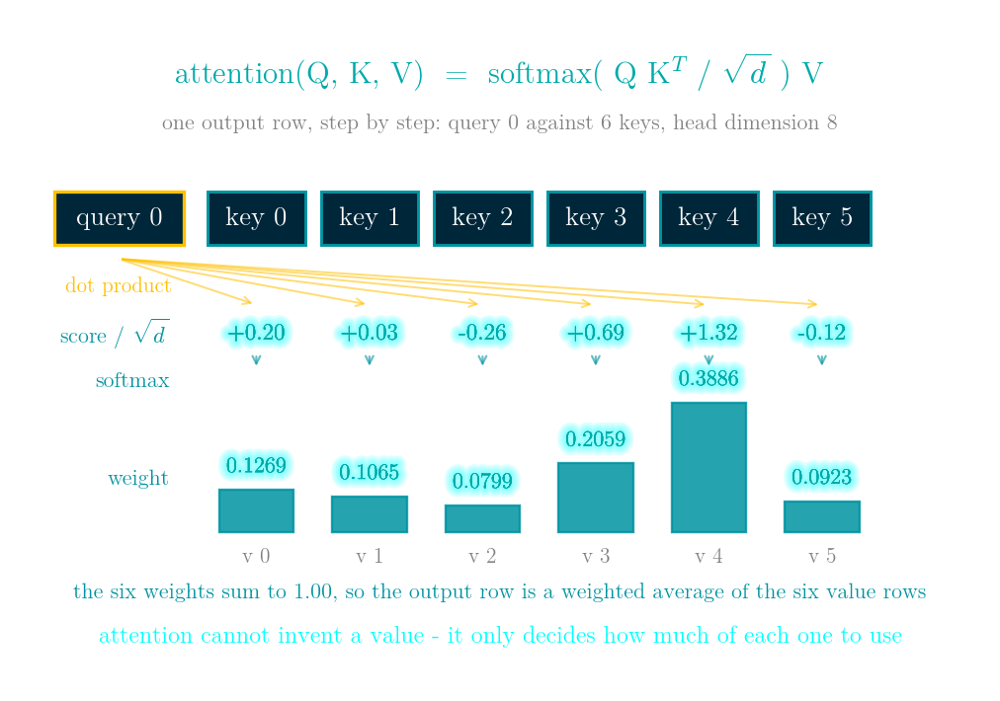
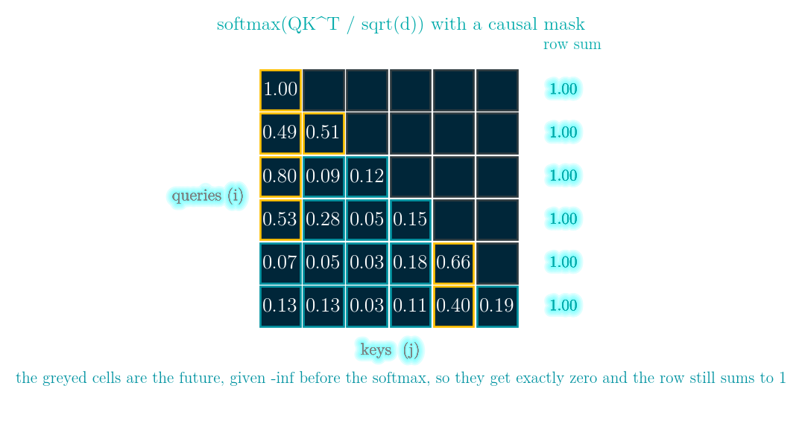

# Attention, FlashAttention, PagedAttention and MLA: writing attention by hand, then doing the arithmetic on a long-context memory bill

More details in:
https://medium.com/100-days-of-python/day-52-attention-from-scratch

Interactive walkthrough: [demo.html](demo.html) - a single self-contained page
(no build step, works offline, 中文 / English toggle) that animates the weight matrix
and the causal mask, the softmax overflow and the 1/sqrt(d), the FlashAttention block
walk, the memory bill, paged KV allocation, the delta rule, and both LeetCode problems.



```
attention(Q, K, V) = softmax(Q K^T / sqrt(d)) V
```

Four steps, shown above with real numbers from a 4-query, 6-key, head-dimension-8 example.
Query row 0 is dotted with each key row, giving one score per pair (+0.20, +0.03, -0.26,
+0.69, +1.32, -0.12); dividing by `sqrt(d)` keeps those scores at roughly unit scale
whatever the head width; softmax turns them into non-negative weights that sum to 1.00
(0.1269, 0.1065, 0.0799, 0.2059, 0.3886, 0.0923); and those weights are applied to the six
value rows. `Q`, `K` and `V` are themselves linear projections of the input, and the causal
mask is one extra line.

Attention is a weighted average: score every pair of positions, softmax the scores into
weights that sum to one, and average the value vectors with those weights. Because each
row of weights is non-negative and sums to one, the output is always a convex combination
of the values - attention cannot invent a value, only decide how much of each one to use.

Everything expensive about it comes from the pair count. The score matrix has one entry
per pair of positions per head per layer, so at a context of 131,072 tokens it is 1,024 GB
for one layer in fp16, and the KV cache that avoids recomputing the past is 64.0 GB under
plain multi-head attention. This day implements the four lines, shows the two ways they
fail without raising, and then works through the four changes every serving stack makes:
FlashAttention, PagedAttention, the MQA/GQA/MLA family, and delta-rule linear attention.

Run `python attention.py` to print the whole story; every number here is printed by that
file, and the implementations it measures are checked by the asserts at the bottom.

## The two silent failures

`exp()` overflows at 89 in float32 and at 12 in float16, so the textbook
`exp(x) / sum(exp(x))` returns `nan` on realistic logits. Subtracting the row maximum
first is exact, not an approximation, because the constant cancels between numerator
and denominator.

Masking after the softmax instead of before leaves the rows summing to
`[0.0504 0.5048 0.0618 0.9274 0.826 1.]` instead of all ones: every early position is
attenuated by however much future it was not allowed to see. Nothing raises and the loss
still goes down.



(the 6 x 6 causal weight matrix those row sums come from)

## Why the 1/sqrt(d)

A score is a sum of `d` products, so its standard deviation grows like `sqrt(d)`
(measured: 2.846 / 7.911 / 22.563 / 64.109 at d = 8 / 64 / 512 / 4096). Unscaled, a
4096-wide head puts an average largest weight of 0.9688 on a single key, which is an
argmax with almost no gradient left for the others; divided by `sqrt(d)` the average
largest weight stays near 0.04 at every width.

## FlashAttention

Walk the keys in blocks carrying a running maximum and a running sum, and rescale what
has already been accumulated by `exp(old_max - new_max)` whenever the maximum moves. The
result matches the full matrix to 6.661e-16 at block size 1 and 4.996e-16 at block size
256 - an exact rewrite agreeing to the last bit or two, which is why it changes the
memory and the speed and not the model. The score matrix is never allocated, so memory becomes linear in the context while
the arithmetic stays quadratic.

## PagedAttention

A contiguous KV cache must reserve for the longest a sequence might get: eight sequences
totalling 3,509 tokens, each allowed to reach 4,096, reserve 32,768 slots and waste 89.3%.
Pages of 16 waste 1.2%, pages of 64 waste 7.1%, pages of 256 waste 27.9% - the page size
trades the unused tail of the last page against the size of the page table. Attention then
reads K and V through a page table, which is also what lets two sequences share a prefix.

## MHA, MQA, GQA, MLA

At 32 layers, 32 query heads, head dimension 128 and fp16, one token costs 524,288 bytes
under MHA, 131,072 under GQA, 36,864 under MLA and 16,384 under MQA - 64.0 / 16.0 / 4.5 /
2.0 GB at a 128k context. MQA and GQA shrink the cache by making heads share K and V; MLA
keeps one low-rank latent per token and rebuilds per-head K and V from it, so the heads
stay distinct, with a separate small path for the positional part.

## The delta rule

A delta-rule layer keeps one `d x d` matrix and edits it in place
(`S <- S (I - beta k k^T) + beta v k^T`, read with its own query projection, `o = S @ q`),
so all 32 layers together hold 32 MB of state whatever the context length. Sixteen
orthogonal pairs fit a 16 x 16 state; the seventeenth overwrites one, and thirty-two
overwrite sixteen. With ordinary random keys, eight pairs already give a worst error of
1.66. Constant memory, bounded recall - which is why the gated variants (Gated DeltaNet
with one scalar decay per head, Kimi KDA with one per channel) get interleaved with a few
full-attention layers rather than replacing them.

## LeetCode 239 - Sliding Window Maximum

**The task.** A window of width `k` slides one position at a time from the left end of an
array to the right end; report the maximum inside it at each position.

**Input / output.** A list `nums` and an integer `k`; return `len(nums) - k + 1` values,
the i-th being the maximum of `nums[i:i+k]`.

**Example.** `[1, 3, -1, -3, 5, 3, 6, 7]` with `k = 3` gives `[3, 3, 5, 5, 6, 7]`.

**Constraints.** Up to 100,000 elements. Re-scanning each window is `O(n*k)` and will not
pass; a heap gets to `O(n log k)` only if the element leaving the window can be deleted,
which a plain binary heap cannot do without extra bookkeeping. The intended cost is `O(n)`.

A deque of indices whose values are strictly decreasing. A newly arrived value is both
larger and newer than everything smaller at the back, so those can never be a maximum
again and are popped. The front is the maximum of the window and leaves only when it falls
out by index. Every index is pushed and popped once, so the sweep is `O(n)` - the same
running-maximum trick as online softmax.

[leetcode.com/problems/sliding-window-maximum](https://leetcode.com/problems/sliding-window-maximum/)

## LeetCode 703 - Kth Largest Element in a Stream

**The task.** Answer "what is the k-th largest value seen so far" after each addition to a
stream.

**Input / output.** `KthLargest(k, nums)` constructs; `add(val)` returns the k-th largest
including `val`.

**Example.** `KthLargest(3, [4, 5, 8, 2])` then adding 3, 5, 10, 9, 4 returns
`[4, 5, 5, 8, 8]`.

**Constraints.** Up to 10^4 calls, and at least `k` elements are guaranteed to exist when
the query is asked. The constraint that decides the solution is the memory: the stream is
not meant to be kept.

A min-heap of exactly `k` elements; the root is the answer and anything below it is
discarded on arrival. The trap is which heap: a max-heap of everything also returns the
right number, in `O(n)` memory and `O(k log n)` per call. The size-k min-heap is the one
whose memory does not depend on how much has gone past.

[leetcode.com/problems/kth-largest-element-in-a-stream](https://leetcode.com/problems/kth-largest-element-in-a-stream/)

## Complexity

| Operation | Time | Space |
|---|---|---|
| attention, full matrix | O(n*m*d) | O(n*m) |
| attention, online / FlashAttention | O(n*m*d) | O(n*d) |
| KV cache read, per generated token | O(n*d) | O(n*d) |
| delta-rule write and read | O(d^2) | O(d^2) |
| LeetCode 239 | O(n) | O(k) |
| LeetCode 703 add | O(log k) | O(k) |

## References
- [Attention Is All You Need](https://arxiv.org/abs/1706.03762)
- [FlashAttention](https://arxiv.org/abs/2205.14135)
- [Efficient Memory Management for LLM Serving with PagedAttention](https://arxiv.org/abs/2309.06180)
- [GQA: Training Generalized Multi-Query Transformer Models](https://arxiv.org/abs/2305.13245)
- [DeepSeek-V2 (multi-head latent attention)](https://arxiv.org/abs/2405.04434)
- [Parallelizing DeltaNet](https://arxiv.org/abs/2406.06484)
- [Gated Delta Networks](https://arxiv.org/abs/2412.06464)
- [Wikipedia: Attention (machine learning)](https://en.wikipedia.org/wiki/Attention_(machine_learning))
