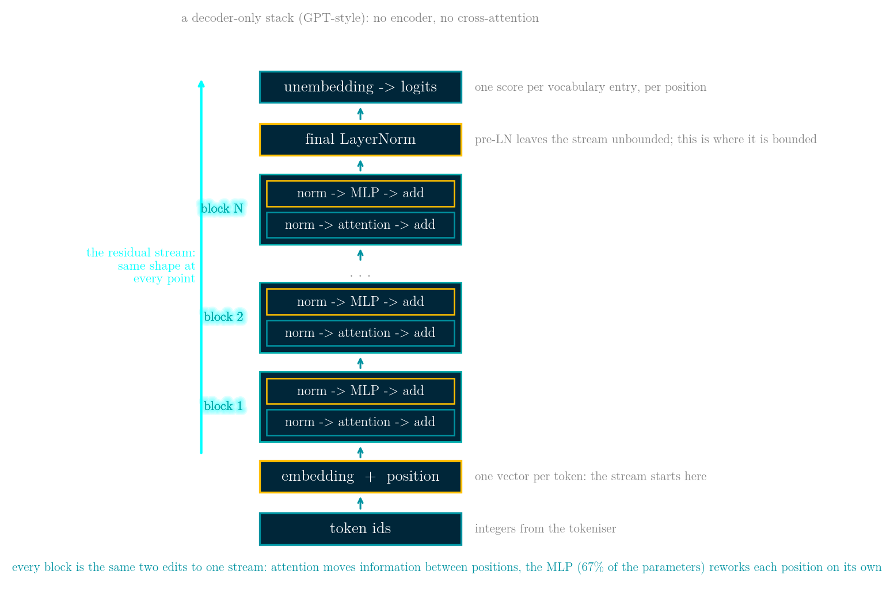
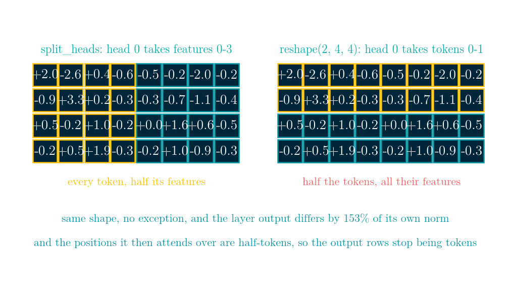
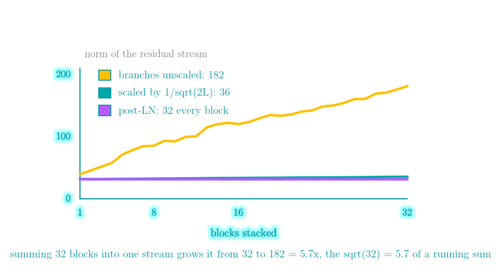

# Multi-head attention and the transformer block: what the heads are for, and the two bugs that still return the right shape

More details in:
https://medium.com/100-days-of-python/day-53-multi-head-attention-and-the-transformer-block

Interactive walkthrough: [demo.html](demo.html) - a single self-contained page
(no build step, works offline, 中文 / English toggle) that animates the block itself in
both pre-LN and post-LN form, the head split and the way it goes wrong, what a second
head buys, the one-pass variance, 32 stacked blocks, the parameter and FLOP budget, and
both LeetCode problems.



This is the decoder-only stack - what GPT-style language models are. The 2017 paper also
had an encoder and a cross-attention sub-layer inside each decoder block, which is what a
translation model needs; a model that only continues its own text drops both. Token ids in,
one vector per token out of the embedding, N identical blocks editing that set of vectors,
a final LayerNorm, and an unembedding that turns each vector into one score per vocabulary
entry. Five decisions carry the design. Every block takes
`(n, d_model)` and returns `(n, d_model)`, so stacking is free and there is one shape to
shard. Blocks add into the stream rather than replacing it, so a new block starts as a
no-op and only learns a correction - at the cost of a stream that grows with depth
(32.0 to 197.0 over 32 blocks here). Attention is the only operation in the stack that
reads other positions, which is what makes a causal mask sufficient, a KV cache possible,
and the cost split cleanly into a linear and a quadratic part. Everything else is
per-position, so a single forward pass trains every position at once instead of walking
the sequence. And the capacity sits in the per-position half: the MLP is 67% of every
block at every width, which is also why mixture-of-experts replaces the MLP and not the
attention.

A transformer block is two mixers. Attention mixes across positions: every position
becomes a weighted average of the others, with the same weights for every channel. The
MLP mixes across features: every position's channels are stirred together, with the same
weights at every position. Both write into one residual stream whose shape never changes,
which is the entire reason blocks stack.

Multi-head attention costs no extra parameters. The four projections are
`d_model x d_model` whether there is 1 head or 64, and `h` only decides how they are cut.
What it buys is measurable: on a target where half the channels need the previous token
and half need the first token, two heads reach it exactly over twelve different inputs,
while one head stops at a mean squared error of 0.1446 against 0.8746 for predicting zero
everywhere - and that single head is given more than a real one has, namely its own
`d x d` channel matrix (what `Wv` and `Wo` amount to) and a free choice of attention
matrix per input. Without that channel matrix the comparison is rigged: at `n = d = 8` a
single input can be fitted to 5.7e-30 by solving for the channel matrix alone. What one
head cannot do is use a different attention matrix for different channels.

Run `python transformer_block.py` to print the whole story; every number here is printed
by that file, and the implementations are checked by the asserts at the bottom.

## Splitting the heads

```python
def split_heads(X, h):
    n, d = X.shape
    return X.reshape(n, h, d // h).transpose(1, 0, 2)
```

Group the feature axis, then move it to the front. Drop the transpose and reshape straight
to `(h, n, d_head)` and the shape is identical while the axis is wrong: head 0 gets the
first tokens with all of their features instead of all tokens with their first features,
so the positions each head attends over are half-tokens, and after merging the heads back
together the output rows no longer correspond to tokens at all. On 16 tokens, 64 features
and 8 heads the two splittings put the layer output a maximum of 1.911 apart - 153% of the
output's own norm - with no exception and no shape error.



## The one-pass variance

`var = E[x^2] - E[x]^2` saves a pass over the data and pays for it by differencing two
large numbers to get a small one - and a residual stream is exactly what accumulates a
large common offset. With 512 standard normal values in float32, shifted by a constant,
the two-pass variance stays at about 1.0194 throughout while the one-pass version reports
1.0625 at an offset of 1,000, **-8.0** at 10,000 (a negative variance, whose square root
is nan), 1024.0 at 100,000 and 0.0 at 1,000,000. At the offset of 10,000 the array still
holds 475 distinct float32 values: the data is fine, the identity is not.

RMSNorm divides by the root mean square and never subtracts the mean, so it drops one
reduction and the beta parameters and gives up shift invariance: shifting a row by +100
moves LayerNorm's output by 6.13e-15 and RMSNorm's by 0.8014. Both are invariant to
scaling a row, which is what the residual stream actually does.

## Pre-LN and post-LN

Post-LN makes the norm of the residual stream stop depending on the depth, because the
last thing a post-LN block does is normalise; at this initialisation (`gamma = 1`,
`beta = 0`) it lands on 32.0 = `sqrt(16 * 64)` after every block. Pre-LN leaves the residual path alone and the norm grows
from 37.9 to 197.0 over 32 blocks. A perturbation at the input ends up 7.50x its original
size with pre-LN against 1.10x with post-LN - but as a fraction of the stream those are
nearly the same (0.0381 against 0.0345), so that measurement does not show pre-LN carrying
more signal. What it shows is structural: pre-LN leaves one path from input to output that
never passes a normalisation, post-LN puts one on that path in every block. That is also
why a pre-LN stack needs one final LayerNorm before the output head.

The stream grows because every branch adds into it: from 32.0 to 181.8 over 32 blocks, a
factor of 5.7, which is the `sqrt(32) = 5.66` expected of a running sum of 32 independent
pieces. Scaling what each branch writes by `1/sqrt(2L)` holds it at 1.12x.



## The budget

Attention is four `d_model x d_model` matrices and the MLP is two of `d_model x 4*d_model`,
so 67% of every block is the feed-forward part, at every width. The compute splits into a
part linear in the context and a part quadratic in it, and they are equal at exactly
`6 * d_model` - 24,576 tokens at `d_model` 4096, where the quadratic share runs 2.0% at a
context of 512, 25.0% at 8,192 and 57.1% at 32,768. The head count appears in neither.

## LeetCode 189 - Rotate Array

**The task.** Shift every element `k` places to the right, wrapping the elements that fall
off the end around to the front in order.

**Input / output.** A list `nums` and a non-negative integer `k`; the array is modified in
place and nothing is returned.

**Example.** `[1, 2, 3, 4, 5, 6, 7]` with `k = 3` becomes `[5, 6, 7, 1, 2, 3, 4]`.

**Constraints.** Up to 100,000 elements, and `k` may exceed the length, so `k %= n` is not
optional. The follow-up is the real requirement: in place, `O(1)` extra space.

Reverse the whole array, then reverse the first `k` elements and the rest. The other
in-place method walks the permutation cycles, and it needs `gcd(n, k)` starting points:
on `[1, 2, 3, 4, 5, 6]` with `k = 2`, starting only at index 0 returns `[5, 2, 1, 4, 3, 6]`
- half the array moved, still six integers long. With `k = 1` there is one cycle and the
same code is right, so small tests never show it. Same shape as the head-splitting bug.

[leetcode.com/problems/rotate-array](https://leetcode.com/problems/rotate-array/)

## LeetCode 303 - Range Sum Query (immutable)

**The task.** Answer "sum of the elements from `left` to `right` inclusive" many times over
a fixed array.

**Input / output.** `NumArray(nums)` constructs; `sumRange(left, right)` returns the
inclusive range sum.

**Example.** On `[-2, 0, 3, -5, 2, -1]`, `sumRange(0, 2)` is 1, `sumRange(2, 5)` is -1 and
`sumRange(0, 5)` is -3.

**Constraints.** Up to 10,000 elements and 10,000 queries; re-summing each range is `O(n)`
per call. The array never changing is the permission to precompute. (The mutable sibling,
LeetCode 307, is the one that needs a Fenwick tree - Day 29.)

One prefix pass makes every query a subtraction, and the leading zero is what keeps
`left = 0` from being a special case. Extend the trick to variance - prefix sums of `x` and
`x^2` - and it meets the identity above: on float32 data with a mean of 10,000 the true
window variance is 1.080859 and the prefix-sum route returns 28.860555.

[leetcode.com/problems/range-sum-query-immutable](https://leetcode.com/problems/range-sum-query-immutable/)

## Complexity

| Operation | Time | Space |
|---|---|---|
| multi-head attention, n tokens | O(n^2 d + n d^2) | O(n^2) per head, or O(n d) with online softmax |
| the MLP branch | O(n d d_ff) | O(n d_ff) |
| LayerNorm / RMSNorm, per row | O(d) | O(1) |
| LeetCode 189 | O(n) | O(1) |
| LeetCode 303 build / query | O(n) / O(1) | O(n) |

## References
- [Attention Is All You Need](https://arxiv.org/abs/1706.03762)
- [Layer Normalization](https://arxiv.org/abs/1607.06450)
- [Root Mean Square Layer Normalization](https://arxiv.org/abs/1910.07467)
- [On Layer Normalization in the Transformer Architecture](https://arxiv.org/abs/2002.04745)
- [Gaussian Error Linear Units (GELU)](https://arxiv.org/abs/1606.08415)
- [Wikipedia: Algorithms for calculating variance](https://en.wikipedia.org/wiki/Algorithms_for_calculating_variance)
