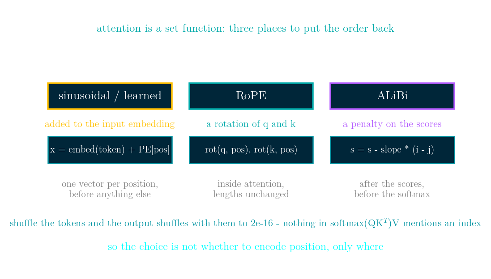
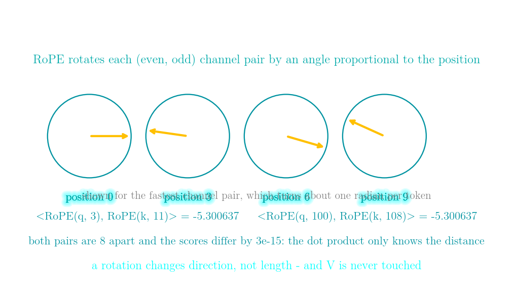
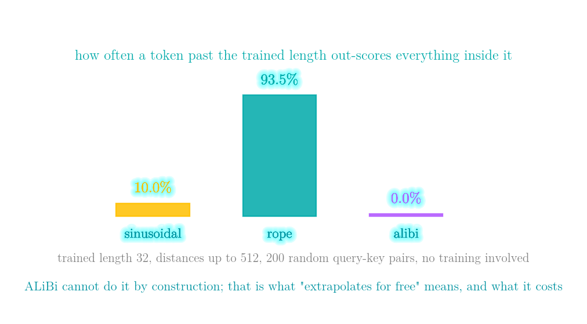
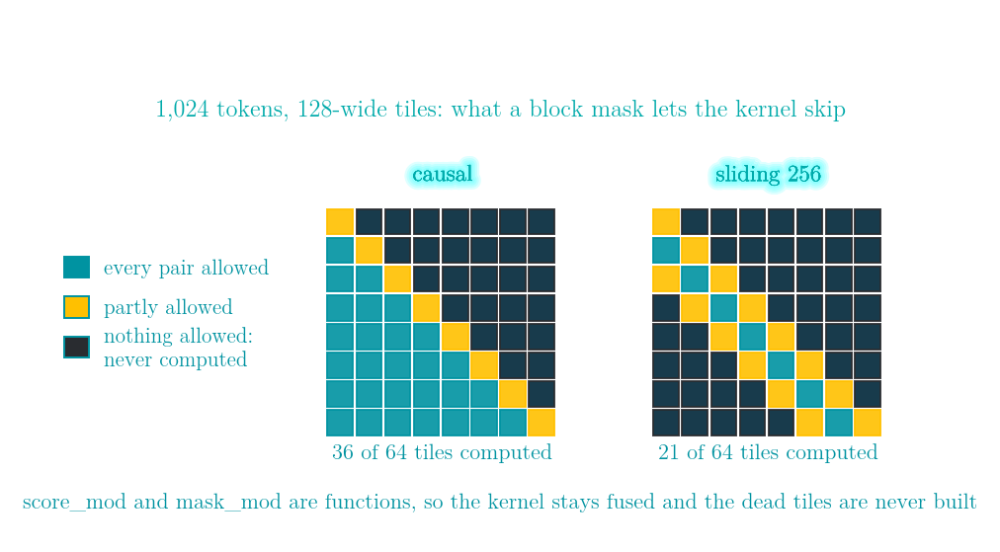

# Positional encodings: sinusoidal, RoPE and ALiBi, and why a long-context model needs its positions rescaled

More details in:
https://medium.com/100-days-of-python/day-54-positional-encodings

Interactive walkthrough: [demo.html](demo.html) - a single self-contained page
(no build step, works offline, 中文 / English toggle) that animates the permutation test,
the sinusoidal table, RoPE as a rotation, ALiBi's per-head windows, what survives past
the trained length, the FlexAttention block mask, and the decode-offset bug.

A language model holds a sentence as a pile of vectors, one per token, and attention - the
operation that lets those vectors look at each other - has no idea which of them came
first. Shuffle the input rows and every output row moves with them: the difference between
"attend then shuffle" and "shuffle then attend" is 2.2e-16, floating-point noise. The
formula is why: `softmax(QK^T / sqrt(d)) V` is a dot product, a softmax and a weighted sum,
and none of them mentions an index.

So the order is put back by hand, and how is a design decision called the positional
encoding. The three answers in use inject it at three different points: sinusoidal adds a
vector per position onto the embedding before attention runs, RoPE rotates the query and
key vectors inside attention, and ALiBi subtracts a distance penalty from the scores. The
choice matters because this is the part that breaks first when a model is asked to read
more than it was trained on.

Run `python positional.py` to print the whole story; every number here is printed by that
file, and the implementations are checked by the asserts at the bottom.

## Sinusoidal

One vector per position, added to the embedding. Sines are used because shifting by `k`
becomes a fixed rotation of each (sin, cos) pair - the same linear map at every position,
measured to 3.3e-15. The side effect is that similarity against distance wobbles: +0.483,
+0.442, +0.374, +0.350, +0.303, +0.306 at distances 1, 2, 4, 8, 16, 32.

## RoPE

Each (even, odd) pair of channels of `q` and `k` is rotated by an angle proportional to
the position - never `V`. A rotation does not change lengths, and the score ends up
depending only on the distance: `<RoPE(q,3), RoPE(k,11)>` and `<RoPE(q,100), RoPE(k,108)>`
are both -5.300637, differing by 2.7e-15.

At `d = 128` the fastest channel pair turns every 6.28 tokens and the slowest every
54,410. Trained at 4,096 the slowest pair gets through 0.08 of a turn; 32,768 would ask
for 0.60. That gap is what position interpolation (multiply positions by 0.125) and
raising the base (10,000 to about 82,685) are both aimed at.

## ALiBi

`slope * (k_index - q_index)` added to the scores, one slope per head from a geometric
sequence. Nothing to embed, nothing to train, and each head becomes a soft window: 10, 19,
37, 74, 148, 293, 458 and 497 tokens hold 99% of the weight for the eight heads (the last
rows are clipped by the 512-token probe, not by their slopes).

## What survives past the trained length

All three are formulas, so all three can be evaluated at an unseen position; a learned
absolute table cannot. But over 200 random query-key pairs with a trained length of 32, a
token between 33 and 512 away out-scores everything inside the trained range 10.0% of the
time under sinusoidal, 93.5% under RoPE and 0.0% under ALiBi. ALiBi's zero is structural -
the penalty grows with distance - which is both what "extrapolates for free" means and
what it costs.

## FlexAttention

RoPE, ALiBi, causal masking, sliding windows and soft-capping all edit one of two things:
the value of a score, or whether a pair is allowed. Passed in as `score_mod` and
`mask_mod`, they stop being separate kernels - the numpy version here reproduces the
hand-written causal and causal-plus-ALiBi results with a difference of exactly 0.0.

The payoff is block sparsity rather than tidiness: at 1,024 tokens with 128-wide tiles,
causal leaves 36 of 64 tiles to compute (43.8% skipped) and a 256-token sliding window
leaves 21 (67.2% skipped). Those tiles contain no allowed pair, so their scores are never
built - and the fused kernel survives a change of rule.

## The silent failure

While decoding, the new token's absolute position is the length of the KV cache. Rotating
it at position 0 - because it is the first row of this step's tensor - gives attention
weights of `[0.0808 0.0391 0.1214 0.3489 0.1837 0.2262]` instead of
`[0.1669 0.0351 0.1301 0.3161 0.1093 0.2425]`: a maximum difference of 0.0862, both rows
finite and both summing to 1. The test that catches it compares prefill-in-one-pass
against decode-token-by-token and requires them to agree.

## Complexity

| Operation | Time | Space |
|---|---|---|
| sinusoidal table, n positions | O(n d) | O(n d) |
| RoPE applied to q and k | O(n d) | O(1) extra |
| ALiBi bias | O(n^2) as a matrix, O(1) as a function | O(1) with a kernel |
| flex attention, n tokens | O(n^2 d) minus the skipped tiles | O(n d) |

## References
- [Attention Is All You Need (sinusoidal)](https://arxiv.org/abs/1706.03762)
- [RoFormer: Enhanced Transformer with Rotary Position Embedding](https://arxiv.org/abs/2104.09864)
- [Train Short, Test Long: Attention with Linear Biases (ALiBi)](https://arxiv.org/abs/2108.12409)
- [Extending Context Window via Position Interpolation](https://arxiv.org/abs/2306.15595)
- [FlexAttention (PyTorch blog)](https://pytorch.org/blog/flexattention/)
