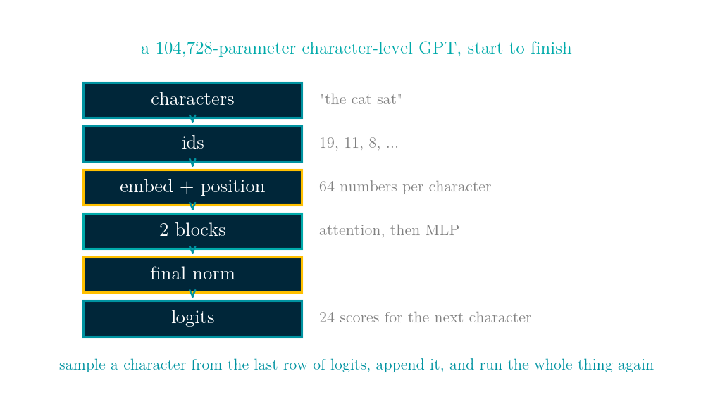
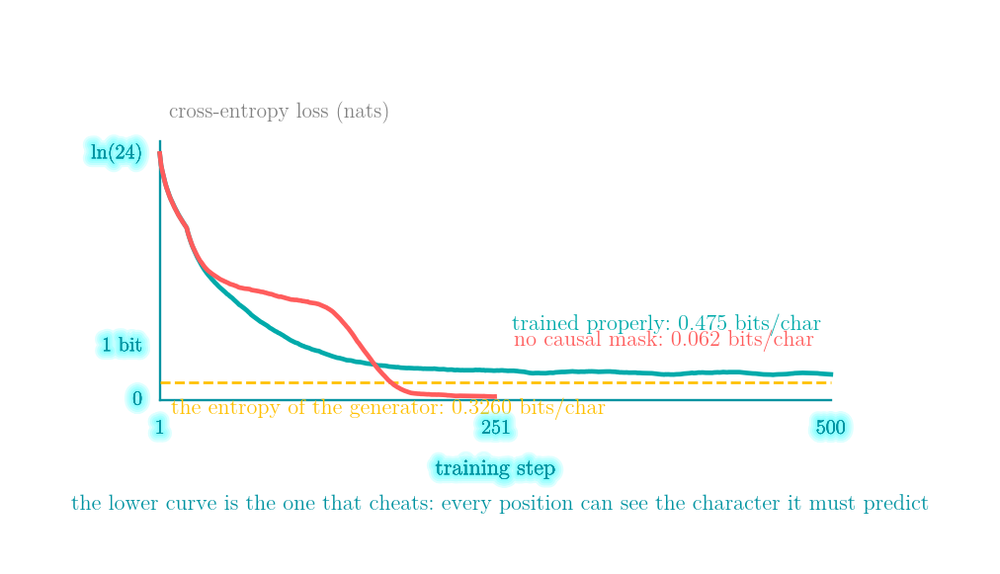
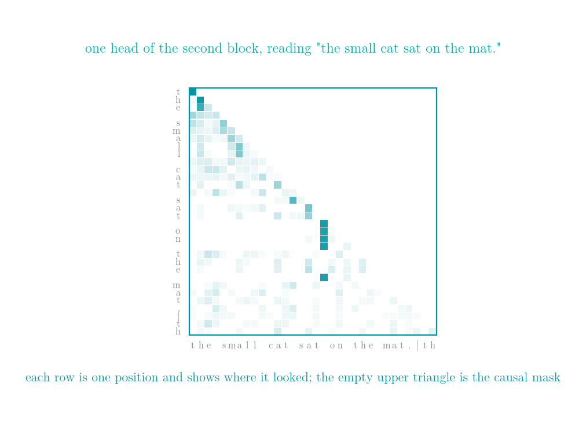

# A character-level mini-GPT in numpy: 100k parameters, a hand-written backward pass, and a loss you can check against the truth

More details in:
https://medium.com/100-days-of-python/day-55-char-level-mini-gpt

Interactive walkthrough: [demo.html](demo.html) - a single self-contained page
(no build step, works offline, 中文 / English toggle) that walks through the corpus and
its entropy, the training curve, sampling at three temperatures, the two bugs that lower
the loss, and the attention weights of a trained head.

The last four days built the parts - a tokeniser, attention, the transformer block,
positional encodings. Here they go in one file and the thing trains: 104,728 parameters,
`d_model` 64, 2 blocks, 4 heads, a context of 32 characters, no framework and no autograd.
The backward pass is written out by hand and agrees with central differences to a worst
relative error of 3.06e-06.

Run `python mini_gpt.py` to train it and print the whole story (about two minutes on a
CPU); every number here comes from that run.

## The corpus is generated, and that is the point

Trained on a scraped text file, the only thing you can say afterwards is "the loss went
down" - down to where? So the corpus is made by a five-slot grammar defined in the module:
determiner, optional adjective, noun, verb, place. 38,005 characters, 24 distinct ones.

Because the generator is known, the entropy of the source is known exactly: five
independent choices worth 10.288 bits per sentence over 31.56 characters on average, so
**0.3260 bits per character**. No model can go below it. It also makes the generated text
checkable: ask the grammar whether it could have produced each line.

## Training

Input 32 characters, target the same string shifted one place right. Adam at 3e-3, batch
16, 500 steps, no schedule and no clipping.

| | loss | bits/char |
|---|---|---|
| step 1 (knowing nothing is `ln(24)` = 3.1781) | 3.1724 | 4.5769 |
| step 100 | 0.7284 | 1.0508 |
| step 500 | 0.3367 | 0.4858 |
| held-out text from the same grammar | 0.3301 | 0.4762 |
| the source itself | | 0.3260 |

Train and held-out agreeing means the model learned the grammar rather than the particular
38,005 characters it saw.

## Sampling

One character at a time: logits of the last position, divided by the temperature,
optionally restricted to the top k, sampled, appended, repeat.

| setting | grammatical | first line |
|---|---|---|
| temperature 1.0 | 67% of 6 | `the old bird sat in the garden.` |
| temperature 0.8, top-k 5 | 50% of 6 | `the quiet child ran near the doog ran under the tree.` |
| temperature 0.2 | 100% of 7 | `the old robot sang under the tree.` |

The 0.2 row is nearly greedy and its lines repeat themselves - low temperature buys safety
and pays in variety. The 0.8 row scoring under 1.0 is not a real reversal: with six lines
and one bad character spoiling a whole line, the percentage bounces; comparing settings
properly needs hundreds of lines.

## Two bugs that make the loss go down

**No causal mask**: 250 steps reach 0.0491 against 0.3824 with the mask, because every
position can see the character it must predict. Shapes, gradients and curve all look fine.
The model with the *lower* loss generates 0% grammatical lines - `the e e eeeeeeee e ee.`
- because at generation time there is no future to read.

**Targets not shifted**: predicting the character just given reaches 0.0012 where the
correct version is at 0.4863. It is learning the identity function, and it generates
blanks.

Same shape in both cases: the loss went down because the task got easier. Only evaluating
what the model is for - generating, then checking against the grammar - finds them.

## Complexity

| Operation | Time | Space |
|---|---|---|
| forward, batch B context T | O(B T^2 d + B T d^2) per block | O(B T^2) attention weights |
| backward | about twice the forward | the cached activations |
| one Adam step | O(parameters) | 2x parameters (m and v) |
| sampling n characters | O(n) forwards of one window | O(T d) |

## References
- [Attention Is All You Need](https://arxiv.org/abs/1706.03762)
- [Language Models are Unsupervised Multitask Learners (GPT-2)](https://cdn.openai.com/better-language-models/language_models_are_unsupervised_multitask_learners.pdf)
- [Adam: A Method for Stochastic Optimization](https://arxiv.org/abs/1412.6980)
- [Wikipedia: Entropy (information theory)](https://en.wikipedia.org/wiki/Entropy_(information_theory))
