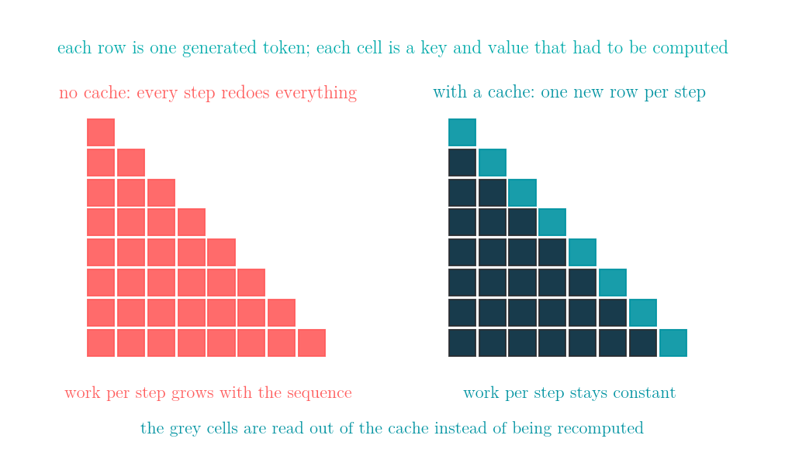
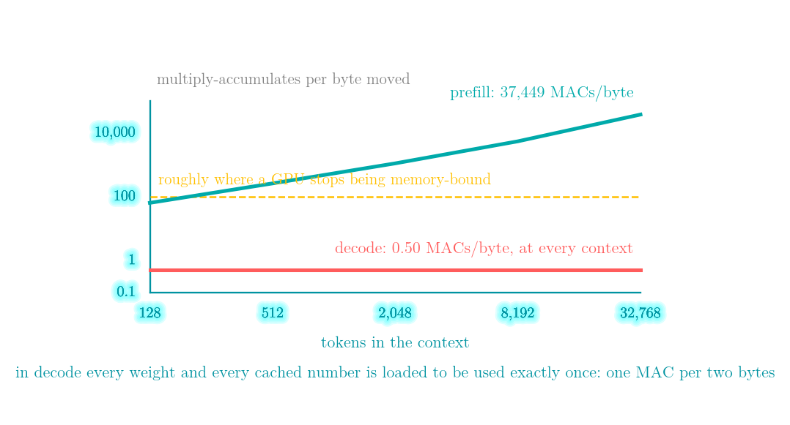

# The KV cache: what it stores, what it costs, and why prefill and decode are two different machines

More details in:
https://medium.com/100-days-of-python/day-56-kv-cache

Interactive walkthrough: [demo.html](demo.html) - a single self-contained page
(no build step, works offline, 中文 / English toggle) covering why the cache exists, what
it holds and how big it gets, the arithmetic intensity of prefill against decode, why
decode gets batched, and the cache that was not reset.

Generating a token means looking at every earlier token. Without a cache that means
rerunning the whole model over the whole sequence, once per generated token: work
proportional to `n(T + n)` for n tokens after a prompt of T. Keeping the keys and values
makes it `nT`. On the toy model here, 64 tokens after a 64-token prompt take 0.31 s
recomputing and 0.04 s cached - and the ratio grows with the sequence, so the shape
matters more than the 8.6x.

Run `python kv_cache.py` to print the whole story; every number here comes from that run.

## What is in it

Two arrays per layer - the keys and values of every token so far - allocated once at the
maximum length. Not the queries: a query is used once by the token that made it, while
keys and values are read by every token that follows.

Size is `2 x layers x kv_heads x head_dim x bytes` per token, per sequence:

| model | bytes/token | at a 128k context |
|---|---|---|
| the toy model here | 512 | 0.1 GB |
| 32 layers, 32 kv heads | 524,288 | 64.0 GB |
| 32 layers, GQA with 8 kv heads | 131,072 | 16.0 GB |
| 80 layers, GQA with 8 kv heads | 327,680 | 40.0 GB |

## It must change nothing

The acceptance test is differential: prefill the prompt, decode token by token, require
every step to equal the full forward. Measured here at 3.75e-16, and sampling 24 tokens
both ways gives the same tokens. Nearly every cache bug - a wrong write position, a stale
entry, a rotation at the wrong offset - shows up here as a finite, plausible, unequal
number.

## Prefill and decode

| context | prefill MACs/byte | decode MACs/byte |
|---|---|---|
| 128 | 64.3 | 0.50 |
| 2,048 | 1,107.9 | 0.50 |
| 8,192 | 5,433.0 | 0.50 |

Decode's 0.50 is exact and is the whole story: every weight and every cached number is
loaded to be used in exactly one multiply-accumulate, and an fp16 number is two bytes.
Prefill reuses each loaded weight across all T tokens. GQA cuts the bytes decode reads and
the MACs it does by the same factor, so it makes decode cheaper without making it any less
memory-bound.

## Which is why decode gets batched

The weights are read once per step whatever the batch size. Measured (numpy on a CPU -
read the shape, not the milliseconds): 211 microseconds per sequence at batch 1, 120 at
batch 8, then flat at about 135, because with 512 tokens in the cache numpy is already
spending its time on the attention einsum. On a GPU the flat region runs much further.

What stops the batch growing is the cache itself: every sequence carries its own.

## The silent failure

Starting a second sequence without clearing the cache changes the logits by up to 0.2731,
flips the most likely next token on 4 of 12 steps, and lets up to 67% of what the model
attends to belong to the previous sequence. Nothing raises; the output is just slightly
strange. The differential test above catches it immediately.

## Complexity

| Operation | Time | Space |
|---|---|---|
| generating n tokens, no cache | O(n (T+n) d^2 + n (T+n)^2 d) | O((T+n)^2) |
| generating n tokens, cached | O(n T d^2) | O((T+n) d) cache |
| one decode step | O(d^2 + T d) per layer | reads weights + whole cache |
| cache per sequence | | 2 x layers x kv_heads x head_dim x bytes per token |

## References
- [Fast Transformer Decoding: One Write-Head is All You Need (MQA)](https://arxiv.org/abs/1911.02150)
- [GQA: Training Generalized Multi-Query Transformer Models](https://arxiv.org/abs/2305.13245)
- [Efficient Memory Management for LLM Serving with PagedAttention](https://arxiv.org/abs/2309.06180)
- [Efficiently Scaling Transformer Inference](https://arxiv.org/abs/2211.05102)
