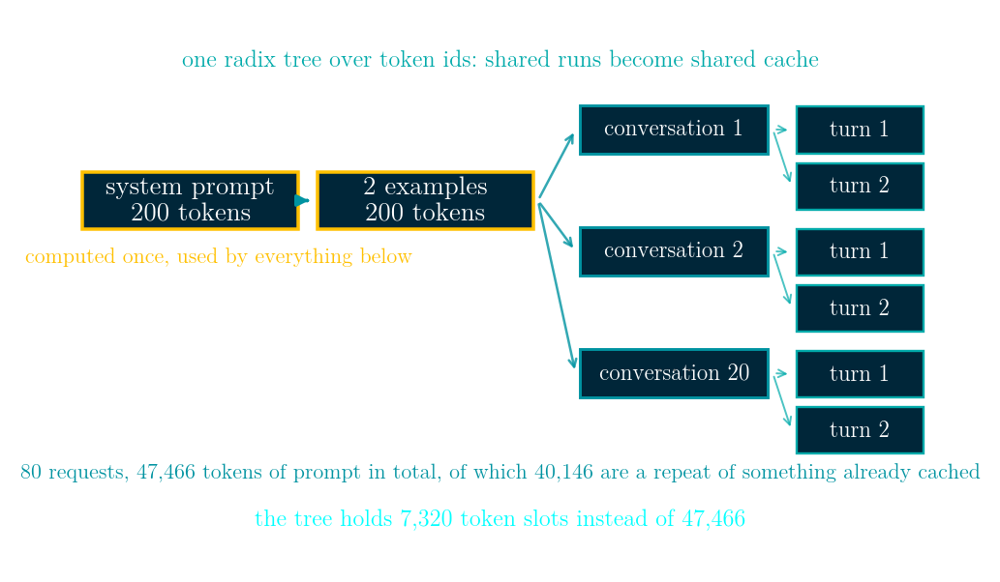
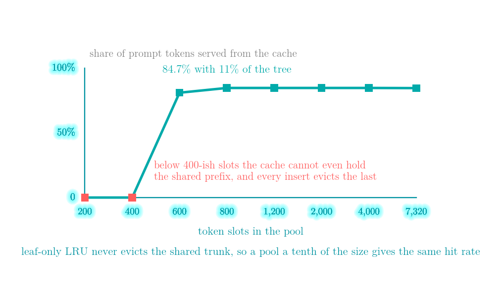

# RadixAttention: sharing one KV cache between requests that start the same way

More details in:
https://medium.com/100-days-of-python/day-57-radix-attention

Interactive walkthrough: [demo.html](demo.html) - a single self-contained page
(no build step, works offline, 中文 / English toggle) covering the repeated part of a
request, the radix tree and its splits, eviction with leaf-only LRU, the text-vs-token
trap, what PyTorch and JAX can and cannot do, and how SGLang does it.



Yesterday's cache belonged to one sequence. On a real server most requests begin
identically - the same system prompt, the same examples, the earlier turns of the same
conversation - and recomputing those keys and values per request is the largest piece of
wasted work in serving.

In the simulated workload here (20 conversations of four turns, 80 requests, a shared
200-token system prompt and two shared examples), **84.6% of all prompt tokens are a
recomputation**: 47,466 tokens of prompt, of which only 7,320 have never been seen.

Run `python radix_attention.py` to print the whole story; every number here comes from
that run.

## The tree

Walk down from the root while the tokens agree; how far you get is the prefix that does
not need recomputing. A request that diverges halfway along an edge splits it in two, so
both sides keep sharing everything above the split.

| | nodes | token slots held |
|---|---|---|
| plain trie, one token per node | 7,216 | - |
| radix tree | 83 | 7,320 |
| no sharing at all | - | 47,466 |

A conversation's first turn shares the system prompt and examples (380 of 440 tokens,
86%); later turns also share what the conversation has already said (542 of 644, 84%).
One structure covers both and knows nothing about either - only about prefixes.

## Eviction: LRU, leaves only

| pool (token slots) | share of the tree | hit rate |
|---|---|---|
| 400 | 5% | 0.0% |
| 600 | 8% | 81.0% |
| 800 | 11% | 84.7% |
| 2,000 | 27% | 84.7% |
| 7,320 | 100% | 84.6% |

Flat from 11% of the tree upwards, because the part earning the hits is the shared prefix
and leaf-only LRU never reaches it. Below the size of that prefix it does not degrade, it
collapses: every insert evicts what the last one wrote.

The extra rule is why this is not an ordinary LRU cache. Plain LRU picks the oldest
timestamp, which is the shared prefix - everybody matches *through* it rather than onto
it. The node it would evict holds 124 tokens itself and takes 379 with it. Nodes a running
request is decoding on are pinned by a reference count.



## The trap

```
"abc" -> (5,)      "abd" -> (4, 7)
2 characters in common, 0 tokens in common
```

With a tokeniser where `ab` and `abc` are both single tokens, a text prefix is not a token
prefix. A cache keyed on text hands back the K and V of a token the second request never
contained - right shapes, finite numbers, nothing raised. Match on token ids.

## In PyTorch, JAX, and then SGLang

`transformers` has no cross-request sharing: compute the system prompt once and
`copy.deepcopy` its `past_key_values` per request. JAX does the same with a padded array
and `dynamic_update_slice`. Both skip the prefill; neither shares the memory, because the
cache is an object in your code's hands.

SGLang is not a library but an inference **server** - it owns the GPU memory, which is
what makes real sharing possible, and RadixAttention is its name for today's structure
(on by default). The names match: `RadixCache`, slots in `token_to_kv_pool`, protected
nodes for our `refs`. `--disable-radix-cache` turns it off to compare, `/flush_cache`
drops the tree before a benchmark. vLLM reaches the same goal by hashing fixed-size
blocks instead (`--enable-prefix-caching`).

## Complexity

| Operation | Time | Space |
|---|---|---|
| match a prefix of length m | O(m) token comparisons | O(1) |
| insert a request of length n | O(n) plus one edge split | O(new tokens) |
| evict | O(leaves) per victim here; a real server keeps a heap | O(1) |
| the tree | | one slot per distinct token position, not per request |

## References
- [SGLang: Efficient Execution of Structured Language Model Programs (RadixAttention)](https://arxiv.org/abs/2312.07104)
- [Efficient Memory Management for LLM Serving with PagedAttention](https://arxiv.org/abs/2309.06180)
- [Wikipedia: Radix tree](https://en.wikipedia.org/wiki/Radix_tree)
