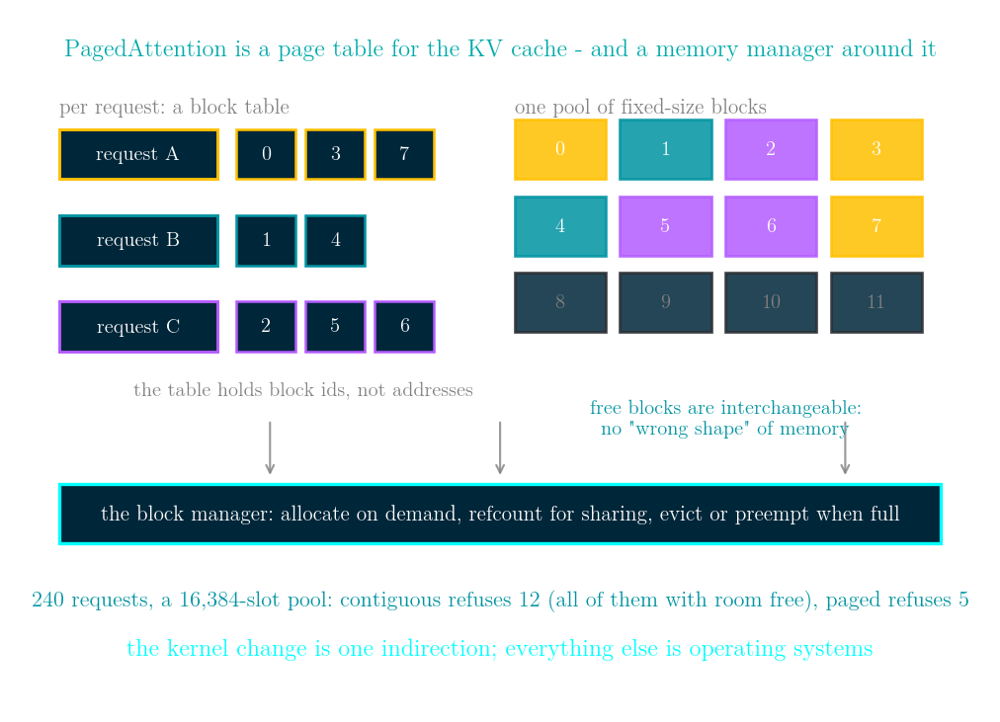
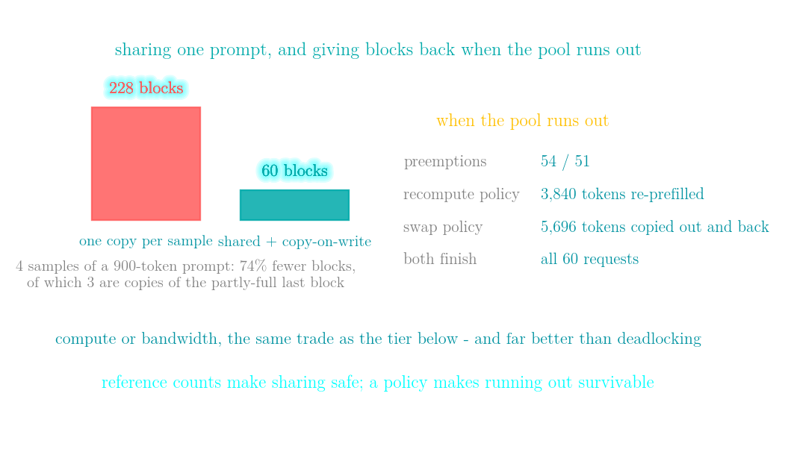

# PagedAttention is a memory allocator: block tables, copy-on-write, and what a server does when the KV pool runs out

More details in:
https://medium.com/100-days-of-python/day-58-paged-attention-memory

Interactive walkthrough: [demo.html](demo.html) - a single self-contained page
(no build step, works offline, 中文 / English toggle) covering external fragmentation,
block size, sharing with copy-on-write, preemption, the two silent failures, and how vLLM
and SGLang expose each piece.



The attention change is small - read K and V through a block table instead of a flat
array. Everything around it is the work: each request owns a block table of block ids, the
blocks live in one shared pool, and a block manager allocates on demand, counts references
so requests can share, and decides what happens when there are none left.

Run `python paged_memory.py` to print the whole story; every number here comes from that
run.

## Why pages: free memory in the wrong shape

The contiguous allocator is given the kindest case - told each request's exact final
length, so it never over-reserves - and still loses:

| 240 requests, 16,384 slots | refused | of those, with enough free | occupancy |
|---|---|---|---|
| one contiguous range per request | 12 | **12** | 65.7% |
| fixed-size blocks of 16 tokens | 5 | - | 68.5% |

Every refusal happened while the pool had room, in pieces too small to use. Fixed-size
blocks delete the notion of shape: any free block is as good as any other.

## What paging costs

| tokens per block | wasted | block-table entries |
|---|---|---|
| 1 | 0.0% | 201,736 |
| 16 | 0.9% | 12,721 |
| 256 | 12.5% | 901 |

The block is also the granularity at which prefixes can be shared, so a bigger block means
coarser sharing as well as more waste.

## Sharing and copy-on-write

Four samples of a 900-token prompt: 228 blocks naively, 60 with sharing (74% fewer). Only
the prompt's partly-full last block is copied, once per sample - copy-on-write, as in
`fork()`.

## When the pool runs out

60 requests against 4,096 slots: the recompute policy causes 54 preemptions and 3,840
tokens of re-prefill; swapping causes 51 and moves 5,696 tokens out and back. Both finish
all 60. Compute or bandwidth - the same trade as the tiered cache, one level up.



## Two silent failures

A failure path that forgets to free leaks 617 blocks (9,872 of 65,536 slots) and the pool
never recovers - the symptom is "throughput degrades after a few hours", and the test is an
idle-time invariant: free blocks plus tabled blocks equal the pool.

Attending over the padded length reads the tail of the last block: 70 tokens occupy 80
slots, and those 10 hold someone else's old KV. The softmax still sums to one.

## In vLLM

```bash
vllm serve meta-llama/Llama-3.1-8B \
    --block-size 16 --gpu-memory-utilization 0.90 \
    --max-num-seqs 256 --swap-space 4 --enable-prefix-caching
```

`--block-size` is `PagedPool.block`, the pool comes from a startup profiling pass and
`--gpu-memory-utilization`, `BlockTable` is `table[rid]`, `ref_count` with copy-on-write is
`refs[b]`, and `SamplingParams(n=4)` shares the prompt's blocks. When the pool runs out it
logs `Sequence group ... is preempted by PreemptionMode.RECOMPUTE`.

## In SGLang

```bash
python -m sglang.launch_server --model-path meta-llama/Llama-3.1-8B \
    --mem-fraction-static 0.9 --page-size 1 \
    --max-running-requests 256 --chunked-prefill-size 8192
```

Its page is one token by default (zero internal fragmentation, a long index - affordable
because the index is a `req_to_token_pool` tensor on the GPU, with the slots in
`token_to_kv_pool`). When it runs out it **retracts** instead of swapping, because the
prefix is usually still in the radix cache, so recomputing only redoes the part that
missed.

## Complexity

| Operation | Time | Space |
|---|---|---|
| allocate n tokens | O(blocks) | O(blocks) table entries |
| share a prefix | O(blocks shared) | O(1) - a reference count |
| copy-on-write | O(1) block copied per writer | one extra block each |
| preempt a request | O(blocks) to free, then a re-prefill or a copy | - |

## References
- [Efficient Memory Management for LLM Serving with PagedAttention (vLLM)](https://arxiv.org/abs/2309.06180)
- [vLLM engine arguments](https://docs.vllm.ai/en/latest/configuration/engine_args.html)
- [SGLang server arguments](https://docs.sglang.ai/advanced_features/server_arguments.html)
- [Wikipedia: Fragmentation (computing)](https://en.wikipedia.org/wiki/Fragmentation_(computing))
