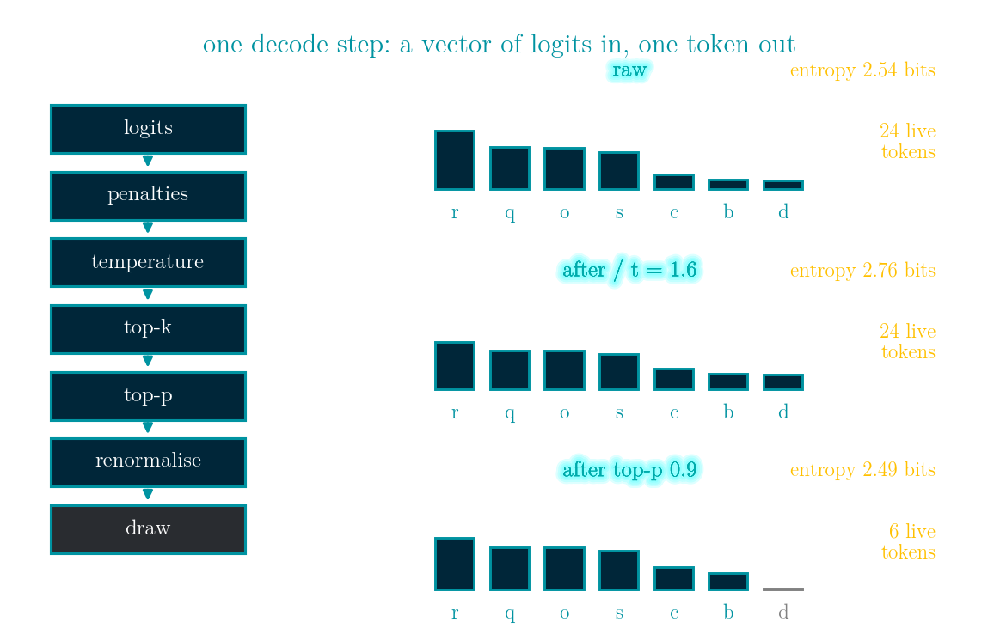

# Temperature, top-k and top-p: choosing the next token

More details in:
https://medium.com/100-days-of-python

Interactive walkthrough: [demo.html](demo.html) - a single self-contained page
(no build step, works offline, 中文 / English toggle) that animates the tail of a
real next-token distribution, the temperature sweep, the four truncation rules, the
order-of-operations difference, and the sort-free threshold search a GPU kernel uses.

A model's last act on every decode step is a row of logits, one per token. Turning
that row into a single token is the sampling step, and it is the only knob in the
serving stack that changes what the model says rather than how fast it says it.

To make "what it says" measurable, `sampling.py` trains a character 8-gram on 1,500
sentences drawn from a small grammar. That grammar admits exactly 1,250 sentences and
a parser can check any generated line, so every number here is a rate over 100
samples: how many parsed, and how many distinct sentences came out.

Greedy decoding scores 100% grammatical and 1 distinct sentence - the absence of
sampling. Sampling at temperature 2.0 scores 0%. Temperature 2.0 with `min-p 0.1`
scores 100% and 96 distinct sentences: the randomness was never the problem, only the
part of it that could never have been right.

## Greedy is not even the most likely sentence

The grammar admits 1,250 sentences, so every one can be scored exactly - a sentence's
log probability is the sum of its per-step log probabilities. Greedy, which takes the
highest-probability character at every step, produces the **44th** most likely
sentence, 1.61x less likely than the best one: a locally attractive character leads
into a prefix with no good ending, and a step rule cannot go back. argmax per step is
not argmax over sequences, which is why searching over sequences is a separate
decoding strategy rather than a parameter.

The enumeration also checks the measuring rig: the legal sentences hold 90.9% of the
model's sentence-level probability against a measured 90% grammatical rate at
`t = 1.0`, and 100 draws should give 87.3 distinct sentences against 88 measured.

## Temperature

`logits / t` before the softmax. At `t = 0.7` the model gives 98 distinct sentences
out of 100 samples with every one grammatical; at `t = 1.7` only 5% parse. Between
`t = 1.0` and `t = 1.7` the entropy moves from 0.34 to 1.18 bits while correctness
falls from 90% to 5% - and variety falls with it, because a broken sentence is not a
different sentence.

## Truncation: top-k, top-p, min-p

All measured at a fixed `t = 2.0`:

| rule | grammatical | distinct |
|---|---|---|
| no truncation | 0% | 0 |
| top-k 1 (greedy) | 100% | 2 |
| top-k 3 | 0% | 0 |
| top-p 0.9 | 2% | 2 |
| top-p 0.7 | 89% | 85 |
| top-p 0.5 | 100% | 80 |
| min-p 0.1 | 100% | 96 |
| typical 0.9 | 2% | 2 |
| typical 0.5 | 94% | 84 |

A fixed `k` cannot be right twice: across the corpus 249 steps are peaked (one
character above 90%) and 61 are flat, and `k = 1` throws away 0.45% of the mass on
the first kind and 54% on the second. top-p asks for a mass instead of a count, so
the nucleus sizes itself - 1.0 against 3.46 on average. min-p compares each token
against a fraction of the best one, which costs a single comparison per token.

Locally typical sampling asks a third kind of question: keep the tokens whose
surprise, −log p, is closest to this step's entropy, on the argument that language
carries a roughly constant amount of information per word. On this corpus it never
separates from top-p - over 1,875 steps it kept the same number of tokens every time
and never dropped the most likely one - so `sampling.py` builds a distribution where
the two must disagree (one token at 0.60, ten at 0.03, a thousand at 0.0001, entropy
2.28 nats): asked for 0.25 of the mass, top-p keeps 1 token and typical sampling keeps
9, dropping the most likely one entirely.

## The order of operations

With `t = 2.5` and `p = 0.9`, temperature-then-top-p leaves 18 candidates and
top-p-then-temperature leaves 2; the two distributions are 0.276 apart in total
variation. Servers apply penalties, then temperature, then top-k, then top-p. That is
a convention, not a theorem.

## Sampling on a GPU without sorting

A real vocabulary is ~150,000 tokens and sampling runs once per sequence per decode
step. A full sort is ~2.6M element comparisons against ~0.15M for a partial top-50
selection - but top-p needs no order at all: bisect a probability threshold until the
surviving mass reaches `p` (24 reductions, no sort) and the result is the same set.

`sampling.py` closes with the matching sections for vLLM (`SamplingParams`, the order
of penalties and temperature, `seed`, `n`, `logprobs`) and SGLang
(`--sampling-backend flashinfer` against the sorting reference path, and the custom
logit processor that generalises every filter here into structured output).

## Complexity

| Operation | Time | Space |
|---|---|---|
| temperature | O(V) | O(1) |
| top-k, by partial selection | O(V + k log k) | O(V) |
| top-p, by sorting | O(V log V) | O(V) |
| top-p, by threshold bisection | O(V · iterations) reductions | O(1) |
| min-p | O(V) | O(1) |
| typical | O(V log V) | O(V) |

## References
- [The Curious Case of Neural Text Degeneration](https://arxiv.org/abs/1904.09751) - nucleus sampling
- [vLLM sampling parameters](https://docs.vllm.ai/en/latest/api/vllm/sampling_params.html)
- [SGLang sampling parameters](https://docs.sglang.ai/references/sampling_params.html)
