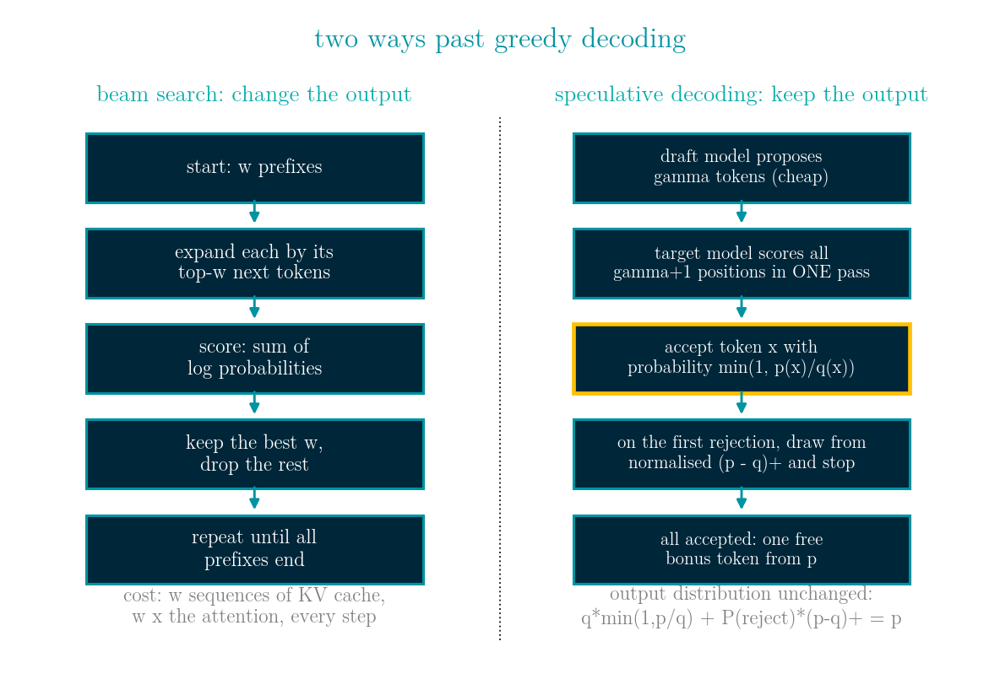

# Beam search and speculative decoding: searching for a better sentence, and getting the same one faster

More details in:
https://medium.com/100-days-of-python

Interactive walkthrough: [demo.html](demo.html) - a single self-contained page
(no build step, works offline, 中文 / English toggle) that animates the gap between
the best token and the best sentence, a beam keeping several prefixes alive, the two
things beams get wrong, one round of draft-and-verify, the proof that the output
distribution does not move, and the two knobs that control the speedup.

The previous day ended on a measurement: greedy decoding produces the **44th** most
likely sentence out of the 1,250 this grammar admits. Picking the best character at
every step is not picking the best sentence, and no temperature or top-p setting
closes that gap, because it is a search problem rather than a sampling one.

Beam search is the search. Speculative decoding is the opposite kind of idea: leave
the output distribution untouched and spend a cheap model's guesses to produce it with
fewer calls to the expensive one. Both are checked here against an enumeration of
every legal sentence, so "did the search find the best sentence" and "did the speedup
change the answers" have real answers.

## Beam search

| width | rank found | log p |
|---|---|---|
| 1 (greedy) | 44 | -6.717 |
| 2 | 44 | -6.717 |
| 4 | 10 | -6.502 |
| 8, 16, 32 | 5 | -6.407 |

Width 1 is greedy - and reproducing that exactly requires a stable sort, because this
model has genuine ties. Widening climbs from rank 44 to rank 5 and then stops: the
best sentence's prefix was pruned early, so no width reaches rank 1. A beam is a
heuristic, not a maximiser. The cost is linear in the width: w sequences, w KV caches
and w times the attention work at every step.

## Where the beam actually loses

Because the answer key exists, the failure can be located exactly. Follow the best
sentence's prefix through a width-8 beam: it is dropped at **step 9**, on the prefix
`'a small d'`, where its score ranked 10th of the 64 candidates while the beam keeps 8.
Nothing recovers after that - every sentence starting with that prefix is gone with it.
That is the real failure mode: not a wrong final comparison but a prefix that is
temporarily behind and would have caught up (`a small d` looks worse than `the old r`
until the word is finished).

The best sentence is reachable, at a price: width 32 and 64 still miss it, and
**width 128** finds it - sixteen times the beam that got within one rank of it.

## The two things beams get wrong

**Wider is not monotonically better.** On a model trained on a smaller corpus, a
width-3 beam scores *worse* than width 2. Keeping more prefixes alive lets a mediocre
early prefix survive and crowd out the one that would have won - the effect
translation papers call the beam search curse, where past a width of 5 to 10 the BLEU
score falls while model probability keeps rising.

**Highest total probability means shortest.** Every character multiplies the score by
something below 1. Here the bias is mild (correlation 0.061 over sentences spanning 21
to 38 characters), but visible: the top 10 by total log probability average 28.8
characters against 36.5 for the top 10 by log probability per character. Dividing by
`length ** alpha` is the standard patch, and a pure heuristic.

**And a beam returns neighbours, not options.** Its 16 best sentences share only 8
distinct subjects, against 12.8 for 16 sampled sentences. That is not a bug: the most
probable outputs resemble each other by construction, which is why beam search belongs
where one answer is correct (translation, speech recognition, constrained extraction)
and chat models use the previous day's sampling.

## Speculative decoding

A cheap draft proposes `gamma` tokens; the expensive model verifies all of them in
**one** forward pass. That is allowed because a causal model scores position i using
only the tokens to its left, so running `context + all proposals` once produces the
distribution at every one of the gamma+1 positions - the prefix of length i is already
inside the longer sequence, with the mask hiding what follows it. It is the same
computation as one training step on that sequence (teacher forcing). Each proposal is accepted with probability `min(1, p/q)`, the
first rejection is replaced by a draw from the normalised positive part of `p - q`, and
a round where everything is accepted emits a free bonus token.

Adding the two routes gives back `p` exactly - the measured error is 1e-16, which is
floating point, not approximation. Two shortcuts that sound equivalent are not: trusting
the draft moves the distribution by up to 0.367, and dropping the coin flip while
accepting whenever `p >= q` moves it by up to 0.043. Neither raises an error.

| draft order | accept rate | tokens / round | grammatical |
|---|---|---|---|
| 1 | 0.173 | 1.69 | 93% |
| 2 | 0.605 | 3.42 | 93% |
| 3 | 0.837 | 4.35 | 90% |
| 5 | 0.929 | 4.72 | 88% |

The quality column is the point: it does not move. A bad draft costs speed, never
correctness.

| gamma | accept | measured tokens/round | iid theory | speedup |
|---|---|---|---|---|
| 1 | 0.911 | 1.91 | 1.91 | 1.74x |
| 2 | 0.910 | 2.82 | 2.74 | 2.35x |
| 4 | 0.842 | 4.37 | 3.65 | 3.12x |
| 8 | 0.760 | 7.08 | 3.82 | 3.94x |

The textbook formula `(1 - a^(gamma+1)) / (1 - a)` assumes proposals are accepted
independently. They are not: the draft is right through a whole predictable stretch and
wrong at branch points, so long runs of acceptance are far more common than a coin with
the same average gives. That is why deployments report accepted *length* rather than
accept rate.

## Tree drafting, and when speculation stops paying

A chain spends all its verified positions on depth. A tree spends some on siblings -
two candidates for the same position, verified in the same pass, with the residual
distribution updated between them so the output is still exactly the target's.

| draft | chain tokens/round | tree tokens/round | tokens per verified position |
|---|---|---|---|
| order 1 | 1.65 | **1.96** | chain 0.41 / tree 0.68 |
| order 2 | 3.54 | 3.32 | chain 0.88 / tree 0.91 |
| order 3 | **4.41** | 3.72 | chain 1.10 / tree 0.97 |

A bad draft makes the tree win, because the sibling rescues rounds the first candidate
would have ended; a good draft makes the chain win, because every sibling is a position
that bought nothing. That is the argument for EAGLE-style tree drafting, and the reason
it ships as a topk knob rather than a default.

And the speedup is not unconditional. Speculation buys memory bandwidth with compute:
on a 70B-class model (140 GB of weights at 5 TB/s is a 28 ms read, 140 GFLOP per token
at 1 PFLOP/s), with 4.41 tokens per round at gamma=4:

| batch | plain step | speculative step | speedup |
|---|---|---|---|
| 1 - 32 | 28.0 ms | 28.0 ms | 4.41x |
| 128 | 28.0 ms | 89.6 ms | 1.38x |
| 512 | 71.7 ms | 358.4 ms | **0.88x** |

At small batches the arithmetic units are idle waiting for weights, so the extra
positions are free. Past the point where arithmetic fills the read they cost real time
and the rejected ones are pure waste - at batch 512 this configuration is slower than
not speculating at all, which is why servers gate speculation on the running batch size.

`decoding.py` closes with the matching sections for SGLang (`--speculative-algorithm
EAGLE3`, the tree above as `--speculative-eagle-topk` plus `--speculative-num-steps`
and `--speculative-num-draft-tokens`, `NEXTN` for models with their own MTP head) and
for vLLM (beam search moved out of `SamplingParams` into `LLM.beam_search()`,
`--speculative-config`, and the `ngram` method that needs no draft model at all).

## Complexity

| Operation | Time | Space |
|---|---|---|
| greedy | O(L · V) | O(1) sequences |
| beam search, width w | O(L · w · V) | O(w) sequences of KV cache |
| exact best sentence | O(number of sequences) | - |
| speculative round | 1 target pass + gamma draft passes | O(gamma) |

## References
- [The Curious Case of Neural Text Degeneration](https://arxiv.org/abs/1904.09751)
- [Fast Inference from Transformers via Speculative Decoding](https://arxiv.org/abs/2211.17192)
- [Accelerating Large Language Model Decoding with Speculative Sampling](https://arxiv.org/abs/2302.01318)
- [On NMT Search Errors and Model Errors: Cat Got Your Tongue?](https://arxiv.org/abs/1908.10090)
