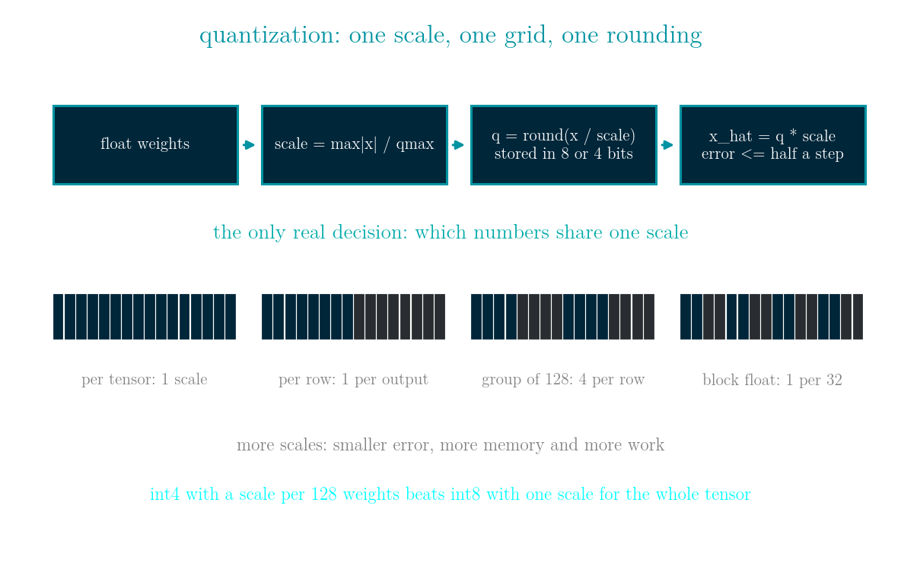
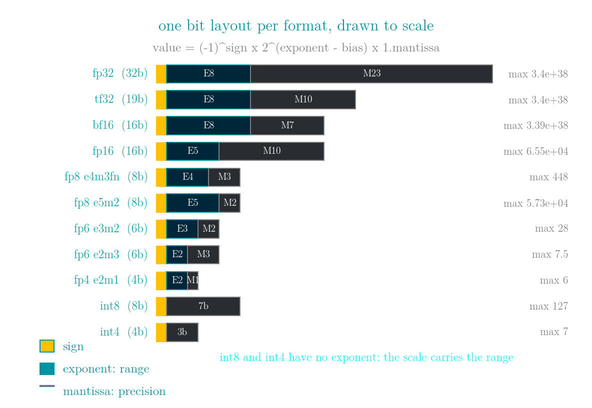

# Quantization: fewer bits per weight, and what the rounding costs

More details in:
https://medium.com/100-days-of-python

Interactive walkthrough: [demo.html](demo.html) - a single self-contained page
(no build step, works offline, 中文 / English toggle) that animates the grid a
quantized number lives on, who shares a scale, integer against float formats, the
activation outliers and the three ways to deal with them, GPTQ and AWQ, and training
through the rounding.



A 70B model in bf16 is 140 GB of weights, and every decode step reads all of them, so
bits per weight is both whether the model fits on the card and how long a token takes.
The question is never "is int8 accurate". It is three decisions: **which numbers share
a scale**, **where the outliers go**, and **whether the rounding minimises the error in
the weights or in the layer's output**.

| format | bits/weight | 70B model | one read at 5 TB/s |
|---|---|---|---|
| bf16 | 16.00 | 140.0 GB | 28.0 ms |
| fp8 / int8 | 8.00 | 70.0 GB | 14.0 ms |
| int4, group 128 | 4.12 | 36.1 GB | 7.2 ms |
| MXFP4, block 32 | 4.25 | 37.2 GB | 7.4 ms |

Everything below is measured on one linear layer whose activations are shaped like a
real one: 6 of 512 input channels carry values ~100x the median. The metric is the
relative error of the layer's **output**, because that is what the next layer sees.

## Every format on one page

Before the methods, the units. A float is three fields packed into one word - a sign bit, an exponent and a mantissa (the fraction) - read as

```
value = (-1)^sign * 2^(exponent - bias) * 1.mantissa
```

Take 0.15625 stored as an fp32, which you can check yourself with `np.float32(0.15625).view(np.uint32)`:

```
sign      0                        -> +1
exponent  01111100                 -> stored 124, minus bias 127 = -3
mantissa  01000000000000000000000  -> 1.01... = 1.25
value     1.25 x 2^-3 = 0.15625
```

Two conventions are doing a lot of work there. The exponent is stored **biased** - as an unsigned number with `bias = 2^(e-1) - 1` subtracted on reading - so that comparing two floats as if they were integers still gives the right order. And the leading `1.` before the point is **not stored at all**; it is implied, which is one free bit of precision. Numbers too small for that (below `2^emin`) are stored as *subnormals* with a leading `0.` instead, which is how a float degrades gradually towards zero instead of snapping to it.

So a format is three numbers: how many exponent bits (range), how many mantissa bits (precision), and what the all-ones exponent is spent on.



| format | bits | S / E / M | bias | largest | smallest normal | relative step | decimal digits | used for |
|---|---|---|---|---|---|---|---|---|
| `fp32` | 32 | 1 / 8 / 23 | 127 | 3.403e+38 | 1.18e-38 | 1.19e-07 | 6.9 | the default everywhere |
| `tf32` | 19 | 1 / 8 / 10 | 127 | 3.401e+38 | 1.18e-38 | 0.000977 | 3.0 | NVIDIA tensor cores: fp32 range, fp16 precision |
| `bf16` | 16 | 1 / 8 / 7 | 127 | 3.39e+38 | 1.18e-38 | 0.00781 | 2.1 | training: fp32 range, half the bytes |
| `fp16` | 16 | 1 / 5 / 10 | 15 | 6.55e+04 | 6.1e-05 | 0.000977 | 3.0 | older training, needs loss scaling |
| `fp8 e4m3fn` | 8 | 1 / 4 / 3 | 7 | 448 | 0.0156 | 0.125 | 0.9 | FP8 forward pass: weights and activations |
| `fp8 e5m2` | 8 | 1 / 5 / 2 | 15 | 5.734e+04 | 6.1e-05 | 0.25 | 0.6 | FP8 gradients: more range, less precision |
| `fp6 e3m2` | 6 | 1 / 3 / 2 | 3 | 28 | 0.25 | 0.25 | 0.6 | MX block element, more range |
| `fp6 e2m3` | 6 | 1 / 2 / 3 | 1 | 7.5 | 1 | 0.125 | 0.9 | MX block element, more precision |
| `fp4 e2m1` | 4 | 1 / 2 / 1 | 1 | 6 | 1 | 0.5 | 0.3 | MXFP4 / NVFP4 element |
| `int8` | 8 | 1 / - / 7 | - | 127 | 1 | 0.00787 | 2.1 | a uniform grid: the scale carries the magnitude |
| `int4` | 4 | 1 / - / 3 | - | 7 | 1 | 0.143 | 0.8 | a uniform grid: the scale carries the magnitude |

How to read that table. **Exponent bits buy range**: bf16 and fp32 have the same 8, which is why casting fp32 to bf16 never overflows. **Mantissa bits buy precision**: the relative step is `2^-m`, so fp32 resolves about 7 decimal digits and bf16 about 2. fp16 makes the opposite trade from bf16 at the same 16 bits - more precision, a tenth of the exponent range - which is exactly why fp16 training needs loss scaling and bf16 training does not.

Two notes on the names. `e4m3` is literally the field widths, so any format can be read off its name. And the `fn` in `float8_e4m3fn` means **finite**: it gives up infinities so the all-ones exponent can hold numbers instead, which buys one more binade - a maximum of 448 rather than 240.

The integers at the bottom have no exponent at all. All the magnitude information lives in the scale stored next to them, which is why everything else in this article is about choosing that scale.

The MX ("micro-scaling") formats sit in between: an element format plus one shared exponent per block of 32 values, which is where the fractional bit counts come from.

| MX format | element | block | scale | bits per value | element max |
|---|---|---|---|---|---|
| MXFP8 e4m3 | 8 bits | 32 | E8M0 | 8.25 | 448 |
| MXFP6 e3m2 | 6 bits | 32 | E8M0 | 6.25 | 28 |
| MXFP4 e2m1 | 4 bits | 32 | E8M0 | 4.25 | 6 |

The block scale is `E8M0` - 8 exponent bits and no mantissa, so it is a power of two and applying it is an exponent add rather than a multiply. NVFP4 is the same idea with a block of 16 and an e4m3 scale.

## Who shares a scale

`q = round(x / scale)`, `x_hat = q * scale`. Every error is at most half a step, and
the step is set by the largest value in the group:

| scheme | bits | relative error |
|---|---|---|
| int8, per tensor | 8.00 | 0.03103 |
| int8, per row | 8.00 | 0.01444 |
| fp8 e4m3 | 8.00 | 0.02658 |
| fp8 e5m2 | 8.00 | 0.05281 |
| int4, per row | 4.00 | 0.26197 |
| int4, group 128 | 4.12 | 0.17584 |
| MXFP4, block 32 | 4.25 | 0.12301 |

Read the last row against the first: **4 bits with a shared exponent per 32 values
beats 8 bits with one scale for the whole tensor**, at half the memory. That is the
trade every modern format makes - fewer bits per value, more scales.

## Integers against floats

int8 has 254 evenly spaced levels and a 127:1 range, so the *absolute* error is
constant everywhere and small values lose their significant digits. FP8 spends bits on
an exponent instead: e4m3 covers 2.3e5 and e5m2 3.8e9, with a roughly constant
*relative* error. e4m3 (3 mantissa bits) is the forward-pass format and e5m2 (one more
exponent bit) exists for gradients, which span a wider range and need less precision -
which is why mixed FP8 training uses both. MXFP4 goes further: an E2M1 element with
eight magnitudes `{0, .5, 1, 1.5, 2, 3, 4, 6}` and one shared power-of-two exponent per
32 values.

## Every method on one page

The formats above were the units. These are the methods, and three questions separate all of them: **what gets quantized**, **how the scale is chosen**, and **whether the rounding itself is improved**.

| method | quantizes | typical bits | what it costs | the idea |
|---|---|---|---|---|
| **round to nearest (RTN)** | W | 8 / 4 | nothing | absmax scale per tensor, row or group; the baseline everything is compared to |
| **MSE / percentile clipping** | W, A | 8 / 4 | a few calibration batches | search the clipping threshold that minimises squared error instead of using max |
| **LLM.int8()** | W + A | 8 (+16) | nothing | split the matmul: outlier columns stay in 16-bit, the rest go to int8 |
| **ZeroQuant / per-token dynamic** | W + A | 8 | nothing | per-token activation scales computed at run time, per-column weight scales |
| **SmoothQuant** | W + A | 8 | a few calibration batches | migrate range from activations into weights: X W = (X/s)(W s) |
| **AWQ** | W | 4 | a few calibration batches | scale up the channels the activations actually use before rounding |
| **GPTQ (from OBQ / OBS)** | W | 4 / 3 | a few calibration batches | round column by column and push the error into the rest using H = X^T X |
| **SqueezeLLM** | W | 4 / 3 | a few calibration batches | sensitivity-weighted k-means codebook plus a sparse outlier set |
| **SpQR** | W | ~4 | a few calibration batches | keep the few most sensitive weights in high precision, quantize the rest hard |
| **HQQ** | W | 4 / 3 / 2 | nothing | optimise the scale and zero-point with a robust loss; no calibration data |
| **QuIP#** | W | 2 | a few calibration batches | rotate the weights to make them incoherent, then lattice-quantize |
| **AQLM** | W | 2 | a training run | additive codebooks over groups, fine-tuned end to end |
| **NF4 / QLoRA** | W | 4 | nothing | levels at the quantiles of a normal distribution, plus a second quantization of the scales |
| **GGUF k-quants** | W | 2-8 | nothing | blocks of 16-32 with a super-block scale; the llama.cpp family (Q4_K_M, ...) |
| **FP8 (e4m3 / e5m2)** | W + A + grad | 8 | nothing | a float grid plus a per-tensor or per-row scale; the hardware path |
| **MX / NVFP4** | W + A | 4-8 | nothing | block floating point: one shared exponent per 16-32 values |
| **KV cache quantization** | KV | 8 / 4 | nothing | the cache is the memory, so quantize K and V per head or per token |
| **QAT (STE, LSQ, PACT)** | W + A | 4 / 3 / 2 | a training run | train through the rounding; LSQ learns the step size, PACT the clipping |

Read the "what it costs" column as a ladder. Everything that costs nothing can be applied to a checkpoint you downloaded five minutes ago. Everything that wants calibration needs a few hundred real sequences - still cheap, still offline, but the result now depends on what you fed it. Only the last rows want a training run, which is why they stay rare outside the labs that trained the model in the first place.

And the notation. **W4A16** means 4-bit weights and 16-bit activations - weight-only, which is the default for serving, because decode reads the weights once per token while the activations are tiny. **W8A8** and FP8 quantize the activations too, which buys tensor-core throughput that weight-only cannot, and matters in prefill where the work is compute-bound rather than bandwidth-bound. With a scale per 128 weights, "W4" really costs 4.12 bits.

The rest of this article measures the ones that fit on a single layer: round-to-nearest at every grouping, MSE clipping, LLM.int8(), SmoothQuant, AWQ, GPTQ and QAT.

## The outliers are in the activations

| what is quantized | output error |
|---|---|
| weights only, per row | 0.01462 |
| activations only, per tensor | 0.06897 |
| activations only, per token | 0.03394 |
| both | 0.03703 |

The weights are nearly Gaussian and a per-row scale fits them. The activations are not,
and that single fact is why weight-only quantization is the default. Three fixes:

- **Keep them.** LLM.int8() leaves 1.2% of the columns in 16-bit: 0.03703 → 0.00686.
  The cost is two matmuls and an irregular shape.
- **Move them.** SmoothQuant uses `X W^T = (X/s)(W s)^T` to shift range into the
  weights; alpha 0.5 gives 0.03703 → 0.01348, and the scales fold into the previous
  layer norm so it is free at run time.
- **Give them their own scale** - per-token, group-wise, MXFP4.

## Rounding to nearest is not the best rounding

At 4 bits with a group of 128:

| method | weight error | output error |
|---|---|---|
| round to nearest | 0.17584 | 0.17612 |
| GPTQ | **0.31186** | **0.13051** |
| AWQ (alpha 0.37) | - | 0.10059 |

GPTQ ends up with *worse* weights and a better output, which is the whole idea. It
rounds column by column and pushes each rounding error into the columns not yet done,
in the direction `H = XᵀX` says the real inputs excite. AWQ attacks the same problem
from the other side: it rescales the columns the activations use so the same rounding
hurts less. Both need calibration data.

## Training through the rounding

| inputs | train then round | train through rounding |
|---|---|---|
| correlated (like a real layer) | 2.180 | **0.837** (2.60x) |
| nearly orthogonal | 1.632 | 1.474 (1.11x) |

The straight-through estimator pretends `round()` has derivative 1, so the forward
pass sees rounded values while the weights stay in float. The second row is the part
worth keeping: with orthogonal inputs the gain almost vanishes, because the benefit
comes entirely from one weight absorbing another one's rounding error - the same
property GPTQ computes in closed form. Training discovers it; GPTQ derives it.

The QAT loss also does not fall monotonically (it swings by ±1.17 over the last 300
steps, final iterate 1.226 against a best of 0.837), because the forward pass is a step
function. That is why QAT runs select a checkpoint by validation loss.

`quantization.py` closes with the matching sections for **PyTorch** (`torchao`'s
`quantize_`, `torch.float8_e4m3fn` with `torch._scaled_mm`, and QAT as an
`autograd.Function`) and **JAX** (`jnp.float8_e4m3fn`, `preferred_element_type`, the
one-line straight-through estimator `x + stop_gradient(round(x) - x)`, and AQT / Qwix).
The difference worth carrying between them: PyTorch quantizes *modules*, JAX quantizes
*operations*, and the arithmetic underneath is identical.

## Complexity

| Operation | Time | Extra memory |
|---|---|---|
| round to nearest | O(n) | scales: 16 bits per group |
| MSE / percentile clipping | O(n · grid) | same |
| SmoothQuant / AWQ scales | O(n) per calibration batch | one vector per layer |
| GPTQ | O(d³) for H⁻¹ plus O(d² · rows) | H is d × d |
| QAT | a training run | none at inference |

## References
- [LLM.int8()](https://arxiv.org/abs/2208.07339)
- [SmoothQuant](https://arxiv.org/abs/2211.10438)
- [GPTQ](https://arxiv.org/abs/2210.17323)
- [AWQ](https://arxiv.org/abs/2306.00978)
- [FP8 Formats for Deep Learning](https://arxiv.org/abs/2209.05433)
- [Microscaling Data Formats (MX)](https://arxiv.org/abs/2310.10537)
