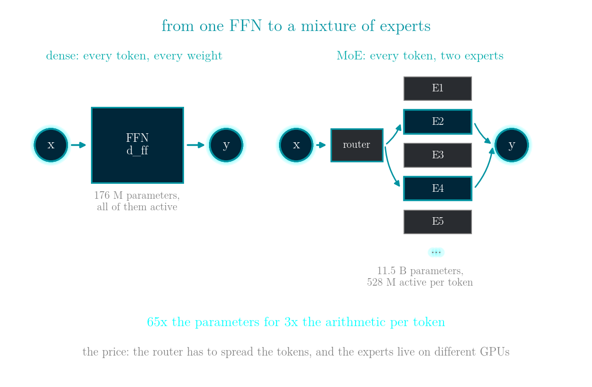

# Mixture of Experts: growing a model's parameters without growing the cost per token

More details in:
https://medium.com/100-days-of-python

Interactive walkthrough: [demo.html](demo.html) - a single self-contained page
(no build step, works offline, 中文 / English toggle) that animates the FFN-to-MoE
accounting, the router, expert collapse and the two ways to stop it, the capacity
factor, expert parallelism with its all-to-alls, and what DeepEP does to them.



Day 53 measured where a transformer's parameters live: two thirds of them sit in the
feed-forward block, and every token pays for all of them. That is the observation MoE
is built on. Replace the one FFN with E copies, send each token to the best k of them,
and the parameters multiply by E while the arithmetic per token multiplies by k.

| | parameters | active per token |
|---|---|---|
| one dense FFN (d_model 4096, d_ff 14336) | 176 M | 176 M |
| 64 experts + 1 shared | 11.5 B | 528 M |

**65x the parameters for 3x the arithmetic.** Across 61 layers that is 699 B
parameters of which 32 B run for any given token - the shape of every large open MoE
of the last two years. Another way to say it: the layer is a feed-forward block of
width 917,504 that only ever activates 28,672 of it per token.

## The router, and why it collapses

```python
probs = softmax(x @ Wg)          # score every expert
idx   = argsort(-probs)[:, :k]   # discrete: no gradient flows through this
w     = probs[idx]               # the weights that do get a gradient
y     = sum_j w[:, j] * expert[idx[:, j]](x)
```

The selection is discrete, so the router only learns through the experts it already
picked. An expert that is never chosen never improves and therefore is never chosen.

`moe.py` trains this for real - 2048 tokens from 8 regimes, 16 experts, top-2:

| router | loss | busiest / average | dead | entropy | purity |
|---|---|---|---|---|---|
| dense baseline | 0.0363 | - | - | - | - |
| no balancing | **0.0230** | 2.26 | 1 | 0.812 | 0.641 |
| auxiliary loss (Switch / GShard) | 0.0241 | 1.98 | 0 | 0.922 | 0.645 |
| selection bias, no loss (DeepSeek-V3) | 0.0257 | **1.05** | 0 | **1.000** | 0.568 |


The MoE beats the dense layer by 37%, and then one expert never sees a token. Both
balancing methods cost a little loss (5% and 12%) and buy a flat load. The auxiliary
loss adds `E * sum_i (fraction routed to i) * (mean probability of i)` - the fraction
has no gradient, the probability does, so the push lands on the router. The loss-free
scheme adds a per-expert bias to the **selection score only**, never to the weight
that multiplies the expert output, and nudges it by the sign of the load error; it
flattens the load hardest and costs the most specialisation.

## Capacity: fixed buffers mean dropped tokens

`capacity = factor * k * tokens / experts`, and tokens past it skip the layer.

| factor | capacity | dropped, unbalanced | dropped, balanced | padding |
|---|---|---|---|---|
| 1.0 | 256 | 41.2% | 1.1% | +0% |
| 1.25 | 320 | 27.8% | 0.0% | +25% |
| 1.5 | 384 | 17.6% | 0.0% | +50% |
| 2.0 | 512 | 3.6% | 0.0% | +100% |

The factor pads **every** expert to make room for the busiest one, so the padding
column is arithmetic wasted across the whole layer. Balance is what lets a small
factor run without drops.

## Expert parallelism, and the two all-to-alls


With E experts over N GPUs, a token whose expert lives elsewhere is dispatched there
and its result combined back: two all-to-all collectives per MoE layer, every layer,
every step. A collective is synchronous, so the router's imbalance becomes idle GPUs:

- unbalanced router, 4 GPUs: 1582 / 798 / 1361 / 355 tokens, busiest/average **1.54**,
  the others idle **35%** of the expert computation
- balanced router: 1022 / 1001 / 1032 / 1041, busiest/average **1.02**

Why EP rather than tensor parallelism for the experts? Both hold the same weights per
GPU; the difference is what moves per token. TP all-reduces the whole activation once
per layer (58.7 MB here); EP all-to-alls only the routed tokens, twice (117.4 MB at
k=2). EP moves more bytes, but the traffic is sparse, uneven and overlappable with
compute, which an all-reduce at the end of a layer is not. Real systems use both: TP
inside attention, EP across the experts.

## DeepEP

One dispatch of 4096 tokens at top-8 with d_model 7168 moves 470 MB. Three things in
DeepEP are worth understanding:

- **Two kernel sets.** The high-throughput ones forward a token over NVLink and then
  send it once per destination node over RDMA - fewest bytes on the slow link, right
  for prefill and training. The low-latency ones use pure RDMA with no forwarding hop,
  because decode cannot afford it.
- **FP8 dispatch.** 470 MB becomes 235 MB and, in this model, 8.59 ms becomes 4.29 ms.
  The combine stays bf16: summing k expert outputs needs the precision.
- **Overlap.** A hook lets the receive not be a barrier, so attention can run while
  the MoE tokens are still in flight.

## Writing the layer in PyTorch

The whole thing is about fifty lines, and the interesting part is that the loop over experts is what you are trying to avoid.

```python
class MoE(nn.Module):
    def __init__(self, d_model, d_ff, n_experts, k):
        self.gate = nn.Linear(d_model, n_experts, bias=False)
        # all the experts as ONE parameter, not a ModuleList:
        self.w1 = nn.Parameter(torch.empty(n_experts, d_model, d_ff))
        self.w2 = nn.Parameter(torch.empty(n_experts, d_ff, d_model))
        self.k = k

    def forward(self, x):                       # x: (tokens, d_model)
        probs  = self.gate(x).softmax(-1)
        w, idx = probs.topk(self.k, dim=-1)     # (tokens, k)
        w = w / w.sum(-1, keepdim=True)

        flat   = idx.reshape(-1)                # k entries per token
        order  = flat.argsort()                 # group by expert
        counts = torch.bincount(flat, minlength=self.w1.shape[0])
        xs = x.repeat_interleave(self.k, 0)[order]

        h  = F.silu(torch._grouped_mm(xs, self.w1, counts))
        ys = torch._grouped_mm(h, self.w2, counts)

        out = torch.zeros_like(x)
        token_of = torch.arange(len(x)).repeat_interleave(self.k)
        out.index_add_(0, token_of[order], ys * w.reshape(-1, 1)[order])
        return out
```

Four design decisions are hiding in there, and they are the same four in every real implementation.

**The experts are one tensor, not a list.** `nn.ModuleList([nn.Linear(...) for _ in range(E)])` is the obvious way to write it, and it means E separate kernel launches, E separate weight loads, and an expert id that cannot be used as an index. One `(E, d_model, d_ff)` parameter makes "choose an expert" into "choose an index", which is what the next three decisions need.

**Sort, do not mask.** The straightforward implementation multiplies by a one-hot mask and runs every expert on every token. It is correct and it throws away the entire point, because it does E times the arithmetic. Real layers sort the tokens by expert id, run one grouped matmul over the resulting variable-sized groups (`torch._grouped_mm`, or the Triton kernels in Megatron-LM and vLLM), and unsort at the end.

**Scatter back with `index_add_`.** A token appears k times and its k expert outputs have to be summed, so this has to be an add and not a write - and that add is also where the gradient for the gate weights comes from.

**The balancing loss is returned from `forward`.** It needs `probs` and the routing counts, which only exist inside the layer. Every MoE codebase ends up with a module-level list that layers append their auxiliary losses to and the training loop sums.

For the distributed version, the dispatch is one collective:

```python
torch.distributed.all_to_all_single(recv, send, out_splits, in_splits)
```

where the splits are the per-rank token counts from the sort. That line is where an imbalanced router turns into wall-clock time, because the splits are uneven and everyone waits for the largest.

## Writing the layer in JAX

Same algorithm, and the code looks nothing like it, because JAX wants a fixed shape and a sharding rule rather than a gather.

```python
def moe(x, wg, w1, w2, k, capacity):
    probs  = jax.nn.softmax(x @ wg)                   # (T, E)
    w, idx = jax.lax.top_k(probs, k)
    mask = jax.nn.one_hot(idx, n_experts).sum(1)      # (T, E)
    pos  = jnp.cumsum(mask, axis=0) * mask - 1        # slot inside the buffer
    disp = mask[..., None] * jax.nn.one_hot(pos, capacity)   # (T, E, cap)

    xe = jnp.einsum("tec,td->ecd", disp, x)           # FIXED (E, cap, d)
    he = jax.nn.silu(jnp.einsum("ecd,edf->ecf", xe, w1))
    ye = jnp.einsum("ecf,efd->ecd", he, w2)
    return jnp.einsum("ecd,tec,te->td", ye, disp, w)
```

The einsum chain *is* the dispatch and the combine. Nothing is sorted, nothing is variable length, and **the capacity appears explicitly as an array dimension** - which is exactly why the capacity factor exists at all: with fixed buffers, the overflow has nowhere to go.

And the parallelism is an annotation rather than a call:

```python
mesh = Mesh(devices, ("data", "expert"))
w1   = jax.device_put(w1, NamedSharding(mesh, P("expert", None, None)))
moe  = shard_map(moe, mesh, in_specs=..., out_specs=...)
```

Sharding the expert axis of `w1` **is** expert parallelism. The einsum needs data that lives on another device, so XLA inserts the all-to-all; nobody writes the collective. That is the real difference between the two ecosystems: in PyTorch you call `all_to_all_single` and own the splits, in JAX you annotate the axis and the compiler emits the communication.

The trade is the one you would expect. The gather-and-sort version does arithmetic proportional to the tokens actually routed and needs custom kernels to be fast; the one-hot version is pure dense einsum that any compiler can fuse, and pays for every empty slot in the buffers.

## In the serving stacks, briefly

Both servers expose the same two decisions. Where the experts live - SGLang `--ep-size 8`, vLLM `--enable-expert-parallel` - and what carries the all-to-all: SGLang `--enable-deepep-moe` with `--deepep-mode normal|low_latency|auto`, vLLM picking DeepEP or pplx-kernels underneath. Both end up running data-parallel attention next to expert-parallel experts, because attention has no experts to spread and the MoE weights do not fit otherwise.

The flag worth knowing beyond that is SGLang's `--enable-eplb` with `--ep-num-redundant-experts`. A balancing loss flattens the **average**, and real traffic is not the average: one minute of requests can all want the same few experts. So the server measures the live per-expert load, **moves experts between ranks**, and **replicates the hottest ones**. The collapse problem from training, reappearing as an operations problem with an operations answer.

## Complexity

| Operation | Time per token | Memory |
|---|---|---|
| dense FFN | O(d_model · d_ff) | all weights read |
| MoE, top-k | O(k · d_model · d_ff) | E · weights resident |
| routing | O(d_model · E + E log E) | - |
| expert parallel layer | 2 all-to-alls of k · d_model per token | E/N experts per GPU |

## References
- [Outrageously Large Neural Networks (sparse MoE)](https://arxiv.org/abs/1701.06538)
- [GShard](https://arxiv.org/abs/2006.16668)
- [Switch Transformer](https://arxiv.org/abs/2101.03961)
- [DeepSeek-V3](https://arxiv.org/abs/2412.19437) - shared experts, loss-free balancing
- [DeepEP](https://github.com/deepseek-ai/DeepEP)
