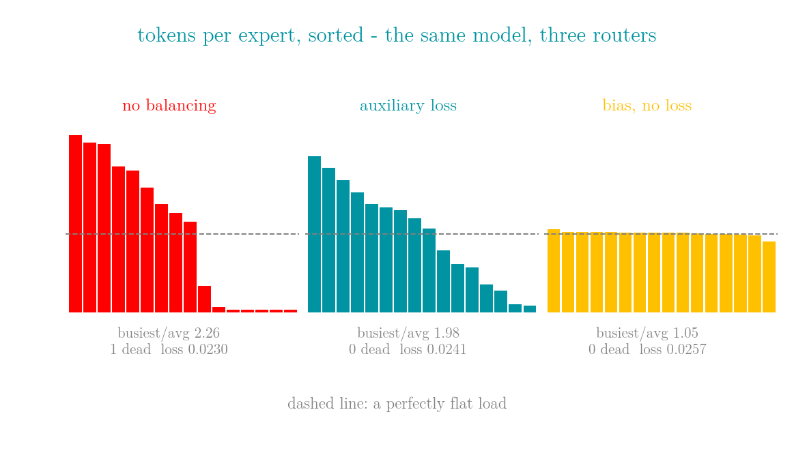
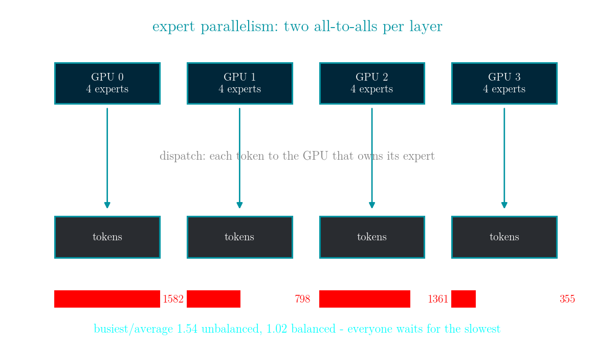

# Mixture of Experts: one FFN becomes many, and each token runs two of them

More details in:
https://medium.com/100-days-of-python

Interactive walkthrough: [demo.html](demo.html) - a single self-contained page
(no build step, works offline, 中文 / English toggle) that animates the FFN-to-MoE
accounting, the router, expert collapse and the two ways to stop it, the capacity
factor, expert parallelism with its all-to-alls, and what DeepEP does to them.


Day 53 measured where a transformer's parameters live: two thirds of them sit in the
feed-forward block, and every token pays for all of them. That is the observation MoE
is built on. Replace the one FFN with E copies, send each token to the best k of them,
and the parameters multiply by E while the arithmetic per token multiplies by k.

| | parameters | active per token |
|---|---|---|
| one dense FFN (d_model 4096, d_ff 14336) | 176 M | 176 M |
| 64 experts + 1 shared | 11.5 B | 528 M |

**65x the parameters for 3x the arithmetic.** Across 61 layers that is 699 B
parameters of which 32 B run for any given token - the shape of every large open MoE
of the last two years. Another way to say it: the layer is a feed-forward block of
width 917,504 that only ever activates 28,672 of it per token.

## The router, and why it collapses

```python
probs = softmax(x @ Wg)          # score every expert
idx   = argsort(-probs)[:, :k]   # discrete: no gradient flows through this
w     = probs[idx]               # the weights that do get a gradient
y     = sum_j w[:, j] * expert[idx[:, j]](x)
```

The selection is discrete, so the router only learns through the experts it already
picked. An expert that is never chosen never improves and therefore is never chosen.

`moe.py` trains this for real - 2048 tokens from 8 regimes, 16 experts, top-2:

| router | loss | busiest / average | dead | entropy | purity |
|---|---|---|---|---|---|
| dense baseline | 0.0363 | - | - | - | - |
| no balancing | **0.0230** | 2.26 | 1 | 0.812 | 0.641 |
| auxiliary loss (Switch / GShard) | 0.0241 | 1.98 | 0 | 0.922 | 0.645 |
| selection bias, no loss (DeepSeek-V3) | 0.0257 | **1.05** | 0 | **1.000** | 0.568 |



The MoE beats the dense layer by 37%, and then one expert never sees a token. Both
balancing methods cost a little loss (5% and 12%) and buy a flat load. The auxiliary
loss adds `E * sum_i (fraction routed to i) * (mean probability of i)` - the fraction
has no gradient, the probability does, so the push lands on the router. The loss-free
scheme adds a per-expert bias to the **selection score only**, never to the weight
that multiplies the expert output, and nudges it by the sign of the load error; it
flattens the load hardest and costs the most specialisation.

## Capacity: fixed buffers mean dropped tokens

`capacity = factor * k * tokens / experts`, and tokens past it skip the layer.

| factor | capacity | dropped, unbalanced | dropped, balanced | padding |
|---|---|---|---|---|
| 1.0 | 256 | 41.2% | 1.1% | +0% |
| 1.25 | 320 | 27.8% | 0.0% | +25% |
| 1.5 | 384 | 17.6% | 0.0% | +50% |
| 2.0 | 512 | 3.6% | 0.0% | +100% |

The factor pads **every** expert to make room for the busiest one, so the padding
column is arithmetic wasted across the whole layer. Balance is what lets a small
factor run without drops.

## Expert parallelism, and the two all-to-alls



With E experts over N GPUs, a token whose expert lives elsewhere is dispatched there
and its result combined back: two all-to-all collectives per MoE layer, every layer,
every step. A collective is synchronous, so the router's imbalance becomes idle GPUs:

- unbalanced router, 4 GPUs: 1582 / 798 / 1361 / 355 tokens, busiest/average **1.54**,
  the others idle **35%** of the expert computation
- balanced router: 1022 / 1001 / 1032 / 1041, busiest/average **1.02**

Why EP rather than tensor parallelism for the experts? Both hold the same weights per
GPU; the difference is what moves per token. TP all-reduces the whole activation once
per layer (58.7 MB here); EP all-to-alls only the routed tokens, twice (117.4 MB at
k=2). EP moves more bytes, but the traffic is sparse, uneven and overlappable with
compute, which an all-reduce at the end of a layer is not. Real systems use both: TP
inside attention, EP across the experts.

## DeepEP

One dispatch of 4096 tokens at top-8 with d_model 7168 moves 470 MB. Three things in
DeepEP are worth understanding:

- **Two kernel sets.** The high-throughput ones forward a token over NVLink and then
  send it once per destination node over RDMA - fewest bytes on the slow link, right
  for prefill and training. The low-latency ones use pure RDMA with no forwarding hop,
  because decode cannot afford it.
- **FP8 dispatch.** 470 MB becomes 235 MB and, in this model, 8.59 ms becomes 4.29 ms.
  The combine stays bf16: summing k expert outputs needs the precision.
- **Overlap.** A hook lets the receive not be a barrier, so attention can run while
  the MoE tokens are still in flight.

`moe.py` closes with the matching sections for **SGLang** (`--ep-size`,
`--enable-deepep-moe`, `--deepep-mode normal/low_latency/auto`, and `--enable-eplb`
with `--ep-num-redundant-experts`, which move and replicate experts because real
traffic is skewed minute to minute) and **vLLM** (`--enable-expert-parallel` with
`--data-parallel-size` for DP attention plus EP experts).

## Complexity

| Operation | Time per token | Memory |
|---|---|---|
| dense FFN | O(d_model · d_ff) | all weights read |
| MoE, top-k | O(k · d_model · d_ff) | E · weights resident |
| routing | O(d_model · E + E log E) | - |
| expert parallel layer | 2 all-to-alls of k · d_model per token | E/N experts per GPU |

## References
- [Outrageously Large Neural Networks (sparse MoE)](https://arxiv.org/abs/1701.06538)
- [GShard](https://arxiv.org/abs/2006.16668)
- [Switch Transformer](https://arxiv.org/abs/2101.03961)
- [DeepSeek-V3](https://arxiv.org/abs/2412.19437) - shared experts, loss-free balancing
- [DeepEP](https://github.com/deepseek-ai/DeepEP)
