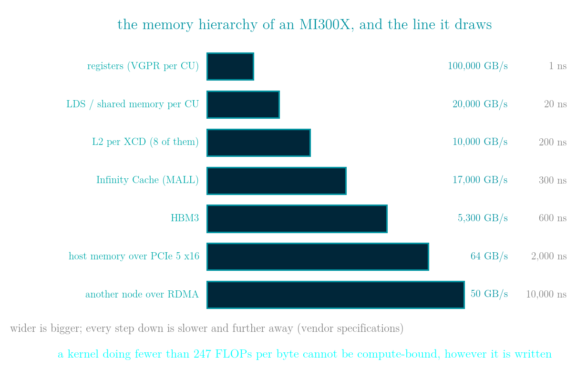
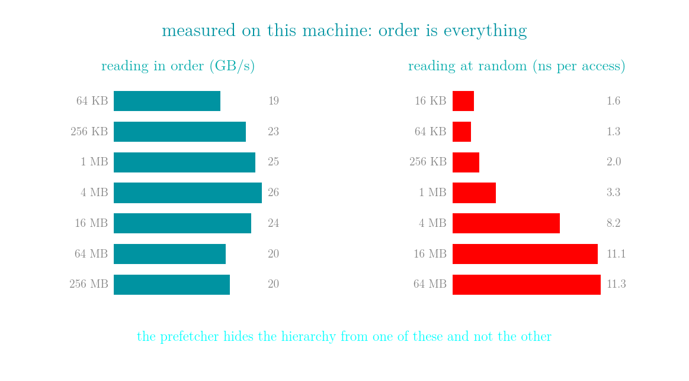
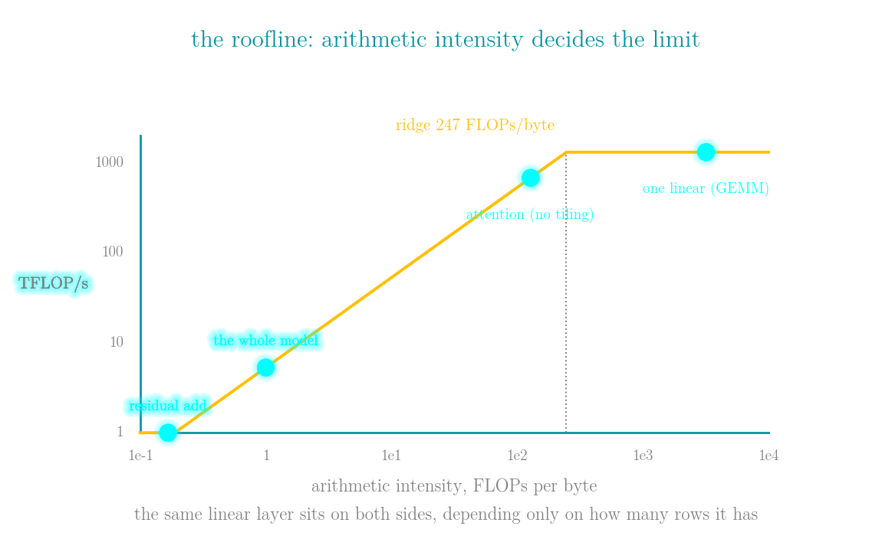
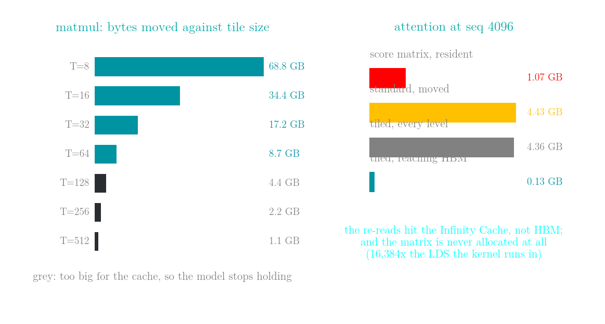

# The memory hierarchy and the roofline: why some kernels never get faster

More details in:
https://medium.com/100-days-of-python

Interactive walkthrough: [demo.html](demo.html) - a single self-contained page
(no build step, works offline, 中文 / English toggle) that animates the hierarchy, the
measured difference between reading in order and at random, the roofline with this
series' kernels on it, batching, tiling, FlashAttention as a case of tiling, and
Little's law.

Every performance number in this series has turned out to be a memory number. Decode is
slow because it reads the weights once per token. The KV cache is the capacity limit.
MoE is a communication problem. Quantization helps because fewer bits means fewer bytes.
None of those are statements about arithmetic.

This is the model underneath all of them.

## The hierarchy

Every number here is from a public source. **spec** means published by the vendor -
product pages, data sheets, the CDNA 3 and Hopper architecture whitepapers, the PCIe and
Ethernet standards. **est.** means my own order-of-magnitude figure: on-chip bandwidths
and access latencies are almost never in a datasheet, so all of those are estimates and
should be read as "about", not as measurements.

Capacity, all vendor-published:

| level | MI300X | H200 SXM | H100 SXM |
|---|---|---|---|
| registers | 512 KB / CU | 256 KB / SM | 256 KB / SM |
| shared memory (LDS) | 64 KB / CU | 228 KB / SM | 228 KB / SM |
| L2 | 4 MB / XCD, 8 of them | 50 MB | 50 MB |
| Infinity Cache (MALL) | 256 MB | - | - |
| HBM | 192 GB HBM3 | 141 GB HBM3e | 80 GB HBM3 |

Bandwidth, estimated on-chip and published off-chip:

| level | MI300X | H200 SXM | H100 SXM |
|---|---|---|---|
| registers | ~100,000 GB/s (est.) | ~100,000 GB/s (est.) | ~100,000 GB/s (est.) |
| shared memory (LDS) | ~20,000 GB/s (est.) | ~20,000 GB/s (est.) | ~20,000 GB/s (est.) |
| L2 | ~10,000 GB/s (est.) | ~7,000 GB/s (est.) | ~7,000 GB/s (est.) |
| Infinity Cache (MALL) | 17,000 GB/s (spec) | - | - |
| HBM | 5,300 GB/s (spec) | 4,800 GB/s (spec) | 3,350 GB/s (spec) |
| host memory, PCIe 5 x16 | 64 GB/s (spec) | 64 GB/s (spec) | 64 GB/s (spec) |
| another node, RDMA | ~50 GB/s (400 Gb/s NIC) | ~50 GB/s | ~50 GB/s |

Latencies, used in the Little's-law section below, are estimates throughout: 1 ns for
registers, 20 ns for shared memory, 200-300 ns for the caches, 600 ns for HBM, 2 us over
PCIe and 10 us across the network.

Peak bf16 is 1307 TFLOP/s on the MI300X and 990 TFLOP/s on both Hopper parts - H200 is
the same die as H100 with more and faster memory, so its arithmetic did not move. Divide
peak by HBM bandwidth and the machine balances are **247**, **206** and **296** FLOPs per
byte. Lower is better for anything memory-bound, so on that column the order is H200,
then MI300X, then H100 - and that *is* the argument for the refresh part: nothing changed
except the memory. The shape is the same on all three, which is why nothing below changes
qualitatively between them. Everything that follows uses the MI300X numbers unless it
says otherwise.

They differ in ways that matter later: the MI300X has the most HBM at the most bandwidth
and a 256 MB Infinity Cache between L2 and HBM that neither Hopper part has, while both
NVIDIA parts have a much larger L2 and more shared memory per SM (228 KB against 64 KB) -
and **shared memory is exactly what sets the block size** in the tiling sections below.

The last two rows are earlier days: the host-memory row is why HiCache has
tiers, and the RDMA row is why DeepEP ships two different sets of kernels.
## Measured here: order is everything

Summing an array is bandwidth-bound at every size, so it should fall off a cliff when
the array leaves cache. On this machine it moves by about 1.3x - the prefetcher sees a
sequential read coming and starts it early. Read the *same bytes* in a random order and
the hierarchy appears in full: **1.1 ns per access in cache against 11.7 ns out of it, a
factor of 11**.

Bandwidth is what the specification sells you; locality is what decides whether you get
it. Every structure in this series that looks like a pointer chase - a radix tree, a
block table, a gather of expert weights - pays the second price.

## The roofline

A machine is two numbers: for the MI300X, 1307 TFLOP/s and 5300 GB/s. Their ratio is
the **machine balance**, 247 FLOPs per byte, and a kernel that does less arithmetic per byte than that
cannot be compute-bound however it is written.

| kernel | FLOPs/byte | bound | time |
|---|---|---|---|
| decode: one linear (GEMV) | 1.00 | memory | 0.02 ms |
| prefill: one linear (GEMM) | 3185.78 | compute | 0.37 ms |
| decode: attention over KV | 1.00 | memory | 0.01 ms |
| prefill: attention (untiled) | 128.00 | memory | 0.41 ms |
| RMSNorm | 1.00 | memory | 0.01 ms |
| residual add | 0.17 | memory | 0.02 ms |
| decode: the whole 70B model | 1.00 | memory | 26.42 ms |

Read the first two rows together: the same weights and the same kernel, memory-bound as
a matrix-vector product in decode and compute-bound as a matrix-matrix product in
prefill. The kernel did not change; the number of rows did.

## Batching moves you along it

| batch | FLOPs/byte | bound | per token |
|---|---|---|---|
| 1 | 1.00 | memory | 22.2 us |
| 16 | 15.96 | memory | 1.4 us |
| 256 | 247.17 | compute | 0.1 us |
| 1024 | 896.00 | compute | 0.1 us |

The weights are read once whatever the batch, so intensity grows linearly until it
crosses the ridge and the cost per token falls by two orders of magnitude. The day on
speculative decoding measured the same curve from the other end.

## Tiling is the only way to raise intensity

A kernel cannot choose its FLOPs. It can choose how many times it re-reads the same
bytes. A 4096x4096 matmul moves **549.8 GB** untiled and **5.4 GB** in tiles of 104 -
103x less, and the factor is exactly the tile size. The tile size is not free: three
tiles must fit in cache at once, so `T = sqrt(cache / 3)`.

## FlashAttention is that argument, applied to attention

Day 52 proved the online-softmax identity - the same answer in one pass over the keys,
to the last bit. This is why it is worth doing, and the honest version has three parts.

At seq 4096 with 32 heads of 128 and **64 KB of LDS**, the block is 64 rows and K and V
are re-read 64 times, so counting every level of the hierarchy the tiled version moves
4.36 GB against 4.43 GB untiled - **1.0x**, which is to say almost nothing. The saving
scales with SRAM over d_head squared, which is why it looked larger in the original
paper at d_head 64.

But those re-reads mostly never reach HBM. K and V for one head are **2.1 MB** against a
**268 MB Infinity Cache**, so the repeated passes are cache hits and the traffic that
actually crosses to HBM is **0.13 GB, 33.0x less** than untiled. A model that counts only
one level of the hierarchy will mispredict - which is this whole day's lesson, applied
to the day itself.

And the traffic was never the main prize anyway. What tiling buys is that the **1.07 GB
score matrix is never allocated at all** - 16,384 times the LDS the kernel runs in. That is a
capacity argument, not a bandwidth one, and it is why long contexts are servable. The
backward pass does the same thing: it stores the log-sum-exp per row, one number instead
of seq numbers, and recomputes the scores from Q and K, because recomputation is cheaper
than the round trip.
## Latency, and why bandwidth alone is not enough

Little's law: keeping the pipe full needs `bandwidth x latency` bytes in flight, which
here is 3.2 MB, or about **24,800 simultaneous requests**. A kernel that issues one load
and waits is slow however clean it is.

And a cache line is fetched whole. Measured on this machine, reading with a stride of
16 leaves **6.2%** of the fetched bytes useful and makes the loop *slower*, because the
same 16 MB is fetched for a sixteenth of the payload. That is coalescing on a GPU and
array-of-structs on a CPU: one hardware fact, two names.

`memory_hierarchy.py` closes with the matching sections for **PyTorch** (`torch.profiler`,
`max_memory_allocated`, `torch.compile` fusion, `scaled_dot_product_attention`) and
**JAX** (`memory_analysis()` and `cost_analysis()` - a roofline the compiler computes
before you run anything - XLA's default fusion, and Pallas when you need to choose the
block sizes yourself).

## Complexity

| Quantity | Formula |
|---|---|
| arithmetic intensity | FLOPs / bytes moved |
| machine balance | peak FLOP/s / bandwidth |
| time | max(FLOPs / peak, bytes / bandwidth) |
| tiled matmul traffic | O(n^3 / T) for tiles of T |
| optimal tile | sqrt(cache / 3) |
| bytes in flight needed | bandwidth x latency |

## References
- [Roofline: an insightful visual performance model](https://dl.acm.org/doi/10.1145/1498765.1498785)
- [FlashAttention](https://arxiv.org/abs/2205.14135) - IO-aware attention
- [FlashAttention-2](https://arxiv.org/abs/2307.08691)
- [Making Deep Learning Go Brrrr From First Principles](https://horace.io/brrr_intro.html)
