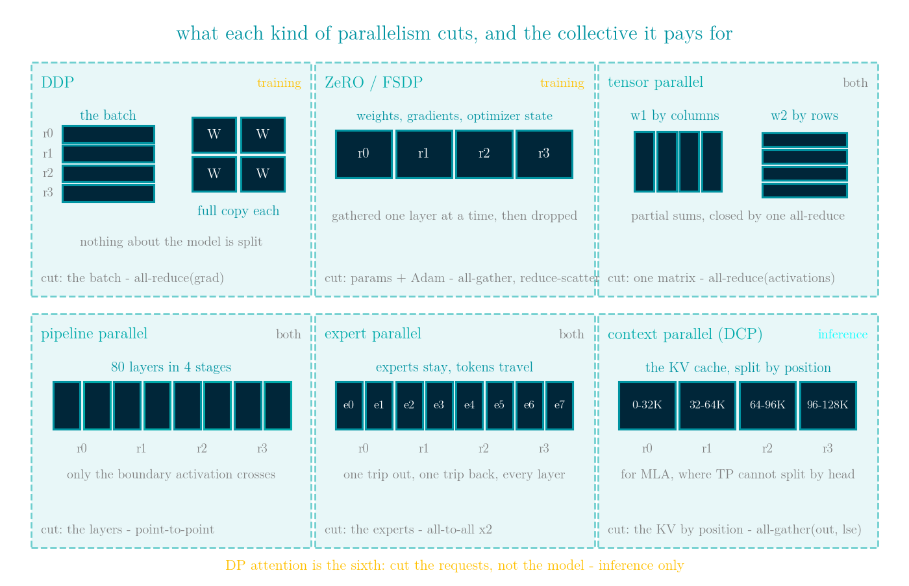
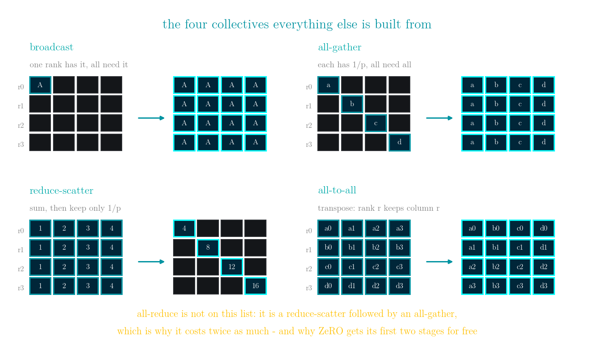
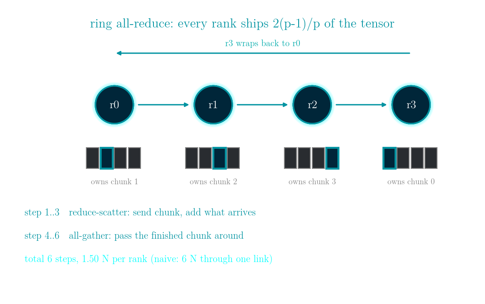
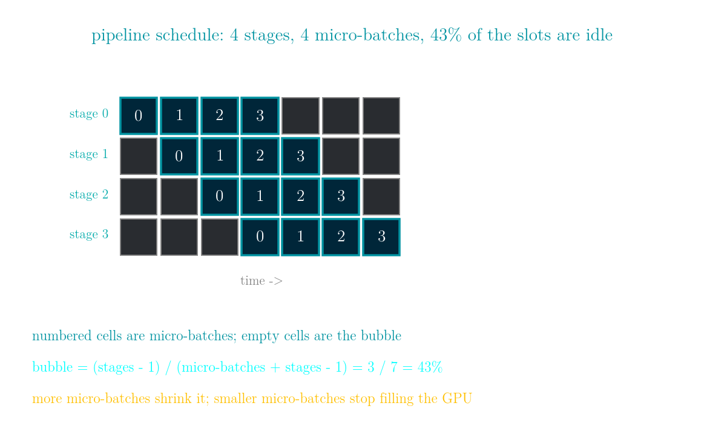
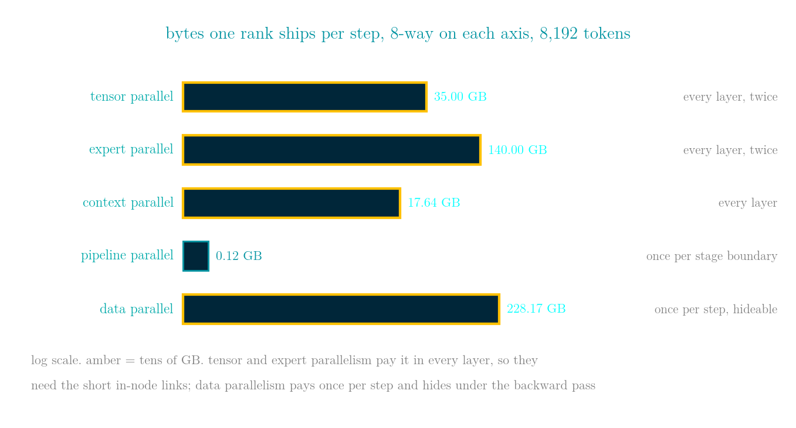

# Collective communication: splitting a model across GPUs without changing its answers

More details in:
https://medium.com/100-days-of-python

Interactive walkthrough: [demo.html](demo.html) - a single self-contained page
(no build step, works offline, 中文 / English toggle) that animates the ring all-reduce
step by step, the four primitives it is built from, then the training axes (DDP, ZeRO
and FSDP, tensor parallelism, the pipeline bubble) and the inference ones (what
disappears without gradients, expert parallelism, context parallelism for MLA), the
table that decides which axis goes inside a node, and four parallelism bugs that never
raise an error.



TP, EP, DP, DCP, DDP, FSDP, PP. Seven names, and they are all the same decision: which
collective runs, how often, and on how many bytes. This day builds the collectives from
scratch on a simulated ring of ranks, counts the traffic each kind of parallelism
causes, and then checks - numerically, against a single device - that none of them
changed the answer.

The day is in two halves because the two jobs are genuinely different. **Training** has
gradients and optimizer state, so its problem is that the *weights* do not fit: a 70B
model with Adam needs **1,043 GB per GPU** if every GPU keeps a replica. **Inference**
has neither, so its problems are that the *KV cache* does not fit - 64 requests of 128K
tokens is **2,560 GB** - and that every collective now happens on a latency budget. The
collectives underneath are the same five.

## The primitives

| collective | what it is for | bytes each rank ships | steps |
|---|---|---|---|
| broadcast | one rank has it, everybody needs it | N | log2(p) |
| all-reduce | everybody has a partial sum, everybody needs the total | 2(p-1)/p · N | 2(p-1) |
| reduce-scatter | everybody has a partial sum, each keeps 1/p | (p-1)/p · N | p-1 |
| all-gather | each rank has 1/p, everybody needs all of it | (p-1)/p · N | p-1 |
| all-to-all | rank r holds a shard addressed to every rank | (p-1)/p · N | p-1 |
| point-to-point | hand a tensor to the next rank, nobody else cares | N | 1 |



An all-reduce is not a primitive: it is a reduce-scatter followed by an all-gather,
which is why its bill is twice theirs - and, as the training half shows twice over, why
some memory savings turn out to be free.



Run the ring version on 8 ranks and a 64 KB vector: 14 steps, 114,688 bytes shipped per
rank, every rank ending with the same sum. The naive alternative - everybody sends the
whole vector to rank 0 and rank 0 sends the total back - would push 917,504 bytes through
a single link. The ring never lets any rank hold more than one chunk of the sum at a
time, so the volume per rank stops growing with p and only the step count does.

That trade is the whole implementation choice. Small messages are decided by hops and a
tree wins (2log2(p) levels against 2(p-1) steps); large messages are decided by bytes and
the ring wins. On the link model in this module the crossover is around **2 MB**, which is
why NCCL and RCCL switch implementation by message size, and why the tiny all-reduce
inside a decode step is not free - it costs hops even when it costs almost no bytes.

# Part one - training: the weights do not fit

## DDP: a full replica per GPU, a different slice of the batch

DDP - `torch.nn.parallel.DistributedDataParallel` - is the simplest thing that works.
Every GPU keeps a **complete** copy of the model and reads a different quarter of the
batch; one process per GPU; one gradient all-reduce per step; nothing else is shared.

Four ranks, 60 training steps. One device on the full batch reaches loss 0.014105; the
four ranks reach 0.014105, and the largest weight difference is 1.19e-07. They agree
because **the loss is a mean**: the average of the per-rank gradients is exactly the
full-batch gradient, and the all-reduce is what enforces it.

Nothing about the model is split, so the memory per GPU does not move. That is the whole
limitation of DDP in one sentence, and the reason the next section exists.

Two details are how that all-reduce stops being visible. The first is **bucketing**:
gradients are produced back to front, so a chunk can fly while the backward pass is still
running.

| buckets | size each | all-reduce each | total comm | exposed at the end |
|---|---|---|---|---|
| 1 | 1024 MB | 4.73 ms | 4.73 ms | 4.73 ms |
| 4 | 256 MB | 1.20 ms | 4.81 ms | 1.20 ms |
| 25 | 41 MB | 0.22 ms | 5.40 ms | 0.22 ms |

More buckets means slightly more total traffic - each one pays the latency again - and
much less of it left exposed at the end of the step.

The second is **gradient accumulation**. Inside `with model.no_sync():` DDP skips the
all-reduce entirely and lets gradients pile up locally, so N micro-steps cost one
all-reduce instead of N. It is also the one place where skipping a collective is safe,
because *every* rank skips it - exactly the condition that silent failure 2 breaks.

## ZeRO and FSDP: stop replicating what you can shard


Adam in mixed precision keeps 16 bytes per parameter: 2 for the bf16 weight, 2 for the
bf16 gradient, 4 for the fp32 master copy, 4 and 4 for the two moments. That is **eight
times the weights themselves**, and it is why the optimizer, not the model, is what
makes large training runs not fit.

| stage | GB per rank | wire GB | vs DDP | collectives |
|---|---|---|---|---|
| DDP (no sharding) | 1043 | 228.2 | 1.00x | all-reduce(grad) |
| ZeRO-1 (optimizer) | 359 | 228.2 | 1.00x | reduce-scatter(grad) + all-gather(param) |
| ZeRO-2 (+ gradients) | 244 | 228.2 | 1.00x | reduce-scatter(grad) + all-gather(param) |
| ZeRO-3 / FSDP (+ parameters) | 130 | 342.3 | 1.50x | all-gather(param) x2 + reduce-scatter(grad) |

Stages 1 and 2 are free, and the reason is the primitive table: an all-reduce *is* a
reduce-scatter plus an all-gather. Split it in two, keep only your own slice of the
gradient in between, and most of the memory is gone without one extra byte on the wire.
Stage 3 is the one with a price, because the parameters themselves are sharded and each
layer has to be all-gathered just before it runs and dropped straight after: 1.5x the
bytes for 1/8 of the memory. Day 62.5 called this trade recompute versus store; here it
is refetch versus store, and it is the same curve.

## Tensor parallelism: one layer, split across GPUs

Split the first matrix by columns and the second by rows. The column split is not a
coin flip: it gives each rank whole hidden units, so the non-linearity between the two
matrices needs no communication at all. After the second matrix each rank holds a
*partial* sum of the full-width output, and one all-reduce closes the block. Verified
against a single device: 4.77e-07.

At 8,192 tokens, 8-way: the activation is 128 MB, each all-reduce moves 224 MB per rank,
and there are 160 of them in a forward pass - one after attention and one after the MLP
in each of 80 layers - for 35 GB total. **The bill scales with tokens, not parameters**,
the opposite of DDP, which is why this is the axis that makes a long sequence trainable
at all and why it has to stay inside one node. What the same all-reduce costs when there
is only one token per request is the inference half.

Sequence parallelism is the free half of a trade. An all-reduce is already a
reduce-scatter plus an all-gather, so keeping the sharded form in between - 224 MB
either way, identical bytes - lets the norms and residuals in the middle run on 1/p of
the sequence: 16 MB of activation per rank instead of 128 MB.

## Pipeline parallelism: the cheapest wire, paid for in idle time



Only the boundary activation crosses, point to point, no collective at all: 128 MB per
boundary and 7 boundaries, 896 MB for a whole forward pass of 8,192 tokens. That is three
orders of magnitude below what tensor parallelism moves, which is why pipeline stages can
sit on different nodes.

The cost is the bubble. The last stage has nothing to do until the first micro-batch has
walked through all the earlier ones:

| micro-batches | bubble | utilisation |
|---|---|---|
| 1 | 87.5% | 12.5% |
| 4 | 63.6% | 36.4% |
| 16 | 30.4% | 69.6% |
| 64 | 9.9% | 90.1% |

bubble = (stages - 1) / (micro-batches + stages - 1), so the fix is always more
micro-batches - until they get small enough that the matmuls stop filling the GPU, which
is the Day 62.5 roofline putting a floor under it.

## A real run stacks all four at once

64 GPUs as a mesh of tensor 8 x pipeline 4 x data 2. Each GPU then holds 20 of the 80
layers and 2.19 B of the 70 B parameters:

| | |
|---|---|
| optimizer state per GPU, no sharding | 32.6 GB |
| the same with ZeRO-3 on the data axis | 16.3 GB |
| tensor-parallel traffic per step | 8.75 GB (inside the node) |
| pipeline hand-offs per step | 0.12 GB (point to point) |
| gradient all-reduce per step | 4.07 GB (once, overlapped) |

The ordering is the lesson. Tensor and pipeline parallelism already shard the parameters,
so the 1,043 GB is down to 32.6 GB before ZeRO does anything at all - ZeRO only shards what
the data-parallel axis is still replicating. And the three traffic rows want three
different links.

# Part two - inference: the KV cache does not fit

## What disappears, and what takes over

There are no gradients, so the largest collective of the training half - the gradient
all-reduce, 228 GB per step - is simply never called. Data parallelism in a serving stack
means independent replicas with their own schedulers, and its only cost is memory. The
memory that matters is the KV cache:

| layout | KV GB per rank | why |
|---|---|---|
| KV cache, 64 requests x 128K tokens | 2,560 | the whole thing |
| TP, MHA/GQA (split by head) | 320 | the heads divide by p |
| TP, MLA (one latent per token) | 2,560 | no head dimension left to split |
| DP attention (split by request) | 320 | 8 whole requests per rank |
| context parallel (split by position) | 320 | each rank owns a key range |

And decode produces one token per request, so the activation tensor parallelism was
shipping collapses - while the hop count does not move at all:

| phase | payload | hops | bytes | total | latency share |
|---|---|---|---|---|---|
| decode (1 token x 64 requests) | 1.75 MB | 28.0 us | 4.6 us | 32.6 us | 86% |
| prefill (8,192 tokens) | 224.00 MB | 28.0 us | 587.2 us | 615.2 us | 5% |

Same collective, same 2(p-1) hops, 128x less data. Across 160 of them that is still
5.21 ms per decode step, which is why serving stacks fuse the all-reduce into the next
norm, prefer fewer and fatter collectives, and why tensor parallelism stops helping
decode long before it runs out of bandwidth. Day 62.5 said decode is memory-bound; this
is the same sentence with the interconnect in place of HBM.

## Expert parallelism: the tokens move, the weights stay

The Day 62 router decides which experts a token needs; expert parallelism hands the
experts out to ranks, so the tokens have to travel to whichever GPU owns theirs. Two
all-to-alls per layer, dispatch and combine, verified to be bit-identical to the
single-device MoE.

At 8,192 tokens with top-8 routing and 8-way EP: 896 MB out, 896 MB back, per layer -
**140 GB per forward pass, four times what tensor parallelism pays for the same tokens**,
because every token is sent to k experts rather than one. Dispatching in fp8 halves it to
70 GB, which is exactly why DeepEP ships a quantized dispatch path, and why MoE serving
is decided by the interconnect rather than by the GPUs. Training a MoE uses the same two
all-to-alls and two more in the backward pass.

## Context parallelism (DCP): split the keys, merge with the log-sum-exp

Each rank owns a slice of the keys and values, computes a partial attention output and
the log-sum-exp of its own slice, and the ranks merge by rescaling to a common maximum.
Against full attention, for 2, 4 and 8 ranks: 1.0e-16, 8.0e-17, 1.7e-16.

This is the identity Day 52 proved for FlashAttention - two partial softmaxes combine if
you carry their running maximum and sum - with the two halves on different GPUs instead
of in different registers. The same algebra, one level up the hierarchy.

**Who needs it, and who does not.** Splitting the keys works for any attention - that is
Ring Attention - but it is only the cheapest option when there is nothing else left to
split. With MHA or GQA the KV cache divides neatly by head, so tensor parallelism already
shards it for free and nobody reaches for context parallelism. With MLA there is one
latent per token and no head dimension at all, so every tensor-parallel rank keeps a full
copy - and that is the case the serving feature called DCP exists for. Read DCP as "for
the MLA models", not as a general-purpose axis; the alternatives are splitting by request
(DP attention) or by position (this one).

# Both halves at once

## Which axis goes where



One rank, one step, 8,192 tokens, 8-way on each axis:

| axis | GB per step | in-node | cross-node | penalty |
|---|---|---|---|---|
| tensor parallel | 35.00 | 98.4 ms | 774.0 ms | 7.9x |
| expert parallel | 140.00 | 378.1 ms | 3017.7 ms | 8.0x |
| context parallel | 17.64 | 48.5 ms | 384.3 ms | 7.9x |
| pipeline parallel | 0.12 | 0.3 ms | 2.7 ms | 8.0x |
| data parallel (gradients) | 228.17 | 612.5 ms | 4900.1 ms | 8.0x |

Read the first column and the deployment writes itself. Tensor and expert parallelism pay
tens of gigabytes **in every layer**, so they have to stay on the short links inside a
node. Pipeline parallelism ships almost nothing and is happy crossing a network. Data
parallelism moves the most of all, but **once per step rather than per layer**, and it
can hide under the backward pass - so it crosses the network too, and at inference it is
not there at all.

## Five ways this breaks without an error message

**Summing the gradients instead of averaging them.** The learning rate is silently
multiplied by the world size. After 1, 3 and 5 steps the correct run is at 0.6129, 0.3251
and 0.2362; the summed run is at 6.82, 70,331 and 1.76e+10. It cannot be caught on one
GPU, because with a world size of 1 the sum and the mean are the same number.

**Ranks that take different branches.** Collectives are matched by call order, not by
name, so "this rank has no tokens for any expert, skip the all-reduce" leaves rank 0
waiting at one collective and rank 1 at another, forever. NCCL does not raise; the job
hangs with the GPUs at 100% utilisation. This is why MoE implementations send empty
buffers rather than skip the call - and why `no_sync()` is safe only because every rank
enters it.

**The reduction order is part of the answer.** The same data all-reduced by a ring and by
a tree differs in 32,459 of 65,536 values, by up to 9.77e-04 (1.2e-04 relative).
Re-running the ring is bit-identical, so this is not randomness: float addition is not
associative and the schedule chose a different order. Same seed, different world size,
different loss curve - reproducibility needs the collective algorithm pinned too.

**One slow rank is the step time**, because a collective is a barrier. Give every rank a
1% chance of a hiccup on any step: at 8 ranks some rank is affected on 7.7% of steps and
the job is 5.2% slower; at 512 ranks it is 99.4% of steps and 49.3% slower. Scaling out
multiplies the number of chances to be unlucky, not the size of each one.

**A dropped all-reduce.** Remove it from a row-parallel layer and every shape is still
correct, nothing is NaN, and the output is off by 2.30 - about 77% of its own scale. The
model keeps generating text, slightly worse text. Which is why the first test for any
parallelism change is: set the world size to 1 and check the answer did not move.

## In PyTorch

```python
mesh = init_device_mesh("cuda", (2, 4), mesh_dim_names=("dp", "tp"))

DistributedDataParallel(model)              # all-reduce(grad), bucketed
fully_shard(model, mesh=mesh["dp"])         # FSDP2 = ZeRO-3
parallelize_module(block, mesh["tp"], {
    "w1": ColwiseParallel(), "w2": RowwiseParallel()})
```

`ColwiseParallel` and `RowwiseParallel` are the tensor-parallel section above: the first
marks its output as sharded, the second marks it as partial, and DTensor inserts the
all-reduce when a partial tensor is asked to become replicated. You annotate placements
and the framework derives the collectives - so an unexpected all-reduce in a profile is
usually a placement that forced it. Underneath are `dist.all_reduce`,
`reduce_scatter_tensor`, `all_gather_into_tensor` and `all_to_all_single`, plus
`model.no_sync()` for accumulation.

## In JAX

```python
mesh = jax.make_mesh((2, 4), ("dp", "tp"))
x = jax.device_put(x, NamedSharding(mesh, P("dp", None)))
w = jax.device_put(w, NamedSharding(mesh, P(None, "tp")))
```

You never call a collective. You say where the arrays live and XLA inserts whatever
all-reduce, all-gather or all-to-all is needed to make the program consistent across
devices. Data parallelism is a sharded batch axis, tensor parallelism a sharded feature
axis, FSDP a sharded parameter axis plus `jax.remat`. When the automatic choice is wrong,
`shard_map` lets you write the collectives by hand (`jax.lax.psum`, `jax.lax.all_to_all`),
and `jax.jit(f).lower(x).compile().as_text()` prints the HLO with every inserted
collective named - a parallelism review in JAX is reading that text, in PyTorch it is
reading a profiler trace.

## In the serving stacks

```
--tensor-parallel-size 8      --expert-parallel-size 8
--data-parallel-size 2        --pipeline-parallel-size 2
--context-parallel-size 2
```

Same five flags, different arithmetic, for the reasons in the inference half: no
gradients to all-reduce, a KV cache that decides the layout, and collectives that are
paid in hops rather than bytes.

## Cost summary

| axis | collective | bytes per rank | scales with | used in |
|---|---|---|---|---|
| DDP | all-reduce(grad), once per step | 2(p-1)/p · params | parameters | training |
| ZeRO-3 / FSDP | all-gather(param) x2 + reduce-scatter(grad) | 3(p-1)/p · params | parameters | training |
| tensor parallel | all-reduce(act), 2 per layer | 2(p-1)/p · tokens · d | tokens | both |
| expert parallel | all-to-all x2 per layer | 2(p-1)/p · tokens · k · d | tokens · k | both |
| context parallel (DCP) | all-gather(partial out, lse) | (p-1)/p · tokens · heads · d_head | tokens | inference, MLA |
| pipeline parallel | point-to-point per boundary | tokens · d | tokens | both |
| DP attention | none | 0 | - | inference |

## References
- [NCCL collective operations](https://docs.nvidia.com/deeplearning/nccl/user-guide/docs/usage/collectives.html)
- [Bandwidth-optimal all-reduce (the ring)](https://andrew.gibiansky.com/blog/machine-learning/baidu-allreduce/)
- [Megatron-LM: tensor and sequence parallelism](https://arxiv.org/abs/1909.08053)
- [ZeRO: memory optimizations toward training trillion parameter models](https://arxiv.org/abs/1910.02054)
- [PyTorch FSDP](https://arxiv.org/abs/2304.11277)
- [GPipe](https://arxiv.org/abs/1811.06965) and [PipeDream 1F1B](https://arxiv.org/abs/1806.03377)
- [Ring Attention](https://arxiv.org/abs/2310.01889) - context parallelism for long sequences
- [DeepSeek-V2](https://arxiv.org/abs/2405.04434) - MLA, the reason the KV cannot be split by head
- [DeepEP](https://github.com/deepseek-ai/DeepEP) - the all-to-all for MoE
