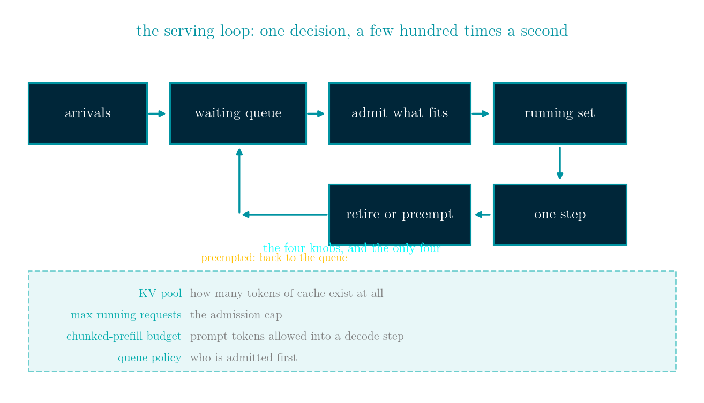
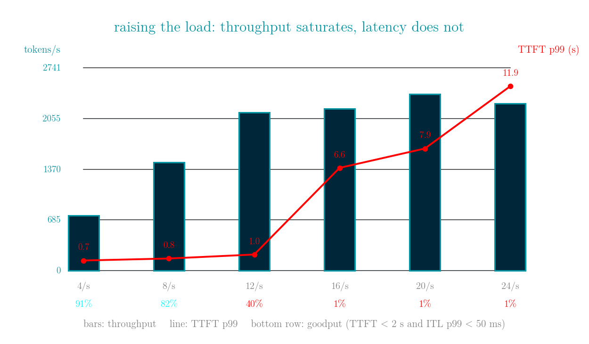
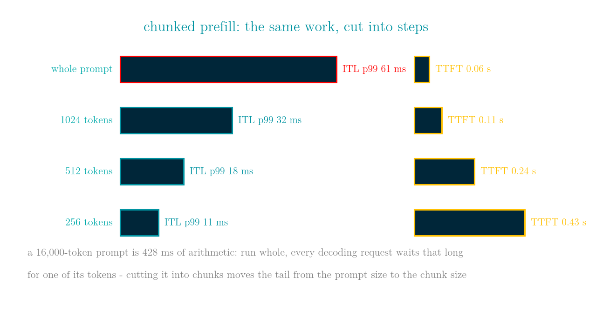
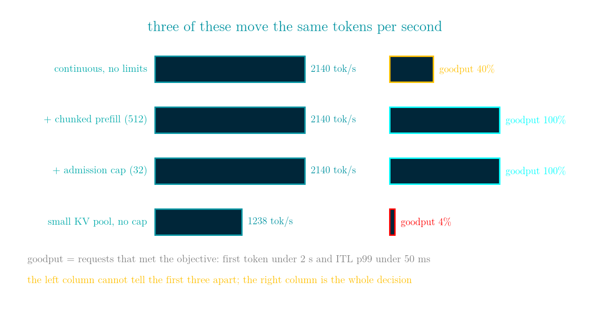

# Continuous batching: serving 2.7x more tokens by changing when a request may join the batch

More details in:
https://medium.com/100-days-of-python

Interactive walkthrough: [demo.html](demo.html) - a single self-contained page
(no build step, works offline, 中文 / English toggle) that animates the scheduling loop,
static against continuous batching step by step, the load curve and its knee, chunked
prefill, what happens when the KV pool fills, admission control, the queue policies, and
why goodput and throughput are different numbers.



A serving engine is a loop that decides, a few hundred times a second, which requests go
into the next forward pass. Everything people call "inference optimisation" at the
system level is a change to that decision. This module simulates the loop - arrivals,
a waiting queue, a KV pool, prefills and decodes - and measures what each change does.

Same model, same GPUs, the same 300 requests arriving at 12 per second:

| scheduler | TTFT p50 | throughput | finished in |
|---|---|---|---|
| static batching (B=8) | 25.62 s | 807 tok/s | 81 s |
| static batching (B=32) | 9.70 s | 1368 tok/s | 48 s |
| continuous batching | 0.06 s | 2140 tok/s | 30 s |

**2.7x the throughput and a median first token 400x sooner**, with no kernel changed.
The only difference is that a request may join and leave the batch between steps instead
of only at its edges.

## What one step costs

The machine is a 70B-class model served 8-way tensor parallel in bf16, with every
constant derived the way Day 62.5 did it: 17.5 GB of weights per GPU over 5.3 TB/s is
**3.30 ms to read the weights once**, one token of KV cache is 40 KB so **0.008 us** to
read, and one prompt token is 2·params/8 FLOPs at half of peak, so **0.027 ms**.

| batch | step time | output tokens/s | per token |
|---|---|---|---|
| 1 | 3.32 ms | 301 | 3317 us |
| 16 | 3.54 ms | 4515 | 222 us |
| 64 | 4.27 ms | 14996 | 67 us |
| 128 | 5.23 ms | 24456 | 41 us |

The weights are read once per *step*, not once per request, so a request added to a
running batch is nearly free until the KV reads catch up with the weight read. That one
line is why a scheduler exists: to keep the step as full as the KV pool allows.

## Static batching: the slot stays occupied after the answer is done


A static batch runs until its *longest* member finishes. With a batch of 32, **72% of all
slot-steps are spent on requests that have already produced their last token** - the
batch is full of nothing. And a request that arrives one step after the batch started
waits for the whole batch to drain: that is where the 25.6-second median first token
comes from, not from the model.

Continuous batching changes one rule - a finished request leaves immediately and returns
its KV, and whoever is waiting takes the slot in the same step. Padding waste goes to
zero, and the arrival queue stops being a function of how unlucky your timing was.

## The load curve, and where the knee is



| arrivals/s | throughput | TTFT p50 | TTFT p99 | ITL p99 | goodput |
|---|---|---|---|---|---|
| 4 | 743 | 0.03 s | 0.66 s | 20.3 ms | 91% |
| 8 | 1463 | 0.04 s | 0.79 s | 43.8 ms | 82% |
| 12 | 2140 | 0.06 s | 1.04 s | 61.2 ms | 40% |
| 16 | 2191 | 2.43 s | 6.63 s | 431.2 ms | 1% |
| 20 | 2384 | 2.96 s | 7.88 s | 431.1 ms | 1% |
| 24 | 2258 | 4.82 s | 11.89 s | 431.2 ms | 1% |

Below the knee the engine is arrival-limited: throughput tracks the offered load and
latency barely moves. Above it the queue grows without bound and **the only column that
still looks healthy is throughput**. The capacity here is set by prefill, not by the
batch dimension: the average prompt is 48 ms of pure arithmetic, so about 20 requests per
second is all the FLOPs allow.

## A prefill blocks every decode behind it



A 16,000-token prompt is 428 ms of arithmetic. Run as a single step, every request that
is currently decoding sees a 428 ms gap between two of its tokens.

| chunk budget | TTFT p50 | ITL p50 | ITL p99 | throughput |
|---|---|---|---|---|
| none (whole prompt) | 0.06 s | 3.6 ms | 61.2 ms | 2140 |
| 1024 tokens | 0.11 s | 3.7 ms | 31.7 ms | 2140 |
| 512 tokens | 0.24 s | 3.7 ms | 17.9 ms | 2140 |
| 256 tokens | 0.43 s | 10.4 ms | 10.8 ms | 2139 |

Chunked prefill cuts the prompt into pieces and mixes them into decode steps, so the tail
becomes the size of a chunk instead of the size of a prompt. It is not free: each chunk
pays the weight read again (which is why the ITL *median* gets worse at 256), and a
prompt that now takes several steps reaches its first token later. The knob trades TTFT
for ITL; it does not create time.

## When the KV pool runs out

Admitting a request is a promise of cache space for every token it will generate, and
nobody knows how many that is. When the pool fills, somebody is evicted.

| pool tokens | admission cap | preemptions | throughput | ITL p99 | goodput |
|---|---|---|---|---|---|
| 150,000 | none | 0 | 2140 | 61.2 ms | 40% |
| 150,000 | 24 | 0 | 2140 | 75.4 ms | 29% |
| 150,000 | 16 | 0 | 1985 | 62.0 ms | 25% |
| 60,000 | none | 59 | 1238 | 428.4 ms | 4% |
| 60,000 | 24 | 7 | 2013 | 104.4 ms | 12% |
| 60,000 | 16 | 0 | 1985 | 59.5 ms | 26% |
| 60,000 | none, swap | 16 | 2140 | 75.9 ms | 29% |

With **recompute** the victim loses everything: its KV is dropped and its prompt is
prefilled again later, so the tokens it had already produced were wasted too - 59
preemptions cost 42% of the throughput and left a 428 ms inter-token tail. With **swap**
the KV is copied to host memory and back (about 5 ms for a 4,000-token context over
PCIe), progress is kept, and both numbers recover.

Nothing in that table raises an error. A pool that is too small for the admitted set just
looks like a slow server.

## Admission control: a claim about which resource is binding

On the small pool, capping the running set to 16 wins on **both** axes: throughput goes
*up* 60% (1238 → 1985) and goodput by 7x (4% → 26%), because what the preemptions threw
away was pure waste. A queue is cheaper than half-finished work, and that is the entire
argument for admission control.

On the big pool the same cap is a mistake: nothing was being preempted, so capping only
adds queueing - 7% less throughput and goodput down from 40% to 25%. **A cap is not a
knob you tune up and down; it is a claim that the KV pool is the binding constraint**,
and when it is not, the claim costs you the slack.

## Which request goes first

| policy | mean | p50 | p99 | max | long prompts (n=27) |
|---|---|---|---|---|---|
| FCFS | 5.8 s | 5.5 | 12.5 | 15.7 | 5.6 s |
| shortest-job-first | 3.1 s | 2.0 | 19.9 | 21.7 | 10.0 s |

Shortest-job-first is the textbook answer and it works: the mean halves. It also doubles
the latency of exactly the requests that were already slowest, because a long prompt is
overtaken by every short one that arrives while it waits - under sustained overload it
never runs at all. Production schedulers therefore age the queue: priority rises with
waiting time, so the policy is shortest-job-first with a guarantee attached.

## Goodput, not throughput



| configuration | throughput | TTFT p99 | ITL p99 | goodput |
|---|---|---|---|---|
| continuous, no limits | 2140 | 1.04 s | 61.2 ms | 40% |
| + chunked prefill (512) | 2140 | 1.60 s | 17.9 ms | 100% |
| + admission cap (32) | 2140 | 1.60 s | 17.8 ms | 100% |
| small KV pool, no cap | 1238 | 22.65 s | 428.4 ms | 4% |

The first three move the same number of tokens per second. What separates them is how
many requests met a service-level objective - here a first token within 2 s and a
99th-percentile inter-token latency under 50 ms. **Tuning a serving stack means moving
the last column**, and the last column is invisible if you only measure the first. It is
also why a serving report needs input and output lengths, concurrency, TTFT, TPOT and ITL
together: drop any one of them and the rest can be made to look good.

## Four things that look like wins and are not

**"A bigger batch is always better."** With a pool that cannot hold it, raising the
running set produces 59 preemptions, 42% less throughput and a 428 ms tail. The limit is
the KV pool, not the batch dimension of the kernels.

**"Throughput went up, so it is better."** Three configurations at identical throughput
and goodput between 40% and 100%.

**"Shortest-job-first minimises latency."** It minimises the mean while roughly doubling
the latency of the long prompts.

**"The batch is full, so the GPU is busy."** In static batching at B=32, 72% of the
slot-steps are requests that have already finished.

## In vLLM

```
--max-num-seqs 256              # the running set, the admission cap
--max-num-batched-tokens 8192   # the chunked-prefill budget
--enable-chunked-prefill
--gpu-memory-utilization 0.9    # how much HBM becomes KV pool
--preemption-mode recompute     # or swap
```

vLLM calls the admitted set the running queue and keeps a waiting queue behind it; the
block manager hands out KV in pages, which is what turns admission into a counting
problem instead of a guess. The log line worth watching is the preemption warning - it is
the engine telling you the KV-pool section is happening to you right now.

## In SGLang

```
--max-running-requests 256      # the same cap
--chunked-prefill-size 8192
--schedule-policy lpm           # longest-prefix-match, not FCFS
--schedule-conservativeness 1.0 # how eagerly to admit
```

The interesting difference is the default policy: SGLang orders the waiting queue by
longest prefix match, so requests that share a prefix run next to each other and hit the
radix cache instead of prefilling the same tokens twice. That is a scheduling decision
taken for a memory reason - the same move as everything else in this series.

## Cost summary

| decision | knob | what it trades |
|---|---|---|
| who joins the batch | static vs continuous | nothing: continuous wins on both axes |
| how much prompt per step | chunked-prefill budget | TTFT for ITL |
| how many run at once | max running requests | throughput for predictability, only when the pool binds |
| what happens when the pool fills | recompute vs swap | recomputation for PCIe traffic |
| who goes first | FCFS vs SJF vs aging | mean latency for tail latency |

## References
- [Orca: a distributed serving system (iteration-level scheduling)](https://www.usenix.org/conference/osdi22/presentation/yu)
- [vLLM and PagedAttention](https://arxiv.org/abs/2309.06180)
- [Sarathi-Serve: chunked prefill and stall-free batching](https://arxiv.org/abs/2403.02310)
- [DistServe: disaggregating prefill and decode](https://arxiv.org/abs/2401.09670)
- [vLLM scheduler documentation](https://docs.vllm.ai/en/latest/)
- [SGLang scheduling and RadixAttention](https://arxiv.org/abs/2312.07104)
