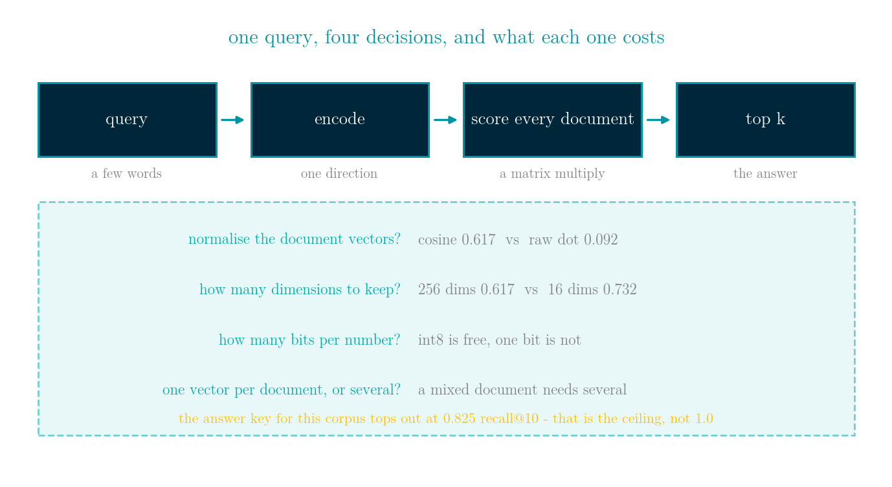
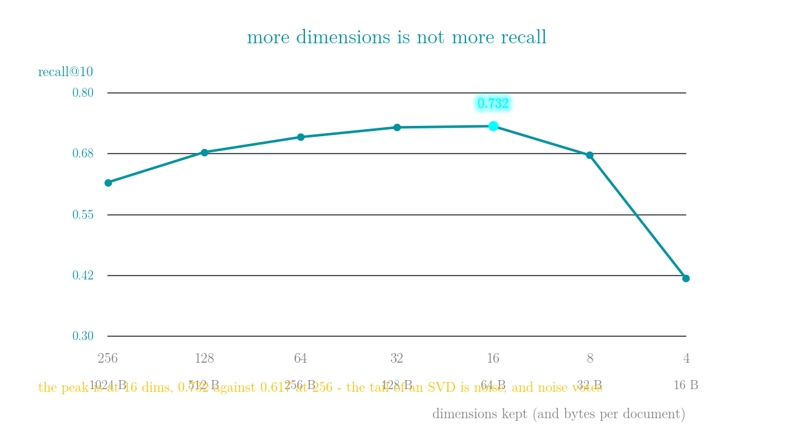
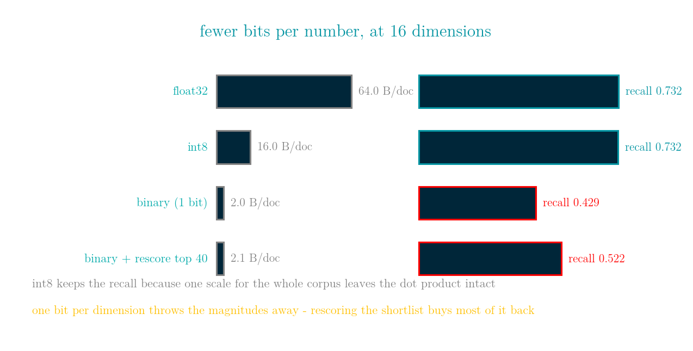

# Embeddings and vector search: a document becomes a direction, and retrieval asks whose direction is closest

More details in:
https://medium.com/100-days-of-python

Interactive walkthrough: [demo.html](demo.html) - a single self-contained page
(no build step, works offline, 中文 / English toggle) that animates what a vector is,
the length bias, building an embedding out of a term-count matrix, the truncation curve,
quantization with rescoring, one vector per document against one per section, what
fusing a second score does, and three traps that never raise an error.



An embedding turns a document into a direction in space; retrieval turns a question into
"whose direction is closest". Everything after that is a handful of decisions - normalise
or not, how many dimensions, how few bits, how many vectors per document - and this day
measures the price of each one instead of quoting defaults.

To make measurement possible the corpus has its answers planted: **20,000 documents, 200
queries, and 10 known-correct documents for every query**, so recall@10 is a fact rather
than a judgement.

| | recall@10 |
|---|---|
| term matching (tf-idf cosine) | 0.419 |
| our embedding (256 dims, twenty lines of numpy) | 0.617 |
| the answer key itself | 0.825 |

**The ceiling is 0.825, not 1.0.** Even ranking by the exact recipe the corpus was
generated from cannot recover every planted answer, because background documents about
the same topic crowd into the top ten. Finding that ceiling first is what turns "our
system scores 0.62" from a disappointment into a 75%-of-possible.

## A vector is a direction, so the length has to go


The length of a document vector correlates **0.92** with how many words the document has.
A raw dot product therefore does not ask "is this about the same thing", it asks "is this
about the same thing *and* is it long":

| scoring | recall@10 | average length of the top 10 |
|---|---|---|
| cosine (normalised) | 0.617 | 250 words |
| raw dot product | 0.092 | 1,494 words |

The median document is 199 words. Forget to normalise and the index is still an index -
it just ranks by length now, with nothing in any log to say so. That is the entire reason
every library has a `normalize_embeddings` flag, and why people forget it exactly once.

## Where the vectors come from

```python
X      = log1p(counts) * idf        # down-weight common words
U,S,Vt = svd(X - X.mean(0))         # the directions that matter
vec    = X @ Vt[:dims].T            # project into `dims` numbers
```

That is the whole embedding: 0.419 for term matching, 0.617 once projected. The SVD is
not compression for its own sake - it builds directions out of words that keep appearing
together, which is what lets a query match a document that used different words. A
trained encoder swaps the SVD for a contrastive objective; the output has exactly the
same shape, one dense direction per document, which is why every number below carries
over.

## The two sides are not symmetric

| encoding | recall@10 |
|---|---|
| both sides normalised (cosine) | 0.617 |
| query left unnormalised | 0.617 |
| documents left unnormalised | 0.092 |
| query encoded without the idf weights | 0.629 |
| query encoded with an idf of its own | 0.609 |
| query with the idf applied twice | 0.588 |

The first fact is exact: **normalising the query cannot change the ranking**, because
scaling one side multiplies every score by the same number. Only the document side
matters.

The last three are the interesting ones. Encoding the query differently from the
documents moves the answer by up to 0.041 recall **in both directions**, with no error
anywhere. In this corpus the damage is small; what makes it dangerous in production is
that instruction-tuned embedding models are trained with a query prefix and a document
prefix, so the two encoders really are different functions - and swapping them is exactly
this kind of silent move.

## How many dimensions



| dims | bytes/doc | GB per million | recall@10 |
|---|---|---|---|
| 256 | 1,024 | 0.95 | 0.617 |
| 128 | 512 | 0.48 | 0.678 |
| 64 | 256 | 0.24 | 0.710 |
| 32 | 128 | 0.12 | 0.730 |
| 16 | 64 | 0.06 | **0.732** |
| 8 | 32 | 0.03 | 0.672 |
| 4 | 16 | 0.01 | 0.420 |

The columns of an SVD come out ordered, so the first *d* of them are already the best
*d*-dimensional version of the same embedding - truncation needs no retraining, which is
the property Matryoshka training puts into a neural encoder on purpose.

The peak here is at 16 dimensions, not 256: **the tail directions are noise, and noise
still gets a vote**. A trained Matryoshka model gives a curve that is flat and then falls
rather than rising, but the conclusion is the same either way - the dimension count is a
hyperparameter, not a virtue, and truncation is the first thing to try on a vector bill.

## How few bits per number



| representation | bytes/doc (256 dims) | recall | bytes/doc (16 dims) | recall |
|---|---|---|---|---|
| float32 | 1,024 | 0.617 | 64 | 0.732 |
| int8 | 256 | 0.618 | 16 | 0.732 |
| binary, 1 bit per dimension | 32 | 0.032 | 2 | 0.429 |
| binary + rescore top 40 | 34 | 0.086 | 2.1 | 0.522 |

**int8 is free** - one scale for the whole corpus leaves the dot product intact up to
rounding, at a quarter of the memory. Per-vector scales are the trap: a different unit
for every document is exactly the comparison the index is supposed to make.

**One bit per dimension is not free here**, because this embedding puts its information
in the first few dimensions and a sign bit treats every dimension as equally important.
Truncate first and it becomes usable; rescore the binary shortlist with the full vectors
and it recovers further. That is the standard recipe in one line: search in the cheap
representation, decide in the dear one.

## One vector per document is a bet about the document


4,000 documents, each five sections about different things, with the answer in exactly
one section; the competing documents are vaguely on-topic throughout.

| representation | vectors/doc | bytes/doc | recall@10 |
|---|---|---|---|
| one vector for the whole document | 1 | 512 | 0.100 |
| one vector per section, score = best section | 5 | 2,560 | 0.584 |

**5.8x the recall for 5x the vectors.** The average of five directions points at none of
them, so a single vector for a long mixed document is a claim that the document is about
one thing. Chunking is how everyone repairs that claim; late-interaction models (a vector
per span, scored by the best match) are the same idea taken to its limit.

## A second score is not automatically better

| scoring | recall@10 |
|---|---|
| vector score only | 0.617 |
| lexical score only (same shortlist) | 0.250 |
| reciprocal rank fusion (k=60) | 0.457 |
| weighted 80% vector / 20% lexical | 0.629 |

These queries ask for two topics at once and word overlap cannot see that, so the lexical
score is genuinely the weaker one. **Reciprocal rank fusion assumes both lists deserve
equal trust** and costs 0.160 recall; weighting the weaker score down to 20% merely gets
back to where we started. A second signal helps where the first is wrong, and the fusion
weight is a measurement, not a default.

## What brute force costs

| documents | memory | ms per query | queries/s |
|---|---|---|---|
| 10,000 | 0.01 GB | 0.24 | 4,235 |
| 100,000 | 0.10 GB | 9.07 | 110 |
| 400,000 | 0.38 GB | 23.12 | 43 |

A full scan is one matrix multiply, which makes it the right answer for longer than
people expect - a quarter of a millisecond at ten thousand documents. It is also strictly
linear, and no amount of vectorisation fixes linear. That gap is what approximate nearest
neighbour indexes exist to close, by refusing to look at most of the data.

## Three traps that never raise an error

**Near-duplicates take the seats.** Adding 3 near-identical copies of one answer costs
that query 3 of its 10 slots. They do not split the vote - deduplicate before indexing,
not after retrieving.

**Per-vector quantization scales.** A scale computed from each vector on its own is a
different unit per document, so scores stop being comparable while every call still
returns ten results.

**Cosine similarity is not relevance.** It measures "about the same things", which is why
even the answer key only reaches 0.825 here: documents about the right topic are not the
same as documents that answer the question.

## In sentence-transformers

```python
model = SentenceTransformer("...", truncate_dim=256)          # Matryoshka
doc_vecs = model.encode(docs, normalize_embeddings=True,
                        prompt_name="document", batch_size=256)
q_vecs   = model.encode(queries, normalize_embeddings=True,
                        prompt_name="query")
from sentence_transformers.quantization import quantize_embeddings
small = quantize_embeddings(doc_vecs, precision="int8",
                            calibration_embeddings=doc_vecs[:50_000])
```

Four arguments on that page are four sections above: `normalize_embeddings` is the length
bias, `truncate_dim` is the dimension curve, `calibration_embeddings` is the corpus-wide
scale, and the prompt names are the asymmetry - the model was trained with a query prefix
and a document prefix, and swapping them is silent.

## In a vector store

```python
index = faiss.IndexFlatIP(dims)        # exactly the brute-force scan
faiss.normalize_L2(doc_vecs)           # ...so inner product = cosine
index.add(doc_vecs)
scores, ids = index.search(q_vecs, 10)
```

Every managed vector database is this plus three decisions you now have numbers for: how
many dimensions to store, how many bits per number, and whether one vector per document
is enough. The index type - the part that avoids the linear scan - is the only piece this
day did not build.

## Complexity

| Operation | Time | Space |
|---|---|---|
| encode a corpus | O(N · cost of one encode) | O(N · dims · bytes) |
| exact search | O(N · dims) per query | - |
| truncation to d dims | O(1) (slice) | O(N · d · bytes) |
| int8 / binary quantization | O(N · dims) once | 1/4 and 1/32 of float32 |
| rescoring a shortlist of m | O(m · dims) per query | full vectors kept somewhere |
| late interaction / chunking | O(N · s · dims) per query | s vectors per document |

## References
- [Matryoshka Representation Learning](https://arxiv.org/abs/2205.13147)
- [ColBERT: late interaction](https://arxiv.org/abs/2004.12832)
- [Binary and scalar embedding quantization (sentence-transformers)](https://huggingface.co/blog/embedding-quantization)
- [Sentence-BERT](https://arxiv.org/abs/1908.10084)
- [Latent Semantic Analysis](https://en.wikipedia.org/wiki/Latent_semantic_analysis) - the SVD used here
- [FAISS](https://github.com/facebookresearch/faiss)
