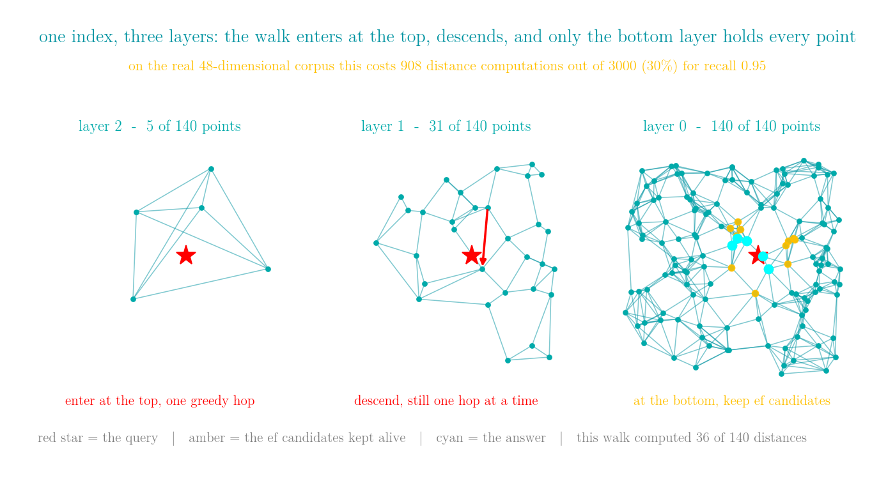
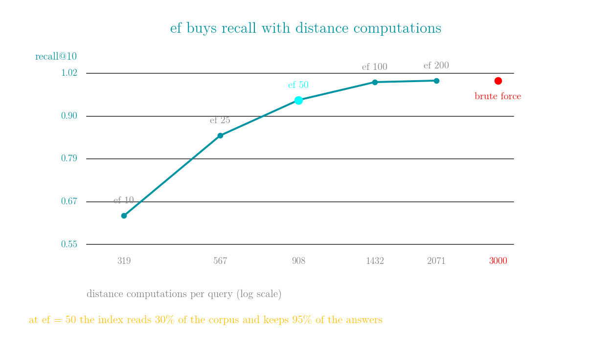
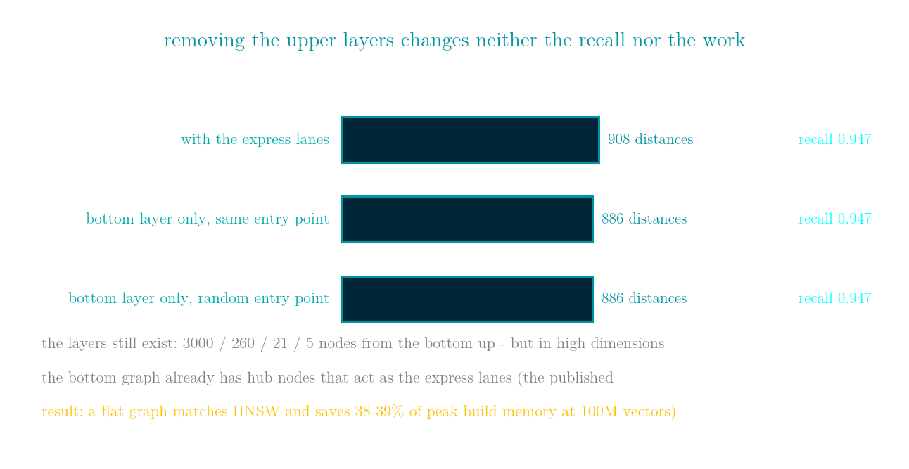
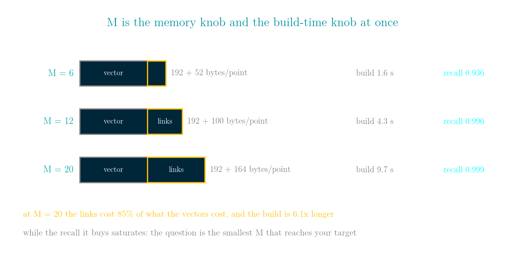
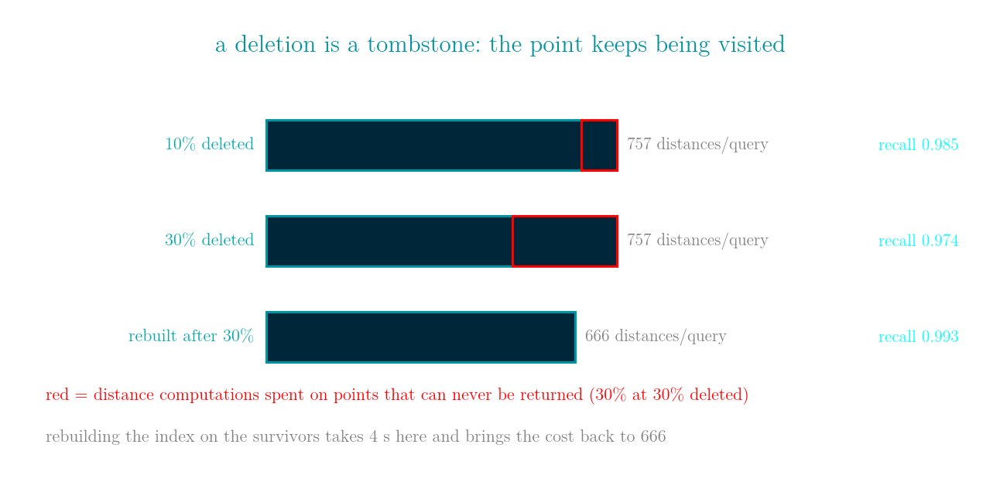
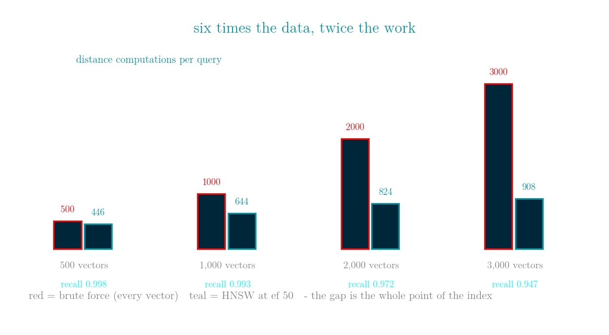

# HNSW: finding the nearest vectors without looking at most of them

More details in:
https://medium.com/100-days-of-python

Interactive walkthrough: [demo.html](demo.html) - a single self-contained page
(no build step, works offline, 中文 / English toggle) that animates the greedy walk
down the layers, what ef actually controls, why the hierarchy turns out not to matter,
the price of M, how neighbours are chosen, what a deletion really does, how the work
grows with the corpus, and three failures that never raise an error.

A brute-force search computes the distance to every vector in the corpus. HNSW computes
a few hundred and usually returns the same answer. It does that by wiring the vectors
into a graph where every point is linked to a handful of near neighbours, and then
walking that graph greedily: step to whichever neighbour is closer to the query, and
stop when no neighbour improves. There is no bucketing, no tree, and no partition of
space - just a graph and a walk.



That figure is the whole algorithm on 140 points in two dimensions, drawn from a real
index built by this day's module - the edges are the ones it actually created and the red
arrows are the hops it actually took. The red star is the query. On the upper layers only
a sparse sample of the points exists, so each hop covers a lot of ground; on the bottom
layer the walk keeps ef candidates alive at once (amber) and the nearest of them are the
answer (cyan). The whole walk computed 36 distances out of 140 points, and every teal
point it never visited is what the index is for.

On the real corpus in `hnsw.py` - 3,000 vectors of 48 dimensions, 120 queries, k = 10:

| search | distance computations | recall@10 |
|---|---|---|
| brute force | 3,000 | 1.000 |
| HNSW (ef = 50) | 908 | 0.947 |

**30% of the work for 95% of the answers.** That trade - a tunable amount of wrongness
in exchange for a large amount of skipped work - is the subject of the day.

## The layers

Every point draws a level once, from a geometric distribution with mean `1/ln(M)`, and
keeps it forever. The probability of climbing one more level is `1/M`, so each layer
holds roughly `1/M` of the layer below it:

| layer | nodes | share of the corpus | predicted |
|---|---|---|---|
| 0 | 3,000 | 1.000 | 3,000.0 |
| 1 | 260 | 0.087 | 250.0 |
| 2 | 21 | 0.007 | 20.8 |
| 3 | 5 | 0.002 | 1.7 |

This is a skip list (Day 31) with a graph instead of a linked list - the same express-lane
trick applied in a space where "the next element" is not defined. The search starts at the
single entry point on the top layer with `ef = 1`, descends one layer each time no
neighbour improves, and only opens the candidate list on layer 0.

## ef, the only knob that matters at query time

`ef` is how many candidates the walk keeps alive. Everything else follows from it: more
candidates means more neighbours expanded, more distance computations, and a better
chance of escaping a local pocket.



| ef | distance computations | fraction of corpus | recall@10 |
|---|---|---|---|
| 10 | 319 | 10.6% | 0.629 |
| 25 | 567 | 18.9% | 0.849 |
| 50 | 908 | 30.2% | 0.947 |
| 100 | 1,432 | 47.7% | 0.996 |
| 200 | 2,071 | 69.0% | 1.000 |

The curve is steep at the start and flat at the end, and **ef is the one parameter that
can be changed without rebuilding the index**, which is why every library exposes it per
query.

## The hierarchy is not where the speed comes from



| | distance computations | recall@10 |
|---|---|---|
| with the express lanes | 908 | 0.947 |
| bottom layer only, same entry point | 886 | 0.947 |
| bottom layer only, random entry point | 886 | 0.947 |

Deleting the upper layers changes neither the recall nor the work, even when the walk
starts from a randomly chosen point. This is not a flaw in the implementation: it
reproduces a published result (Munyampirwa, Lakshman and Coleman, ECIR 2026), which found
no measurable benefit from the hierarchy on high-dimensional data and a 38-39% saving in
peak construction memory at 100M vectors when it is dropped. Their explanation is the
**hub highway**: in high dimensions a small number of points end up in everybody's
neighbour list, so the bottom graph already contains the long edges the hierarchy was
supposed to supply. Earlier work found the layers only help below roughly 32 dimensions.

## M: neighbours, memory and build time



| M | edges per node | link bytes | vs vector bytes | recall@10 |
|---|---|---|---|---|
| 6 | 13.1 | 52 | 0.27x | 0.936 |
| 12 | 24.9 | 100 | 0.52x | 0.996 |
| 20 | 40.9 | 164 | 0.85x | 0.999 |

`M` is the memory knob and the build-time knob at once. Recall saturates almost
immediately; the links do not. At `M = 20` the graph costs about as much as the vectors
it indexes, and the build - which does `ef_construction` worth of searching for every
inserted point - gets steadily slower with it. The useful question is never "what is the
best M" but "what is the smallest M that reaches the recall I need".

## Which neighbours to keep

Keeping simply the `m` nearest candidates fills a point's neighbour list with its own
cluster, and the graph loses the edges that leave it - so the greedy walk gets locked
inside. The heuristic keeps a candidate only if it is closer to the new point than to
anything already chosen:

| | recall@10 | edges staying inside the cluster |
|---|---|---|
| plain nearest-M | 0.754 | 45% |
| diversity heuristic | 0.799 | 39% |

On 12 clusters at `M = 6` that is worth five points of recall, paid for with a slower
insert (every candidate is compared against the ones already kept). With a generous `M`
the two converge, which is the honest version of the story: the heuristic is how recall
is bought back when the neighbour budget is tight.

## Deletions are tombstones



| state | recall@10 | distances per query | spent on deleted points |
|---|---|---|---|
| 10% deleted | 0.985 | 757 | 10.2% |
| 30% deleted | 0.974 | 757 | 29.8% |
| rebuilt after 30% | 0.993 | 666 | - |

Removing a point from a graph index properly means repairing every neighbour list that
points at it, so no implementation does that online. Instead the point stays in the graph
as a stepping stone and is filtered out of the results. The cost is the last column: the
work per query does not move while the useful corpus shrinks. **Every vector database
that offers deletion is really offering a compaction schedule**; the only question is who
runs it and when.

## What happens as the corpus grows



| vectors | distances per query | fraction of corpus | recall@10 |
|---|---|---|---|
| 500 | 446 | 89.1% | 0.998 |
| 1,000 | 644 | 64.4% | 0.993 |
| 2,000 | 824 | 41.2% | 0.972 |
| 3,000 | 908 | 30.2% | 0.947 |

Six times the data and roughly twice the work, against six times for brute force: the
cost per query grows like the logarithm of the corpus. Notice the recall drifting down at
the same time - **ef has to be re-tuned when a corpus grows, not only when it changes.**

## Four ways this goes wrong quietly

1. **ef smaller than k.** With `ef = 5` and `k = 10` the walk cannot return ten results
   at all; libraries clamp `ef` up to `k` and still only reach 0.629. ef is a floor on
   how good the answer can be, not a performance setting.
2. **Inner product on unnormalised vectors.** Scaling 25% of the corpus by three drops
   recall against the true cosine answer to 0.250, with every hit coming from the scaled
   group. The index is answering a different question and nothing says so.
3. **Grading the index against itself.** Recall measured against the index's own output
   is 1.000, next to 0.947 against brute force. An approximate index always needs a
   non-approximate reference.
4. **Never compacting.** The deleted points keep being visited.

## In hnswlib, FAISS and a vector database

```python
import hnswlib
ix = hnswlib.Index(space="cosine", dim=d)
ix.init_index(max_elements=N, M=16, ef_construction=200)
ix.add_items(vectors, ids)
ix.set_ef(64)          # recall per query
ix.mark_deleted(i)     # a tombstone

index = faiss.IndexHNSWFlat(d, 32)   # 32 is M
index.hnsw.efConstruction = 200
index.hnsw.efSearch = 64
```

The same three numbers appear under four spellings: Chroma's `hnsw:M` /
`hnsw:construction_ef` / `hnsw:search_ef`, Qdrant's `m` / `ef_construct` / `hnsw_ef`,
Milvus' `M` / `efConstruction` / `ef`, and pgvector's `m` / `ef_construction` /
`hnsw.ef_search`. Pinecone exposes none of them, because the index type is the product.
What a managed service takes away is not the algorithm - it is the compaction schedule
and the decision about when to rebuild.

## Complexity

| Operation | Time | Space |
|---|---|---|
| insert | O(M · ef_construction · log N) distance computations | O(N · (d + 2M)) |
| search | O(ef · M · log N) distance computations - 908 here, set by ef | O(ef) |
| delete (tombstone) | O(1) | O(1), and the point keeps costing distance computations |
| rebuild | the cost of a full build | - |

## References

- [Malkov & Yashunin, *Efficient and robust approximate nearest neighbor search using HNSW graphs*](https://arxiv.org/abs/1603.09320)
- [Munyampirwa, Lakshman & Coleman, *Down with the Hierarchy: The 'H' in HNSW Stands for "Hubs"*](https://arxiv.org/abs/2412.01940)
- [hnswlib](https://github.com/nmslib/hnswlib)
- [FAISS wiki - HNSW](https://github.com/facebookresearch/faiss/wiki)
