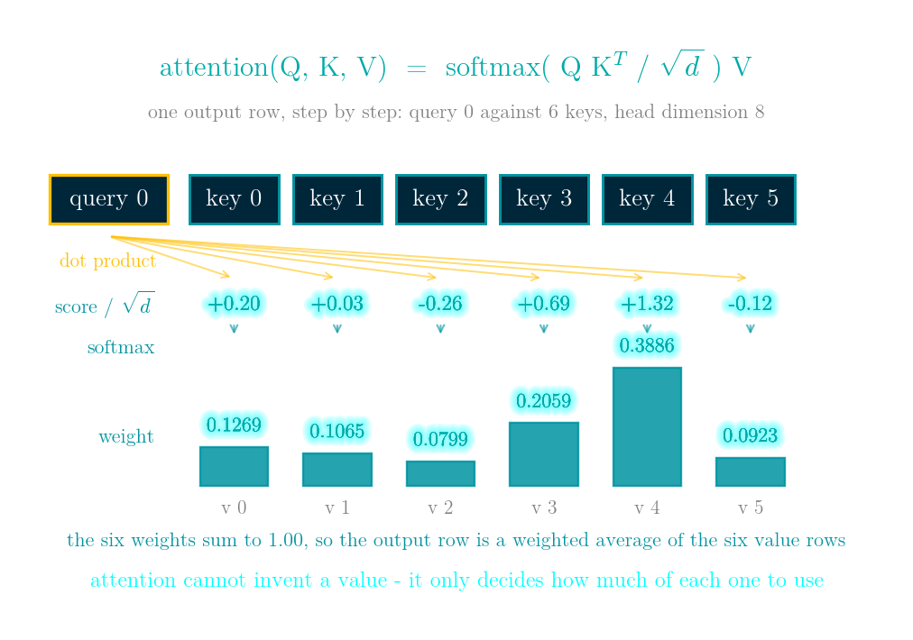
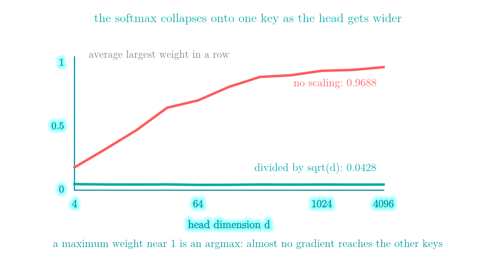
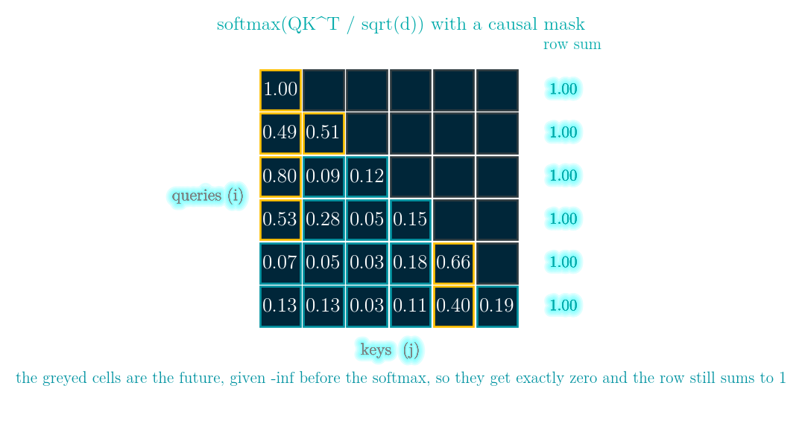
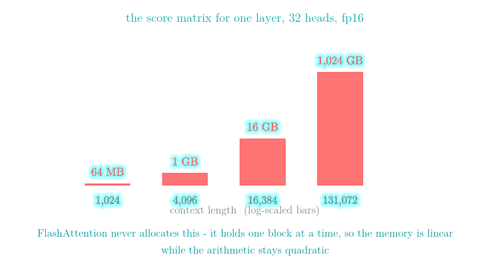
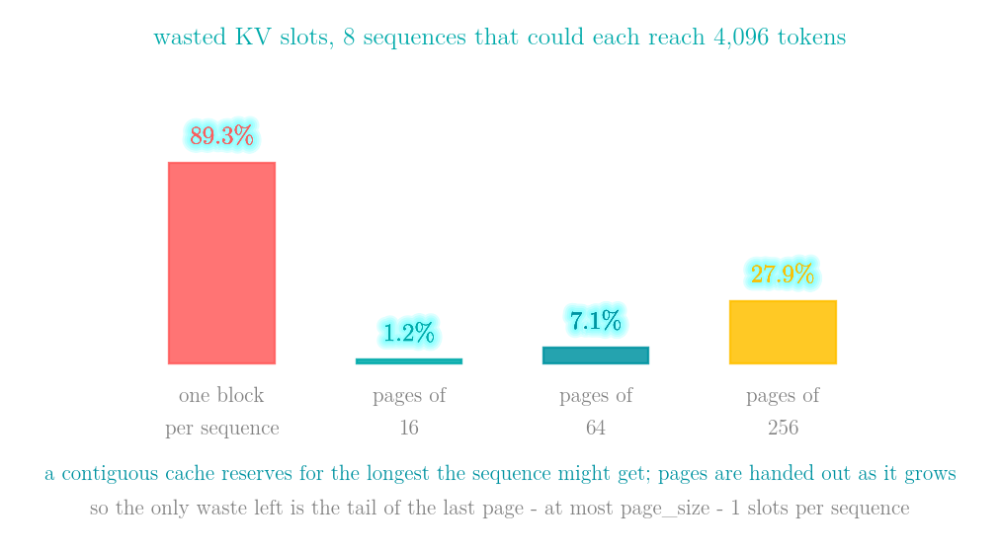
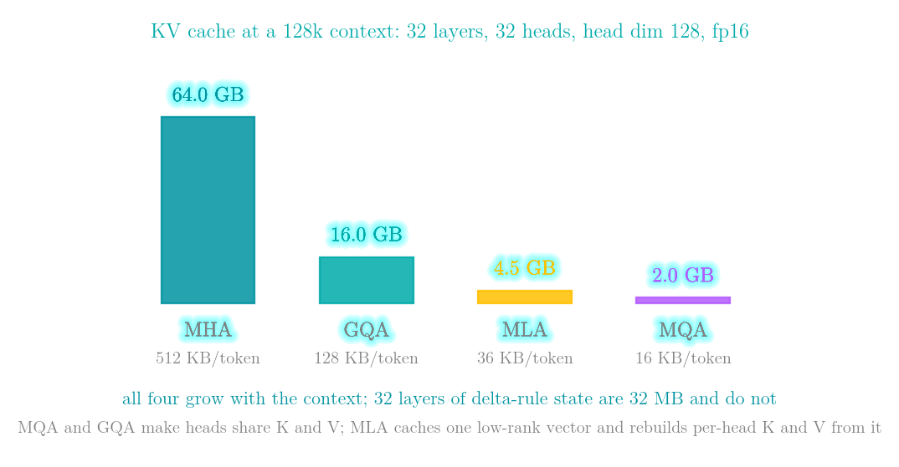
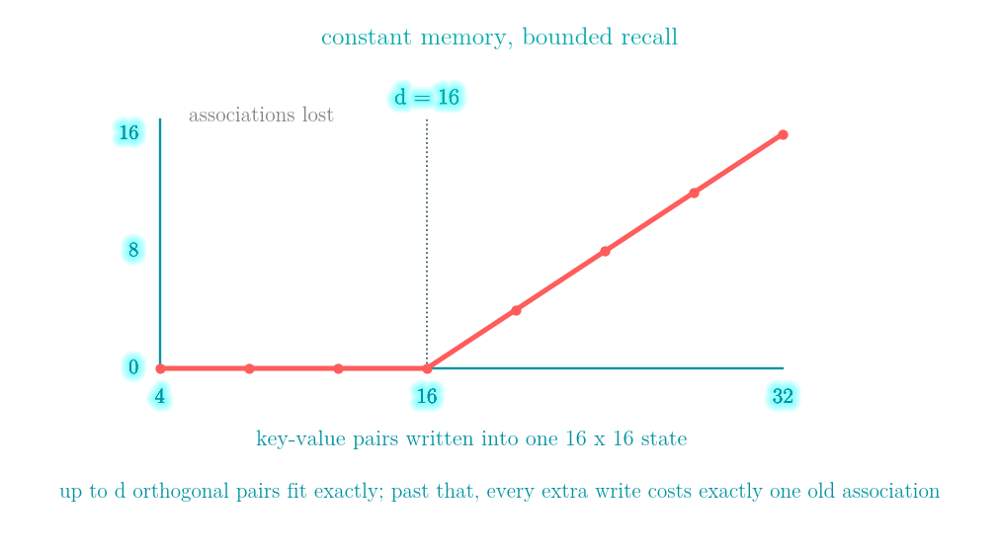

# Attention, FlashAttention, PagedAttention and MLA: writing attention by hand, then doing the arithmetic on a long-context memory bill

Code: [day 52 on GitHub](https://github.com/KingRei/100DaysPython/tree/master/day%2052%20-%20attention%20from%20scratch)

*100 Days of Python - day 52*

Attention is a weighted average. That is the whole model: for each query position you score every key position, turn those scores into weights that sum to one, and average the value vectors with those weights. Four lines of numpy.

Everything that is hard about attention is about computing that average without building the thing it is an average over. At a context of 131,072 tokens the score matrix alone is 1,024 GB for a single layer in fp16, which is not a number you can allocate. The KV cache that lets you skip recomputing the past is 64.0 GB for the same context under plain multi-head attention, and 4.5 GB under MLA. Today is the implementation, the two ways it silently goes wrong, and then the four changes that every serving stack makes to it: FlashAttention, PagedAttention, the MQA/GQA/MLA family, and delta-rule linear attention.

Day 51 turned text into token ids. This is what the model does with them.

## How attention works, in one picture



```
attention(Q, K, V) = softmax(Q K^T / sqrt(d)) V
```

Read it right to left and it is a weighted average of `V`; read it left to right and it is four steps, each of which the figure shows with real numbers from a 4-query, 6-key, head-dimension-8 example.

**One score per pair.** Query row 0 is dotted with each of the six key rows, giving six numbers: +0.20, +0.03, -0.26, +0.69, +1.32, -0.12. A dot product is large when two vectors point the same way, so a score says "how much does this query want to read from that position". Every pair of positions gets one, which is the `n x m` matrix the whole memory story of this article is about.

**Divide by sqrt(d).** A score is a sum of `d` products, so its spread grows with the width of the head. Dividing by `sqrt(d)` keeps the numbers at roughly unit scale whatever `d` is - measured further down, without it a 4096-wide head puts an average largest weight of 0.9688 on a single key.

**Softmax turns scores into weights.** Exponentiate and divide by the total: the six weights come out as 0.1269, 0.1065, 0.0799, 0.2059, 0.3886, 0.0923. They are non-negative and sum to 1.00, and position 4 - the one with the highest score - gets the most.

**Multiply by V.** The output row is those weights applied to the six value rows: `out = 0.1269 v0 + 0.1065 v1 + ... + 0.0923 v5`. Because the weights are non-negative and sum to one, the output is a convex combination of the values and can never leave their range. Attention cannot invent a value; it can only decide how much of each existing one to use.

That is the whole model. `Q`, `K` and `V` are themselves just linear projections of the input, the mask is one extra line, and everything else in this article is about computing that average without ever building the matrix it averages over.

## One weighted average

```python
def attention(Q, K, V, mask=None, scale=None):
    d = Q.shape[-1]
    scores = Q @ K.T / (scale if scale is not None else math.sqrt(d))
    if mask is not None:
        scores = np.where(mask, scores, -np.inf)
    w = softmax(scores, axis=-1)
    return w @ V, w
```

`Q` is `(n, d)`, `K` and `V` are `(m, d)`, and the score matrix is `(n, m)`: one number for every pair of positions. That pair count is where the quadratic cost comes from, and it is the only reason the rest of this article exists.

With 4 queries, 6 keys and a head dimension of 8, the weight matrix is `(4, 6)` and every row sums to 1. Row 0 of the weights is `[0.1269 0.1065 0.0799 0.2059 0.3886 0.0923]`. Because every row is a set of non-negative numbers summing to one, every output row is a convex combination of the value rows, so the output can never leave the range of `V`: with values ranging from `[-0.634 -1.504 -1.052]` to `[1.107 0.519 1.721]`, the outputs range from `[0.332 -0.667 -0.07]` to `[0.42 -0.24 0.112]`. Attention cannot invent a value. It can only decide how much of each existing one to use.

## Silent failure #1: exp() of a large number

The textbook softmax is `exp(x) / sum(exp(x))`. In float32 the largest representable number is 3.403e+38 and `exp(89)` is already inf; in float16 the limit is 65504 and `exp(12)` is already inf. So `softmax_naive([1000, 1001, 999])` returns `[nan nan nan]`: inf divided by inf.

The fix is one line, and it is exact rather than an approximation. `softmax(x)` equals `softmax(x - c)` for any constant `c`, because `c` cancels between the numerator and the denominator. Choosing `c = max(x)` makes the largest exponent `exp(0) = 1`, so nothing can overflow:

```python
def softmax(x, axis=-1):
    x = np.asarray(x, dtype=float)
    m = np.max(x, axis=axis, keepdims=True)
    e = np.exp(x - m)
    return e / e.sum(axis=axis, keepdims=True)
```

The same input now gives `[0.2447 0.6652 0.09]`. A logit of 1000 sounds absurd until you remember that a score is a dot product of two d-dimensional vectors - and that in fp16 you only need a logit of 12.

## Why the 1/sqrt(d), measured

A score is a sum of `d` products. With unit-variance inputs, the standard deviation of that sum grows like `sqrt(d)`, so the raw logits spread out as the head gets wider, and a softmax over spread-out logits collapses onto its largest entry.

| d | std of raw scores | sqrt(d) | max weight, unscaled | scaled |
|---|---|---|---|---|
| 8 | 2.846 | 2.83 | 0.3221 | 0.0437 |
| 64 | 7.911 | 8.00 | 0.7067 | 0.0404 |
| 512 | 22.563 | 22.63 | 0.9048 | 0.0423 |
| 4096 | 64.109 | 64.00 | 0.9688 | 0.0428 |

The measured standard deviation tracks `sqrt(d)` to within about one percent (the worst row is d = 64, 7.911 against 8.00). Unscaled, a 4096-wide head puts an average largest weight of 0.9688 on one key: that is an argmax, and an argmax passes almost no gradient to the other keys. Dividing by `sqrt(d)` holds the logits at roughly unit scale whatever `d` is, and the average largest weight stays near 0.04 across a 512-fold change in width.



## Silent failure #2: masking after the softmax instead of before

A causal language model must stop position `i` from reading position `j > i`. The right way is to put `-inf` into the scores before the softmax: `exp(-inf)` is 0, those keys get exactly zero weight, and the row still sums to 1. The wrong way - which reads identically in a diff - is to compute the softmax first and then zero out the future entries.

```
row sums, masked before softmax: [1. 1. 1. 1. 1. 1.]
row sums, masked after  softmax: [0.0504 0.5048 0.0618 0.9274 0.826  1.    ]
```

Row 0 can only see itself, so its single weight should be 1.0. Masked afterwards it carries 0.0504 instead: each early position is scaled down by however much future it was not allowed to see, and the output is that much closer to zero. Nothing raises, nothing is nan, no shape is wrong, and the loss still goes down - the model just trains with its early positions attenuated by a random amount.



*(the figure shows the 6 x 6 causal weight matrix the two row-sum lines above come from)*

## FlashAttention: the same number, in one pass, without the matrix

The naive implementation materialises the whole `(n, m)` score matrix because softmax needs the row maximum and the row sum, and you cannot have either until you have seen the whole row. Online softmax says: you can, if you are willing to fix up what you already have.

Walk the keys in blocks, carrying two numbers per query row - the largest score seen so far, and the running sum of `exp(score - that max)`. When a block contains a bigger score, rescale everything accumulated so far by `exp(old_max - new_max)` and carry on. That rescaling is the entire trick:

```python
s_blk = Q @ K[s:e].T / math.sqrt(d)          # one block of the score matrix
new_max = np.maximum(run_max, np.max(s_blk, axis=-1))
alpha = np.exp(run_max - new_max)            # fix up everything accumulated so far
p = np.exp(s_blk - new_max[:, None])
run_sum = run_sum * alpha + p.sum(axis=-1)
out = out * alpha[:, None] + p @ V[s:e]
run_max = new_max
```

(the file has two extra `np.where` guards for rows where every key is masked out, which would otherwise leave `-inf` in the running maximum)

| block size | max abs difference from the full matrix |
|---|---|
| 1 | 6.661e-16 |
| 8 | 3.886e-16 |
| 32 | 3.608e-16 |
| 128 | 3.886e-16 |
| 256 | 4.996e-16 |

Those differences are floating-point noise at the last bit, at every block size. This matters more than it looks: FlashAttention is an exact rewrite of the same sum, not an approximation of it, which is why turning it on changes the memory and the speed and not the model. There is no accuracy column to check.

## The bill the quadratic term sends

The score matrix holds one entry per pair of positions, per head, per layer. In fp16 with 32 heads:

| context | score matrix per layer | with 32 layers |
|---|---|---|
| 1,024 | 0.06 GB | 2.0 GB |
| 4,096 | 1.00 GB | 32.0 GB |
| 16,384 | 16.00 GB | 512.0 GB |
| 131,072 | 1024.00 GB | 32768.0 GB |

Quadrupling the context multiplies this by 16. At 131,072 tokens one layer's score matrix is 1,024 GB, and FlashAttention's real contribution is that it never allocates it: it holds one block at a time, so the memory becomes linear in the context while the arithmetic stays quadratic. The quadratic work does not go away - only the quadratic storage does.



## PagedAttention: the KV cache is a memory allocator problem

During generation you do not recompute the past; you keep K and V for every token you have already seen. A contiguous cache has to reserve space for the longest a sequence might get, because once handed out it cannot move. Eight sequences of lengths `[12, 300, 48, 900, 7, 2048, 64, 130]`, each allowed to grow to 4,096 tokens:

```
one contiguous block per sequence: 32,768 slots, 3,509 used, 89.3% wasted
pages of   16:   3,552 slots, 3,509 used,  1.2% wasted (222 pages)
pages of   64:   3,776 slots, 3,509 used,  7.1% wasted (59 pages)
pages of  256:   4,864 slots, 3,509 used, 27.9% wasted (19 pages)
```

Hand out fixed-size pages as the sequence grows and the only waste left is the unused tail of each sequence's last page - at most `page_size - 1` slots per sequence, however long the sequence gets. That is why the waste falls from 89.3% to 1.2% and then climbs back to 27.9% as the pages get bigger: the page size trades the tail against the size of the page table.

The cost is that attention can no longer read K and V as one flat array; it goes through a page table first. This is the same indirection an operating system uses on memory, for the same reason, and it buys the same second benefit: two sequences that share a prompt can point at the same prefix pages instead of each keeping a copy.



## MHA, MQA, GQA, MLA: four answers to "what has to be cached"

Paging removes the waste. It does not change how much a token actually costs. With 32 layers, 32 query heads, head dimension 128 and fp16:

| layout | bytes/token | KB | 128k ctx | vs MHA |
|---|---|---|---|---|
| MHA (32 kv heads) | 524,288 | 512 | 64.0 GB | 1.0x |
| GQA (8 kv heads) | 131,072 | 128 | 16.0 GB | 4.0x |
| MLA (512 latent + 64 rope) | 36,864 | 36 | 4.5 GB | 14.2x |
| MQA (1 kv head) | 16,384 | 16 | 2.0 GB | 32.0x |

What each one gives up is the interesting column. MQA makes all 32 query heads read the same K and V, so the heads lose the ability to attend to different things. GQA is the same trade in groups of four, which is why it is the common default. MLA keeps one low-rank latent vector per token and reconstructs per-head K and V from it at read time, so the heads stay distinct and the cache still shrinks 14.2x - paid for with extra arithmetic when reading, and a separate small path for the part that carries position information, because a rotary embedding does not survive being folded into the latent.

All four still grow with the context, because the cache is per token. The next section is the family that does not.



## The delta rule: a state you write to, not a cache you append to

Softmax attention keeps every key and value and re-reads all of them at every step. That is exactly what makes it exact, and exactly what makes the cache grow. A delta-rule layer keeps one `d x d` matrix and edits it in place:

```python
out[t] = S @ k                                    # read
S = S - b * np.outer(S @ k, k) + b * np.outer(V[t], k)   # erase, then write
```

which is `S <- S (I - beta k k^T) + beta v k^T` with the product expanded. A real layer reads with its own query projection, `o = S @ q`; the file probes with the key itself because what it is measuring is what got stored.

The first term erases whatever `S` currently associates with `k`; the second writes `v` there instead. Reading is one matrix-vector product. All 32 layers together hold 32 MB of state, and it is the same 32 MB whether the context is 1,000 tokens or 1,000,000.

The question is how much fits. Writing orthogonal key-value pairs into a 16 x 16 state and reading them all back:

| pairs written | worst recall error | associations lost |
|---|---|---|
| 8 | 1.00e-12 | 0 |
| 16 | 1.00e-12 | 0 |
| 17 | 1.33e+00 | 1 |
| 24 | 1.69e+00 | 8 |
| 32 | 1.87e+00 | 16 |

Sixteen fit, because a 16-dimensional space holds at most 16 mutually orthogonal directions - the 1e-12 in the first two rows is the epsilon the file adds when it normalises the keys, not interference. The seventeenth overwrites exactly one of them, and thirty-two overwrite sixteen. The newest write is always perfect - its error is 1.8e-12 - and it is the old associations that go. And that is the best case: with ordinary random keys instead of orthogonal ones, eight pairs into the same state already give a worst error of 1.66, because every write smears the ones already there.

So the trade is not "linear attention is worse". It is: constant memory, bounded recall. The gated delta-rule family adds a forget factor so old associations decay instead of persisting until something overwrites them, which makes that bound behave better: Gated DeltaNet uses one scalar decay per head, and Kimi's KDA refines it to one per channel, a diagonal gate. The state is still a fixed-size matrix. Which is why these layers get interleaved with a few full-attention ones rather than replacing them: the full layers do the exact long-range recall, the linear layers carry everything else at constant cost per token.



## LeetCode 239 - Sliding Window Maximum

**The task.** You are given an array and a window width `k`. The window starts at the left end and slides one position at a time to the right end. Report the maximum inside the window at every one of its positions.

**Input / output.** A list of integers `nums` and an integer `k`. Return a list with `len(nums) - k + 1` entries, the i-th being the maximum of `nums[i:i+k]`.

**Example.** `nums = [1, 3, -1, -3, 5, 3, 6, 7]`, `k = 3` gives `[3, 3, 5, 5, 6, 7]`. The first window `[1, 3, -1]` has maximum 3; the second `[3, -1, -3]` still has 3; then `[-1, -3, 5]` brings in the 5, which survives one more window before 6 and then 7 take over.

**Constraints.** Up to 100,000 elements, and `1 <= k <= len(nums)`. Re-scanning each window is `O(n*k)`, which is 10^10 operations at the top end and will not pass; and a heap of the window costs `O(n log k)` only if you can delete the element leaving the window, which a plain binary heap cannot do without bookkeeping. The intended solution is `O(n)`.

Keep a deque of indices whose values are strictly decreasing. When a value arrives, everything smaller at the back is dead for good: the newcomer is both larger and newer, so it outlives all of them and is the better answer in every window that still contains them. The front is the maximum of the current window and gets dropped only when it falls out of the window by index.

```python
class Solution:
    def maxSlidingWindow(self, nums: list[int], k: int) -> list[int]:
        from collections import deque
        dq, out = deque(), []
        for i, v in enumerate(nums):
            while dq and nums[dq[-1]] <= v:
                dq.pop()
            dq.append(i)
            if dq[0] <= i - k:
                dq.popleft()
            if i >= k - 1:
                out.append(nums[dq[0]])
        return out
```

It looks like a nested loop, but every index is pushed once and popped once, so the whole sweep is `O(n)` with `O(k)` of state. That running maximum is the FlashAttention section: online softmax carries one number instead of a whole row, and rescales what it already has whenever that number changes.

[leetcode.com/problems/sliding-window-maximum](https://leetcode.com/problems/sliding-window-maximum/)

## LeetCode 703 - Kth Largest Element in a Stream

**The task.** Build a class that is told `k` and a starting list of numbers, and then answers "what is the k-th largest number seen so far?" after each new number is added.

**Input / output.** `KthLargest(k, nums)` constructs it; `add(val)` adds one number and returns the k-th largest of everything seen, including `val`.

**Example.** `KthLargest(3, [4, 5, 8, 2])` then adding 3, 5, 10, 9, 4 returns `[4, 5, 5, 8, 8]`. After adding 3 the values are `2, 3, 4, 5, 8` and the third largest is 4; adding 10 makes it `5`, because the top three are now 10, 8, 5.

**Constraints.** Up to 10^4 calls to `add`, and it is guaranteed that there are at least `k` elements when the query is asked. The point of the problem is the memory: you are not meant to keep the stream.

Keep a min-heap of exactly `k` elements. Its root is the k-th largest so far, and anything smaller than the root is discarded the moment it arrives.

```python
class KthLargest:
    def __init__(self, k: int, nums: list[int]):
        import heapq
        self.k = k
        self.heap = list(nums)
        heapq.heapify(self.heap)
        while len(self.heap) > k:
            heapq.heappop(self.heap)

    def add(self, val: int) -> int:
        import heapq
        if len(self.heap) < self.k:
            heapq.heappush(self.heap, val)
        elif val > self.heap[0]:
            heapq.heapreplace(self.heap, val)
        return self.heap[0]
```

The trap is which heap. A max-heap of everything also answers the query correctly, in `O(n)` memory and `O(k log n)` per call - it passes the tests and it is the wrong answer to the question being asked. The min-heap of size `k` is the one whose memory does not depend on how much has gone past.

[leetcode.com/problems/kth-largest-element-in-a-stream](https://leetcode.com/problems/kth-largest-element-in-a-stream/)

## Complexity

| Operation | Time | Space |
|---|---|---|
| attention, full matrix | O(n*m*d) | O(n*m) |
| attention, online / FlashAttention | O(n*m*d) | O(n*d) |
| KV cache read, per generated token | O(n*d) | O(n*d) |
| delta-rule write and read | O(d^2) | O(d^2) |
| LeetCode 239 | O(n) | O(k) |
| LeetCode 703 add | O(log k) | O(k) |

## Why this matters later

Every one of these is the same move: one pass over something you cannot store, and a bounded amount of state that has to be enough. FlashAttention bounds it at two numbers per query row and stays exact. A delta-rule layer bounds it at one matrix and gives up exactness. LeetCode 239 bounds it at a deque and 703 at a size-k heap. Which bound is right depends entirely on what you are willing to lose.

The paging section is also where this series' operating-system material comes back: pages, a page table, internal fragmentation and copy-on-write sharing, applied to a tensor instead of a process address space. And the low-rank latent in MLA is the Eckart-Young approximation from Day 49, used as a storage format rather than as a plot.

Code and the interactive walkthrough are in the repo: [day 52 on GitHub](https://github.com/KingRei/100DaysPython/tree/master/day%2052%20-%20attention%20from%20scratch).
