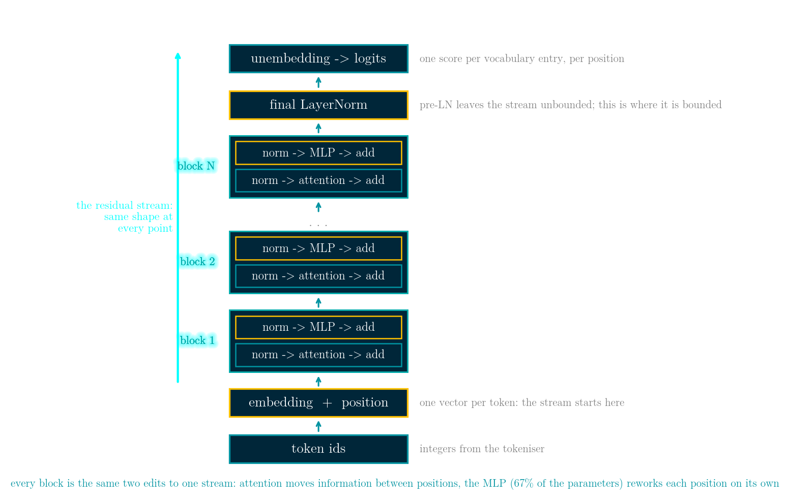
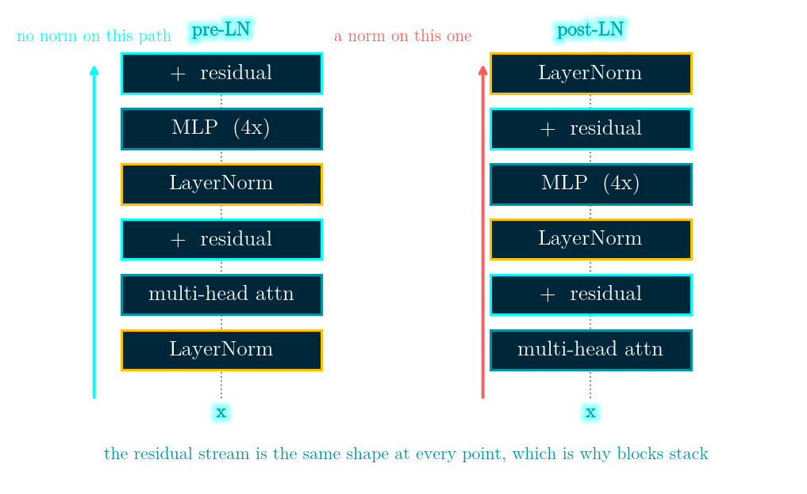
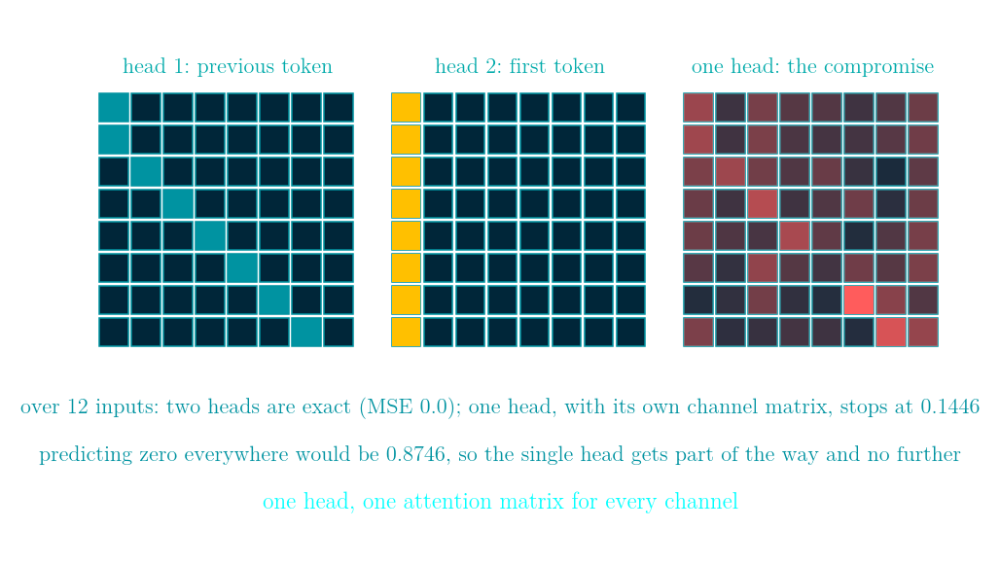
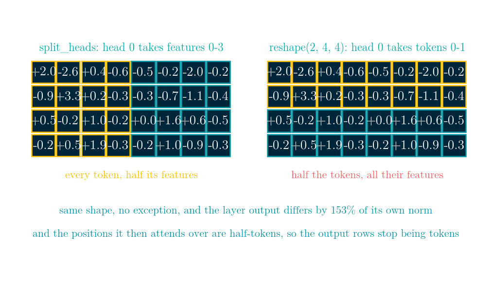
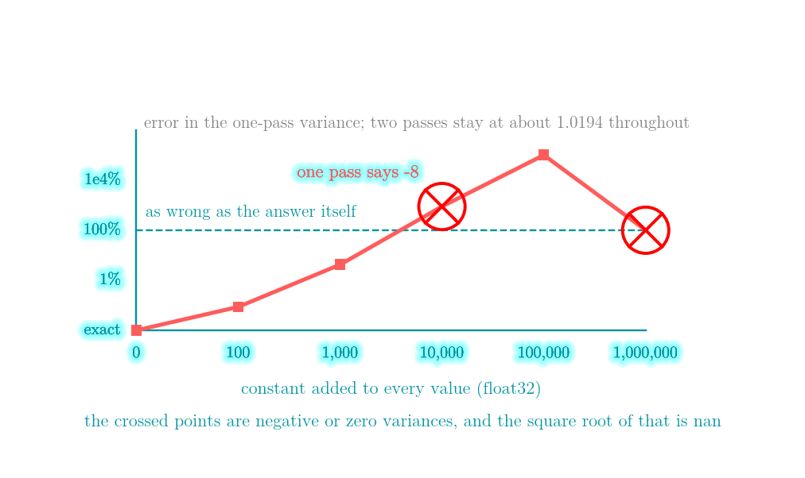
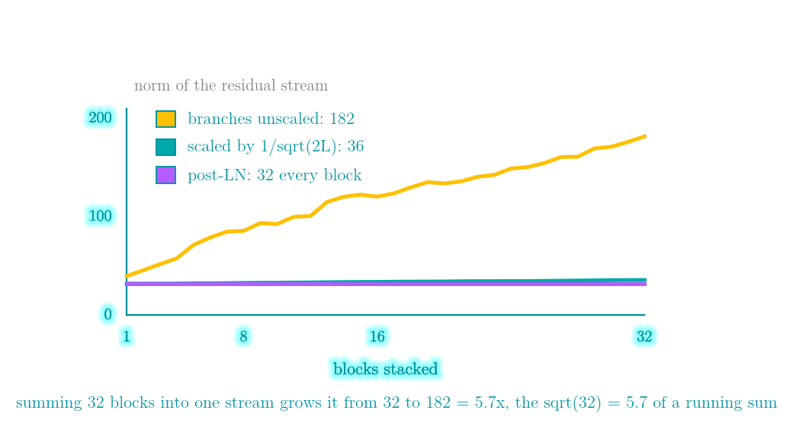
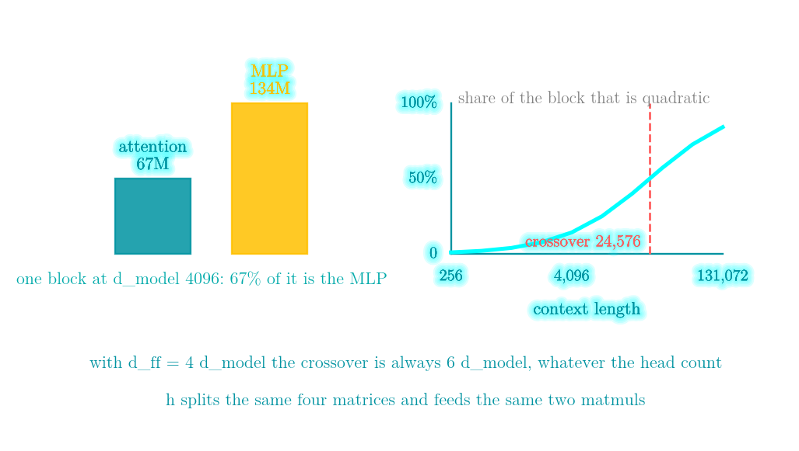

# Multi-head attention and the transformer block: what the heads are for, and the two bugs that still return the right shape

Code: [day 53 on GitHub](https://github.com/KingRei/100DaysPython/tree/master/day%2053%20-%20multi-head%20attention%20and%20the%20transformer%20block)

*100 Days of Python - day 53*

A transformer block is two mixers. Attention mixes across positions: every position becomes a weighted average of the others, using the same weights for every channel. The MLP mixes across features: every position's channels get stirred together, using the same weights at every position. Both write into one residual stream whose shape never changes, which is the entire reason you can stack 32 of them.

Multi-head attention costs no extra parameters at all. The four projections are `d_model x d_model` whether you use 1 head or 64; `h` only decides how they are cut. What it buys is measurable: on a task where half the channels need the previous token and half need the first token, two heads reach it exactly, while one head - handed a channel matrix and a free attention matrix per input, which is more than a real head gets - stops at a mean squared error of 0.1446, against 0.8746 for predicting zero.

And two of the most common ways to get a block wrong return an array of exactly the right shape: splitting the heads along the wrong axis, and computing LayerNorm's variance in one pass.

Day 52 built attention. This is the layer and the block around it.

## The shape of the whole thing, and why it is that shape



Token ids come in, one vector per token comes out of the embedding, N identical blocks each edit that set of vectors, a final LayerNorm bounds it, and an unembedding turns each vector into one score per vocabulary entry. Five design decisions do all the work here, and each one buys something specific.

**One stream of a fixed width.** Every block takes `(n, d_model)` and returns `(n, d_model)` - measured below, `(16, 64)` in and `(16, 64)` out. That is what makes "stack 32 of them" a sentence rather than a redesign: there is exactly one shape to implement, one shape to shard across devices, and one place where a new layer can be inserted.

**Blocks add to the stream instead of replacing it.** A branch that outputs zero leaves the model exactly as it was, so a new block starts as a no-op and only has to learn a correction. The price is that the stream is a running sum and grows with depth - from 32.0 to 197.0 over 32 blocks in the measurement further down - which is what the normalisations and the initialisation scaling are there to control.

**Information crosses between positions in exactly one place.** Attention is the only operation in the whole stack that reads other positions; the MLP, the norms and the unembedding all work on one position at a time. That single restriction is why a causal mask is enough to make the model autoregressive, why a KV cache is possible at all (only attention looks back), and why the cost model splits so cleanly into a part linear in the context and a part quadratic in it.

**Everything else is per-position, so training is parallel over the whole sequence.** A recurrent network has to walk the sequence one step at a time; here all n positions go through the same matmuls at once, and a single forward pass produces a prediction at every position. That is the property that made training at this scale practical, and it is a property of the shape, not of attention itself.

**Capacity goes into the per-position part.** The MLP expands to four times the width and holds 67% of the parameters of every block, at every model size in the table below. The expensive-to-parallelise part, attention, is kept thin; the part that is embarrassingly parallel is made fat. It is also why mixture-of-experts replaces the MLP rather than the attention.

## One block, two mixers

```python
def block_pre_ln(x, p, mask=None):
    a, _ = multi_head_attention(layer_norm(x, p['g1'], p['b1']), ...)
    x = x + a
    return x + ffn(layer_norm(x, p['g2'], p['b2']), p['W1'], p['bb1'], p['W2'], p['bb2'])
```

With `d_model` 64, 8 heads and 16 tokens, the input is `(16, 64)` and the output is `(16, 64)`. The branches add into the stream rather than replacing it: the attention branch has 0.354 of the norm of the stream it was read from, and the whole block moves the stream by 0.772 in relative norm.



## h heads cost nothing

| heads | head dim | params in Wq, Wk, Wv, Wo | weight matrices per layer |
|---|---|---|---|
| 1 | 64 | 16,384 | 1 |
| 2 | 32 | 16,384 | 2 |
| 8 | 8 | 16,384 | 8 |
| 64 | 1 | 16,384 | 64 |

Nothing in that table moves except the last two columns. The head count cuts the same four matrices into `h` independent subspaces, and each subspace then produces its own `n x n` matrix of attention weights. The layer mixes the sequence `h` ways instead of one, for the same parameters and - as the FLOP section below shows - the same arithmetic.

## What the heads actually buy

Here is a target that needs two mixings at once: half of the channels want the value at the previous token, the other half want the value at the first token. Both are things attention does easily. Two heads, one pattern each, each carrying its own half of the channels, reproduce it at a mean squared error of 0.0 - exactly, on all twelve inputs it is measured over.

What can one head do? A head is not only an attention matrix: it also has `Wv` and `Wo`, which together are a `d x d` matrix that can route features freely. So the single head gets that matrix, fitted by gradient descent along with its attention weights - and it gets to pick a different attention matrix for every input, which a real head cannot do, because its weights have to come out of Q and K:

```python
A = softmax(L, axis=-1)          # one attention matrix per input, free
R = A @ V @ M - target           # M is one d x d channel matrix, shared
dM += 2 * (A @ V).T @ R / size
dA = (2 * R @ M.T / size) @ V.T
L -= lr * A * (dA - (dA * A).sum(axis=-1, keepdims=True))
```

It stops at 0.1446, against 0.8746 for predicting zero everywhere. Handing it the channel matrix is what makes the comparison honest: without it, a single input with `n = d = 8` can be fitted to a mean squared error of 5.7e-30 by solving `(A V) M = target` for `M` alone with a *random* attention matrix, which says nothing about heads at all. That is also why twelve inputs are used rather than one.

What one head still cannot do is use a **different attention matrix for different channels**, and that is exactly what this target asks for. Heads are how a layer does several things at once, and making a single head wider does not buy that.



## Silent failure #1: splitting the heads along the wrong axis

To split `(n, d_model)` into `h` heads you group the feature axis and then move it to the front:

```python
def split_heads(X, h):
    n, d = X.shape
    return X.reshape(n, h, d // h).transpose(1, 0, 2)
```

Drop the transpose and reshape straight to `(h, n, d_head)` and the result has exactly the same shape - and cuts the wrong axis. On a `4 x 8` input with 2 heads, the correct split gives head 0 features 0 to 3 of every token; the wrong one gives it tokens 0 and 1 with all of their features. Worse, the "positions" it then attends over are half-tokens - token 0's first four features, token 0's last four, token 1's first four - so after merging the heads back together, the output rows no longer correspond to tokens at all.

Measured on 16 tokens, 64 features, 8 heads: the two splittings put the layer's output a maximum of 1.911 apart, which is 153% of the output's own norm. Nothing raises, no shape is wrong, and a model built on it trains - just worse, with nothing to point at. The assert that catches it is one line: head `j` must equal `X[:, j*d_head:(j+1)*d_head]`.



## Silent failure #2: the one-pass variance in LayerNorm

LayerNorm needs a mean and a variance per row. The textbook identity `var = E[x^2] - E[x]^2` gets the variance in one pass instead of two, which is why it keeps being written. It also differences two large numbers to produce a small one, and a residual stream is exactly the thing that accumulates a large common offset.

512 standard normal values in float32, shifted by a constant:

| offset | two-pass var | one-pass var | distinct float32 values |
|---|---|---|---|
| 0 | 1.019437 | 1.019437 | 512 |
| 100 | 1.019437 | 1.018555 | 512 |
| 1,000 | 1.019434 | 1.062500 | 511 |
| 10,000 | 1.019408 | -8.000000 | 475 |
| 100,000 | 1.019417 | 1024.000000 | 304 |
| 1,000,000 | 1.020317 | 0.000000 | 77 |

At an offset of 10,000 the one-pass variance is **negative**, so its square root is nan - while the two-pass version still returns 1.019408 from the same array, which still holds 475 distinct float32 values. The data is fine; the identity is not. And below that the damage is quiet: at an offset of 1,000 it reports 1.0625 instead of 1.0194, the eps inside the square root keeps everything finite, and the layer simply normalises by the wrong number.

Two passes over a row - 4,096 values at the `d_model` of the configurations in the budget table below - cost nothing next to the matmuls on either side.



## LayerNorm or RMSNorm: which invariance you are paying for

RMSNorm divides by the root mean square and never subtracts the mean. On a row with mean 6.925 and standard deviation 1.943, LayerNorm returns mean 2.64e-16 and std 1.0000, RMSNorm returns mean 0.9628 and std 0.2701. Shift that row by +100 and LayerNorm's output moves by 6.13e-15 while RMSNorm's moves by 0.8014.

So RMSNorm buys one fewer reduction and one fewer parameter vector, and gives up shift invariance. Both are invariant to scaling a row, which is the thing the residual stream actually does to it.

## Pre-LN or post-LN: which path stays unnormalised

Push a tiny perturbation into the input of 32 stacked blocks and watch two things: how much of the perturbation is still there at the top, and how big the stream itself got.

| after block | ‖x‖ pre-LN | ‖x‖ post-LN | influence pre | post |
|---|---|---|---|---|
| 1 | 37.9 | 32.0 | 1.355 | 1.134 |
| 8 | 81.9 | 32.0 | 3.580 | 1.441 |
| 16 | 127.1 | 32.0 | 5.599 | 1.541 |
| 32 | 197.0 | 32.0 | 7.505 | 1.104 |

Post-LN makes the norm of the stream stop depending on the depth, because the last thing a post-LN block does is normalise. With `gamma = 1` and `beta = 0` as initialised here it lands on exactly 32.0 after every block, which is `sqrt(16 * 64)`; learned gamma and beta move that number, but not the fact that the depth drops out of it. Pre-LN leaves the residual path alone, so it grows from 37.9 to 197.0.

The perturbation grows with it, 7.50x against 1.10x in absolute terms - but as a fraction of the stream the two are nearly the same, 0.0381 against 0.0345, so **this measurement does not show pre-LN carrying more signal**. What it shows is the structural difference: pre-LN leaves one path that runs from the input to the output without passing through a normalisation, and post-LN puts one on that path in every block. That is what the training-stability results in the literature are about ([Xiong et al., 2020](https://arxiv.org/abs/2002.04745)), and it is also why a pre-LN stack ends with one final LayerNorm before the output head - nothing else bounds what arrives there.

## The residual stream is a running sum

That unbounded stream grows for a simple reason: every branch adds into it.

| after block | ‖x‖ unscaled | ‖x‖ with 1/sqrt(2L) on each branch |
|---|---|---|
| 0 (the input) | 32.0 | 32.0 |
| 1 | 39.8 | 32.2 |
| 8 | 85.9 | 32.8 |
| 16 | 120.6 | 33.9 |
| 32 | 181.8 | 35.8 |

Over 32 blocks the norm goes from 32.0 to 181.8, a factor of 5.7 - which is the `sqrt(32) = 5.66` you would expect from summing 32 independent pieces into one running total. Scaling what each branch writes by `1/sqrt(2L)` - L layers, two branches each - holds it at 1.12x. That is the whole content of "scale the residual branches at initialisation".



## Where the parameters and the FLOPs actually are

| model dim | heads | attention | MLP | MLP share | FLOP crossover |
|---|---|---|---|---|---|
| 768 | 12 | 2,359,296 | 4,718,592 | 67% | 4,608 |
| 2048 | 16 | 16,777,216 | 33,554,432 | 67% | 12,288 |
| 4096 | 32 | 67,108,864 | 134,217,728 | 67% | 24,576 |
| 8192 | 64 | 268,435,456 | 536,870,912 | 67% | 49,152 |

Attention is four `d_model x d_model` matrices; the MLP is two of `d_model x 4*d_model`. So two thirds of every block is the feed-forward part - the part people talk about least - and the ratio does not depend on the width.

The compute splits into a part linear in the context (`n * (4d^2 + 2*d*d_ff)`, the projections and the MLP) and a part quadratic in it (`2*n^2*d`, the two attention matmuls). Setting them equal gives `n = 6 * d_model` whenever `d_ff = 4 * d_model`. For `d_model` 4096, one block:

| context | linear MACs | quadratic MACs | quadratic share |
|---|---|---|---|
| 512 | 103,079,215,104 | 2,147,483,648 | 2.0% |
| 2,048 | 412,316,860,416 | 34,359,738,368 | 7.7% |
| 8,192 | 1,649,267,441,664 | 549,755,813,888 | 25.0% |
| 32,768 | 6,597,069,766,656 | 8,796,093,022,208 | 57.1% |

The head count appears in neither column.



## LeetCode 189 - Rotate Array

**The task.** Shift every element of an array `k` places to the right, with the elements that fall off the end wrapping around to the front, keeping their order.

**Input / output.** A list `nums` and a non-negative integer `k`. The array must be modified in place; nothing is returned.

**Example.** `[1, 2, 3, 4, 5, 6, 7]` with `k = 3` becomes `[5, 6, 7, 1, 2, 3, 4]`. The last three elements come to the front in their original order, and the first four follow.

**Constraints.** Up to 100,000 elements, and `k` is allowed to be anything from 0 to 100,000, so it may exceed the length of the array and `k %= n` is not optional. The interesting requirement is the follow-up: do it in place, in `O(1)` extra space. Copying into a second array is `O(n)` memory and skips the entire point.

Reverse the whole array, then reverse the first `k` elements and the rest:

```python
class Solution:
    def rotate(self, nums: list[int], k: int) -> None:
        n = len(nums)
        k %= n
        self._rev(nums, 0, n - 1)
        self._rev(nums, 0, k - 1)
        self._rev(nums, k, n - 1)

    @staticmethod
    def _rev(a, i, j):
        while i < j:
            a[i], a[j] = a[j], a[i]
            i, j = i + 1, j - 1
```

The other in-place method walks the permutation cycles, each element jumping `k` places forward. It is correct, but it needs `gcd(n, k)` separate starting points. On `[1, 2, 3, 4, 5, 6]` with `k = 2`, starting only at index 0 returns `[5, 2, 1, 4, 3, 6]`: half the array moved, and what comes back is still a list of six integers. With `k = 1` there is exactly one cycle and the same code is completely correct - `[6, 1, 2, 3, 4, 5]` - so a small test never shows it.

That is the same shape of bug as the head splitting: right type, right length, half the work.

[leetcode.com/problems/rotate-array](https://leetcode.com/problems/rotate-array/)

## LeetCode 303 - Range Sum Query (immutable)

**The task.** Build a class over a fixed array that answers "what is the sum of the elements from index `left` to index `right`, inclusive?" many times.

**Input / output.** `NumArray(nums)` constructs it; `sumRange(left, right)` returns the sum of that inclusive range.

**Example.** For `[-2, 0, 3, -5, 2, -1]`, `sumRange(0, 2)` is 1, `sumRange(2, 5)` is -1, and `sumRange(0, 5)` is -3.

**Constraints.** Up to 10,000 calls to `sumRange` on an array of up to 10,000 elements. Summing the range each time is `O(n)` per call and 10^8 operations overall; the array never changes, which is the permission to precompute. (The mutable sibling, LeetCode 307, is the one that needs a Fenwick tree - that was Day 29.)

```python
class NumArray:
    def __init__(self, nums: list[int]):
        self.pre = [0]
        for v in nums:
            self.pre.append(self.pre[-1] + v)

    def sumRange(self, left: int, right: int) -> int:
        return self.pre[right + 1] - self.pre[left]
```

The leading zero in the prefix array is not decoration: it is what lets a query with `left = 0` avoid being a special case.

Extend the same trick to variance - prefix sums of `x` and of `x^2`, one subtraction each - and it runs straight into this day's other identity. On float32 data with a mean of 10,000, the true variance of a 200-element window is 1.080859 and the prefix-sum route returns 28.860555. The range sums are right and prefix sums are the correct tool for them; it is the large sum of squares carrying a small answer that falls apart.

[leetcode.com/problems/range-sum-query-immutable](https://leetcode.com/problems/range-sum-query-immutable/)

## Complexity

| Operation | Time | Space |
|---|---|---|
| multi-head attention, n tokens | O(n^2 d + n d^2) | O(n^2) per head, or O(n d) with online softmax |
| the MLP branch | O(n d d_ff) | O(n d_ff) |
| LayerNorm / RMSNorm, per row | O(d) | O(1) |
| LeetCode 189 | O(n) | O(1) |
| LeetCode 303 build / query | O(n) / O(1) | O(n) |

## Why this matters later

Everything here is one shape repeated: a fixed-size stream that each layer reads, transforms and adds back into. The reason a block can be stacked is that it returns what it was given, and the reason the stack needs care is that a running sum of independent contributions grows like the square root of how many there are.

Three things from today keep showing up. The head split is a layout question - a reshape is free, a transpose is not, and which one you wrote decides whether the heads mean anything. The one-pass variance is the standard trap of any streaming statistic, and it is the same trap as computing a windowed variance from prefix sums. And the "67% of a block is the MLP" number is why mixture-of-experts replaces the MLP rather than the attention.

Code and the interactive walkthrough are in the repo: [day 53 on GitHub](https://github.com/KingRei/100DaysPython/tree/master/day%2053%20-%20multi-head%20attention%20and%20the%20transformer%20block).
