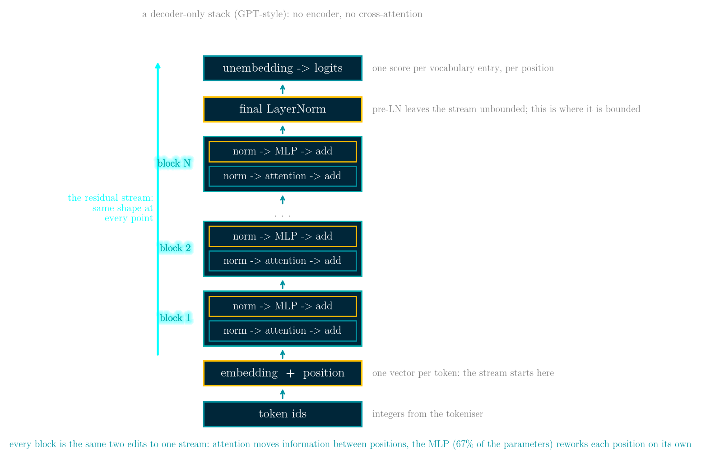
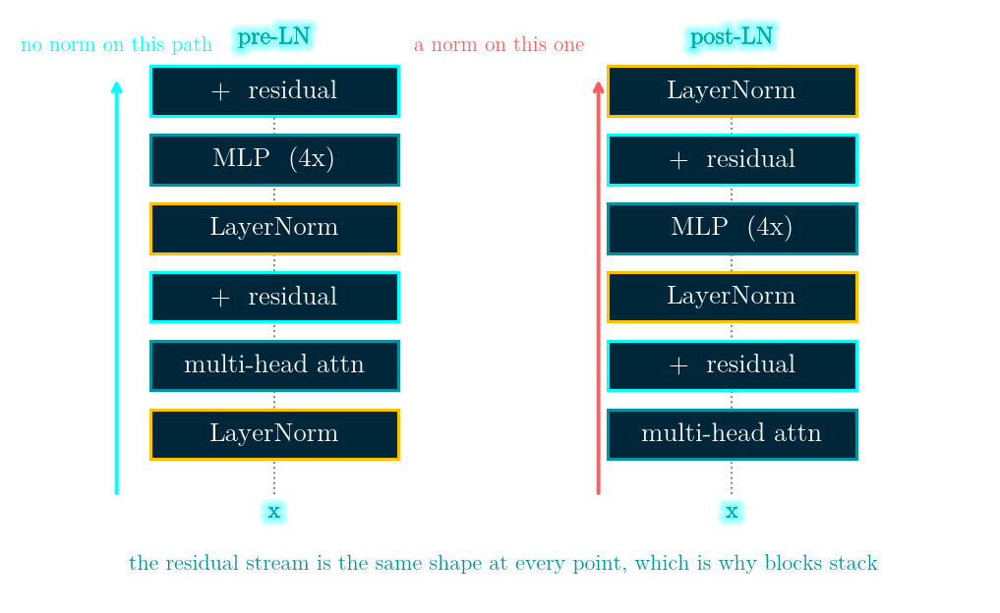
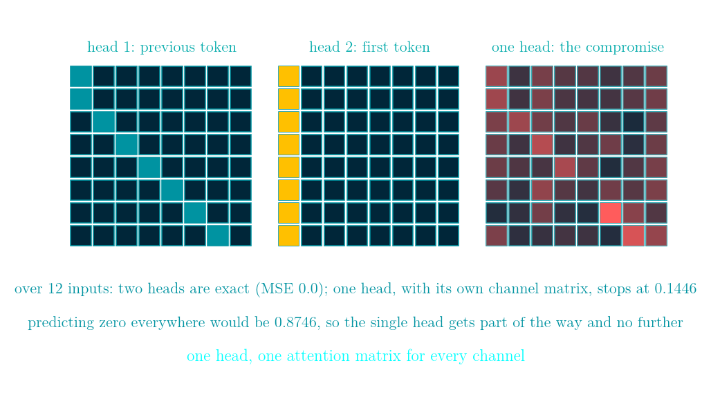
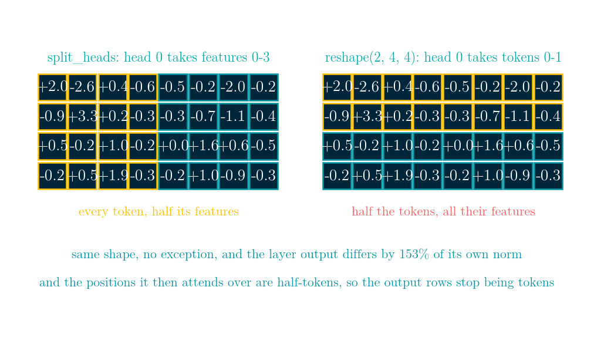
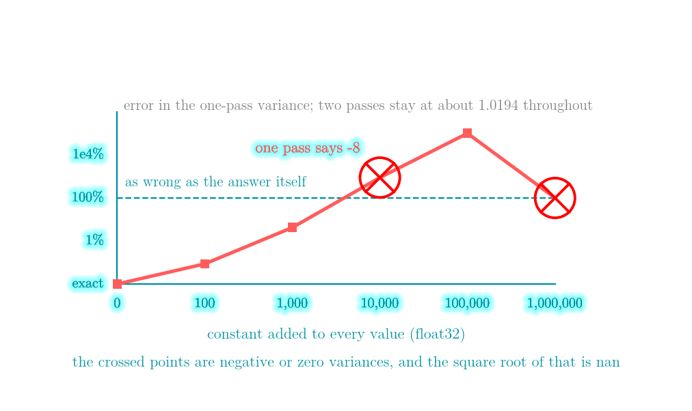
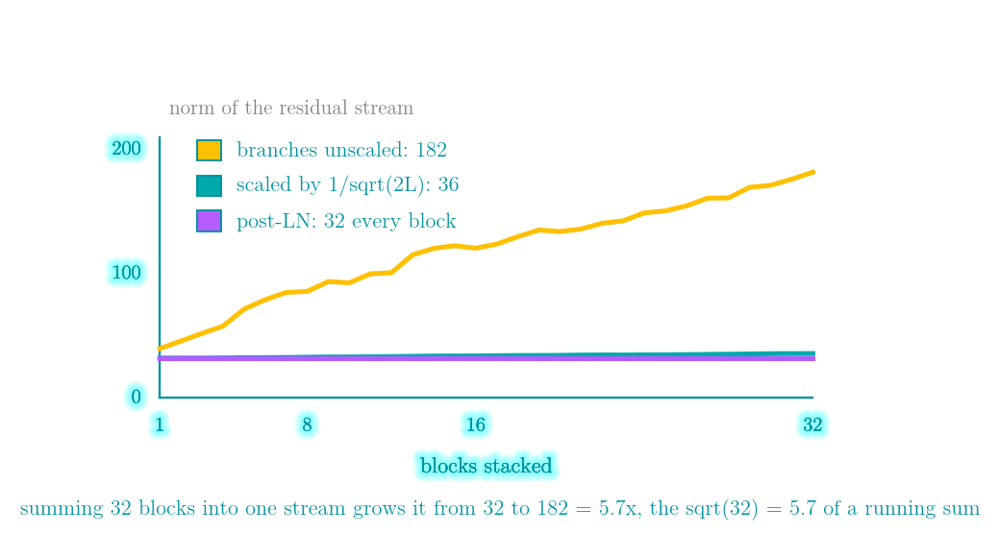
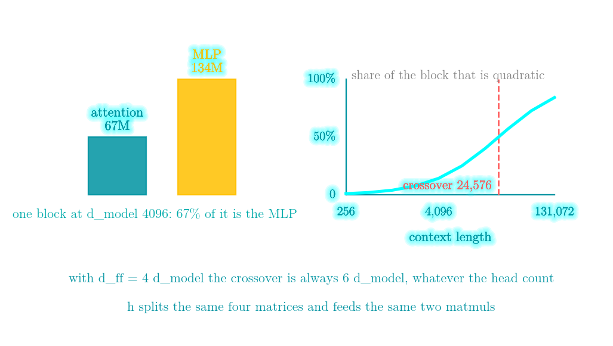

# Day 53 — Multi-Head Attention 與 Transformer Block：head 到底買到了什麼，以及兩個形狀永遠正確的 bug

程式碼：[day 53 on GitHub](https://github.com/KingRei/100DaysPython/tree/master/day%2053%20-%20multi-head%20attention%20and%20the%20transformer%20block)

*100 Days of Python - day 53*

一個 transformer block 只有兩個混合器。attention 跨「位置」混合：每個位置變成其他位置的加權平均，而每個通道都用同一組權重。MLP 跨「通道」混合：每個位置把自己的通道攪在一起，而每個位置都用同一組權重。兩者都寫回同一條殘差流，形狀從頭到尾不變——這就是為什麼你可以把它疊 32 層。

multi-head attention 不多花任何參數。不管用 1 個 head 還是 64 個，那四個投影矩陣都是 `d_model x d_model`；h 只決定它們被切成幾份。而 h 買到的東西是量得出來的：在一個「一半通道要前一個 token、另一半要第一個 token」的目標上，兩個 head 完全重現；單一 head 就算配一個通道矩陣、還允許它每組輸入自己挑注意力矩陣（比真的 head 還寬），也只停在 MSE 0.1446，而全部猜 0 是 0.8746。

還有兩種最常見的寫錯方式，都會交回一個形狀完全正確的陣列：把 head 切在錯的軸上，以及用一趟算出 LayerNorm 的變異數。

Day 52 做的是 attention 本身，今天是包著它的那一層和那個 block。

## 整個架構長什麼樣，以及為什麼是這個樣子



這是 **decoder-only** 的堆疊，也就是 GPT 這一類語言模型的長相。2017 年那篇論文還有一個 encoder，而且每個 decoder block 裡多一層 cross-attention 去讀 encoder 的輸出——那是翻譯模型需要的東西；只要模型做的事是「把自己的文字接下去」，這兩樣就都會被拿掉，剩下的就是上面這張圖。token id 進來，embedding 把每個 token 變成一個向量，N 個長得一模一樣的 block 輪流在這組向量上「改一點東西」，最後一個 LayerNorm 把它收住，unembedding 再把每個向量變成「每個詞表項目一個分數」。這裡真正在做事的只有五個設計決定，而每一個都換到很具體的東西。

**一條固定寬度的流。** 每個 block 吃 `(n, d_model)`、吐 `(n, d_model)`——後面量的例子就是 `(16, 64)` 進、`(16, 64)` 出。「疊 32 層」因此只是一句話而不是一次重新設計：只有一種形狀要實作、只有一種形狀要切到多張卡上、而且任何地方都插得進一個新層。

**block 是往流上「加」而不是「換掉」。** 一個輸出全零的分支會讓模型完全不變，所以新加的 block 一開始就是什麼都不做，它只需要學一個修正量。代價是這條流變成一個連加、會隨深度長大——後面量到 32 層從 32.0 長到 197.0——而那些 normalisation 和初始化縮放存在的理由就是控制這件事。

**位置之間的資訊只在一個地方交換。** 整個堆疊裡只有 attention 會去讀別的位置；MLP、norm、unembedding 全都是一次只處理一個位置。光是這一條限制就決定了三件事：一個 causal mask 就足以讓模型變成自迴歸的、KV cache 之所以可能（只有 attention 會回頭看），以及成本為什麼會乾淨地分成「跟 context 成正比」和「跟 context 平方成正比」兩半。

**除了 attention 以外全都是逐位置的，所以訓練可以整條序列平行。** 遞迴網路必須一步一步走過序列；這裡 n 個位置一起進同一批矩陣乘法，一次前向就在每一個位置上都產生一個預測。這個性質才是讓這種規模的訓練變得可行的東西，而它來自這個「形狀」，不是來自 attention 本身。

**容量放在逐位置的那一半。** MLP 先放大到四倍寬，佔掉每個 block **67%** 的參數，而且後面那張表上四種模型大小都是 67%。難平行的那一半（attention）被刻意留瘦，好平行的那一半被養胖。這也是為什麼 mixture-of-experts 換掉的是 MLP 而不是 attention。

## 一個 block，兩個混合器

```python
def block_pre_ln(x, p, mask=None):
    a, _ = multi_head_attention(layer_norm(x, p['g1'], p['b1']), ...)
    x = x + a
    return x + ffn(layer_norm(x, p['g2'], p['b2']), p['W1'], p['bb1'], p['W2'], p['bb2'])
```

`d_model` 64、8 個 head、16 個 token 時，輸入 `(16, 64)`、輸出 `(16, 64)`。兩個分支是「加進去」而不是「取代掉」：attention 分支的範數是它讀到的那條流的 0.354 倍，整個 block 把流移動了 0.772（相對範數）。



## h 個 head 不多花參數

| head 數 | head 維度 | Wq/Wk/Wv/Wo 的參數 | 每層產生幾個權重矩陣 |
|---|---|---|---|
| 1 | 64 | 16,384 | 1 |
| 2 | 32 | 16,384 | 2 |
| 8 | 8 | 16,384 | 8 |
| 64 | 1 | 16,384 | 64 |

這張表只有最後兩欄在動。head 數把同樣四個矩陣切成 h 個互相獨立的子空間，每個子空間再各自產生一個 `n x n` 的注意力權重矩陣。於是這一層用同樣的參數（而且如後面的 FLOP 那節所示，同樣的算術）把序列混合了 h 種方式，而不是一種。

## head 真正買到的東西

設一個需要「同時做兩件事」的目標：一半的通道要「前一個 token 的值」，另一半要「第一個 token 的值」。兩個都是 attention 很容易做到的事。兩個 head 各做一件、各自只負責自己那一半通道，在十二組不同輸入上都把目標做到 MSE 0.0——完全重現。

那一個 head 呢？一個 head 不只有注意力矩陣，它還有 `Wv` 和 `Wo`，兩個合起來就是一個可以任意重新路由通道的 `d x d` 矩陣。所以這一輪把那個矩陣也給它，跟注意力權重一起用梯度下降擬合；而且還讓它每一組輸入都挑一個不同的注意力矩陣——真的 head 挑不了，它的權重得從 Q、K 算出來：

```python
A = softmax(L, axis=-1)          # 每組輸入一個注意力矩陣，隨便挑
R = A @ V @ M - target           # M 是一個 d x d 通道矩陣，所有輸入共用
dM += 2 * (A @ V).T @ R / size
dA = (2 * R @ M.T / size) @ V.T
L -= lr * A * (dA - (dA * A).sum(axis=-1, keepdims=True))
```

它停在 0.1446，而全部猜 0 是 0.8746。把那個通道矩陣給它，這個比較才誠實：不給的話，`n = d = 8` 時單一組輸入只要解 `(A V) M = target` 就能把**隨機**的注意力矩陣 A 配到 MSE 5.7e-30，那完全不是在講 head。這也是為什麼要量十二組輸入而不是一組。

單一 head 真正做不到的是**對不同通道用不同的注意力矩陣**，而那正是這個目標要的。head 是一層「同時做好幾件事」的方式，把單一 head 加寬並不能換到這個。



## 第一個不會報錯的壞法：head 切在錯的軸上

要把 `(n, d_model)` 切成 h 個 head，做法是先把「通道」這個軸分組，再把它搬到最前面：

```python
def split_heads(X, h):
    n, d = X.shape
    return X.reshape(n, h, d // h).transpose(1, 0, 2)
```

少掉那個 transpose、直接 reshape 成 `(h, n, d_head)`，結果的形狀一模一樣——而且切錯軸。在一個 `4 x 8`、2 個 head 的輸入上，正確的切法讓 head 0 拿到每個 token 的第 0–3 個通道；錯的那個讓它拿到 token 0 和 1 的全部通道。更糟的是，它接著拿去做 attention 的那些「位置」其實是半個 token——token 0 的前四個通道、token 0 的後四個、token 1 的前四個——所以 head 合併回去之後，輸出的每一列根本不再對應任何一個 token。

在 16 個 token、64 維、8 個 head 上量：兩種切法的層輸出最大差 1.911，佔輸出自己範數的 153%。沒有例外、沒有形狀錯誤，模型照樣訓練，只是比較差，而且你找不到可以指的地方。抓得到它的 assert 只有一行：head `j` 必須等於 `X[:, j*d_head:(j+1)*d_head]`。



## 第二個不會報錯的壞法：LayerNorm 裡一趟算完的變異數

LayerNorm 每一列要一個平均值和一個變異數。課本那條 `var = E[x²] − E[x]²` 讓變異數只要掃一趟而不是兩趟，所以它一直有人寫。它同時也是「把兩個大數相減去得到一個小數」，而殘差流正好就是那個會累積一個共同大偏移的東西。

float32、512 個標準常態值，整排加上一個常數：

| 位移 | 兩趟的變異數 | 一趟的變異數 | 相異的 float32 值 |
|---|---|---|---|
| 0 | 1.019437 | 1.019437 | 512 |
| 100 | 1.019437 | 1.018555 | 512 |
| 1,000 | 1.019434 | 1.062500 | 511 |
| 10,000 | 1.019408 | -8.000000 | 475 |
| 100,000 | 1.019417 | 1024.000000 | 304 |
| 1,000,000 | 1.020317 | 0.000000 | 77 |

位移到 10,000 時，一趟版本的變異數是**負的**，開根號就是 nan——而同一份資料兩趟版本仍然回報 1.019408，而且這個陣列裡還有 475 個相異的 float32 值。壞掉的不是資料，是那條恆等式。在那之前它則是安靜地壞：位移 1,000 時它回報 1.0625 而不是 1.0194，根號裡的 eps 讓一切保持有限，LayerNorm 只是用了錯的尺度去除。

對一列掃兩趟——後面帳本那張表裡的 `d_model` 就是 4,096 個數字——跟它前後那些矩陣乘法比起來完全不算成本。



## LayerNorm 還是 RMSNorm：你是在買哪一種不變性

RMSNorm 除以均方根，從不減平均。在一列平均 6.925、標準差 1.943 的資料上，LayerNorm 回傳平均 2.64e-16、標準差 1.0000，RMSNorm 回傳平均 0.9628、標準差 0.2701。把那一列加上 100，LayerNorm 的輸出只變 6.13e-15，RMSNorm 變 0.8014。

所以 RMSNorm 換到的是少一次 reduction、少一組 beta 參數，放棄的是平移不變性。兩者都對「整列乘上一個常數」免疫，而那才是殘差流真的會對它做的事。

## pre-LN 還是 post-LN：哪一條路沒有被正規化

在 32 層堆疊的輸入上推一個很小的擾動，看兩件事：到了頂端還剩多少，以及那條流本身變多大。

| 疊了幾個 block | ‖x‖ pre-LN | ‖x‖ post-LN | 擾動影響 pre | post |
|---|---|---|---|---|
| 1 | 37.9 | 32.0 | 1.355 | 1.134 |
| 8 | 81.9 | 32.0 | 3.580 | 1.441 |
| 16 | 127.1 | 32.0 | 5.599 | 1.541 |
| 32 | 197.0 | 32.0 | 7.505 | 1.104 |

post-LN 讓流的範數不再跟深度有關，因為 post-LN 的 block 最後一個動作就是正規化。在這裡的初始化（gamma = 1、beta = 0）下它每個 block 之後都剛好是 32.0＝`sqrt(16 × 64)`；學出來的 gamma、beta 會改變這個數字，但改不掉「深度被消掉了」這件事。pre-LN 不碰殘差路徑，所以它從 37.9 長到 197.0。

擾動跟著一起長，絕對值上是 7.50 倍對 1.10 倍——但換算成「佔整條流的比例」兩邊幾乎一樣，0.0381 對 0.0345，所以**這個量測並沒有證明 pre-LN 帶比較多訊號**。它證明的是結構差異：pre-LN 留了一條從輸入直通輸出、中間完全沒有正規化的路，post-LN 則在那條路上每一層都放一個。文獻裡那些訓練穩定性的結果講的就是這件事（[Xiong et al., 2020](https://arxiv.org/abs/2002.04745)），而這也是為什麼 pre-LN 的堆疊最後一定要補一個 LayerNorm 再接輸出層——不然沒有任何東西管得住送進去的大小。

## 殘差流是一個連加

那條沒人管的流會長大，理由很單純：每個分支都往上面加東西。

| 疊了幾個 block | ‖x‖ 未縮放 | ‖x‖ 每個分支乘 1/sqrt(2L) |
|---|---|---|
| 0（輸入） | 32.0 | 32.0 |
| 1 | 39.8 | 32.2 |
| 8 | 85.9 | 32.8 |
| 16 | 120.6 | 33.9 |
| 32 | 181.8 | 35.8 |

32 層之後範數從 32.0 長到 181.8＝5.7 倍，正是「把 32 份互相獨立的東西加進同一個連加」預期的 `sqrt(32) = 5.66`。把每個分支寫進去的東西乘上 `1/sqrt(2L)`（L 層、每層兩個分支），就只變 1.12 倍。「殘差分支在初始化時要縮放」講的就是這整件事。



## 參數和計算量到底在哪裡

| 模型維度 | head 數 | attention | MLP | MLP 佔比 | FLOP 交叉點 |
|---|---|---|---|---|---|
| 768 | 12 | 2,359,296 | 4,718,592 | 67% | 4,608 |
| 2048 | 16 | 16,777,216 | 33,554,432 | 67% | 12,288 |
| 4096 | 32 | 67,108,864 | 134,217,728 | 67% | 24,576 |
| 8192 | 64 | 268,435,456 | 536,870,912 | 67% | 49,152 |

attention 是四個 `d_model x d_model`，MLP 是兩個 `d_model x 4·d_model`。所以每個 block 有三分之二是那個前饋層——大家討論得最少的那一塊——而且這個比例跟寬度無關。

計算量則分成兩半：跟 context 成正比的那半（`n × (4d² + 2·d·d_ff)`，投影加 MLP）和跟它平方成正比的那半（`2·n²·d`，attention 的兩次矩陣乘法）。把兩邊設成相等，在 `d_ff = 4·d_model` 時解出來永遠是 `n = 6·d_model`。`d_model` 4096 的一個 block：

| context | 線性的乘加次數 | 二次方的乘加次數 | 二次方佔比 |
|---|---|---|---|
| 512 | 103,079,215,104 | 2,147,483,648 | 2.0% |
| 2,048 | 412,316,860,416 | 34,359,738,368 | 7.7% |
| 8,192 | 1,649,267,441,664 | 549,755,813,888 | 25.0% |
| 32,768 | 6,597,069,766,656 | 8,796,093,022,208 | 57.1% |

head 數在這兩欄裡都不出現。



## LeetCode 189 - Rotate Array（旋轉陣列）

**題目在問什麼。** 把陣列裡每個元素往右移 k 格，掉出尾端的繞回最前面，而且保持原來的順序。

**輸入輸出。** 輸入一個 list `nums` 和一個非負整數 `k`。必須就地修改，不回傳東西。

**範例。** `[1, 2, 3, 4, 5, 6, 7]`、`k = 3` 變成 `[5, 6, 7, 1, 2, 3, 4]`：最後三個照原順序搬到最前面，前面四個接在後面。

**限制。** 最多 100,000 個元素，而 k 可以是 0 到 100,000 之間任何值——也就是可能比陣列還長，所以 `k %= n` 不能省。真正有意思的是追問：就地做，額外空間 `O(1)`。複製到第二個陣列是 `O(n)` 記憶體，等於跳過這題的重點。

先把整個陣列反轉，再分別反轉前 k 個和剩下的：

```python
class Solution:
    def rotate(self, nums: list[int], k: int) -> None:
        n = len(nums)
        k %= n
        self._rev(nums, 0, n - 1)
        self._rev(nums, 0, k - 1)
        self._rev(nums, k, n - 1)

    @staticmethod
    def _rev(a, i, j):
        while i < j:
            a[i], a[j] = a[j], a[i]
            i, j = i + 1, j - 1
```

另一種就地解法是沿著「每個元素往後跳 k 格」的循環走。它是對的，但必須從 `gcd(n, k)` 個不同起點各走一次。在 `[1, 2, 3, 4, 5, 6]`、`k = 2` 時只從 index 0 出發會得到 `[5, 2, 1, 4, 3, 6]`：只搬了一半，而回傳的仍然是六個整數。`k = 1` 時剛好只有一個循環，同一段程式碼完全正確（`[6, 1, 2, 3, 4, 5]`），所以小測資永遠照不出來。

這跟今天切錯 head 是同一種形狀的 bug：型別對、長度對、做了一半。

[leetcode.com/problems/rotate-array](https://leetcode.com/problems/rotate-array/)

## LeetCode 303 - Range Sum Query - Immutable（區域和檢索 - 陣列不可變）

**題目在問什麼。** 對一個固定不變的陣列，寫一個類別可以重複回答「index `left` 到 `right`（含兩端）的元素總和是多少」。

**輸入輸出。** `NumArray(nums)` 建構；`sumRange(left, right)` 回傳那個閉區間的和。

**範例。** `[-2, 0, 3, -5, 2, -1]` 上，`sumRange(0, 2)` 是 1、`sumRange(2, 5)` 是 −1、`sumRange(0, 5)` 是 −3。

**限制。** 陣列最多 10,000 個元素，`sumRange` 最多呼叫 10,000 次。每次重加一遍是每次 `O(n)`、總共 10⁸ 次運算；而「陣列永遠不變」就是允許你預先算好的那個條件。（會變的那個兄弟題是 LeetCode 307，那題才需要 Fenwick tree，那是 Day 29。）

```python
class NumArray:
    def __init__(self, nums: list[int]):
        self.pre = [0]
        for v in nums:
            self.pre.append(self.pre[-1] + v)

    def sumRange(self, left: int, right: int) -> int:
        return self.pre[right + 1] - self.pre[left]
```

prefix 開頭那個 0 不是裝飾：有了它，`left = 0` 的查詢才不用寫特例。

把同一招延伸去算變異數——對 `x` 和 `x²` 各做一條前綴和，各減一次——就直接撞上今天另一條恆等式。在一段平均值 10,000 的 float32 資料上，200 個元素的視窗真變異數是 1.080859，用前綴和算出來是 28.860555。區間和是對的，前綴和也確實是做區間和的正確工具；垮掉的是「平方和很大、答案很小」這個組合。

[leetcode.com/problems/range-sum-query-immutable](https://leetcode.com/problems/range-sum-query-immutable/)

## 複雜度

| 操作 | 時間 | 空間 |
|---|---|---|
| multi-head attention（n 個 token） | O(n²d + nd²) | 每個 head O(n²)，用 online softmax 是 O(nd) |
| MLP 分支 | O(n·d·d_ff) | O(n·d_ff) |
| LayerNorm / RMSNorm（每列） | O(d) | O(1) |
| LeetCode 189 | O(n) | O(1) |
| LeetCode 303 建表／查詢 | O(n) / O(1) | O(n) |

## 這些東西之後會用在哪

今天所有東西都是同一個形狀在重複：一條固定大小的流，每一層讀它、算一點東西、再加回去。block 能疊，是因為它交回來的跟拿到的一樣；而這個堆疊需要小心，是因為「把很多份互相獨立的東西連加起來」會以根號的速度長大。

有三件事之後會一直出現。head 的切法是一個記憶體佈局問題——reshape 免錢、transpose 不免錢，而你寫的是哪一個決定了那些 head 有沒有意義。一趟算完的變異數是所有 streaming 統計量的通病，也正是用前綴和算視窗變異數時踩到的同一個坑。而「一個 block 有 67% 是 MLP」這個數字，就是為什麼 mixture-of-experts 換掉的是 MLP 而不是 attention。

程式碼和互動式走查都在 repo：[day 53 on GitHub](https://github.com/KingRei/100DaysPython/tree/master/day%2053%20-%20multi-head%20attention%20and%20the%20transformer%20block)。
