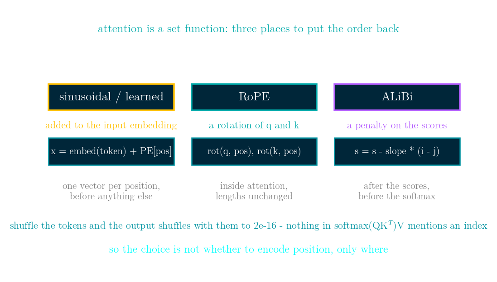
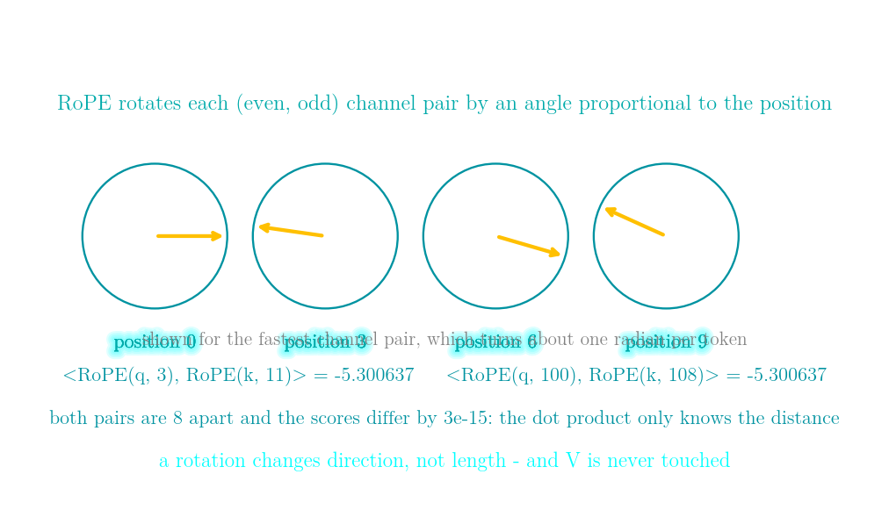
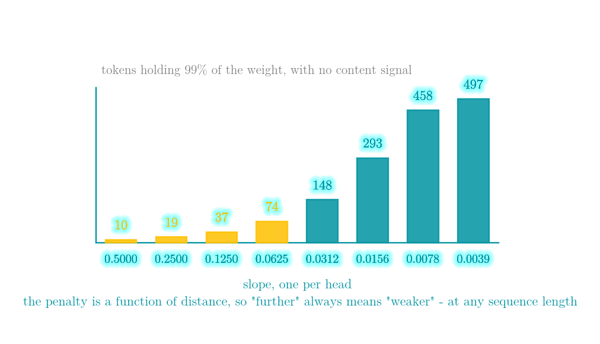
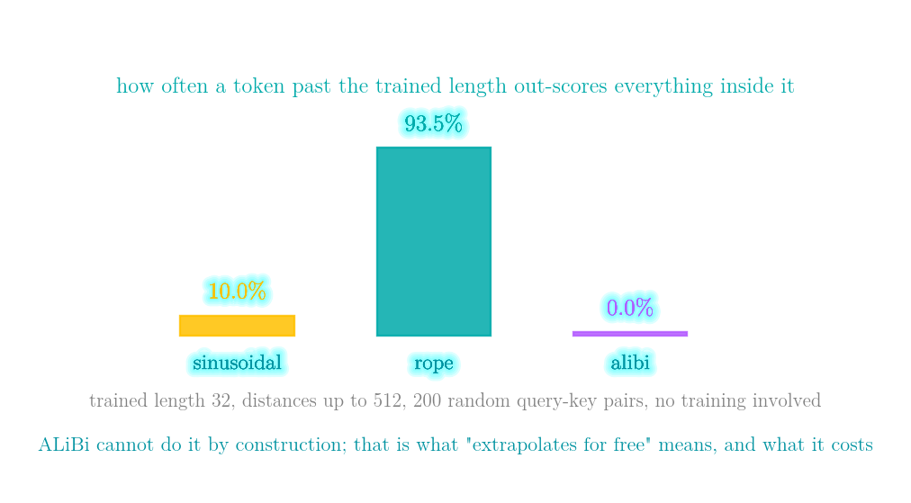
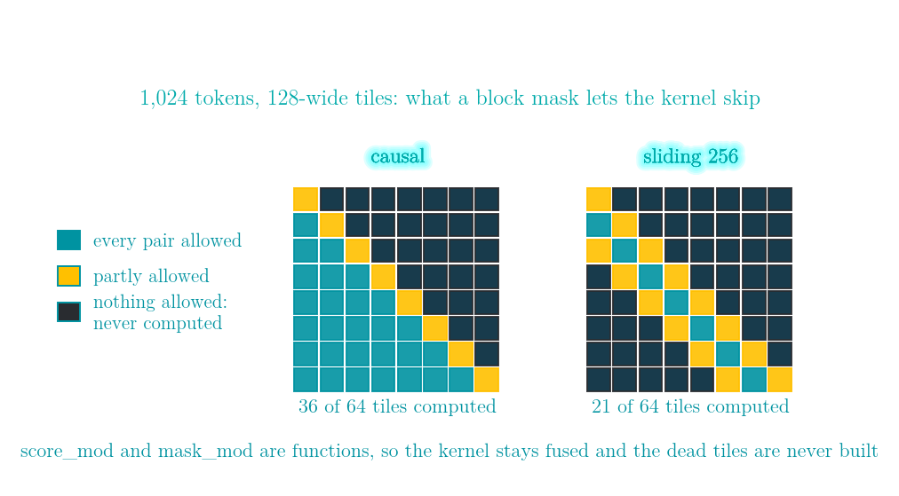

# Positional encodings: sinusoidal, RoPE and ALiBi, and why a long-context model needs its positions rescaled

Code: [day 54 on GitHub](https://github.com/KingRei/100DaysPython/tree/master/day%2054%20-%20positional%20encodings)

*100 Days of Python - day 54*

A language model does not read a sentence as a sentence. The tokeniser turns it into a list of integers, the embedding turns each integer into a vector, and from that point on the model is holding a pile of vectors - one per token. Attention, the operation that lets those vectors look at each other, has no idea which of them came first.

That is not a turn of phrase. Shuffle the rows of the input, run attention, and you get exactly the original output with its rows shuffled the same way: the difference between "attend then shuffle" and "shuffle then attend" is 2.2e-16, which is floating-point noise. The model cannot tell "the cat sat on the mat" from "mat the on sat cat the", because the two inputs are the same pile of vectors in a different order.

The reason is visible in the formula. `softmax(Q K^T / sqrt(d)) V` is a dot product, a softmax and a weighted sum, and none of those three mentions an index. Everything in there asks *how similar* two vectors are; nothing asks *where* they are.

So the order has to be put back by hand, and how you do it is a real design decision with a name: the positional encoding. This article walks through the three answers in use today, each of which injects the position at a different point in the pipeline:

- **sinusoidal** (and the learned-table variant): add one fixed vector per position onto the embedding, before attention ever runs;
- **RoPE**: rotate the query and key vectors by an angle proportional to the position, inside attention - this is what most current open models use;
- **ALiBi**: subtract a penalty proportional to the distance straight from the attention scores.



If they all work, why does the choice matter? Because this is the part of a model that breaks first when you ask it to read something longer than anything it saw in training. Every "now with 128k context" release is, underneath, a story about rescaling the positional encoding - and the numbers below show exactly which quantity is being rescaled and why it runs out.

The last section is FlexAttention, which is worth seeing right after these three: once you notice that RoPE, ALiBi, causal masking and sliding windows all edit one of only two quantities, they stop being separate attention kernels and become arguments to one.

## Sinusoidal: a table of sines added to the embedding

```python
pos = np.arange(n)[:, None]
i = np.arange(0, d, 2)[None, :]
ang = pos / (10000.0 ** (i / d))
pe[:, 0::2], pe[:, 1::2] = np.sin(ang), np.cos(ang)
```

One vector per position, added to the token embedding before attention ever runs. The reason for sines rather than, say, the position number itself is that shifting by `k` becomes a fixed rotation of each (sin, cos) pair: rotate the row at position `t` by an angle that depends only on `k` and you land on the row at `t + k`, measured to 3.3e-15. The same linear map works at every position, so "five tokens back" is one relationship the model learns once instead of one per index.

The side effect is visible in the numbers: the similarity between position 0 and distances 1, 2, 4, 8, 16, 32 is +0.483, +0.442, +0.374, +0.350, +0.303, +0.306. It falls away with distance, but not monotonically - it is a sum of cosines and it wobbles. Nobody asked for that; it comes with the table.

## RoPE: the position is a rotation of q and k

```python
out[..., 0::2] = x[..., 0::2] * c - x[..., 1::2] * s
out[..., 1::2] = x[..., 1::2] * c + x[..., 0::2] * s
```

RoPE treats each (even, odd) pair of channels as a vector in a plane and turns it by an angle proportional to the position - applied to `q` and `k` inside attention, never to `V`. Two things follow immediately. A rotation does not change a vector's length, so nothing can blow up; and because the values are untouched, the position only affects *which* values get read, not what they are.



The property that matters is that the score depends only on the distance:

```
<RoPE(q, 3),   RoPE(k, 11)>  = -5.300637
<RoPE(q, 100), RoPE(k, 108)> = -5.300637      difference 2.7e-15
```

Both pairs are eight apart, and that is all the dot product can tell. The absolute positions cancel when the two rotations meet.

This is also where long-context work happens. At `d = 128` the fastest channel pair completes a turn every 6.28 tokens and the slowest every 54,410. Trained at 4,096, that slowest pair has only got through 0.08 of a turn; running the same model at 32,768 asks it for 0.60 turns - angles it has never seen. The two standard fixes both aim at exactly that: position interpolation multiplies the positions by 0.125 so the old angle range still covers the new length, and the "NTK" approach raises the base from 10,000 to about 82,685 so the wavelengths stretch instead.

## ALiBi: a penalty on distance, applied to the scores

```python
s = Q @ K.T / math.sqrt(d) + slope * (k_index - q_index)
```

Nothing is embedded and nothing is trained. Each head gets a slope from a geometric sequence, and the score of a pair loses `slope * distance` before the softmax. With no content signal, that makes each head a soft window of its own width:

| head | slope | tokens holding 99% of the weight |
|---|---|---|
| 0 | 0.5000 | 10 |
| 2 | 0.1250 | 37 |
| 4 | 0.0312 | 148 |
| 6 | 0.0078 | 458 |

(The last rows are clipped by the 512-token probe, not by their slopes.) Nobody assigns a head its range; the slope does, and a layer covers several scales at once.



## What is left past the trained length

All three are formulas, so all three can be *evaluated* at a position the model never saw - which a learned absolute table cannot do at all: row 4,097 of a 4,096-row table does not exist. But being evaluable is not the same as being meaningful.

Here is a measurement that separates them, with no training involved. Take 200 random query-key pairs, call the trained length 32, and ask how often some token between 33 and 512 away out-scores everything inside the trained range:

| encoding | a far token wins |
|---|---|
| sinusoidal | 10.0% |
| RoPE | 93.5% |
| ALiBi | 0.0% |

Sines keep oscillating forever, so a token 400 positions away can look more attractive than a neighbour. A trained model learns to ignore that - but only for distances it actually saw. ALiBi cannot do it at all: the penalty grows with distance, so further always means weaker, at any length. That is what "ALiBi extrapolates for free" means, and the same sentence is what it costs: a hard recency bias is not always what you want.



## FlexAttention: the scheme becomes an argument

Look at what the three schemes touch. Sinusoidal changes the input, but RoPE and ALiBi - and causal masking, and sliding windows, and soft-capping - all edit one of exactly two things: the value of a score, or whether a pair is allowed at all. Hand those two out as functions and the whole family collapses into one implementation:

```python
def flex_attention(Q, K, V, score_mod=None, mask_mod=None):
    s = Q @ K.T / math.sqrt(d)
    qi, kj = np.arange(n)[:, None], np.arange(m)[None, :]
    if score_mod is not None:
        s = score_mod(s, qi, kj)
    if mask_mod is not None:
        s = np.where(mask_mod(qi, kj), s, -np.inf)
    return softmax(s, axis=-1) @ V
```

Causal is `lambda qi, kj: kj <= qi`. A sliding window adds `& (qi - kj < window)`. ALiBi is `lambda s, qi, kj: s + slope * (kj - qi)`. Soft-capping is `cap * tanh(s / cap)`. Checked against the hand-written versions, causal and causal-plus-ALiBi both come out with a difference of exactly 0.0 - this is the same computation, written differently.

The reason this matters is not tidiness. Writing a mask by hand means materialising an `n x n` boolean matrix and applying it, which costs the memory that FlashAttention exists to avoid. Written as a function, the kernel can ask per tile whether anything inside is allowed at all, and skip the tiles where nothing is:

| mask | live tiles | skipped |
|---|---|---|
| none | 64 of 64 | 0.0% |
| causal | 36 of 64 | 43.8% |
| sliding 256 | 21 of 64 | 67.2% |

That is 1,024 tokens in 128-wide tiles. The dark tiles contain no allowed pair, so those scores are never computed - and the attention kernel stays fused while you change the rule.



## The silent failure: RoPE at the wrong position while decoding

During prefill, the cached keys were rotated at positions 0 to 4. The next generated token's query belongs at position 5 - the length of the cache. Rotating it at position 0, because it is the first row of this step's tensor, is one line:

```
attention weights, correct position: [0.1669 0.0351 0.1301 0.3161 0.1093 0.2425]
attention weights, position 0:       [0.0808 0.0391 0.1214 0.3489 0.1837 0.2262]
largest difference: 0.0862
```

Both rows are finite, both sum to 1, both look exactly like attention weights. Nothing raises, no shape is wrong, and the generated text is merely worse. The test that catches it is a differential one: prefill the whole prompt in a single pass, then decode the same tokens one at a time, and require the two paths to agree at every step.

## Why this matters later

Position is the part of a transformer that most often gets changed after training - every long-context release is a story about rescaling it. Today's measurements are the reason: with RoPE the thing being rescaled is a set of angles, and the question is always whether the slowest channel pair is being asked for a turn it never made during training.

And the FlexAttention framing is worth keeping even without the library: once you notice that the positional scheme, the causal rule, the window and the soft cap are all edits to the same two quantities, the right question about any new variant is which of the two it touches, and whether it still lets whole tiles be skipped.

Code and the interactive walkthrough are in the repo: [day 54 on GitHub](https://github.com/KingRei/100DaysPython/tree/master/day%2054%20-%20positional%20encodings).
