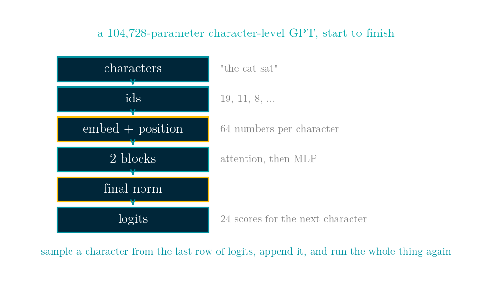
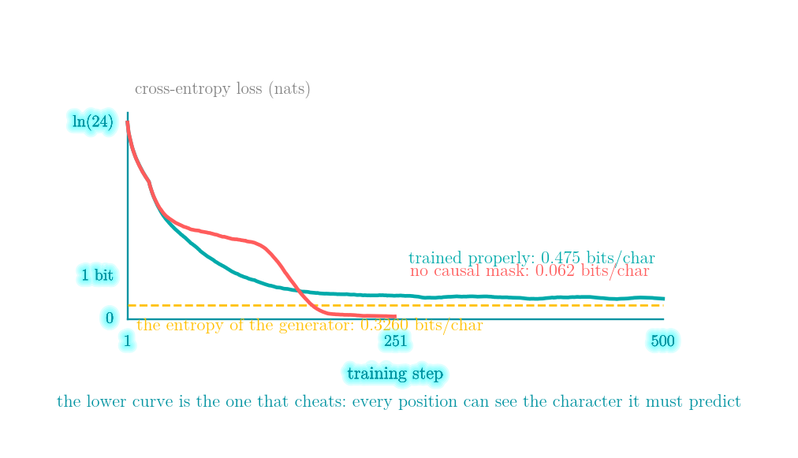
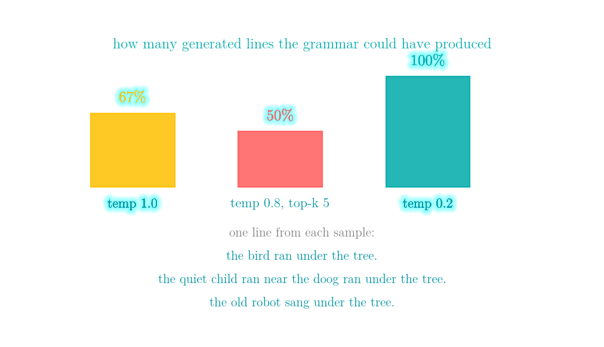
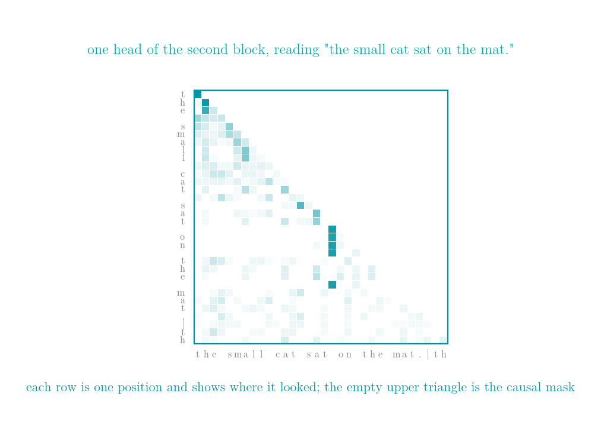

# A character-level mini-GPT in numpy: 100k parameters, a hand-written backward pass, and a loss you can check against the truth

Code: [day 55 on GitHub](https://github.com/KingRei/100DaysPython/tree/master/day%2055%20-%20char%20level%20mini%20gpt)

*100 Days of Python - day 55*

The last four days built the parts: a tokeniser, attention, the transformer block, positional encodings. Today they go in one file and the thing trains. No framework and no autograd - the backward pass is written out by hand and checked against finite differences, worst relative error 3.06e-06.

The model is 104,728 parameters: `d_model` 64, 2 blocks, 4 heads, a context of 32 characters. After 500 Adam steps on a laptop CPU it writes lines like `the old bird sat in the garden.` - and, more usefully, 67% to 100% of the lines it writes are ones the source could have produced, depending on how you sample.



## The corpus is generated, and that is the point

Most toy language models are trained on a scraped text file, which means the only thing you can say afterwards is "the loss went down". Down to where? Compared with what?

So the corpus here is made by a five-slot grammar written in the module: a determiner, an optional adjective, a noun, a verb and a place, 38,005 characters over a vocabulary of 24. Because the generator is known, the entropy of the source is known exactly: each sentence is five independent choices worth 10.288 bits in total, spread over 31.56 characters on average, which is **0.3260 bits per character**. No model can go below that line, and a model well below it is memorising rather than learning.

It also gives a test for the generated text that is not a judgement call: take each generated line and ask the grammar whether it could have made it.

## Training

Input is 32 characters, target is the same string shifted one place right. Adam, learning rate 3e-3, batch 16, 500 steps, no schedule and no gradient clipping.

```
step     1   loss 3.1724   bits/char 4.5769
step   100   loss 0.7284   bits/char 1.0508
step   300   loss 0.3515   bits/char 0.5070
step   500   loss 0.3367   bits/char 0.4858

final training loss  0.3375 = 0.4869 bits/char
held-out loss        0.3301 = 0.4762 bits/char
source entropy       0.3260 bits/char
```

The first number is the one to check before anything else: knowing nothing at all costs `ln(24) = 3.1781`, and step 1 measures 3.1724. The held-out text comes from the same grammar with a different seed, and it scores the same as the training text - so what the model learned is the grammar, not the particular 38,005 characters it saw.



## Sampling: the temperature trade, measured

Generation is one character at a time: take the logits of the last position, divide by the temperature, optionally keep only the top k, sample, append, repeat.

| setting | grammatical lines | first line |
|---|---|---|
| temperature 1.0 | 67% of 6 | `the old bird sat in the garden.` |
| temperature 0.8, top-k 5 | 50% of 6 | `the quiet child ran near the doog ran under the tree.` |
| temperature 0.2 | 100% of 7 | `the old robot sang under the tree.` |

Two things worth saying honestly about that table. The 0.2 row is nearly greedy and its lines start repeating themselves - the same robot keeps turning up - which is the sampling trade in one picture: low temperature buys safety and pays in variety. And the 0.8 row scoring below 1.0 is not a real reversal: a sample of six lines where one bad character spoils the whole line gives a percentage that bounces around. Comparing sampling settings properly means generating hundreds of lines, not six.



## Two bugs that make the loss go down

**Forgetting the causal mask.** 250 steps without it reach a loss of 0.0491, against 0.3824 with it. The unmasked run looks far better, and it is cheating: every position can see the character it is being asked to predict. Nothing about the shapes, the gradients or the loss curve objects. It only shows up when you generate, because then there is no future to read:

```
the e e eeeeeeeeeeeeeeeeeee e ee.e.
 de dedededededededededededededededede
```

0% grammatical, from the model with the lower loss.

**Forgetting to shift the targets.** Ask the model to predict the character it was just given, and 150 steps land at a loss of 0.0012 where the correct version is at 0.4863. A loss heading for zero is easy to read as success; what is being learned is the identity function, and at generation time the character it is supposed to copy is the one that does not exist yet. It emits blanks.

Both bugs have the same shape: **the loss went down because the task got easier, not because the model got better**. The only thing that catches them is evaluating what the model is actually for - here, generating text and running the result back through the grammar.

## What it ends up looking at



That is the attention matrix of one head in the second block, taken out of the forward pass after training, reading `the small cat sat on the mat.`. The empty upper triangle is the causal mask. Most of the weight sits on the last few characters with the occasional reach further back, which is what a task of "finish this word, then start a legal next chunk" should look like. Worth resisting the urge to tell a story about a single head, though: there are two layers of four here, and they work together.

## Why this matters later

Everything above scales up unchanged: the same loop, the same loss, the same two bugs. What changes with size is only what you can afford to check. Here the entropy of the source is known, the whole corpus fits in a string literal, and a wrong gradient is caught by six finite differences. At the other end of the scale none of that is available, which is why the habits are worth forming on something this small - a number the loss can be compared against, and an evaluation that runs the model the way it will actually be used.

Code and the interactive walkthrough are in the repo: [day 55 on GitHub](https://github.com/KingRei/100DaysPython/tree/master/day%2055%20-%20char%20level%20mini%20gpt).
