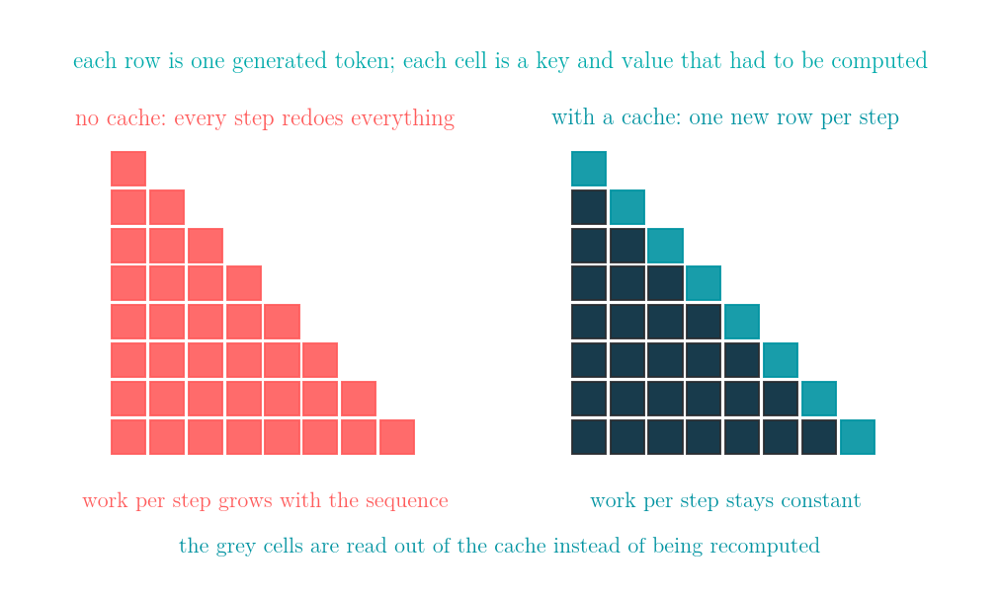
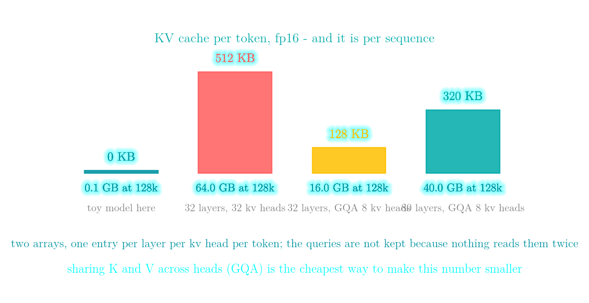
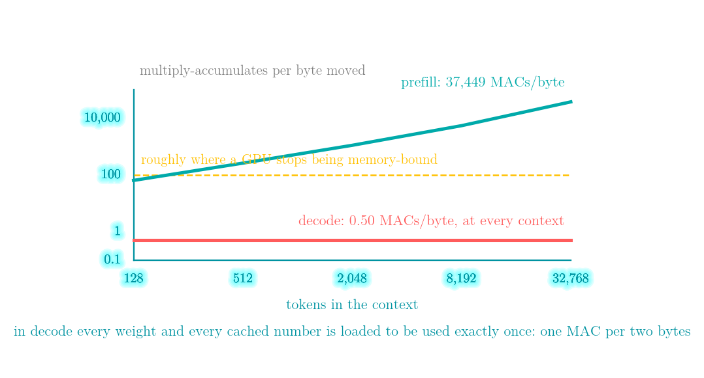
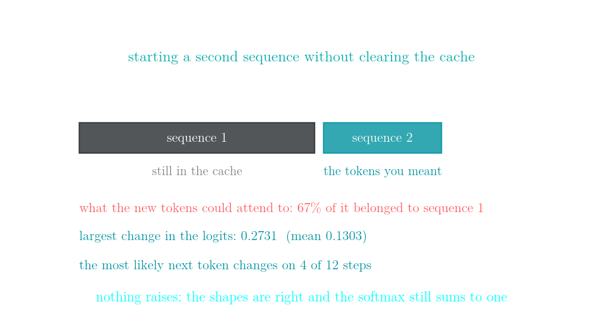

# The KV cache: what it stores, what it costs, and why prefill and decode are two different machines

Code: [day 56 on GitHub](https://github.com/KingRei/100DaysPython/tree/master/day%2056%20-%20kv%20cache)

*100 Days of Python - day 56*

Yesterday's mini-GPT generated text by running the whole model over the whole sequence for every single new character. That is the obvious implementation and it is quadratic: generating n tokens after a prompt of T costs work proportional to n(T + n).

Keep the keys and values you already computed and it becomes nT. On the toy model in this file, 64 tokens after a 64-token prompt take 0.31 s recomputing and 0.04 s cached - and that ratio grows with the sequence, so it is the shape that matters rather than the 8.6x.



That one change also splits inference into two phases with completely different bottlenecks, which is the part worth understanding.

## What is in the cache

Two arrays per layer: the keys and the values of every token so far. Allocated once at the maximum length, because growing a numpy array per token copies the whole thing every step - the cache's own version of the problem it exists to solve.

```python
class KVCache:
    def __init__(self, cfg, max_len=None):
        H, dh = cfg['n_head'], cfg['d_model'] // cfg['n_head']
        self.k = [np.zeros((H, max_len, dh)) for _ in range(cfg['n_layer'])]
        self.v = [np.zeros((H, max_len, dh)) for _ in range(cfg['n_layer'])]
        self.length = 0
```

Note what is *not* in it: the queries. A query is used once, by the token that made it, and never read again. Keys and values are read by every token that comes after, which is exactly why they are the ones worth keeping.

The size is `2 x layers x kv_heads x head_dim x bytes`, per token, per sequence:

| model | bytes/token | at a 128k context |
|---|---|---|
| the toy model here | 512 | 0.1 GB |
| 32 layers, 32 kv heads | 524,288 | 64.0 GB |
| 32 layers, GQA with 8 kv heads | 131,072 | 16.0 GB |
| 80 layers, GQA with 8 kv heads | 327,680 | 40.0 GB |



## It is an optimisation, so it must change nothing

The acceptance test is differential: prefill the prompt, decode token by token, and require every step to equal what the full forward would have said.

```
largest difference between a cached step and the full forward: 3.75e-16
sampling 24 tokens both ways gives the same tokens: True
```

Nearly every cache bug shows up here as a number that is finite, plausible, and not equal - an off-by-one in the write position, a stale entry, a rotation applied at the wrong offset. None of them raise anything.

## Prefill and decode

Arithmetic intensity is multiply-accumulates per byte moved. It decides whether a phase is limited by the arithmetic units or by memory, and a GPU wants it in the hundreds.

| context | prefill MACs/byte | decode MACs/byte |
|---|---|---|
| 128 | 64.3 | 0.50 |
| 512 | 261.2 | 0.50 |
| 2,048 | 1,107.9 | 0.50 |
| 8,192 | 5,433.0 | 0.50 |

The 0.50 is not a coincidence, and it is the whole story in one number. In decode, every weight and every cached number is loaded to be used in exactly **one** multiply-accumulate, and an fp16 number is two bytes. One MAC per two bytes is 0.5. Prefill reuses each loaded weight across all T tokens, which is where its intensity comes from.

This also says something precise about GQA: sharing K and V across heads cuts how many bytes decode has to read, but it cuts the multiply-accumulates by the same factor, so the intensity stays at 0.50. It makes decode cheaper without making it any less memory-bound.



## Which is why decode gets batched

The weights are read once per step no matter how many sequences are decoding, so adding sequences to the batch is close to free until the arithmetic catches up. Measured here (numpy on a CPU, so read the shape and not the milliseconds):

| batch | ms per step | microseconds per sequence |
|---|---|---|
| 1 | 0.21 | 211 |
| 8 | 0.96 | 120 |
| 32 | 4.29 | 134 |
| 128 | 17.3 | 135 |

Going from one sequence to eight cuts the cost per sequence almost in half; after that it flattens out, because with 512 tokens in the cache numpy is already spending its time on the attention einsum rather than on the weights. On a GPU that flat region runs much further, which is why serving systems fight so hard to keep the decode batch full.

What stops the batch growing is the cache itself: every sequence carries its own, and they are what fills the memory. Bigger batch, better throughput, less room for caches - that tension is where every KV cache management technique starts.

## The silent failure: a cache that was not reset

Start a second sequence while the first one is still in the cache - no reset, just carry on appending.

```
largest difference in the logits: 0.2731  (mean 0.1303)
the most likely next token changes on 4 of 12 steps
up to 67% of what the model could attend to belonged to the previous sequence
```

Nothing raises. The shapes are right, the logits are finite, the softmax still sums to one. The model is reading someone else's conversation and the only symptom is that the output is slightly strange - which, in a chat server handling several users, is exactly the kind of bug that gets reported as "the model seems confused sometimes". The differential test above catches it immediately; reading the generated text does not.



## The same cache in PyTorch and JAX

Everything above is one toy class. PyTorch and JAX are both array libraries you write a model in, and in both of them the cache is something your own code holds - only the names and the rules change.

**PyTorch / transformers** hands the cache back to you as `past_key_values`:

```python
from transformers import AutoModelForCausalLM, AutoTokenizer
model = AutoModelForCausalLM.from_pretrained(name, dtype=torch.float16).cuda()

# prefill: the whole prompt in one pass, and the cache comes back with it
out  = model(**tok("the cat sat", return_tensors="pt").to("cuda"), use_cache=True)
past = out.past_key_values           # one (k, v) pair per layer
nxt  = out.logits[:, -1].argmax(-1, keepdim=True)

# decode: one token in, one token out, cache grows by one row
for _ in range(50):
    out  = model(input_ids=nxt, past_key_values=past, use_cache=True)
    past = out.past_key_values
    nxt  = out.logits[:, -1].argmax(-1, keepdim=True)
```

`past[0][0].shape` is `(batch, kv_heads, tokens_so_far, head_dim)` - our `cache.k[l]` with a batch dimension. `model.generate()` runs this loop for you; writing it out is only to see it. Forgetting to pass `past` does not raise: the model treats that single token as a brand new sequence. Reusing a `past` that belongs to another request is the stale-cache bug from the section above.

**JAX** cannot let the cache grow, because `jit` compiles against shapes - a cache one row longer every step would recompile every step. So it is allocated full and written by position:

```python
cache_k = jnp.zeros((heads, MAX_LEN, head_dim))      # allocated once, full size

def decode_step(params, cache_k, cache_v, q, token, pos):
    k, v = project(params, token)
    cache_k = cache_k.at[:, pos].set(k)              # functional write, same shape
    cache_v = cache_v.at[:, pos].set(v)
    live = jnp.arange(MAX_LEN) <= pos                # mask the empty tail
    att  = jnp.where(live, q @ cache_k.T / jnp.sqrt(d), -jnp.inf)
    return jax.nn.softmax(att) @ cache_v, cache_k, cache_v

step = jax.jit(decode_step)                          # compiled once, reused
```

Inside `jit`, `.at[].set()` becomes an in-place update rather than a copy. The slots past `pos` hold junk, so the mask is not optional - forget it and the model softmaxes over a pile of zeros, with perfect shapes and no error.

## Now SGLang, which is a different kind of thing

PyTorch and JAX sit at the same level: libraries you write a model in. SGLang is not another one of those - it is an inference **server** built on top of them. You do not write a decode loop with it; you start a process that loads the weights once, accepts requests from many users over HTTP, decides which of them run in the same batch on each step, and owns all of the GPU memory. vLLM and TensorRT-LLM are the same kind of thing.

Once a server is doing that job, the cache cannot be a variable in your loop any more. Hundreds of requests arrive and finish at unrelated times, so allocating a fresh array per request would fragment the memory within minutes. Instead SGLang carves everything that is not weights into fixed-size token slots at startup, and hands slots out:

```bash
python -m sglang.launch_server --model-path meta-llama/Llama-3.1-8B \
    --mem-fraction-static 0.9 \     # share of HBM the KV pool may take
    --max-running-requests 256 \    # cap on the decode batch
    --chunked-prefill-size 8192     # split long prefills into chunks
```

That pool (`token_to_kv_pool`) *is* the cache, and each request keeps an index table (`req_to_token`) pointing at the slots it owns - our `cache.length` becomes a row in a table rather than a field on an object. The capacity that matters is counted in tokens: `(HBM - weights) / bytes_per_token`, with `bytes_per_token` the number from the table above. That one division decides how many users fit on the machine, which is why `--mem-fraction-static` is the first flag anyone touches.

The other two flags are this day's two measurements turned into policy. `--max-running-requests` caps the decode batch, because decode is memory-bound and wants a large batch while every sequence in it costs slots. `--chunked-prefill-size` exists because a long prefill is compute-bound and holds the GPU for tens of milliseconds, during which every decoding request sits still - so prefills get cut into pieces that run between decode steps.

## Why this matters later

Almost everything in LLM serving is a consequence of the two facts above. The cache is per sequence and large, so memory management becomes the scheduling problem. Decode is memory-bound at 0.50 MACs per byte, so throughput comes from batching rather than from faster arithmetic, and anything that reduces bytes - GQA, quantised caches, sharing a prefix between requests - buys real time.

Code and the interactive walkthrough are in the repo: [day 56 on GitHub](https://github.com/KingRei/100DaysPython/tree/master/day%2056%20-%20kv%20cache).
