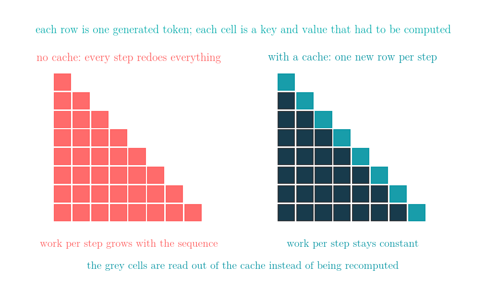
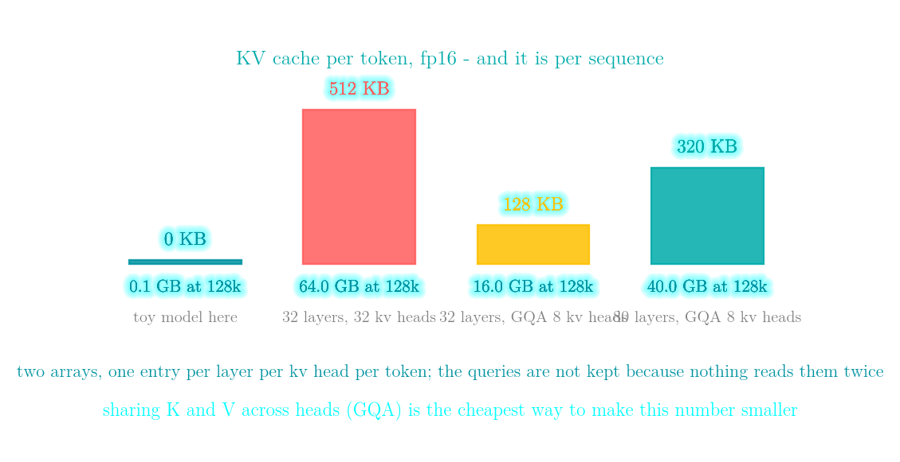
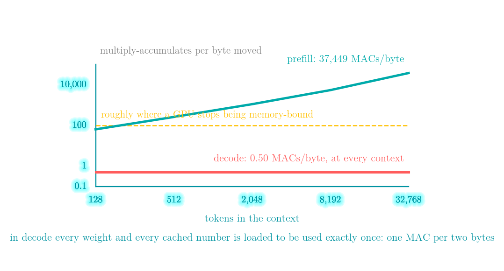
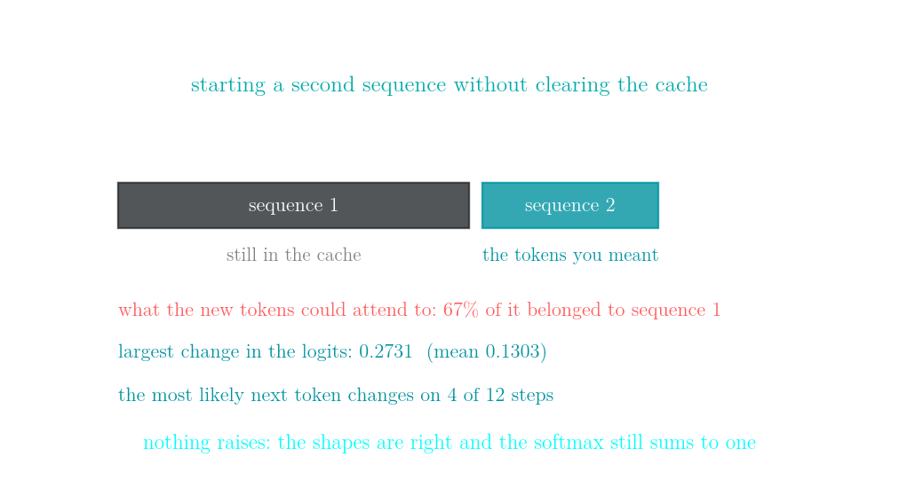

# Day 56 — KV cache：它存什麼、要多少記憶體，以及 prefill 和 decode 為什麼是兩台不同的機器

程式碼：[day 56 on GitHub](https://github.com/KingRei/100DaysPython/tree/master/day%2056%20-%20kv%20cache)

*100 Days of Python - day 56*

昨天那個 mini-GPT 生成文字的方式是：每生一個字元，就把整個模型在整段序列上重跑一次。那是最直覺的寫法，而它是二次方的——prompt 長 T、要生 n 個 token，工作量正比於 n(T + n)。

把已經算過的 key 和 value 留著，它就變成 nT。在這個檔案的玩具模型上，64 個 prompt 再生 64 個 token，重算版要 0.31 秒、有 cache 是 0.04 秒；而這個倍率會隨序列長度繼續變大，所以重點不是 8.6 倍，是「形狀」從二次方變線性。



而這一個改動也把推論切成兩個瓶頸完全不同的階段——那才是今天真正要理解的部分。

## cache 裡放的是什麼

每層兩個陣列：到目前為止每個 token 的 key 和 value。一次配置到最大長度，因為每個 token 重新配置一次 numpy 陣列會整個複製一遍——那就是 cache 自己的那個二次方問題。

```python
class KVCache:
    def __init__(self, cfg, max_len=None):
        H, dh = cfg['n_head'], cfg['d_model'] // cfg['n_head']
        self.k = [np.zeros((H, max_len, dh)) for _ in range(cfg['n_layer'])]
        self.v = [np.zeros((H, max_len, dh)) for _ in range(cfg['n_layer'])]
        self.length = 0
```

注意**沒有**放進去的是 query。query 只被製造它的那個 token 用一次，之後再也沒人讀；key 和 value 則是後面每一個 token 都要讀，所以值得留的是它們。

大小是 `2 × 層數 × kv head 數 × head_dim × 每個數的位元組`，而且是每個 token、每條序列各一份：

| 模型 | bytes/token | 128k context 下 |
|---|---|---|
| 這裡的玩具模型 | 512 | 0.1 GB |
| 32 層、32 個 kv head | 524,288 | 64.0 GB |
| 32 層、GQA 8 個 kv head | 131,072 | 16.0 GB |
| 80 層、GQA 8 個 kv head | 327,680 | 40.0 GB |



## 它是最佳化，所以必須完全不改變答案

驗收標準是對拍：先 prefill 整段 prompt，再一個一個 decode，每一步都必須等於完整 forward 會說的話。

```
cached 的一步與完整 forward 的最大差：3.75e-16
用同一個 seed 取樣 24 個 token，兩邊字字相同：True
```

幾乎所有 cache bug 都會在這裡現形，而且形式都一樣：一個有限、看起來合理、但不相等的數字——寫入位置差一格、留著舊資料、RoPE 用錯位置。它們都不會丟例外。

## prefill 和 decode

Arithmetic intensity 是「每搬一個 byte 做幾次乘加」。它決定一個階段是被計算單元卡住還是被記憶體卡住，而 GPU 想要的是幾百這個等級。

| context | prefill MACs/byte | decode MACs/byte |
|---|---|---|
| 128 | 64.3 | 0.50 |
| 512 | 261.2 | 0.50 |
| 2,048 | 1,107.9 | 0.50 |
| 8,192 | 5,433.0 | 0.50 |

那個 0.50 不是巧合，而且它把整件事濃縮成一個數字：decode 時，每一個被讀進來的權重、每一個 cache 裡的數字，都只被用在**一次**乘加上；而 fp16 一個數字是兩個 byte。一次乘加配兩個 byte 就是 0.5。prefill 則是把讀進來的那份權重給 T 個 token 一起用，它的強度就是從這裡來的。

這也讓 GQA 的效果變得很精確：多個 head 共用同一份 K/V，decode 要讀的 byte 少了幾倍，但要做的乘加也少了同樣幾倍，所以強度還是 0.50。它讓 decode 變便宜，但沒有讓它變得不是記憶體受限。



## 所以 decode 要 batch

不管同時有幾條序列在 decode，權重每一步都只被讀一次，所以在計算量追上來之前，多塞幾條序列幾乎是免費的。實測（numpy 跑在 CPU 上，所以看形狀不要看毫秒數）：

| batch | 每步幾毫秒 | 每條序列幾微秒 |
|---|---|---|
| 1 | 0.21 | 211 |
| 8 | 0.96 | 120 |
| 32 | 4.29 | 134 |
| 128 | 17.3 | 135 |

從 1 條到 8 條，每條序列的成本幾乎砍半；再往上就壓平了，因為 cache 裡有 512 個 token 時，numpy 的時間已經花在 attention 的 einsum 上而不是權重上。在 GPU 上這段平坦區會長很多——這就是服務系統拼命把 decode batch 塞滿的理由。

而擋住 batch 繼續變大的，正是 cache 本身：batch 裡每一條序列都帶著自己的一份，而那就是記憶體被吃掉的地方。batch 越大吞吐越好、cache 越多空間越緊——這條張力就是之後所有 KV cache 管理技巧的起點。

## 不會報錯的壞法：忘了清 cache

第一條序列還在 cache 裡的時候，直接開始第二條——沒有 reset，就繼續往後接。

```
logits 的最大差：0.2731（平均 0.1303）
最可能的下一個 token 在 12 步裡有 4 步不一樣
新 token 能看到的東西裡，最多有 67% 屬於上一條序列
```

什麼都不會報錯。形狀全對、logits 有限、softmax 照樣加總為 1。模型只是在讀別人的對話，而唯一的症狀是輸出「有點怪」——在一個同時服務好幾個使用者的聊天伺服器上，這種 bug 回報上來的樣子就是「模型有時候怪怪的」。前面那個對拍測試立刻就抓得到它；用眼睛看生成結果抓不到。



## 同一個 cache 在 PyTorch 和 JAX 裡長什麼樣

上面都是一個玩具類別。PyTorch 和 JAX 是同一個層級的東西——你用它們「寫模型」的陣列函式庫——而在這兩者裡，cache 都是你自己的程式碼握著的東西，變的只有名字和規則。

**PyTorch / transformers** 直接把 cache 當成 `past_key_values` 交還給你：

```python
from transformers import AutoModelForCausalLM, AutoTokenizer
model = AutoModelForCausalLM.from_pretrained(name, dtype=torch.float16).cuda()

# prefill：整段 prompt 一次進去，cache 跟著回來
out  = model(**tok("the cat sat", return_tensors="pt").to("cuda"), use_cache=True)
past = out.past_key_values           # 每層一對 (k, v)
nxt  = out.logits[:, -1].argmax(-1, keepdim=True)

# decode：一次送一個 token 進去，cache 每步多一列
for _ in range(50):
    out  = model(input_ids=nxt, past_key_values=past, use_cache=True)
    past = out.past_key_values
    nxt  = out.logits[:, -1].argmax(-1, keepdim=True)
```

`past[0][0].shape` 是 `(batch, kv_heads, 目前長度, head_dim)`，就是我們的 `cache.k[l]` 多一個 batch 維。`model.generate()` 會幫你跑完這個迴圈，自己寫出來只是為了看清楚。**忘了傳 `past` 不會報錯**：模型會把那一個 token 當成全新的序列；而重複用別的請求留下來的 `past`，就是前一節那個沒清 cache 的 bug。

**JAX** 不能讓 cache 長大，因為 `jit` 是對形狀編譯的——每步多一列就等於每步重新編譯一次。所以它一開始就配滿，再用位置寫進去：

```python
cache_k = jnp.zeros((heads, MAX_LEN, head_dim))      # 一次配到最大長度

def decode_step(params, cache_k, cache_v, q, token, pos):
    k, v = project(params, token)
    cache_k = cache_k.at[:, pos].set(k)              # functional 寫入，形狀不變
    cache_v = cache_v.at[:, pos].set(v)
    live = jnp.arange(MAX_LEN) <= pos                # 把還沒寫到的尾巴遮掉
    att  = jnp.where(live, q @ cache_k.T / jnp.sqrt(d), -jnp.inf)
    return jax.nn.softmax(att) @ cache_v, cache_k, cache_v

step = jax.jit(decode_step)                          # 編譯一次，之後重用
```

在 `jit` 裡面，`.at[].set()` 會被編譯成就地更新而不是複製。`pos` 之後的格子是垃圾，所以那個 mask 不是可選的——忘了它，模型就會對一堆零做 softmax，形狀完全正確、也不會報錯。

## 接下來我們來看看 SGLang——它是另一種東西

PyTorch 和 JAX 是同一個層級：你拿來「寫模型」的函式庫。SGLang 不是它們的同類，它是蓋在那些函式庫上面的**推論伺服器（inference server）**。你不會用它寫 decode 迴圈；你是啟動一個行程，它把權重載入一次、用 HTTP 接很多使用者的請求、決定每一步要把哪些請求放進同一個 batch，並且掌管整張卡的顯存。vLLM、TensorRT-LLM 也是同一類東西。

一旦有個伺服器在做這件事，cache 就不可能再是你迴圈裡的一個變數。幾百個請求在毫無關聯的時間點進來和結束，每個請求配一塊新陣列的話，幾分鐘之內記憶體就碎掉了。所以 SGLang 開機時就把「權重以外」的顯存整塊切成固定大小的 token slot，再一格一格發出去：

```bash
python -m sglang.launch_server --model-path meta-llama/Llama-3.1-8B \
    --mem-fraction-static 0.9 \     # KV 池可以拿走多少顯存
    --max-running-requests 256 \    # decode batch 的上限
    --chunked-prefill-size 8192     # 把長 prefill 切成塊
```

那座池子（`token_to_kv_pool`）**就是** cache，而每個請求用一張索引表（`req_to_token`）指到自己佔的那些 slot——我們的 `cache.length` 在這裡變成表上的一列，而不是物件上的一個欄位。真正重要的容量是用 token 數算的：`(顯存 − 權重) / 每 token 的 bytes`，而後面那個數字就是前面那張表裡的值。這一個除法決定了這台機器能同時容納多少使用者，也是為什麼 `--mem-fraction-static` 幾乎是所有人第一個動的旋鈕。

另外兩個旗標則是今天那兩個量測變成的政策。`--max-running-requests` 限制 decode batch 的大小，因為 decode 是記憶體受限、想要大 batch，而 batch 裡每條序列都在吃 slot。`--chunked-prefill-size` 的存在理由是：一段長 prefill 是算力受限的，會把 GPU 佔住幾十毫秒，期間所有正在 decode 的請求都停著——所以要把 prefill 切成小塊，夾在 decode 步之間跑。

## 這些東西之後會用在哪

LLM 服務裡幾乎每一件事都是上面那兩個事實的後果。cache 是每條序列一份而且很大，所以記憶體管理就變成了排程問題；decode 固定在 0.50 MACs/byte 的記憶體受限區，所以吞吐量要靠 batch 而不是靠更快的乘法器，而任何能減少「要搬多少 byte」的東西——GQA、量化過的 cache、讓多個請求共用同一段前綴——換到的都是實打實的時間。

程式碼和互動式走查都在 repo：[day 56 on GitHub](https://github.com/KingRei/100DaysPython/tree/master/day%2056%20-%20kv%20cache)。
