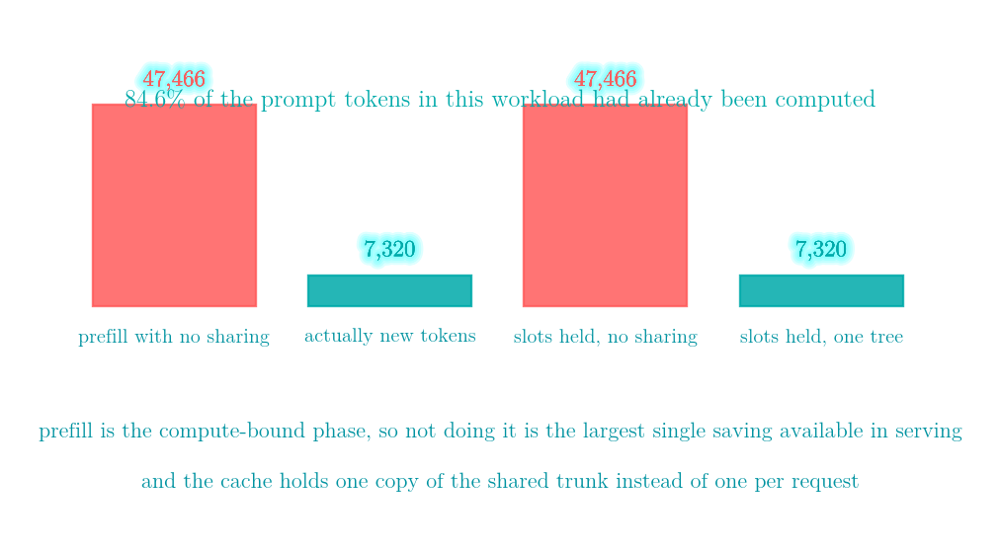
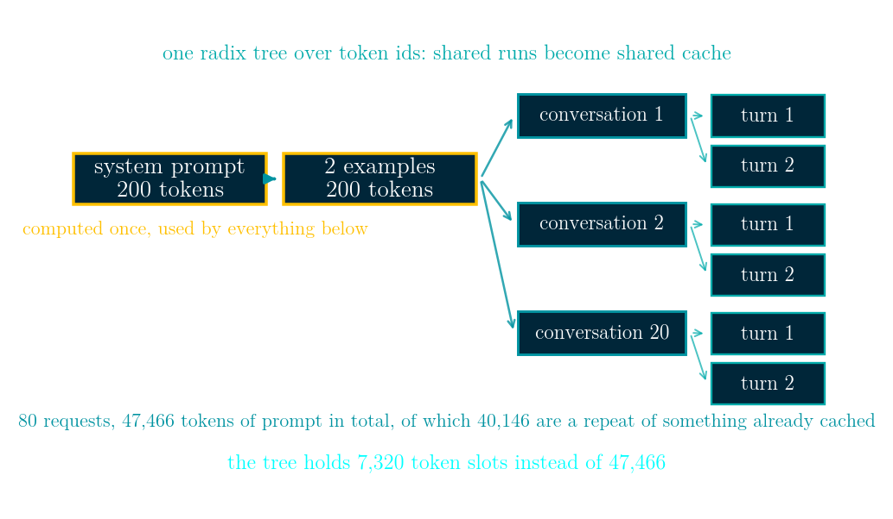
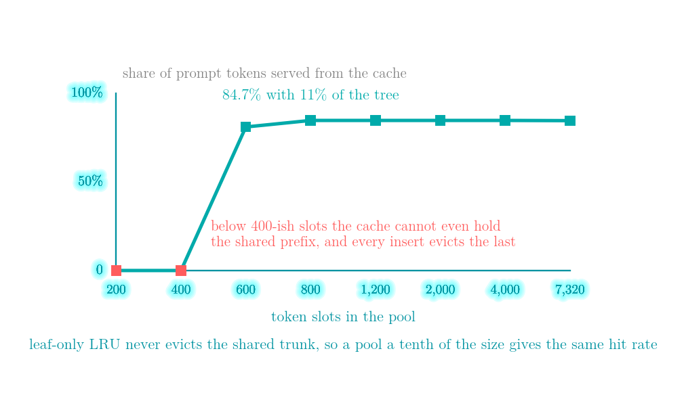
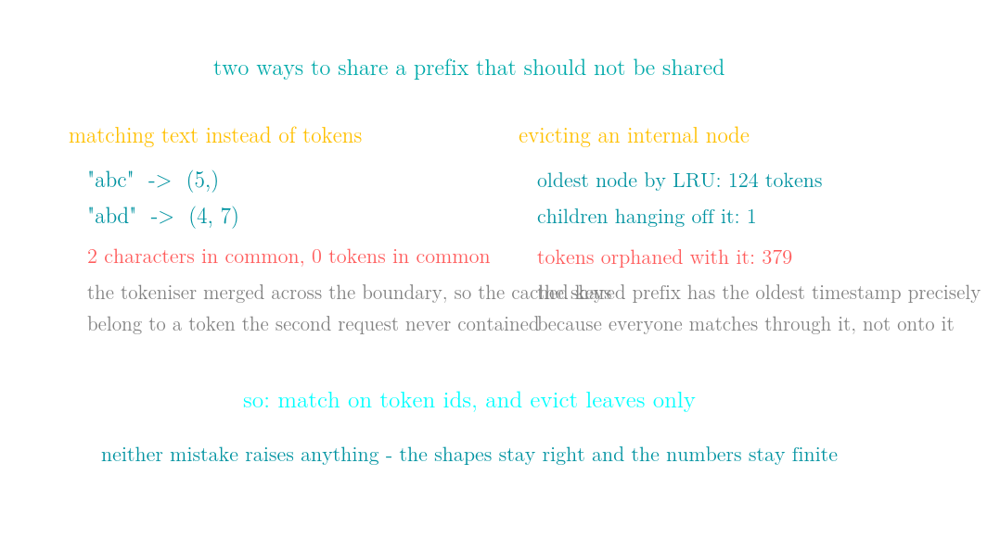

# RadixAttention: sharing one KV cache between requests that start the same way

Code: [day 57 on GitHub](https://github.com/KingRei/100DaysPython/tree/master/day%2057%20-%20radix%20attention)

*100 Days of Python - day 57*

Yesterday's cache belonged to one sequence. On a real server most requests begin identically: the same system prompt, the same few examples, the earlier turns of the same conversation. Computing those keys and values again for every request is the largest piece of wasted work in LLM serving, and prefill is the compute-bound phase, so not doing it is the biggest saving available.

In the simulated chat workload in this file - 20 conversations of four turns, 80 requests, a shared 200-token system prompt and two shared examples - **84.6% of all prompt tokens are a recomputation of something already cached**: 47,466 tokens of prompt, of which only 7,320 have never been seen.



## The data structure

Put the cached token sequences in a radix tree (Day 24) and the lookup falls out: walk down from the root for as long as the tokens agree, and how far you get is the prefix that does not need recomputing.

```python
def match(self, tokens):
    node, i = self.root, 0
    while i < len(tokens):
        child = node.children.get(tokens[i])
        if child is None:
            break
        j = common_prefix_len(child.key, tokens[i:])
        if j < len(child.key):          # diverges inside an edge
            return i + j, child, j
        i += len(child.key)
        node = child
    return i, node, len(node.key)
```

When a request diverges halfway along an edge, the edge is split in two: the head becomes a shared parent and each side keeps its own tail. That is the difference between a radix tree and a plain trie - an edge holds a *run* of tokens rather than one - and it is not cosmetic. Over the same sequences:

| | nodes | token slots held |
|---|---|---|
| plain trie, one token per node | 7,216 | - |
| radix tree | 83 | 7,320 |
| no sharing at all | - | 47,466 |



Where the sharing comes from depends on the request. A conversation's first turn can only share the system prompt and the examples - 380 of 440 tokens, 86%. Its later turns also share everything the conversation has already said - 542 of 644, 84%, on requests that are half as long again. One structure covers both, and it knows nothing about system prompts or conversations; it only knows about prefixes.

## Eviction: LRU, but leaves only

The pool is finite, so entries have to go, and the policy is Day 30's LRU with one extra rule. Two things show up when you sweep the pool size:

| pool (token slots) | share of the full tree | hit rate |
|---|---|---|
| 200 | 3% | 0.0% |
| 400 | 5% | 0.0% |
| 600 | 8% | 81.0% |
| 800 | 11% | 84.7% |
| 2,000 | 27% | 84.7% |
| 7,320 | 100% | 84.6% |

From 800 slots upwards the hit rate does not move: 84.7% with 11% of the tree against 84.6% with all of it. The part earning the hits is the shared prefix, and **leaf-only LRU never evicts it**, because it is an internal node that everything else hangs off.

And below that it does not degrade, it collapses. The pool has to hold the shared prefix (400 tokens here) plus enough of a request to survive insertion; under that line every insert evicts what the previous one just wrote.



That extra rule is the whole reason this is not an ordinary LRU cache. Plain LRU picks the node with the oldest timestamp, and that is usually the shared prefix: everybody matches *through* it rather than ending on it, so nothing refreshes it. Measured on this workload, the node a naive LRU would evict holds 124 tokens itself - and 379 tokens become unreachable with it, including every conversation hanging below. Nodes that a running request is still decoding on are pinned by a reference count for the same reason.

## The trap: text prefixes are not token prefixes

```
"abc"  ->  (5,)
"abd"  ->  (4, 7)

2 characters in common, 0 tokens in common
```

With a tokeniser where both `ab` and `abc` are single tokens, two strings sharing two of three characters share no tokens at all, because the merge crossed the boundary. A cache keyed on the text would hand back the keys and values of a token the second request never contained - right shapes, finite numbers, nothing raised, and the model reading activations that belong to something else.

Prefix matching belongs on token ids, after the tokeniser. Day 51's tokeniser is exactly where that merge happens.



## In PyTorch and JAX: the compute is saved, the space is not

`transformers` has no cross-request prefix sharing. What you can do by hand is compute the system prompt once and copy its cache for each request:

```python
sys_ids = tok(SYSTEM_PROMPT, return_tensors="pt").to("cuda")
base    = model(**sys_ids, use_cache=True).past_key_values    # computed once

for user_turn in requests:
    past = copy.deepcopy(base)                 # a full copy, per request
    out  = model(input_ids=encode(user_turn), past_key_values=past,
                 use_cache=True)
```

JAX is the same story with different mechanics: the cache is a padded fixed-shape array, so a prefix is simply the first so many slots, and a request writes from `base_len` onwards with `jax.lax.dynamic_update_slice`.

Both skip the prefill, and neither shares the memory: every live request carries its own copy. Of today's two numbers, the compute half is reachable this way and the memory half - 47,466 slots down to 7,320 - is not. That is not a flaw in either library; it is that the cache is an object in your code's hands, and sharing needs something that owns all of the memory.

## Now SGLang, where this idea comes from

SGLang is not another library like those two. It is an inference **server**: a process that loads the weights once, takes requests from many users over HTTP, decides which of them share each decode batch, and owns all of the GPU memory. Because it owns the memory, several live requests can point at one copy of a cached prefix - and that is what RadixAttention is. It is on by default.

```bash
python -m sglang.launch_server --model-path meta-llama/Llama-3.1-8B \
    --mem-fraction-static 0.9        # how big the token pool is
    # --disable-radix-cache          # turn the sharing off, to compare

curl localhost:30000/flush_cache       # drop the tree between benchmarks
curl localhost:30000/get_server_info   # the cache hit rate lives here
```

The names line up almost one to one with this file. The class really is called `RadixCache`; the tokens we keep on `node.key` are slot indices into the `token_to_kv_pool` from yesterday; our `refs` counter is its protected node, locked while a request is decoding so eviction cannot touch it. `/flush_cache` is the first thing to call before a benchmark, or the second run is being helped by the first run's tree.

vLLM reaches the same goal with a different structure: `--enable-prefix-caching` cuts the KV into fixed-size blocks and hashes each block's contents, reusing a block when the hash matches. The trade is visible in today's code - a radix tree can branch at any token but has to be maintained, while block hashing only aligns at block boundaries and is far simpler. Both have to compare token ids, for the reason in the section above.

## Why this matters later

This is the first point in the series where a data structure from the classical half pays off directly in the LLM half: a radix tree from Day 24, an LRU policy from Day 30, and a reference count because entries can be in use. The measurement worth remembering is the shape of the capacity curve - flat until the pool can no longer hold the shared prefix, then a cliff - because it says the thing to protect is the trunk, not the volume.

Code and the interactive walkthrough are in the repo: [day 57 on GitHub](https://github.com/KingRei/100DaysPython/tree/master/day%2057%20-%20radix%20attention).
