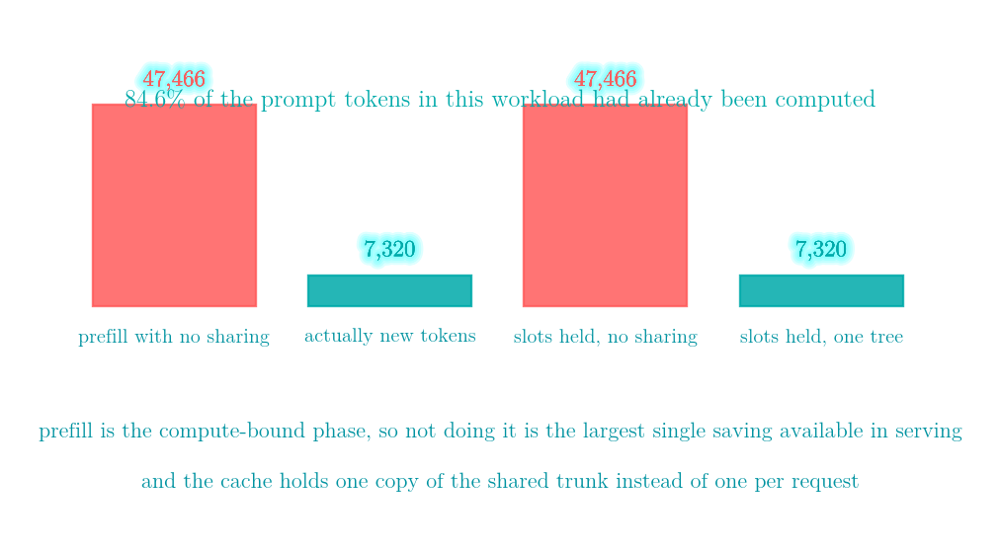
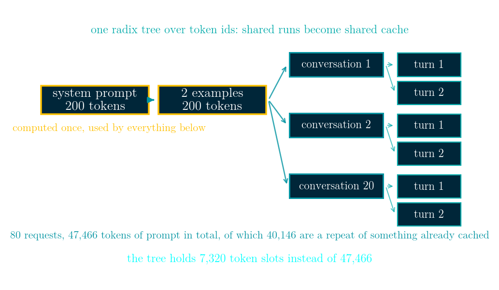
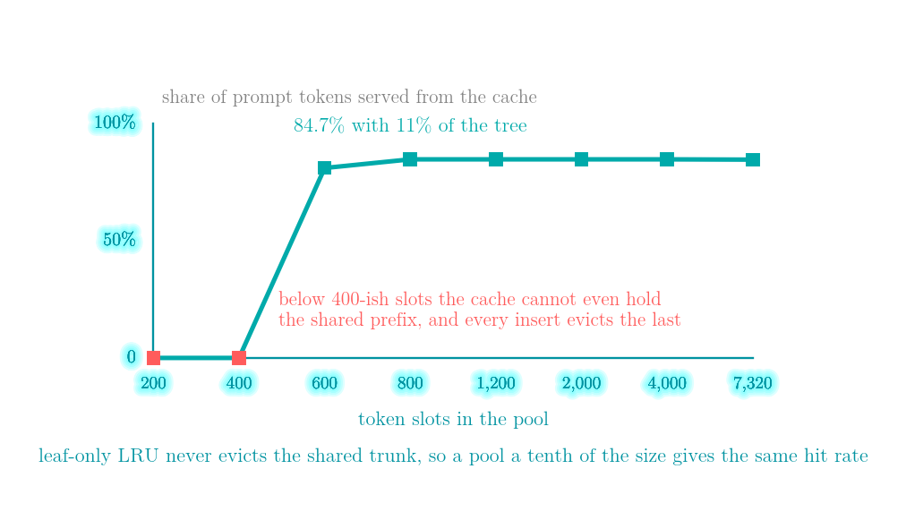
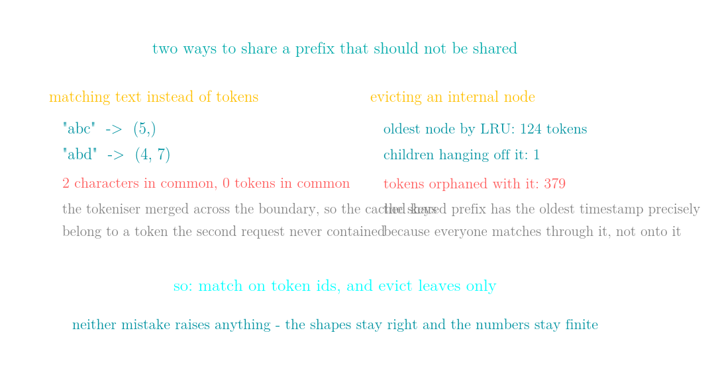

# Day 57 — RadixAttention：讓開頭相同的請求共用同一份 KV cache

程式碼：[day 57 on GitHub](https://github.com/KingRei/100DaysPython/tree/master/day%2057%20-%20radix%20attention)

*100 Days of Python - day 57*

昨天那份 cache 是一條序列自己的。但在真的伺服器上，多數請求的開頭是一模一樣的：同一段 system prompt、同樣那幾個範例、同一段對話的前幾輪。把這些 key 和 value 為每個請求再算一次，是 LLM 服務裡最大的一塊白工——而 prefill 正是算力受限的那一半，所以「不用做」在這裡是能拿到的最大一筆節省。

在這個檔案模擬的聊天工作量裡（20 段對話、每段 4 輪、共 80 個請求，所有人共用一段 200 個 token 的 system prompt 加兩個範例），**所有 prompt token 裡有 84.6% 是在重算已經快取過的東西**：總共 47,466 個 prompt token，真正沒見過的只有 7,320 個。



## 資料結構

把快取過的 token 序列放進一棵 radix tree（Day 24），查詢就自然掉出來了：從 root 往下走，只要 token 還對得上就繼續，走到的長度就是不用重算的前綴。

```python
def match(self, tokens):
    node, i = self.root, 0
    while i < len(tokens):
        child = node.children.get(tokens[i])
        if child is None:
            break
        j = common_prefix_len(child.key, tokens[i:])
        if j < len(child.key):          # 在一條邊的中間分岔
            return i + j, child, j
        i += len(child.key)
        node = child
    return i, node, len(node.key)
```

當一個請求走到某條邊的中間就分岔時，那條邊被切成兩段：前半變成共用的父節點，兩邊各自掛自己的尾巴。這就是 radix tree 跟一般 trie 的差別——**邊上放的是一整串 token，不是一個**——而且這個差別不是裝飾。同樣這些序列：

| | 節點數 | 佔用的 token slot |
|---|---|---|
| 一般 trie（一個 token 一個節點） | 7,216 | - |
| radix tree | 83 | 7,320 |
| 完全不共用 | - | 47,466 |



分享到多少要看是哪種請求。一段對話的第一輪只分享得到 system prompt 和範例——440 個 token 裡的 380 個，86%。第二輪之後連自己前面講過的也在樹上——644 裡的 542，84%，而且請求本身還長了一半。同一個結構同時處理這兩種情況，而它完全不知道什麼是 system prompt、什麼是對話，它只知道前綴。

## 淘汰：LRU，但只能動葉子

池子是有限的，所以要淘汰，政策就是 Day 30 的 LRU 加上一條額外規則。把池子大小掃一遍會看到兩件事：

| 池子（token slot） | 佔整棵樹 | 命中率 |
|---|---|---|
| 200 | 3% | 0.0% |
| 400 | 5% | 0.0% |
| 600 | 8% | 81.0% |
| 800 | 11% | 84.7% |
| 2,000 | 27% | 84.7% |
| 7,320 | 100% | 84.6% |

從 800 個 slot 開始命中率就不動了：用整棵樹 11% 的空間拿到 84.7%，全部給它也只是 84.6%。賺到命中的那一段是共用前綴，而**只淘汰葉子的 LRU 永遠碰不到它**——它是內部節點，底下掛著所有東西。

而再小下去不是退化，是崩掉。池子至少要裝得下共用前綴（這裡 400 個 token）再加上一個請求活得下來的量；低於那條線，每一次插入都把上一次剛寫進去的擠掉。



那條額外規則就是這東西跟普通 LRU 快取的全部差別。普通 LRU 會挑時間戳最舊的節點，而那通常正是共用前綴：所有人都是從它**經過**而不是停在它上面，所以沒有人去更新它的時間戳。在這份工作量上實測，一般 LRU 會挑中的那個節點自己只有 124 個 token，但跟著它一起變成不可達的有 379 個，包括掛在下面的每一段對話。正在 decode 的請求所停的節點也要用 refcount 釘住，理由一樣。

## 陷阱：文字的前綴不等於 token 的前綴

```
"abc"  ->  (5,)
"abd"  ->  (4, 7)

共同的字元 2 個，共同的 token 0 個
```

在一個「ab」和「abc」都是單一 token 的 tokenizer 下，兩個共用三分之二字元的字串可以一個 token 都不共用，因為合併跨過了那個邊界。用文字當 key 的快取會把一個「第二個請求裡根本不存在的 token」的 key/value 交出去——形狀對、數值有限、不報錯，而模型讀到的是別人的東西。

比對一定要在 tokenizer 之後、用 token id 做。Day 51 那個 tokenizer 正是這種合併發生的地方。



## 在 PyTorch 和 JAX 裡：省得掉計算，省不掉空間

`transformers` 沒有跨請求的前綴共享。你能自己做的是把 system prompt 先算一次，然後每個請求複製一份：

```python
sys_ids = tok(SYSTEM_PROMPT, return_tensors="pt").to("cuda")
base    = model(**sys_ids, use_cache=True).past_key_values    # 只算一次

for user_turn in requests:
    past = copy.deepcopy(base)                 # 每個請求一份完整副本
    out  = model(input_ids=encode(user_turn), past_key_values=past,
                 use_cache=True)
```

JAX 是同一個故事、不同的機制：它的 cache 是一個補滿的固定形狀陣列，所以「前綴」就是「前面那幾個 slot」，每個請求從 `base_len` 開始用 `jax.lax.dynamic_update_slice` 往後寫。

兩邊都省掉了 prefill，而兩邊都沒有共用記憶體：每個在跑的請求都帶著自己的副本。今天那兩個數字裡，省計算那一半這樣就拿得到，省空間那一半（47,466 → 7,320 個 slot）拿不到。這不是哪個函式庫的缺陷，而是只要 cache 還是你程式碼手上的一個物件，共用就需要一個「擁有全部記憶體」的東西。

## 接下來看 SGLang——今天這個東西就是從它來的

SGLang 不是上面那兩個的同類。它是**推論伺服器**：一個行程，把權重載入一次、用 HTTP 接很多使用者的請求、決定每一步誰跟誰同一個 decode batch，並且掌管整張卡的顯存。正因為顯存歸它管，多個同時在跑的請求才能指向同一份快取前綴——而那就是 RadixAttention，預設就開著。

```bash
python -m sglang.launch_server --model-path meta-llama/Llama-3.1-8B \
    --mem-fraction-static 0.9        # token 池有多大
    # --disable-radix-cache          # 把共用關掉，用來對照

curl localhost:30000/flush_cache       # benchmark 之間把樹丟掉
curl localhost:30000/get_server_info   # cache hit rate 在這裡
```

名字幾乎跟這個檔案一對一：那個類別在 SGLang 裡真的就叫 `RadixCache`；我們放在 `node.key` 上的 token，在它那裡是昨天那座 `token_to_kv_pool` 的 slot 編號；我們的 `refs` 是它的 protected 節點，請求還在 decode 時鎖住、淘汰不准碰。`/flush_cache` 是做 benchmark 前第一件要呼叫的事，不然第二輪的數字是第一輪的樹在幫忙。

vLLM 用另一種結構達到同樣的目標：`--enable-prefix-caching` 把 KV 切成固定大小的 block、對每個 block 的內容算雜湊，雜湊一樣就重用。差別正好就是今天這段程式碼裡的取捨——radix tree 可以在任意 token 位置分岔但要維護一棵樹，block 雜湊只能以 block 對齊、但實作簡單得多。兩邊都必須在 **token id** 上比對，理由就是上一節那個例子。

## 這些東西之後會用在哪

這是整個系列第一次，前半段的資料結構直接在後半段的 LLM 裡付現：Day 24 的 radix tree、Day 30 的 LRU，再加上一個 refcount（因為項目可能正在被用）。最值得記住的是那條容量曲線的形狀——在池子還裝得下共用前綴之前是平的，裝不下就直接掉到谷底——因為它說的是：要保護的是那段樹幹，不是總量。

程式碼和互動式走查都在 repo：[day 57 on GitHub](https://github.com/KingRei/100DaysPython/tree/master/day%2057%20-%20radix%20attention)。
