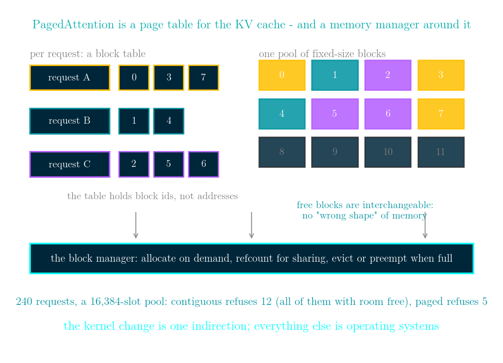
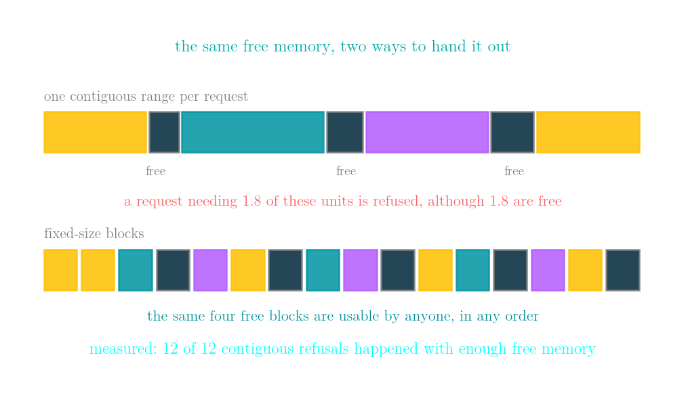
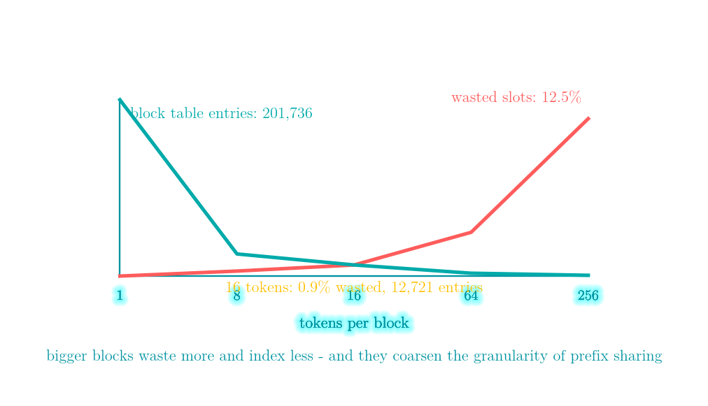
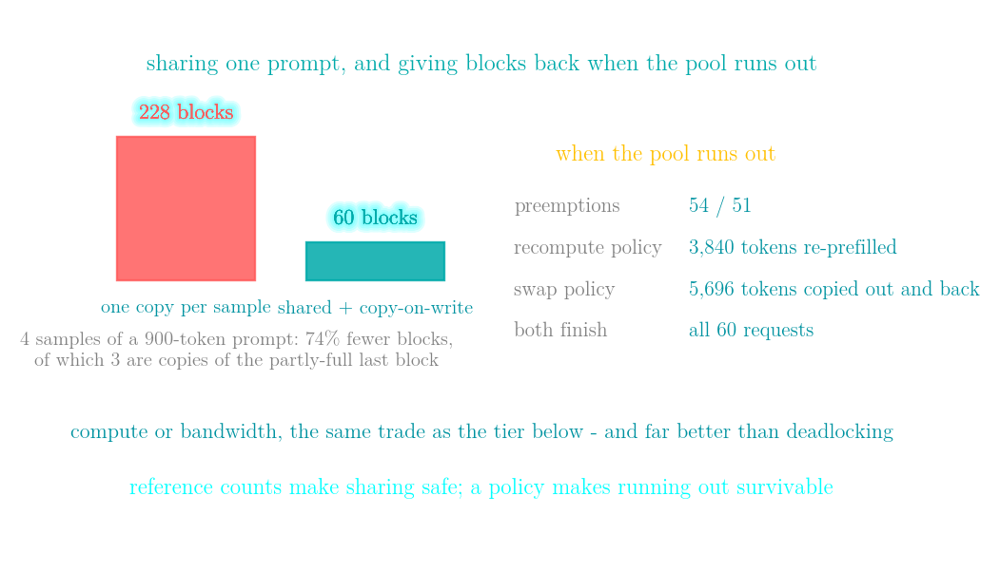

# PagedAttention is a memory allocator: block tables, copy-on-write, and what a server does when the KV pool runs out

Code: [day 58 on GitHub](https://github.com/KingRei/100DaysPython/tree/master/day%2058%20-%20paged%20attention%20memory)

*100 Days of Python - day 58*

The attention part of PagedAttention is small: read K and V through a block table instead of from one flat array per sequence. Everything that makes it worth doing is around that one indirection - handing out fixed-size blocks, refusing work when the pool is full, sharing blocks between samples of the same prompt, and taking blocks back from a request that is already running.



Each request owns a block table - a list of block ids, not addresses - and the blocks live in one pool shared by everybody. A block manager hands them out on demand, counts references so two requests can point at the same block, and decides what to do when there are none left. That is an operating system, not an attention variant, which is why this day is mostly about allocation.

## Why pages at all: free memory in the wrong shape

Give the contiguous allocator the kindest possible case: pretend it is told each request's exact final length in advance, so it never over-reserves. It still loses.

| 240 requests, a 16,384-slot pool | refused | of those, with enough free | occupancy |
|---|---|---|---|
| one contiguous range per request | 12 | **12** | 65.7% |
| fixed-size blocks of 16 tokens | 5 | - | 68.5% |

Every single request the contiguous pool turned away was turned away while the pool had room for it. The space existed, in pieces too small to use: external fragmentation, straight out of the operating systems textbook. Fixed-size blocks delete the problem by construction - any free block is as good as any other, so allocation reduces to "is there enough".



## What paging costs instead

The unused tail of each request's last block, and an entry in a block table for every block:

| tokens per block | wasted slots | block-table entries |
|---|---|---|
| 1 | 0.0% | 201,736 |
| 8 | 0.4% | 25,318 |
| 16 | 0.9% | 12,721 |
| 64 | 3.5% | 3,266 |
| 256 | 12.5% | 901 |

One token per block wastes nothing and needs an entry per token; 256 needs 224 times fewer entries and throws away an eighth of the pool. Real servers sit at the small end, and not only because of the waste: the block is also the granularity at which prefixes can be shared, so a bigger block means coarser sharing.



## Sharing a prompt, and copy-on-write

Because a block table is a list of ids, sharing is almost free to implement:

```python
def share(self, src, dst, tokens):
    shared = self.table[src][:self.blocks_for(tokens)]
    for b in shared:
        self.refs[b] += 1          # a reference count keeps them alive
    self.table[dst] = list(shared)
```

Four samples of a 900-token prompt: 228 blocks the naive way, **60** with sharing - 74% fewer. The only awkward block is the prompt's last one, which is partly full: each sample is about to write its own next token into it, so each takes a private copy of that single block. Copying one block instead of the whole prompt is copy-on-write, the same mechanism `fork()` uses.

## When the pool runs out

Something has to give its blocks back, and there are exactly two currencies. Sixty requests against a 4,096-slot pool:

| policy | preemptions | cost |
|---|---|---|
| recompute | 54 | 3,840 tokens prefilled again |
| swap to host | 51 | 5,696 tokens copied out and back |

Both finished all 60 requests. Compute or bandwidth - the same trade as the tiered cache the day before, one level up. The third option, doing nothing, means the pool fills with half-finished requests and everything deadlocks.



## Two silent failures

**Blocks that are never freed.** 200 requests with one in ten ending on a path that forgets to release: 617 blocks, 9,872 of 65,536 slots gone, and the pool never recovers. Nothing raises. The server accepts fewer and fewer requests and the bug arrives as "throughput degrades after a few hours". The test is an invariant checked when the server is idle: free blocks plus blocks in block tables must equal the pool.

**Forgetting how full the last block is.** 70 tokens occupy 5 blocks = 80 slots, so 10 slots hold whatever the previous owner left there. The kernel needs both the block table *and* the true sequence length, and the mask must use the second. Use the padded length and nothing crashes: the softmax still sums to one, and the model quietly averages in stale KV from a request that finished an hour ago.

## In vLLM

vLLM is where PagedAttention comes from, and its flags map one to one onto the code above:

```bash
vllm serve meta-llama/Llama-3.1-8B \
    --block-size 16 \                # tokens per block
    --gpu-memory-utilization 0.90 \  # share of HBM the pool may take
    --max-num-seqs 256 \             # cap on concurrent sequences
    --swap-space 4 \                 # GiB of host memory for preemption
    --enable-prefix-caching          # reuse blocks across requests
```

At startup it profiles: it measures what the weights and activations take, multiplies what remains by `--gpu-memory-utilization`, and divides by the bytes per block to get the number of blocks. `--block-size` is this file's `PagedPool.block`; the per-request `BlockTable` is `table[rid]`; `ref_count` with copy-on-write is `refs[b]`.

```python
llm = LLM(model=..., block_size=16, gpu_memory_utilization=0.9)
out = llm.generate(prompt, SamplingParams(n=4))   # shares the prompt's blocks
```

`SamplingParams(n=4)` does not copy the prompt's KV four times - the four sequences point at the same blocks with a reference count of 4, and only the partly-full last block is copied on write. `--enable-prefix-caching` applies the same idea *across* requests by hashing whole blocks.

And when the pool runs out, vLLM says so: `Sequence group ... is preempted by PreemptionMode.RECOMPUTE`. Occasional lines are normal; a steady stream of them means the pool is too small for the concurrency you asked for, and the fix is a bigger `--gpu-memory-utilization`, a smaller `--max-num-seqs`, or `--swap-space` to pay in bandwidth instead.

## In SGLang

The same pieces, under different names and with different defaults:

```bash
python -m sglang.launch_server --model-path meta-llama/Llama-3.1-8B \
    --mem-fraction-static 0.9 \      # share of HBM for the KV pool
    --page-size 1 \                  # tokens per page (1 by default)
    --max-running-requests 256 \     # cap on the decode batch
    --chunked-prefill-size 8192 \    # split long prefills
    --max-total-tokens 200000        # or set the pool size directly
```

Two differences are worth knowing. SGLang's page is **one token** by default - the leftmost column of the waste table above: zero internal fragmentation, at the cost of a very long index. It can afford that because the index is a `req_to_token_pool` tensor on the GPU rather than a Python list per request, with the slots themselves in `token_to_kv_pool`. Those two structures are exactly `PagedPool.table` and `PagedPool.free` in this file.

And when it runs out, SGLang **retracts** rather than swapping: the request goes back to the waiting queue, its slots are freed, and it runs again later. The reason is the previous day's radix tree - the retracted request's prefix is usually still cached, so "recompute" really means recomputing only the part that missed. `--chunked-prefill-size` is the other defence: slice a long prefill so it cannot take the whole pool at once, or stall the decode batch while it runs.

The two systems disagree about the defaults and agree completely about the structure: a fixed pool of slots, a table per request, reference counts for sharing, and a policy for running out.

## Why this matters later

Every lever a serving stack gives you is one of the four pieces above: how big a block is, how big the pool is, who may share with whom, and what happens when it is full. Reading a configuration file as "block size, pool size, sharing policy, preemption policy" makes the flags stop being folklore - and tells you which number to move when the symptom is queueing rather than slow tokens.

Code and the interactive walkthrough are in the repo: [day 58 on GitHub](https://github.com/KingRei/100DaysPython/tree/master/day%2058%20-%20paged%20attention%20memory).
