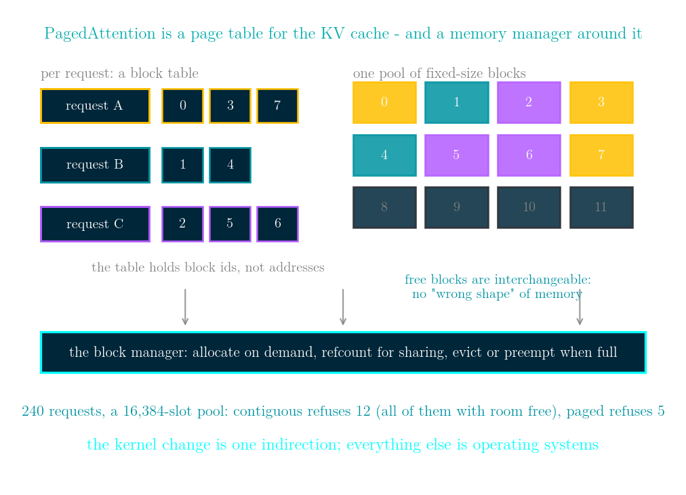
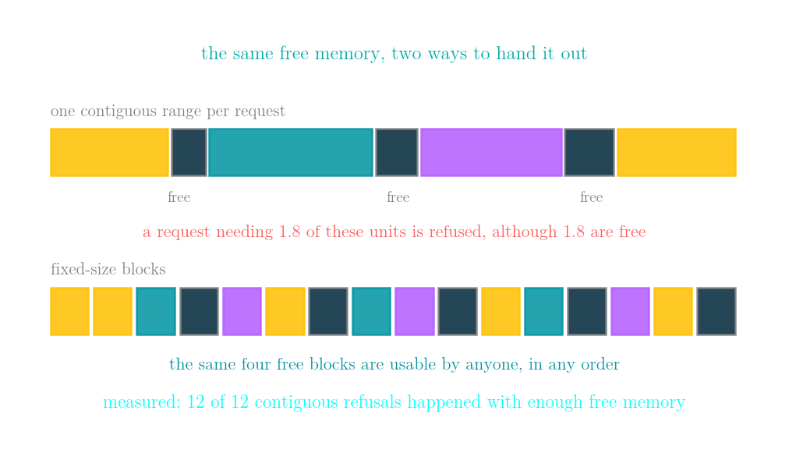
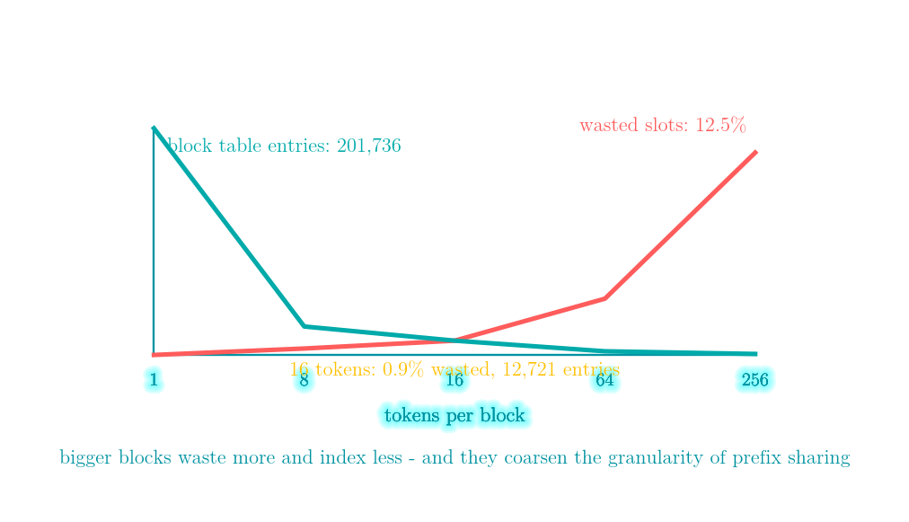
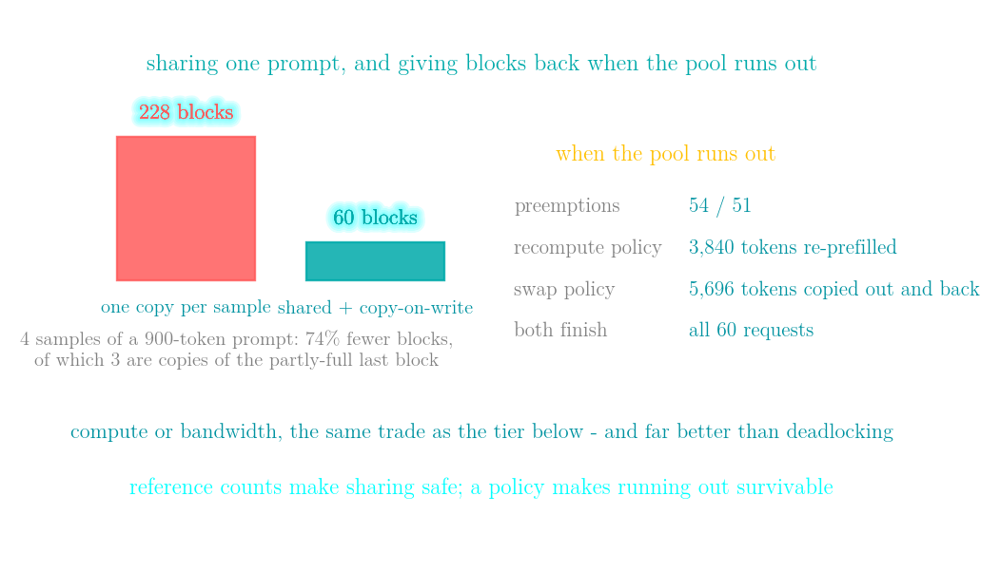

# Day 58 — PagedAttention 其實是一個記憶體配置器：block table、copy-on-write，以及 KV 池滿了之後怎麼辦

程式碼：[day 58 on GitHub](https://github.com/KingRei/100DaysPython/tree/master/day%2058%20-%20paged%20attention%20memory)

*100 Days of Python - day 58*

PagedAttention 裡屬於 attention 的部分其實很小：K 和 V 改成透過一張 block table 讀，而不是從一條平坦的陣列讀。真正讓它值得做的東西全都在那一層 indirection 的外面——固定大小的 block 怎麼發、池子滿了怎麼拒絕、同一個 prompt 的多個樣本怎麼共用、以及要從**已經在跑**的請求手上把 block 收回來時該怎麼辦。



每個請求擁有一張 block table——裡面是 block 的編號，不是位址——而 block 全部住在一座大家共用的池子裡。一個 block manager 負責按需求發放、用 reference count 讓兩個請求可以指向同一個 block、並決定沒得發的時候要做什麼。這是一套作業系統，不是一種 attention 變體，所以今天幾乎整天都在講配置。

## 為什麼要分頁：空間有，但形狀不對

先給連續配置最好的待遇：假設它**事先就知道**每個請求最後會多長，所以完全不會多保留。即使如此它還是輸。

| 240 個請求、16,384 個 slot 的池子 | 拒絕 | 其中「空位夠但不連續」 | 平均佔用率 |
|---|---|---|---|
| 一個請求一段連續空間 | 12 | **12** | 65.7% |
| 固定大小 16 個 token 的 block | 5 | - | 68.5% |

連續配置拒絕掉的每一個請求，都是在「池子裡的空位總量其實夠」的情況下被拒絕的。空間存在，只是被切成太小的碎塊：這就是**外部碎片**，作業系統課本上的那個。固定大小的 block 從結構上消滅了這個問題——任何一個空 block 都一樣好用，所以配置只剩下「夠不夠」一個問題。



## 分頁的代價

每個請求最後一個 block 的尾巴會浪費掉，而且每個 block 都要在 block table 裡佔一筆：

| 每個 block 幾個 token | 浪費掉的 slot | block table 的項目數 |
|---|---|---|
| 1 | 0.0% | 201,736 |
| 8 | 0.4% | 25,318 |
| 16 | 0.9% | 12,721 |
| 64 | 3.5% | 3,266 |
| 256 | 12.5% | 901 |

一個 token 一個 block 什麼都不浪費，但每個 token 都要一筆；256 個 token 一個 block 的索引少了 224 倍，卻丟掉池子的八分之一。實務上都落在小的那一端，而且理由不只是浪費：**block 也是前綴共用能對齊的最小單位**，block 越大、能共用的前綴就越粗。



## 共用一個 prompt，以及 copy-on-write

因為 block table 只是一串編號，共用幾乎不用寫什麼程式：

```python
def share(self, src, dst, tokens):
    shared = self.table[src][:self.blocks_for(tokens)]
    for b in shared:
        self.refs[b] += 1          # reference count 讓它們活著
    self.table[dst] = list(shared)
```

一個 900 個 token 的 prompt 要四個樣本：天真做法要 228 個 block，共用之後是 **60** 個，少了 74%。唯一麻煩的是 prompt 的最後一個 block，它沒裝滿——而每個樣本接下來都要把**自己的**下一個 token 寫進去，所以各自複製那一個 block。複製一個 block 而不是整個 prompt，這就是 copy-on-write，跟 `fork()` 用的是同一招。

## 池子滿了的時候

一定要有人把 block 吐回來，而付帳的方式恰好只有兩種。60 個請求對上 4,096 個 slot：

| 政策 | 收回次數 | 代價 |
|---|---|---|
| 重算 | 54 | 3,840 個 token 重新 prefill |
| 換出到主機 | 51 | 5,696 個 token 搬出去再搬回來 |

兩種都把 60 個請求全部跑完了。**算力或頻寬**——跟前一天那個分層快取是同一個取捨，只是換了一層。第三種選項「什麼都不做」的結果是池子被做到一半的請求塞滿，然後全部卡死。



## 兩個不會報錯的壞法

**永遠沒被釋放的 block。** 200 個請求、十分之一走到一條忘記釋放的失敗路徑：漏掉 617 個 block ＝ 65,536 個 slot 裡的 9,872 個，而且再也回不來。什麼都不會報錯，伺服器只是越來越收不下請求，而這個 bug 回報上來的樣子是「跑幾個小時之後吞吐量就掉了」。抓它的方法是一條不變式，在伺服器閒置時檢查：**空的 block ＋ 所有 block table 裡的 block ＝ 池子大小**。

**忘了最後一個 block 裝了多少。** 70 個 token 佔 5 個 block ＝ 80 個 slot，所以最後 10 格裡是上一個用過這些 slot 的人留下來的東西。kernel 需要 block table **和**真正的序列長度兩樣，而 mask 必須用後者。用補滿後的長度也不會崩潰：softmax 照樣加總為 1，模型只是安靜地把一小時前某個請求的 KV 也平均了進去。

## 在 vLLM 裡

PagedAttention 就是從 vLLM 來的，它的旗標跟上面的程式碼一一對應：

```bash
vllm serve meta-llama/Llama-3.1-8B \
    --block-size 16 \                # 每個 block 幾個 token
    --gpu-memory-utilization 0.90 \  # KV 池可以拿走多少顯存
    --max-num-seqs 256 \             # 同時在跑的序列上限
    --swap-space 4 \                 # 換出用的主機記憶體（GiB）
    --enable-prefix-caching          # 跨請求重用 block
```

它啟動時會先 profiling：量出權重和活化值佔掉多少，剩下的乘上 `--gpu-memory-utilization`，再除以「每個 block 幾個 byte」得到 block 數。`--block-size` 就是這個檔案裡的 `PagedPool.block`；每個請求的 `BlockTable` 就是 `table[rid]`；`ref_count` 加上 copy-on-write 就是 `refs[b]`。

```python
llm = LLM(model=..., block_size=16, gpu_memory_utilization=0.9)
out = llm.generate(prompt, SamplingParams(n=4))   # 四個樣本共用 prompt 的 block
```

`SamplingParams(n=4)` 不會把 prompt 的 KV 複製四份——四條序列指向同一批 block、refcount 變成 4，只有那個沒裝滿的最後一個 block 在寫入時被複製。而 `--enable-prefix-caching` 是把同一招用在**不同請求之間**：以整個 block 為單位算雜湊。

池子滿了的時候 vLLM 會直接講：`Sequence group ... is preempted by PreemptionMode.RECOMPUTE`。偶爾出現是正常的；一直刷就代表池子配不上你要的併發度，而解法是把 `--gpu-memory-utilization` 調大、`--max-num-seqs` 調小，或是用 `--swap-space` 改成付頻寬。

## 在 SGLang 裡

同樣的零件，不同的名字和預設值：

```bash
python -m sglang.launch_server --model-path meta-llama/Llama-3.1-8B \
    --mem-fraction-static 0.9 \      # KV 池拿多少顯存
    --page-size 1 \                  # 每頁幾個 token（預設 1）
    --max-running-requests 256 \     # decode batch 上限
    --chunked-prefill-size 8192 \    # 把長 prefill 切塊
    --max-total-tokens 200000        # 或直接指定池子大小
```

有兩個差別值得知道。SGLang 的 page 預設是**一個 token**——也就是上面那張浪費表最左邊那一欄：零內部碎片，代價是索引很長。它付得起，是因為索引是 GPU 上的一張 `req_to_token_pool` tensor，而不是每個請求一個 Python list；slot 本身則放在 `token_to_kv_pool`。這兩個結構正好就是這個檔案裡的 `PagedPool.table` 和 `PagedPool.free`。

而池子滿了的時候，SGLang 選擇 **retract**（收回）而不是換出：請求回到等待佇列、slot 釋放、之後重跑。理由正好是前一天那棵樹——被收回的請求的前綴多半還在 radix cache 裡，所以「重算」其實只重算沒命中的那一小段。`--chunked-prefill-size` 則是另一道防線：把長 prefill 切成小塊，讓它不會一次吃掉整個池子，也不會讓 decode 停太久。

兩個系統在預設值上意見不同，在結構上完全一致：一座固定的 slot 池、每個請求一張表、共用靠 reference count、滿了有一套政策。

## 這些東西之後會用在哪

服務系統給你的每一個旋鈕，都是上面四件事之一：block 多大、池子多大、誰可以跟誰共用、滿了要怎麼辦。把設定檔當成「block size、pool size、共用政策、preemption 政策」來讀，那些旗標就不再是口耳相傳的魔法——而且當症狀是「在排隊」而不是「token 很慢」時，你會知道該動哪一個數字。

程式碼和互動式走查都在 repo：[day 58 on GitHub](https://github.com/KingRei/100DaysPython/tree/master/day%2058%20-%20paged%20attention%20memory)。
